# Post Author Biography block

[Go back to the list of **Blocks**](../block-editor/blocks-list.md)

The *Post Author Biography* block allows you to embed a user’s biography from the **About Yourself** section in **Users** > **Profile** into your page or post.

In order to add a *Post Author Biography* block, click on the **Block Inserter** (+) icon.

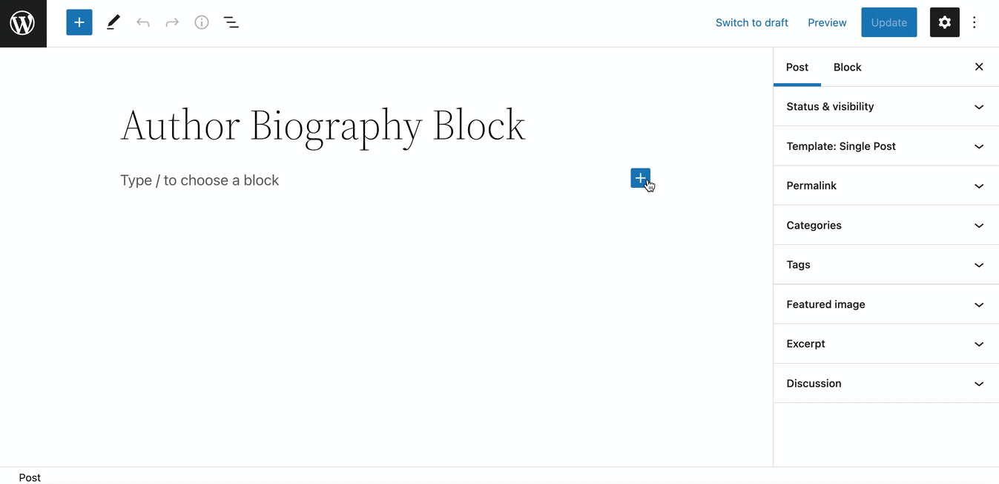

You can also type <kbd>/Post Author Biography</kbd> and hit <kbd>enter</kbd> in a new paragraph block to add one quickly

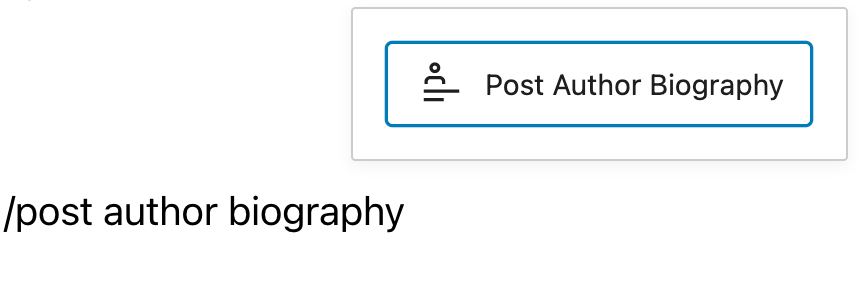

> [!NOTE]
> [Detailed instructions on adding blocks](../block-editor/adding-a-new-block.md)

## Block Toolbar

Every block comes with unique toolbar icons and block-specific user controls that allow you to manipulate the block right in the editor.

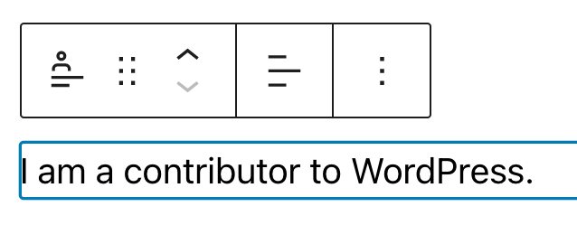

**Transform to**

You can transform the *Post Author Biography block* into a Group or Columns.

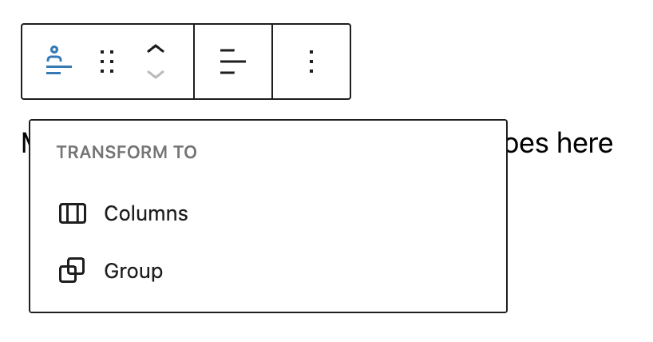

**Drag icon**

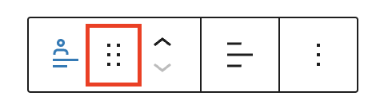

To drag and drop the block to a new location on the page, click and hold the rectangle of dots, then drag to the new location. The blue separator line indicates where the block will be placed. Release the left mouse button when you find the new location to place the block.

**Move handles**

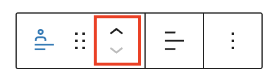

The up and down arrow icons can be used to move a block up and down on the page.

> [!NOTE]
> [Get more information about moving a block within the editor.](../block-editor/moving-blocks.md)

**Change alignment**

When you select your *Post Author Biography block*, a toolbar will appear where you can change the block’s text alignment.

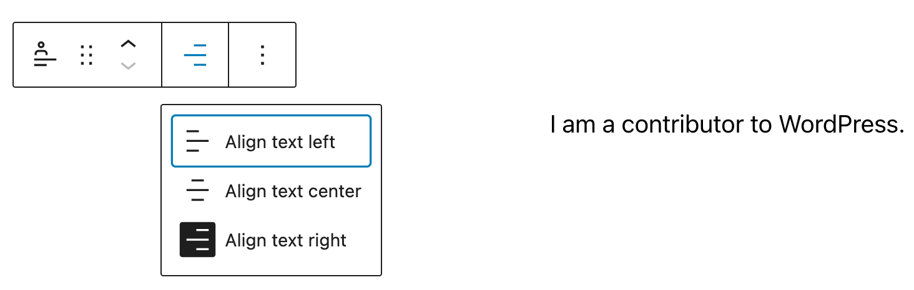

Choose between the options to:

-   **Align text left**
-   **Align text center**
-   **Align text right**

### More options

These controls give you the option to copy, duplicate, and edit your block as HTML.

> [!NOTE]
> [Read about these and other settings.](../block-editor/more-options.md)

## Block Settings

Every block has specific options in the editor sidebar in addition to the options found in the block toolbar. *If you do not see the sidebar, simply click the ‘cog’ icon.*

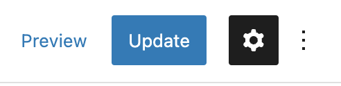

### Color

The *Color settings* let you set custom text and background colors.

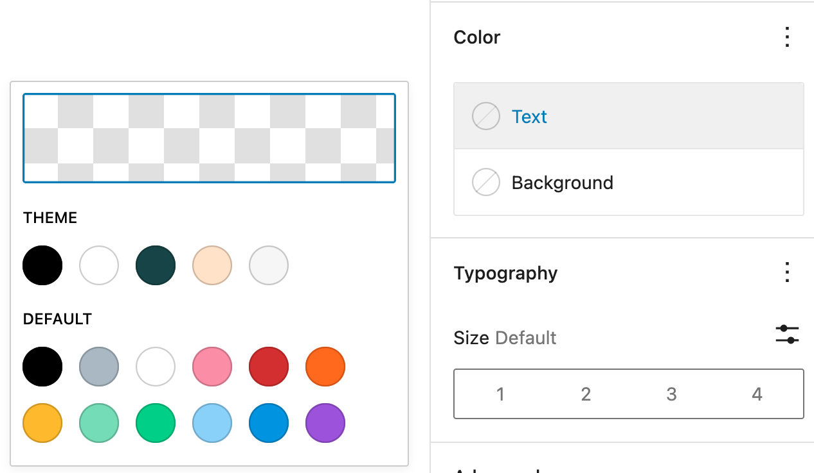

### Typography

On this tab, you can change the **Font size**, **Font family**, **Appearance**, **Line height**, **Letter case** and **Letter spacing**.

To access all the typography options click on the 3-dot icon in the right corner of the *Typography* tab. Click **Reset all** to reset all the Typography settings you made.

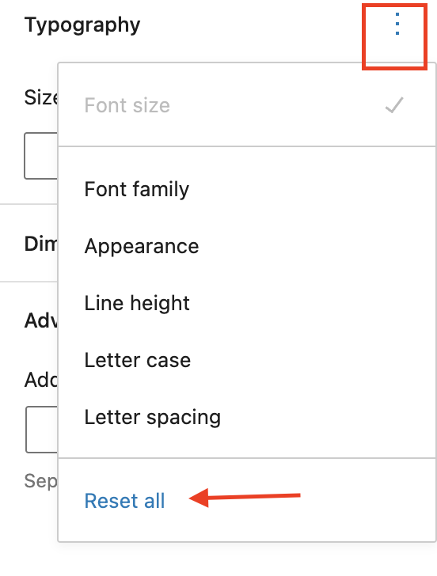

Typography settings for **Font size** let you set custom text sizes. You can choose from the set of available options- *Small*, *Medium*, *Large*, *Extra Large* or set custom settings. You can also change the units from PX, REM and EM.

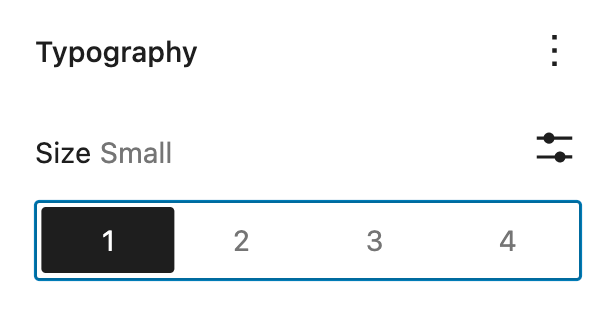

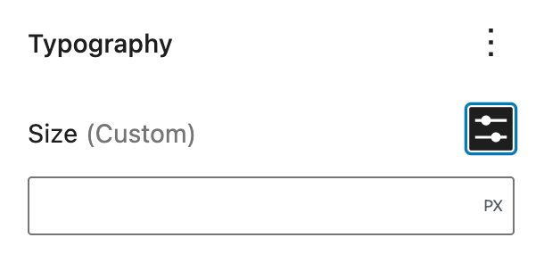

### Dimensions

Click on the 3-dot icon in the right top corner in the *Dimensions* settings to explore all the Dimensions Settings for the entire button block. For the *Post Author Biography* block, you set dimensions for margin, padding, or both.

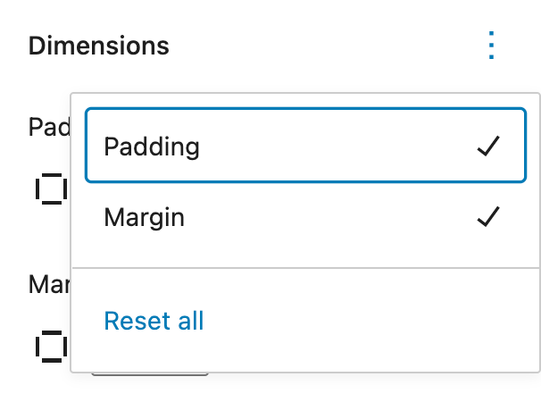

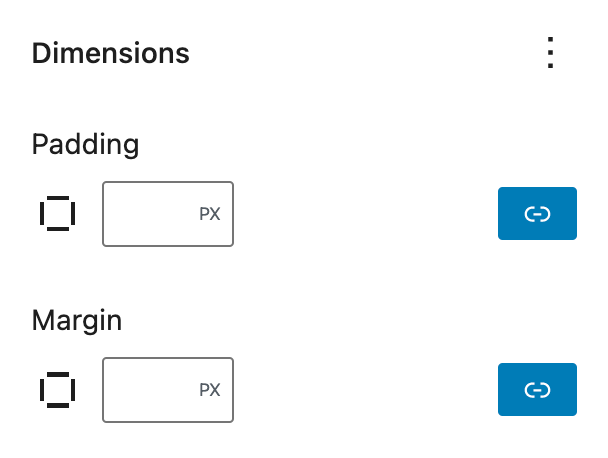

> [!NOTE]
> [Learn more about dimension controls.](../block-editor/dimension-controls-overview.md)

**Advanced**

The following Advanced settings options are available: HTML Anchor, Additional CSS Class(es), Additional CSS, and Styles.

> [!NOTE]
> [Learn more about advanced settings.](../block-editor/advanced-settings-overview.md)

#### Changelog:

-   Updated 2026-06-29
    -   Linked to advanced settings
-   Created 2022-09-18
