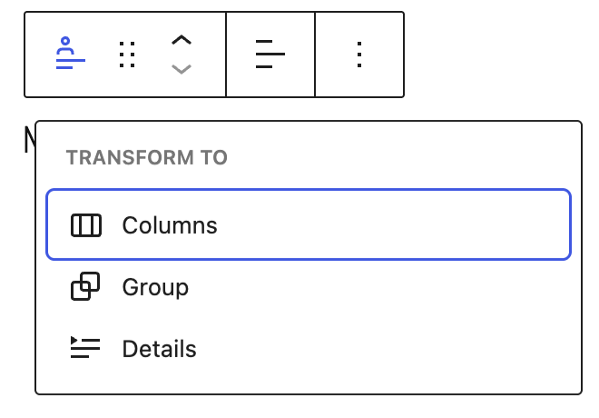
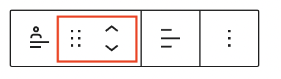
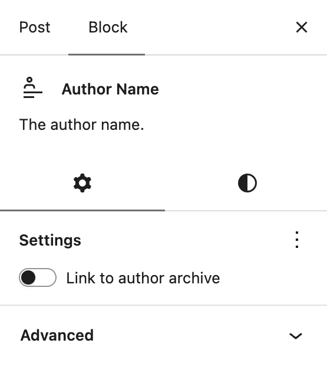
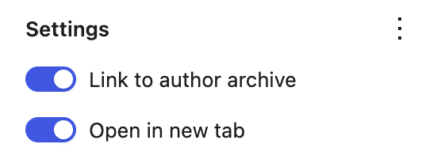

# Author Name block

[Go back to the list of Blocks](../block-editor/blocks-list.md)

The Author Name block displays the post author’s name or username. This block is often nested inside a [query loop](query-loop-block.md) block or added to a [Template](../block-editor/template-editor.md) in the [Site Editor](../appearance/site-editor.md).

WordPress users can choose how their name is displayed publicly.

> [!NOTE]
> [Learn more about this setting in the Your Profile guide.](../../support-guides/dashboard/users-your-profile-screen.md)

## Add an Author Name block

You can insert this block elsewhere by clicking the **Add block** icon to open the block inserter pop-up window and search for the Author Name block. You can also type `author-name` and hit <kbd>enter</kbd> in a new paragraph block to add one quickly.

> [!NOTE]
> [Get detailed instructions on adding blocks](../block-editor/adding-a-new-block.md).

## Block toolbar

Each block has its own toolbar, which contains unique controls that let you customize or configure the block. The Author Name block has the following options on its toolbar:

### Transform to

If you click the Author Name icon on the toolbar, you’ll open the **Transform to** options to convert the block into Columns, Group, or Details block.

### Block moving tools

The **Drag** button lets you drag and drop the Author Name block and reposition it anywhere on the editor, while the **Move up** and **Move down** buttons let you move the Author Name block up or down on the editor.

### Text alignment

Use the **Change text alignment** tool to modify the alignment of the Author Name block. Select the icon to display the alignment dropdown menu. You can align the text to the left, make it center-aligned, or orient it to the right.

### More options

The [More Options menu](../block-editor/more-options.md) represented by **three vertical dots on the far right of the toolbar** gives you more features such as the ability to duplicate, remove, or edit your block as HTML.

> [!NOTE]
> [Read about these and other settings.](../block-editor/more-options.md)

## Block settings

Every block has specific options in the editor sidebar in addition to the options found in the block toolbar. If you do not see the sidebar, click on the **Settings button** next to the Save/Publish button.

### Settings tab

When you select the **Settings tab**, represented by a gear icon, you will see the following settings in the sidebar:

#### Link Settings

The settings section lets you choose whether to have the Author Name link to the same author’s archive with an option to toggle that on or off. If you link to the author archive, you can also choose to open that link in a new tab.

#### Advanced

The following Advanced settings options are available: HTML Anchor, Additional CSS Class(es), Additional CSS, and Styles.

> [!NOTE]
> [Learn more about advanced settings.](../block-editor/advanced-settings-overview.md)

### Styles tab

When you click on the **Styles tab**, represented by a half-filled circle, within the Block Settings sidebar, you will see the following options:

#### Typography

The Typography settings enable you to customize the font and text appearance of the content within the block. The settings have various options, such as font size, font style, font family, and letter spacing.

This block has additional options to style text including line indent, columns, drop cap, and fit text.

> [!NOTE]
> [Get more details about changing typography settings.](../block-editor/typography-settings-overview.md)

#### Background

The Background settings allow you to customize the appearance of supported blocks using background images, colors, and gradients.

> [!NOTE]
> For details, refer to the [Background Settings Overview](../block-editor/background-settings-overview.md).

#### Dimensions

This block provides various options to adjust its dimensions, such as width and height, allowing you to customize the text layout to ensure visual consistency.

> [!NOTE]
> For details refer to this support article: [Dimension settings overview](../block-editor/dimension-controls-overview.md).

#### Border

The border settings add border color, width, and radius and add a shadow to the block.

> [!NOTE]
> For details refer to this support article: [Border settings overview](../block-editor/border-settings-overview.md).

## Changelog

-   Updated 2026-10-02 (props @awetz583 @karthickmurugan)
    -   Updated for 7.1
-   Updated 2026-06-29
    -   Linked to advanced settings
-   Created 2023-03-27
