# Excerpt block

[Go to the List of Blocks](../block-editor/blocks-list.md)

Use the Excerpt block to display the excerpt of a post. This block is primarily nested inside a [query loop](query-loop-block.md) block and helps to customize the appearance of the query loop.

If the post does not have an [excerpt](../../support-guides/publishing/what-is-an-excerpt-classic-editor.md), the Excerpt block displays the first 55 words in the post as the excerpt, followed by the characters ‘[…]’.

The block has an optional **Read More** link which will direct the website visitor to the URL of the full post. You can customize this link text to anything you like. The **Read More** link can be styled independently.

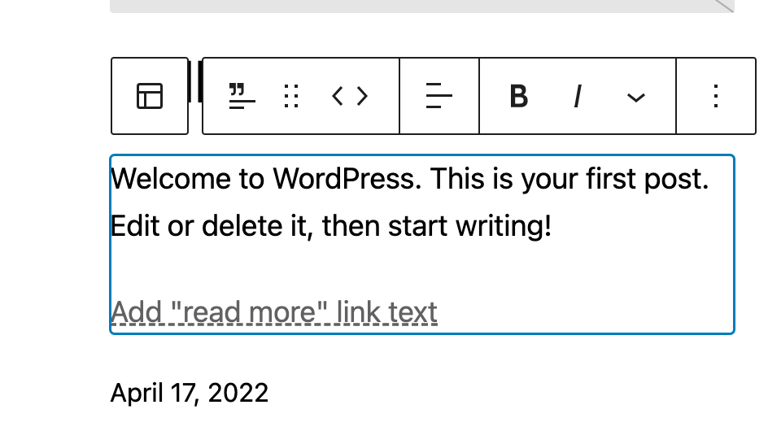

*Excerpt block*

To add an Excerpt block, click the **Block Inserter** icon when editing the page template. Search for the **Excerpt** block. Click on it to add the block to your page template.

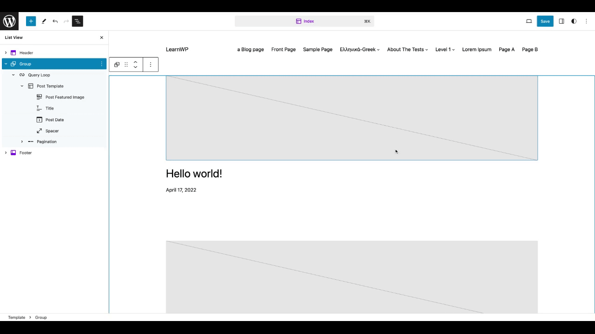

*How to add Excerpt block*

You can also type `/excerpt` and hit enter in a new paragraph block to add the Excerpt block quickly.

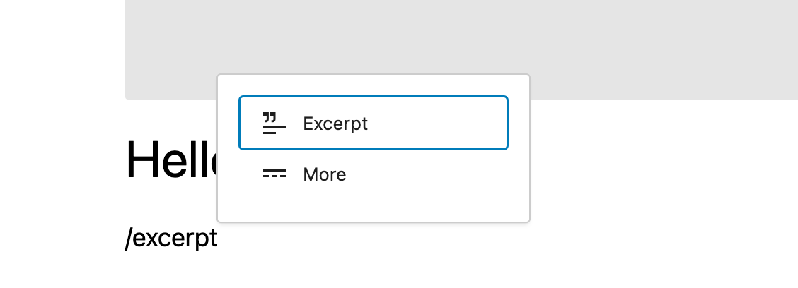

*Adding Excerpt block quickly*

> [!NOTE]
> [Detailed instructions on adding blocks](../block-editor/adding-a-new-block.md)

## Block toolbar

To view the block toolbar, click on the block and the toolbar will be displayed.

Every block comes with unique toolbar icons. These block-specific controls allow you to manipulate the block right in the editor.

The Excerpt block shows these buttons in the block toolbar:

-   Transform to
-   Drag icon
-   Move arrows
-   Change text alignment
-   Bold
-   Italic
-   Link
-   More
-   More options

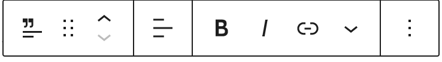

*Excerpt block toolbar*

### Transform to

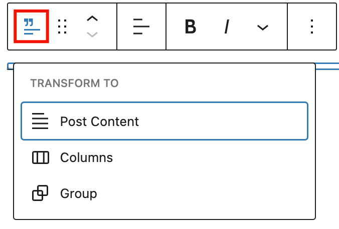

*Transform options in Excerpt block*

Click on the **Transform** button to convert the Excerpt block into a **Group** block or **Columns** block.

<video controls preload="metadata" src="https://wordpress.org/documentation/files/2023/08/trasform-to-for-excerpt.mp4"></video>

*Transform button from Excerpt block toolbar*

### Drag icon

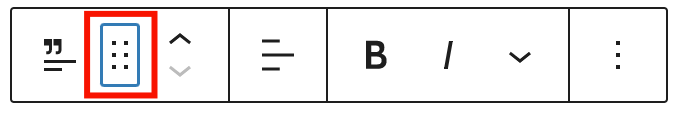

*Drag icon in the Post Excerpt block*

To drag and drop the block to a new location on the page template, click and hold the rectangle of dots, then drag it to the new location. The blue separator line indicates where the block will be placed. Release the left mouse button when you find the new location to place the block.

### Move arrows

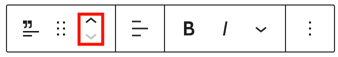

*Move arrows in the Excerpt block*

The up and down arrow icons can be used to move the block up and down on the page.

> [!NOTE]
> [Get more information about moving a block within the editor.](../block-editor/moving-blocks.md)

### Change text alignment

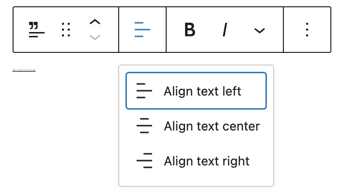

*Change text alignment in Excerpt block*

Click the **Change alignment** button in the Block toolbar to display the alignment drop-down. You can align the block text to the left, make it center-aligned or align it to the right.

### Bold

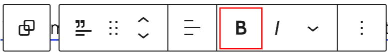

The bold option will make the selected text bolded.

### Italic

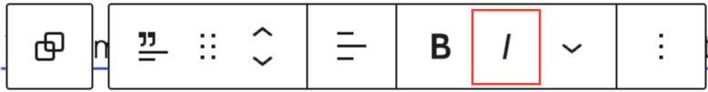

The italic option will make the selected text italic.

### Link

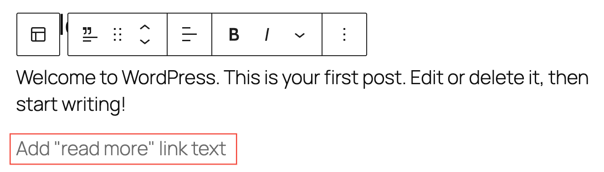

A field to customize the ‘Read more’ link text, the link URL is automatically set to the post.

### More

Click the down arrow button to display more styling tools for the **Read More** link.

> [!NOTE]
> [Get more information about rich text editing options](../block-editor/more-text-editing-overview.md).

### Options

These controls give you the option to copy, duplicate, and edit your block as HTML.

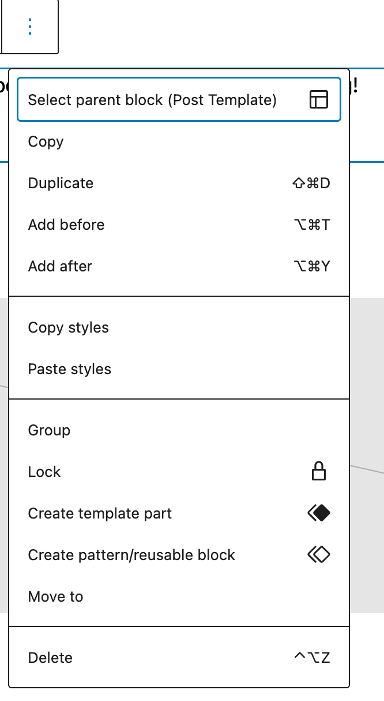

> [!NOTE]
> [Read about these and other settings.](../block-editor/more-options.md)

## Block settings

The block settings panel contains customization options specific to the block. To open it, select the block and click the settings icon next to the **Save** button.

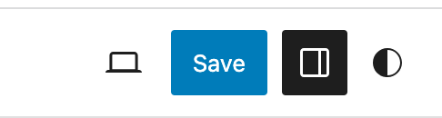

*Block settings to enable sidebar*

*If you do not see the sidebar, click the ‘sidebar’ icon next to the Publish button.* *The device icon between **Save draft** and Publish button shows the preview of the block.*

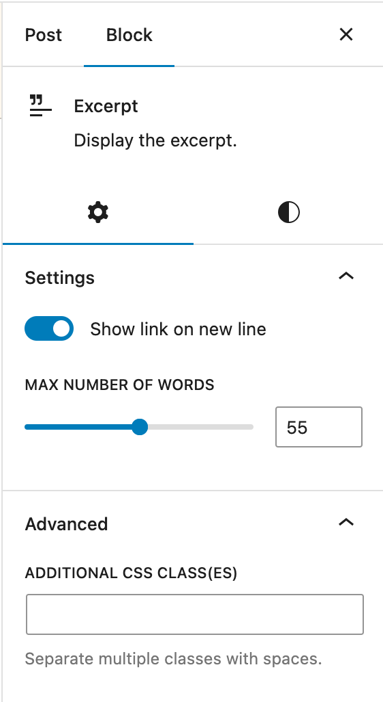

*Excerpt block settings*

#### Show link on new line

Turn on **Show link on new line** button in the Block Settings to show the Excerpt Read More link on a new line instead of inline next to the excerpt text.

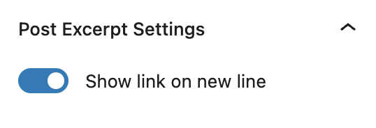

*Show Excerpt settings on new line*

#### Max number of words

Adds the ability to control the excerpt length in a design. The default value is 55 words, to match the WordPress default length for excerpts.

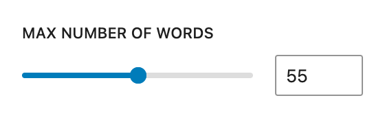

*Max number of words for excerpt*

#### Advanced

The following Advanced settings options are available: HTML Anchor, Additional CSS Class(es), Additional CSS, and Styles.

> [!NOTE]
> [Learn more about advanced settings.](../block-editor/advanced-settings-overview.md)

### Color

The **Excerpt block** provides Color settings options to change the text, background, and link colors. Pick a color from the suggestions, or add a custom color using the color picker or by adding a color code.

> [!NOTE]
> [See this guide for more information about changing colors.](../block-editor/colors-settings-overview.md)

### Typography

The **Excerpt block** provides typography settings to change the font family, appearance, line height, letter spacing, decoration, letter case, and font size.

> [!NOTE]
> [Get more details about changing typography settings.](../block-editor/typography-settings-overview.md)

### Dimensions

Dimension controls are used to control how groups of blocks are placed alongside one another, by changing the values for padding, margin, and other dimensions

> [!NOTE]
> [Learn more about dimension controls.](../block-editor/dimension-controls-overview.md)

## Changelog

-   Updated 2026-06-29
    -   Linked to advanced settings
-   Updated 2022-11-11
    -   Updated all screenshots and updated content for 6.1
-   Created 2023-07-17
    -   Added excerpt length control as described here [44964](https://github.com/WordPress/gutenberg/pull/44964)
    -   Updated the headings for **excerpt** settings items i.e show link on new line and max number of words
    -   Added caption for the image in block toolbar “more” option
-   Updated on 2023-07-22
    -   Updated all the headings
-   Updated on 2023-07-23
    -   added new gif and screenshot for excerpt block and how to add excerpt block from template
    -   added the new video for the **transform to** button on the block toolbar
    -   Updated the block settings sidebar image to update to the latest version
-   Updated on 2023-07-29
    -   Updated the screenshot under Rich text editing option in the block toolbar and included Footnote. Also added link to this page: [https://wordpress.org/documentation/article/more-text-editing-overview/](../block-editor/more-text-editing-overview.md)  and removed the details for that section from this page.
    -   Updated the More Options screenshot.
