# Post Featured Image block

[Go to the List of Blocks](../block-editor/blocks-list.md)

Use the Post Featured Image block to display the featured image of a post. This block is primarily nested inside a [query loop block](query-loop-block.md) and helps to customize the appearance of the query loop.

To add a Post Featured Image block:

1.  Click the **Block Inserter** icon when editing the page template.
2.  Search for the Post Featured Image **block**.
3.  Click on it to add the block to your Post Template.

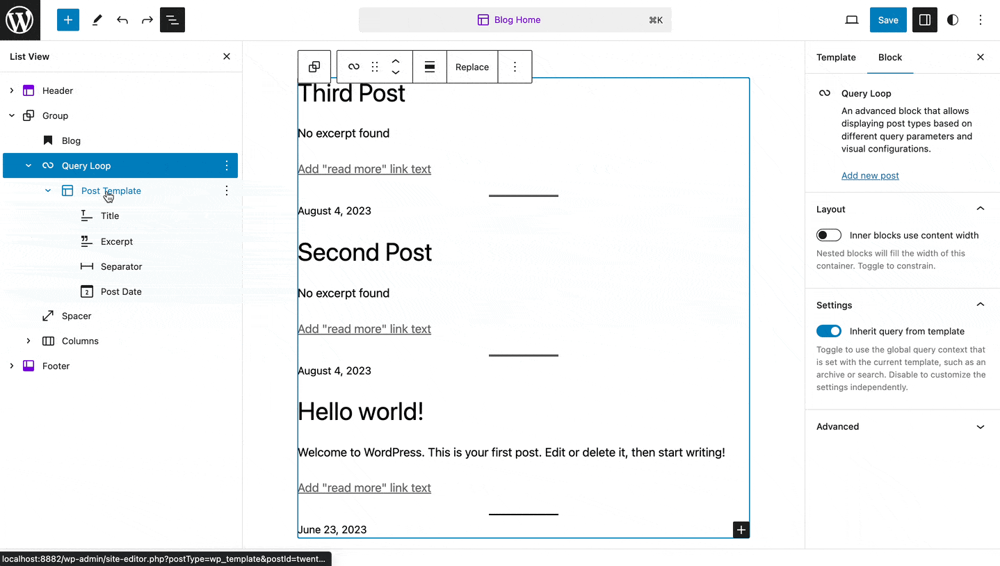

You can also type /post-featured-image and hit enter in a new paragraph block to add the Post Featured Image block quickly.

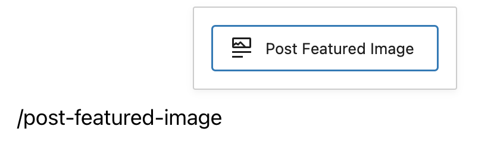

*Add Post Featured Image block quickly*

> [!NOTE]
> [Detailed instructions on adding blocks](../block-editor/adding-a-new-block.md)

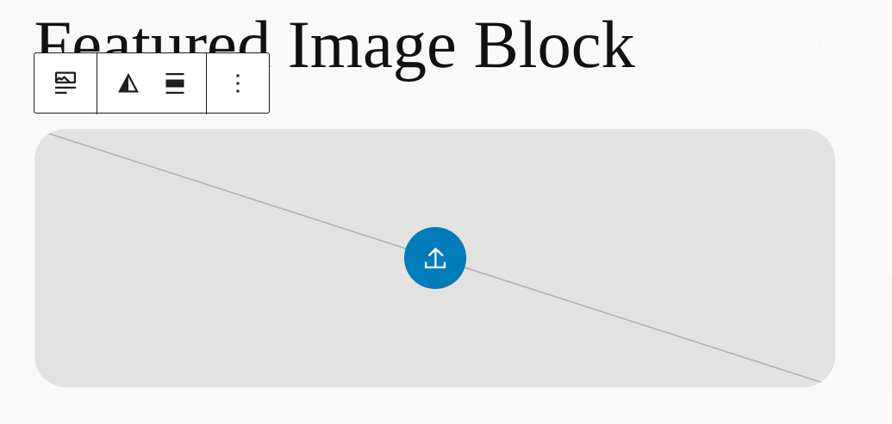

*Featured image block placeholder*

## Block toolbar

To view the block toolbar, click on the block and the toolbar will be displayed.

Every block comes with unique toolbar icons. These block-specific controls allow you to manipulate the block right in the editor.

The Post Featured Image block shows six buttons in the block toolbar:

-   Transform to
-   Drag icon
-   Move handles
-   Apply duotone filter
-   Change alignment
-   More options

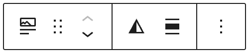

*Post Featured Image Block Toolbar*

**Transform to:**

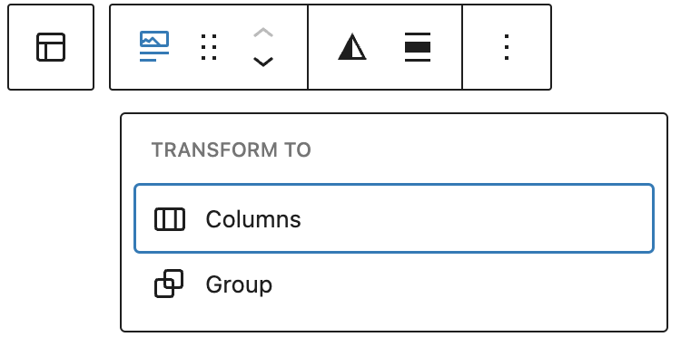

*Transform options for the Post Featured Image block*

Click on the “Transform” button to convert the Post Featured Image block into a “Group” block or “Columns” block.

**Drag icon:**

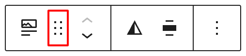

*Drag icon in the Post Featured Image block*

To drag and drop the block to a new location on the page template, click and hold the rectangle of dots, then drag to the new location. The blue separator line indicates where the block will be placed. Release the left mouse button when you find the new location to place the block.

**Move arrows:**

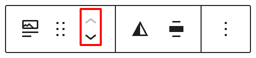

*Move arrows in the Post Featured Image block*

The up and down arrow icons can be used to move the block up and down on the page.

> [!NOTE]
> [Get more information about moving a block within the editor.](../block-editor/moving-blocks.md)

**Change alignment:**

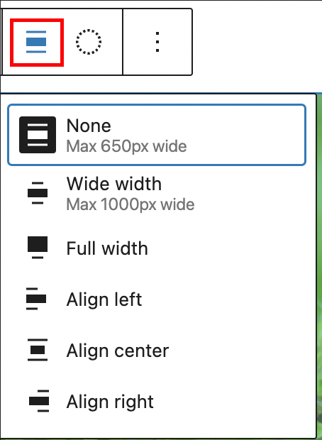

*Change alignment options in the Post Featured Image block*

-   **None –** Leaves the block the current size.
-   **Wide width –** Increase the width of the block beyond the content size.
-   **Full width –** Extend the block to cover the full width of the screen.
-   **Align left** – Make the block left-aligned.
-   **Align center** – Make the block center aligned.
-   **Align right** – Make the block right aligned.

### Apply duotone filter

You can create a two-tone color effect (called the duotone effect) on the featured image without actually changing the original image. The duotone effect works best on high-contrast images.

You can pick the two colors for the effect from the list of six duotone presets provided in the drop-down.

1.  Foreground and background
2.  Foreground and secondary
3.  Foreground and tertiary
4.  Primary and background
5.  Primary and secondary
6.  Primary and tertiary

These are based on the foreground, background, primary, secondary and tertiary colors set in the theme’s color palette.

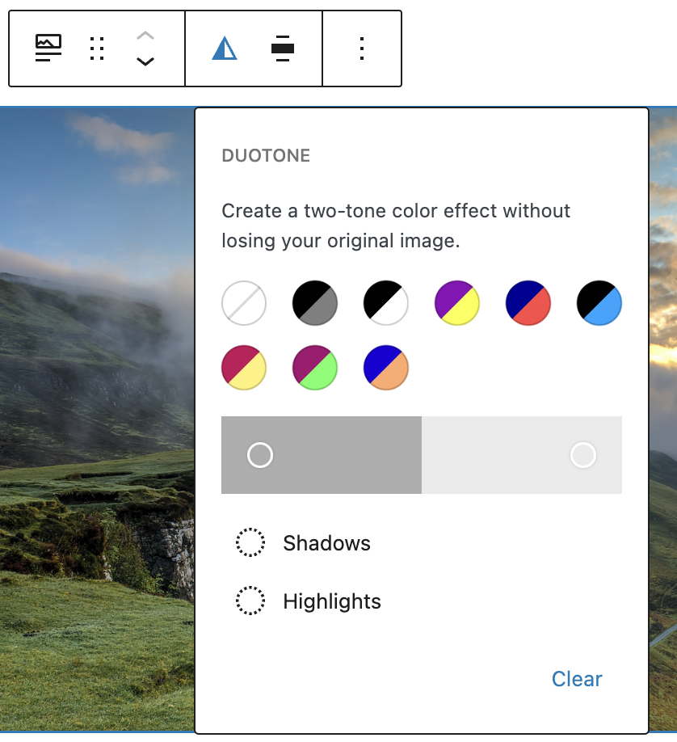

*Apply duotone filter in the Post Featured Image block*

You can also pick your own colors for the shadows and highlights by clicking on the Shadows /Highlights option which opens up the color picker and selecting your custom color from the color palette.

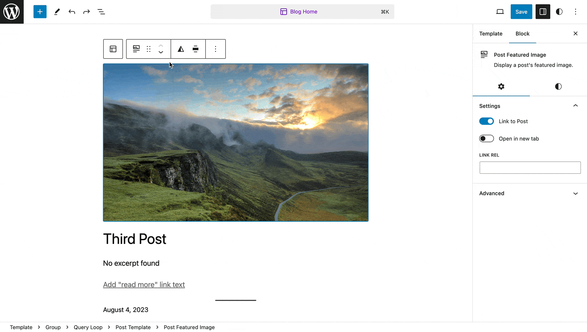

*Video showing how to apply duotone filter*

To clear all the changes you made, use the clear button at the bottom right corner.

**More option**

The More option on a block toolbar gives you more features to customize the block. You have the option to copy, duplicate, and edit your block as HTML.

> [!NOTE]
> [Read about these and other settings.](../block-editor/more-options.md)

## Block settings

Every block has specific options in the editor sidebar besides those found in the **Block Toolbar**. If you do not see the sidebar, click the ‘sidebar’ icon next to the **Publish** or **Update** button.

*How to turn on the Block Settings sidebar*

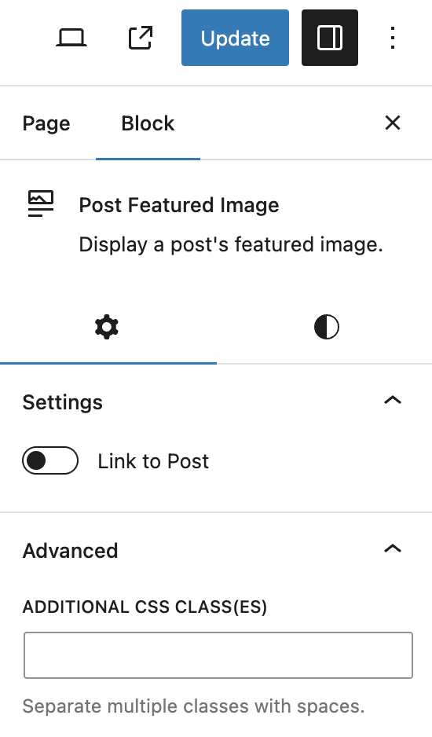

*Block Settings in the Post Featured Image block*

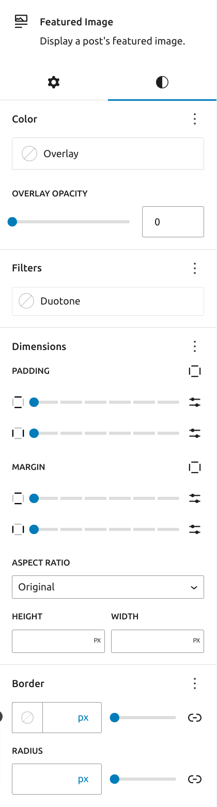

*Block Style Settings in the Post Featured Image block*

### Link to post

Turn on the ‘Link to post’ button in the Block Settings to link the featured image to the URL of the post. This enables the website visitor to go to the post by clicking on the Featured image. There is also an option to open the link in a new tab and set link rel.

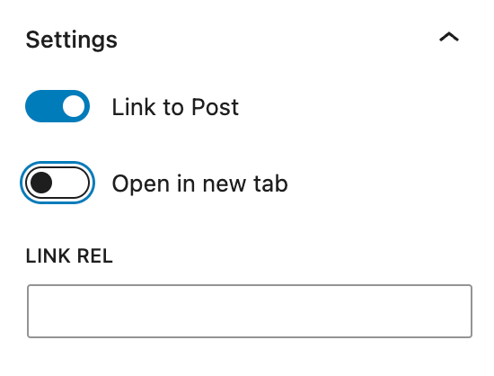

*Link settings in the Post Featured Image block*

### Styles

Styles settings can be found on a second tab in block settings.

#### Color

Under color, options are available to set the overlay color and the opacity. Set the overlay color and adjust the opacity from 0 to 100, and you will notice its effect on the image.

It is also possible to use gradient as overlay if the theme supports gradient presets.

*Gradient overlay with 60% opacity*

#### Filters

Duotone Filters can also be set from style settings. It works the same as the option available under the Block Toolbar (mentioned above).

#### Dimensions

Dimension controls are used to control how groups of blocks are placed alongside one another by changing the values for padding, margin, and other dimensions.

Available dimensions controls

-   Padding
-   Margin
-   Aspect Ratio – changes the shape of your image, which may resulted in changing the size as well.
-   Height & Width

> [!NOTE]
> [Learn more about dimension controls.](../block-editor/dimension-controls-overview.md)

Depending on the theme settings, aspect ratio could be different.

<video controls preload="metadata" src="https://private-user-images.githubusercontent.com/1508963/292555572-cc6705cb-f65e-4a44-b6fc-2c64bdb3c0d5.mp4?jwt=eyJhbGciOiJIUzI1NiIsInR5cCI6IkpXVCJ9.eyJpc3MiOiJnaXRodWIuY29tIiwiYXVkIjoicmF3LmdpdGh1YnVzZXJjb250ZW50LmNvbSIsImtleSI6ImtleTEiLCJleHAiOjE3MDMyNjYzMDEsIm5iZiI6MTcwMzI2NjAwMSwicGF0aCI6Ii8xNTA4OTYzLzI5MjU1NTU3Mi1jYzY3MDVjYi1mNjVlLTRhNDQtYjZmYy0yYzY0YmRiM2MwZDUubXA0P1gtQW16LUFsZ29yaXRobT1BV1M0LUhNQUMtU0hBMjU2JlgtQW16LUNyZWRlbnRpYWw9QUtJQUlXTkpZQVg0Q1NWRUg1M0ElMkYyMDIzMTIyMiUyRnVzLWVhc3QtMSUyRnMzJTJGYXdzNF9yZXF1ZXN0JlgtQW16LURhdGU9MjAyMzEyMjJUMTcyNjQxWiZYLUFtei1FeHBpcmVzPTMwMCZYLUFtei1TaWduYXR1cmU9MTBhNGM5ZTYwODJmMjlhZGI0ZDFlMzgyYjg2YTY3MzI5ZGFlZGEwZWJjMDE4N2UzMzFkODM5MTU5MDlkYzE0YyZYLUFtei1TaWduZWRIZWFkZXJzPWhvc3QmYWN0b3JfaWQ9MCZrZXlfaWQ9MCZyZXBvX2lkPTAifQ.rBhrrDjpHZBqgc97JbYUWOEL0PiC-4Fr3Z2xE2ah0uc"></video>

#### Border

Set the Border and Border radius of the image.

> [!NOTE]
> [Detailed instructions on Border controls](../block-editor/border-settings-overview.md)

### Advanced settings

The following Advanced settings options are available: HTML Anchor, Additional CSS Class(es), Additional CSS, and Styles.

> [!NOTE]
> [Learn more about advanced settings.](../block-editor/advanced-settings-overview.md)

## Inside the site templates

Featured image block can be added and managed inside [site templates](../block-editor/template-editor.md), if the theme supports [the site editor](../appearance/site-editor.md).

Block settings here have a little more options than in a post or page editor, such as scale settings.

## Changelog

-   Updated 2026-06-29
    -   Linked to advanced settings
-   Update 2023-12-22
    -   Add block placeholder screenshot
    -   Add gradient overlay
    -   Add Inside the site templates section
    -   Add aspect ratio video
-   Update 2023-12-15
    -   Updated screenshots for 6.3
    -   Add Styles settings
-   Created on 2022-03-17
