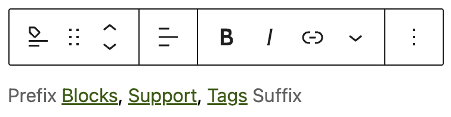
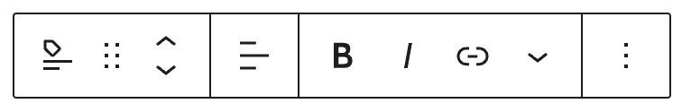
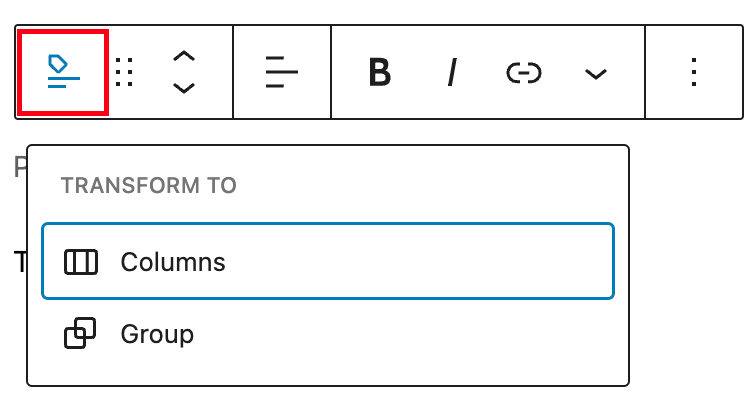
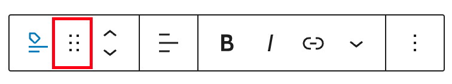
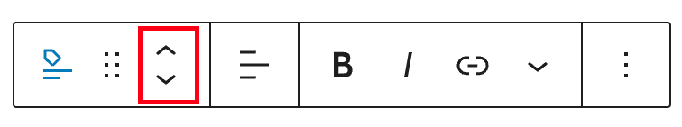
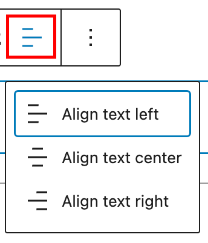
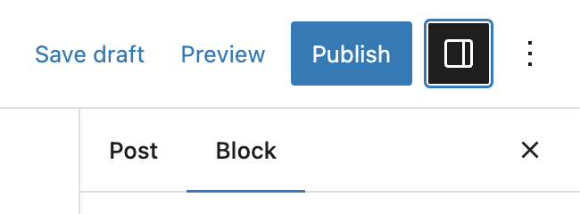
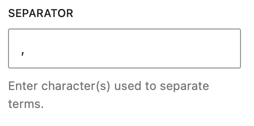

# Post Tags block

[Go to the List of Blocks](../block-editor/blocks-list.md)

Use the *Tags block* to display the posts’ tags. This block is primarily inside a single post template or nested inside a [Query Loop](query-loop-block.md) block and helps to customize the appearance of the query loop.

To add a Tags block, click the **Block Inserter** icon when editing the page template. Search for the Tags **block**. Click on it to add the block to your page template.

You can also type /tags and hit enter to add the Tags block quickly.

<video controls preload="metadata" src="https://wordpress.org/documentation/files/2023/04/post-tags-WP-62.mp4"></video>

*Video showing how to add a Tags block with a prefix.*

> [!NOTE]
> [Detailed instructions on adding blocks](../block-editor/adding-a-new-block.md)

## Adding prefix and suffix

You can add a text before and after the tags. Select the block and click on the placeholder text to enter your text:

## Block Toolbar

To view the block toolbar, click on the block and the toolbar will be displayed.

Every block comes with unique toolbar icons. These block-specific controls allow you to manipulate the block right in the editor.

The Tags block shows five buttons in the block toolbar:

-   Transform to
-   Drag icon
-   Move arrows
-   Change text alignment
-   Bold and Italics
-   Insert Hyperlinks
-   More Rich Text Controls
-   More options

*Tags block toolbar*

### Transform to

*Transform options for the Tags block*

Click on the “Transform” button to convert the Tags block into a “Group” block or “Columns” block.

### Drag icon

*Drag icon in the Tags block*

To drag and drop the block to a new location on the page template, click and hold the rectangle of dots, then drag to the new location. The blue separator line indicates where the block will be placed. Release the left mouse button when you find the new location to place the block.

### Move arrows

*Move arrows in the Tags block*

The up and down arrow icons can be used to move the block up and down on the page.

> [!NOTE]
> [Get more information about moving a block within the editor.](../block-editor/moving-blocks.md)

### Change text alignment

*Change text alignment in the Tags block*

Click the “Change alignment” button in the Block toolbar to display the alignment drop-down. You can align the block text to the left, make it center-aligned or align it to the right.

### Bold and Italics

Used quite frequently, Bold and Italics formatting have their own buttons on the Toolbar. The shortcuts are CTRL+b (or Command+B) for bold and CTRL+i (or Command+i) for italics.

> [!NOTE]
> [Insert hyperlinks](../text-blocks/paragraph-block.md#insert-links)

Use the chain link icon to insert a hyperlink to your highlighted text. Or use the CTRL + k (or Command+k) keyboard shortcut.

### More rich text options

> [!NOTE]
> [Read more about Rich text options](../block-editor/more-text-editing-overview.md).

### More option

The More option on a block toolbar gives you more features to customize the block. These controls give you the option to copy, duplicate, and edit your block as HTML.

> [!NOTE]
> [Read about these and other settings.](../block-editor/more-options.md)

## Block Settings

In addition to the block toolbar, every block has specific options in the editor sidebar. If you do not see the sidebar, click the ‘settings’ icon next to the Save button.

### Color

You can customize the text color, background color, and link color for the Tags block. The color options available will vary based on the theme. Pick a color from the suggestions, or add a custom color using the color picker or by adding a color code.

> [!NOTE]
> [See this guide for more information about changing colors.](../block-editor/colors-settings-overview.md)

### Typography

On this tab, you can adjust the Font size, Font Family, Appearance, Line height, Letter case, and Letter-spacing. These settings allow you to change a block’s font size, appearance, line height, letter casing, and spacing.

> [!NOTE]
> [Get more details about changing typography settings.](../block-editor/typography-settings-overview.md)

### Dimensions

Dimension controls are used to control how groups of blocks are placed alongside one another, by changing the values for padding, margin, and other dimensions.

> [!NOTE]
> [For details refer to this support article: Dimension settings overview](../block-editor/dimension-controls-overview.md)

### Advanced settings

The following Advanced settings options available: HTML Anchor, Additional CSS Class(es), Additional CSS, Separator, and Styles.

The Advanced tab lets you enter character(s) that can be used to separate the category terms. The default setting is a comma.

> [!NOTE]
> [Learn more about advanced settings.](../block-editor/advanced-settings-overview.md)

#### Changelog:

-   Updated 2026-06-29
    -   Linked to advanced settings
-   Updated 2023-08-24
    -   Updated formatting
-   Updated 2023-04-04
    -   Added information about prefix and suffix
    -   Added information about support for dimension settings
    -   Updated screenshots and video
-   Created 2022-03-21
