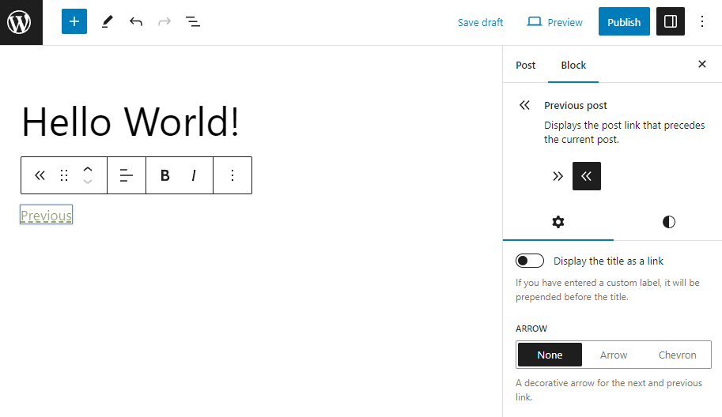
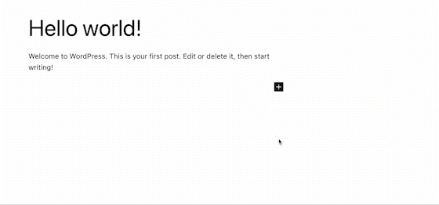
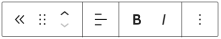
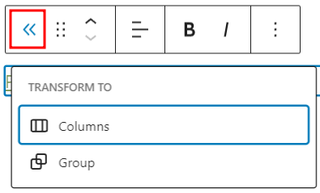
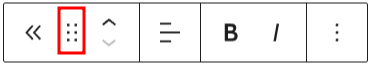
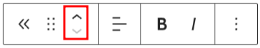
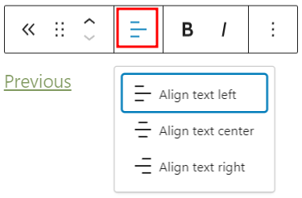
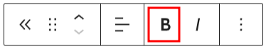
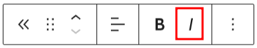
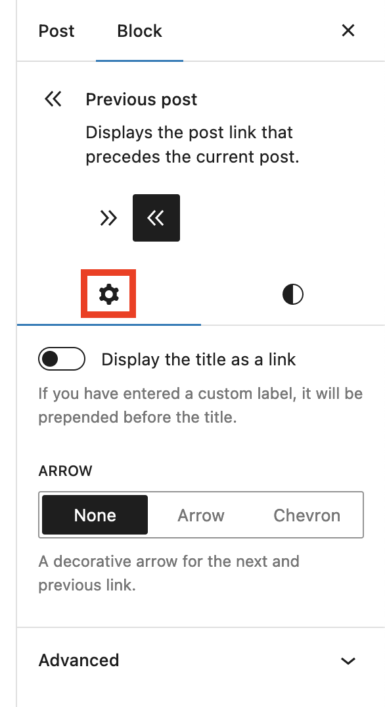

# Previous Post block

[Go back to the list of **Blocks**](../block-editor/blocks-list.md)

Use the *Previous Post* block to display a `Previous` link which automatically points to the previous post or page to the one currently being viewed.

Click the (**+**) icon to open the block inserter pop-up window and search for the *Previous Post* blocks.

You can also use the keyboard shortcut */previous-post* to quickly add the *Previous Post* block.

> [!NOTE]
> Detailed instructions on adding blocks can be found [here](../block-editor/adding-a-new-block.md).

## Block toolbar

To view the block toolbar, click on the block, and the toolbar will be displayed.

Every block comes with unique toolbar icons. These block-specific controls allow you to manipulate the block right in the editor.

The *Previous Post* block shows seven buttons in the block toolbar:

-   Transform to
-   Drag
-   Move up/down
-   Change text alignment
-   Bold
-   Italic
-   Options

### Transform to

Click on the **Transform** button to convert the *Previous Post* block into a *Columns* or *Group* block.

### Drag icon

To drag and drop the block to a new location on the page template, click and hold the rectangle of dots, then drag it to the new location. The blue separator line indicates where the block will be placed. Release the left mouse button when you find the new location to place the block.

### Move arrows

The **up** and **down** arrow icons can be used to move the block up and down on the page.

> [!NOTE]
> Detailed instructions on moving a block within the editor can be found [here](../block-editor/moving-blocks.md).

### Change text alignment

Use the change text alignment tool to change the text alignment for the *Previous Post* block. The following is a list of the block width options:

-   Align text left
-   Align text center
-   Align text right

### Bold

You can select the text in the *Previous Post* block and use the *Bold* option or <kbd>Ctrl</kbd>+<kbd>b</kbd> or <kbd>Cmd</kbd>+<kbd>b</kbd> on your keyboard to bold it, which is usually heavier than the surrounding text.

### Italic

You can select any text inside the *Previous Post* block and use the *Italic* option or <kbd>Ctrl</kbd>+<kbd>i</kbd> or <kbd>Cmd</kbd>+<kbd>b</kbd> on your keyboard to italicize it, which usually appears slanted to the right.

### Options

The More Options menu represented by three vertical dots on the far right of the toolbar gives you more features such as the ability to duplicate, remove, or edit your block as HTML.

> [!NOTE]
> [Read about these and other settings.](../block-editor/more-text-editing-overview.md)

## Block settings

The block settings panel contains customization options specific to the block. To open it, select the block and click the cog icon below the block description, in the sidebar.

Click **Display the title as a link** to use the previous post/page title as link text. If you activate this toggle, another toggle **Include the label as part of the link** appears, allowing you to include in the link the custom label (if you have specified one).

Under the **Arrow** section you can select between three options:

-   *None* no arrow is displayed beside the link.
-   *Arrow* displays a left-headed arrow (**←**) to the left of the link.
-   *Chevron* displays a chevron (**«**) to the left of the link.

### Advanced

The following Advanced settings options are available: HTML Anchor, Additional CSS Class(es), Additional CSS, Filter by Taxonomy, and Styles.

The Filter by Taxonomy option allows you to only link to posts that have the same taxonomy terms as the current post. For example the same tags or categories.

> [!NOTE]
> [Learn more about advanced settings.](../block-editor/advanced-settings-overview.md)

## Block styles

### Colors

The *Previous Post* block provides color settings options to change the text, link, and background colors. 
Specifically:

-   Text color applies to the arrow (if any)
-   Link color applies to the link to the previous post
-   Background color applies to the whole block

> [!NOTE]
> For details, refer to this support article: [Color settings overview](../block-editor/colors-settings-overview.md)

### Typography

The *Previous Post* block provides typography settings to change the font family, appearance, line height, letter spacing, decoration, letter case, and font size.

> [!NOTE]
> For details, refer to this support article: [Typography settings overview](../block-editor/typography-settings-overview.md)

## Changelog

-   Updated 2026-06-29 (props @awetz583)
    -   Linked to advanced settings
-   Created 2023-06-02
