# Query Title block

The Query Title block displays a dynamic heading based on the type of content being viewed, such as a category name, search term etc.

It has two main variations:

## Archive Title

-   Displays the title of the current archive page, such as a category, tag, author, or date.
-   To add a Archive Title block, click the Block Inserter (+) icon, search for “Archive Title”, and select it from the list to insert it into your template.

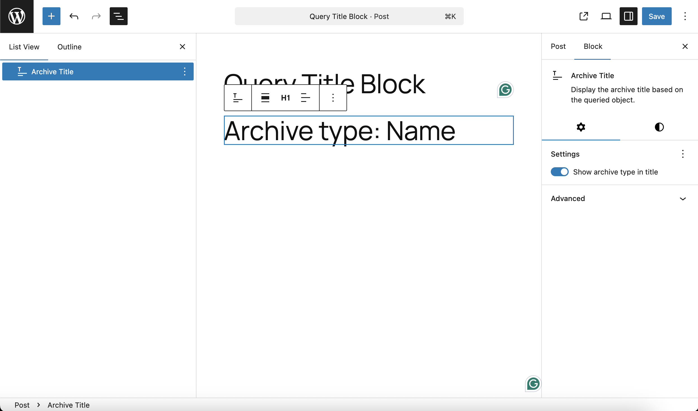

## Search Result Title

-   Displays a heading based on the user’s search query.
-   To add a Search Results Title block, click the Block Inserter (+) icon, search for “Search Results Title”, and select it from the list to insert it into your template.

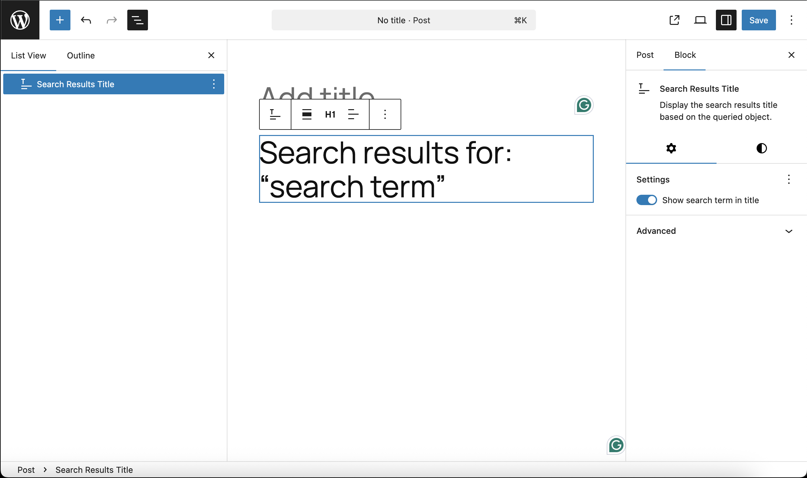

> [!NOTE]
> Both of these are built on top of the same underlying block (core/query-title) and share the same functionality and controls — they differ only in what type of content they’re designed to display.

## Block toolbar

To view the block toolbar, click on the block, and the toolbar will be displayed.

> [!NOTE]
> Every block comes with unique toolbar icons and blocks specific user controls that allow you to manipulate the block right in the editor.

**The Query Title block shows seven buttons in the block toolbar ( From Left to Right ):**

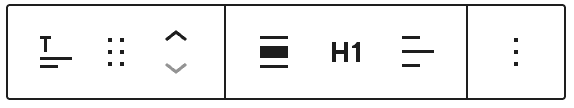

-   Transform to
-   Drag icon
-   Move arrows
-   Heading Level
-   Text Alignment
-   More options

### Transform To

Click on the Transform button to convert the Archive Title block into a Columns, Details, or Groupblock:

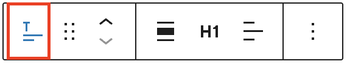

### Drag

To drag and drop the block to a new location on the page template, click and hold the rectangle of dots, then drag it to the new location. The blue separator line indicates where the block will be placed. Release the left mouse button when you find the new location to place the block.

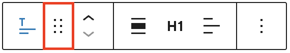

### Move Up / Down Arrows

The up and down arrow icons can be used to move the block up and down on the page. 
[Get more information about moving a block within the editor.](../block-editor/moving-blocks.md)

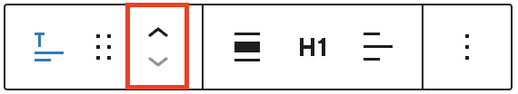

### Heading Level

You can choose the heading level for the Archive Title from H1–H6.

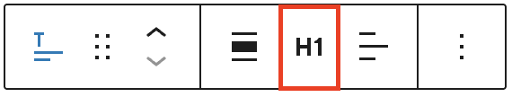

### Text Alignment

Click the Change alignment button in the Block toolbar to display the alignment drop-down. You can align the block text to the left, make it center-aligned or align it to the right.

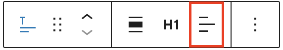

### Options Menu

The [More Options menu](../block-editor/more-options.md) represented by three vertical dots on the far right of the toolbar gives you more features such as the ability to duplicate, remove, or edit your block as HTML.

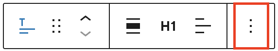

## Block settings

The block settings panel contains customization options specific to the block. To get to the settings, select the block and click to open the Inspector sidebar. You should see the block settings displayed below with the title “Archive Title” at the top:

### Block Settings

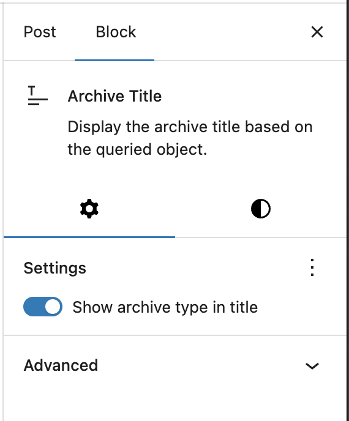

#### Show archive type in title

Toggle this option to include or exclude the archive type (e.g., “Category”, “Tag”, “Author”) in the title.

-   Enabled (default): Displays titles like Category: Travel
-   Disabled: Displays just Travel

### Style Settings

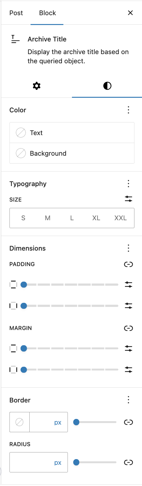

#### Color

Text and background colors can be set on a per-block basis, allowing you to call attention to important content. Using the Color settings, you can customize the block by adding text, background, and link colors.

> [!NOTE]
> [See this guide for more information about changing colors.](../block-editor/colors-settings-overview.md)

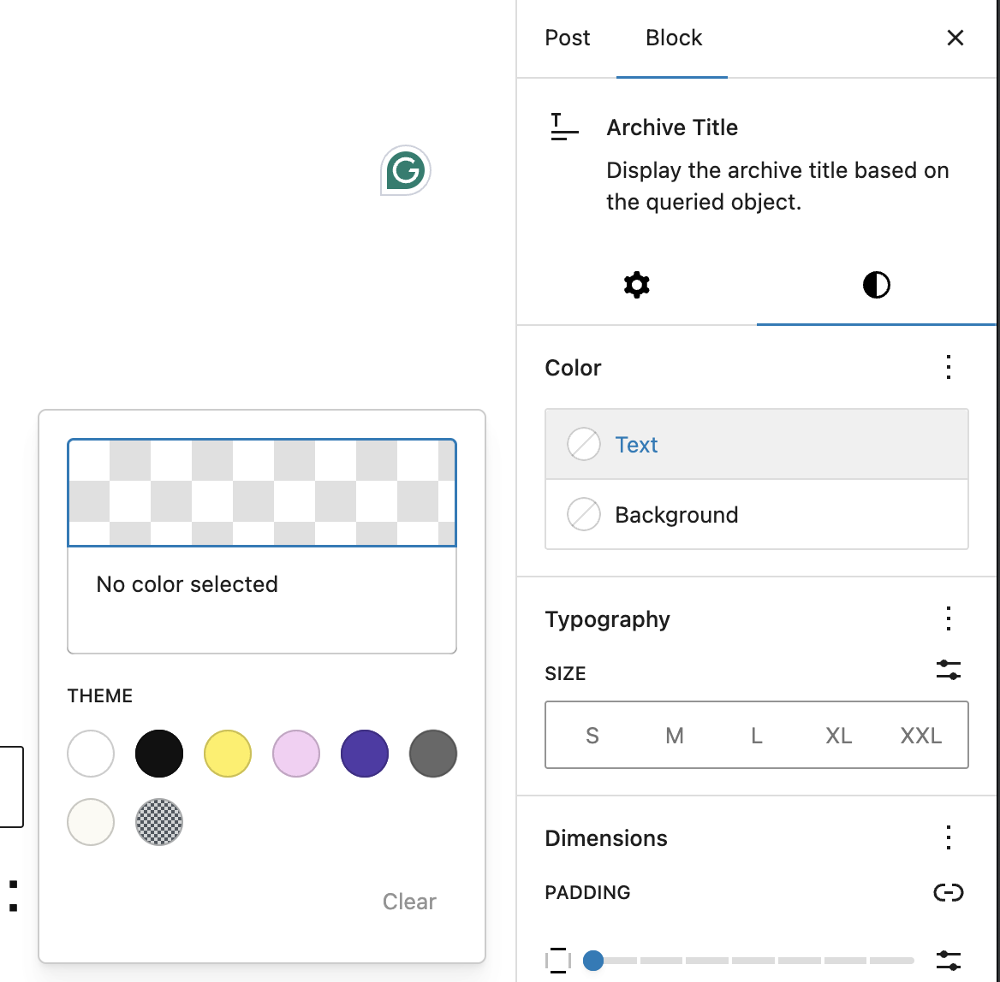

#### Typography

The Typography settings enable you to customize the font and text appearance of the content within the Archive Title block. The settings have various options, such as font family, size, appearance, line height, letter case, letter spacing, and decoration.

> [!NOTE]
> [Get more details about changing typography settings.](../block-editor/typography-settings-overview.md)

#### Dimensions

The Archive Title block provides various options to adjust its dimensions, such as width and height, allowing you to customize the text layout to ensure visual consistency.

#### Border

The Archive Title block provides border settings options to add border color, width, and radius.

> [!NOTE]
> For details refer to this support article: [Border settings overview](../block-editor/border-settings-overview.md)

#### Advanced

The following Advanced settings options are available: HTML Anchor, Additional CSS Class(es), Additional CSS, and Styles.

> [!NOTE]
> [Learn more about advanced settings.](../block-editor/advanced-settings-overview.md)

## Changelog

-   Updated 2026-06-29
    -   Linked to advanced settings
-   Created 2025-08-01
