# Query Total block

[Go to the list of Blocks](../block-editor/blocks-list.md)

WordPress 6.8 is set to introduce a new block called Query Total, enhancing the flexibility of the Query Loop block.

This new block displays the total number of results within a query, making it easier for users to showcase the number of posts retrieved by a query loop.

The Query Total block is designed to be used inside a Query Loop block. It automatically counts the total number of posts retrieved by the query and displays the result in a user-friendly manner. For example, if a Query Loop retrieves 12 posts, the Query Total block will display:

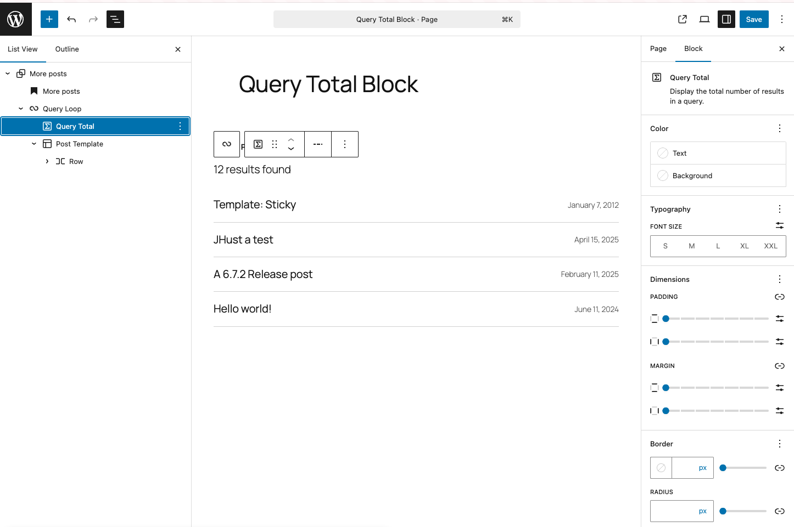

*The Query total block on the site editor*

> [!NOTE]
> You can only insert the Query Total Block inside a Query Loop block.

To add a *Query Total block*, click the **Block Inserter** icon when editing in the Query Loop.

Click on it to add the block to your page template.You can also use the keyboard shortcut `/query-total` to quickly insert the *Query Total block*:

<video controls preload="metadata" src="https://wordpress.org/documentation/files/2025/04/quety-total-block-6.8.mp4"></video>

> [!NOTE]
> [Detailed instructions on adding blocks](../block-editor/adding-a-new-block.md)

## Block toolbar

To view the block toolbar, click on the block, and the toolbar will be displayed.

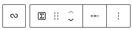

*Query total block toolbar*

Every block comes with unique toolbar icons and blocks specific user controls that allow you to manipulate the block right in the editor.

The *Query Total block* shows seven buttons in the block toolbar:

-   Select parent block
-   Transform to
-   Drag icon
-   Move arrows
-   Change display type
-   More options

### Select parent

Click on the **Select parent** button to move to the *Query Loop block*.

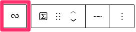

*Select parent for Query Total block*

### Transform to

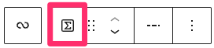

*Transform button for the Query Total block*

Click on the **Transform** button to convert the *Query Total block* into a *Columns, Details, or Group* block:

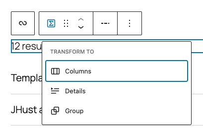

*Transform options for Query Total block*

### Drag icon

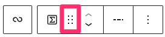

*Drag and drop tool on the toolbar*

To drag and drop the block to a new location on the page template, click and hold the rectangle of dots, then drag it to the new location. The blue separator line indicates where the block will be placed. Release the left mouse button when you find the new location to place the block.

### Move arrows

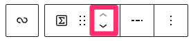

*Block moving tools on the block toolbar*

The up and down arrow icons can be used to move the block up and down on the page.

> [!NOTE]
> [Get more information about moving a block within the editor.](../block-editor/moving-blocks.md)

### Change display type

The next button over will allow you to choose two types of displays:

The “Total results” option displays the number of results found, for example: “12 results found”:

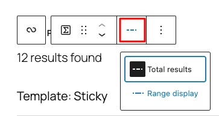

*Display type toolbar tool*

The “Range display” option displays the range total, for example, “Displaying 1 – 10 of 12”.

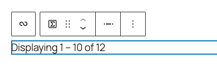

*Range display type for Query Total block*

### More options

The [More Options menu](../block-editor/more-options.md) represented by **three vertical dots on the far right of the toolbar** gives you more features such as the ability to duplicate, remove, or edit your block as HTML.

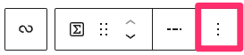

*Examples of the location of the “More Options” menu in a Query Total block.*

> [!NOTE]
> [Read about these and other settings.](../block-editor/more-options.md)

## Block settings

The block settings panel contains customization options specific to the block. To get to the settings, select the block and click to open the Inspector sidebar. You should see the block settings displayed below with the title “Query total” at the top:

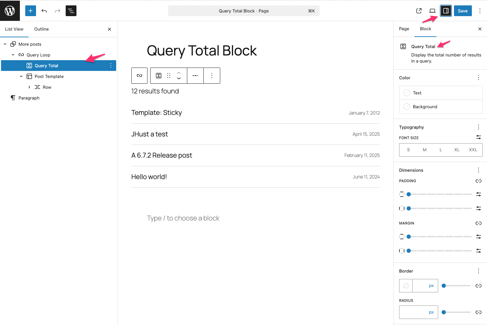

*Illustrates how to open settings for Query Total block*

### Color

Text and background colors can be set on a per-block basis, allowing you to call attention to important content. Using the Color settings, you can customize the block by adding text, background, and link colors.

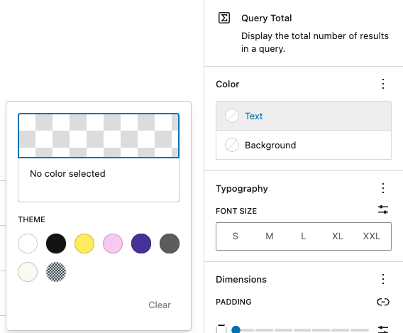

*Color settings*

> [!NOTE]
> [See this guide for more information about changing colors.](../block-editor/colors-settings-overview.md)

### Typography

The Typography settings enable you to customize the font and text appearance of the content within the *Query Total* block. The settings have various options, such as font family, size, appearance, line height, letter case, letter spacing, and decoration.

> [!NOTE]
> [Get more details about changing typography settings.](../block-editor/typography-settings-overview.md)

### Dimensions

The *Query Total* block provides various options to adjust its dimensions, such as width and height, allowing you to customize the text layout to ensure visual consistency.

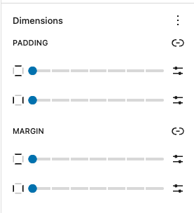

*Dimension settings*

> [!NOTE]
> For details refer to this support article: [Dimension settings overview](../block-editor/dimension-controls-overview.md)

### Border

The *Query Total* block provides border settings options to add border color, width, and radius.

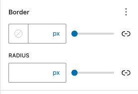

*Border settings*

> [!NOTE]
> For details refer to this support article: [Border settings overview](../block-editor/border-settings-overview.md)

### Advanced

The following Advanced settings options are available: HTML Anchor, Additional CSS Class(es), Additional CSS, and Styles.

> [!NOTE]
> [Learn more about advanced settings.](../block-editor/advanced-settings-overview.md)

## Changelog

-   Updated 2026-06-29
    -   Linked to advanced settings
-   Updated 2025-06-28 (props to [@benazeer](https://profiles.wordpress.org/benazeer/))
    -   Added overview and video
-   Created 2025-04-29 (props to [@n8finch](https://profiles.wordpress.org/n8finch/))
