# Read More block

[Go to the List of Blocks](../block-editor/blocks-list.md)

The Read More block allows you to add links in the [query loop block](query-loop-block.md) that direct visitors to the posts. With this block, you get more flexibility to customize the Read More links and make them look appealing

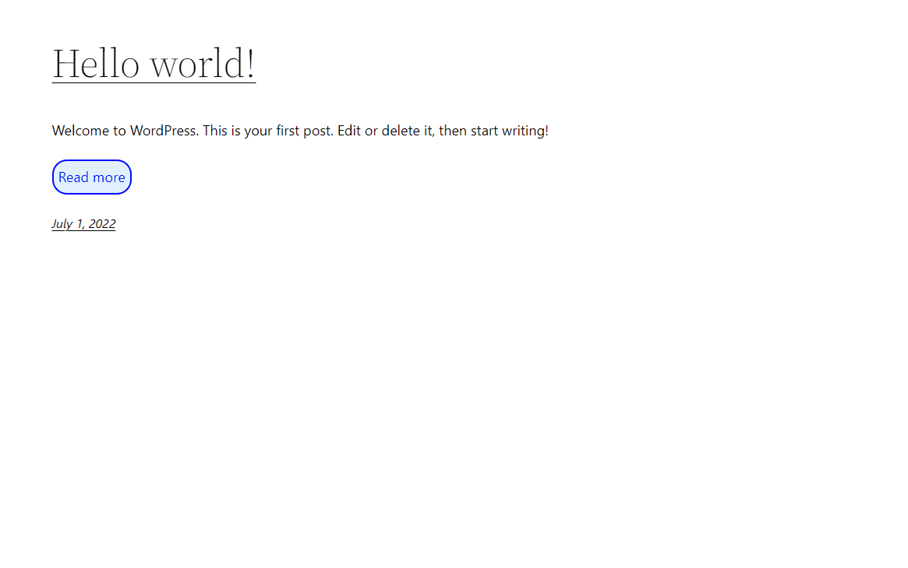

To add a Read More block, click the (+) icon to open the block inserter pop-up window and search for the Read More block. Click on it to add the block to your page template.

You can also type /read-more and hit enter in a new paragraph block to add the Read More block quickly.

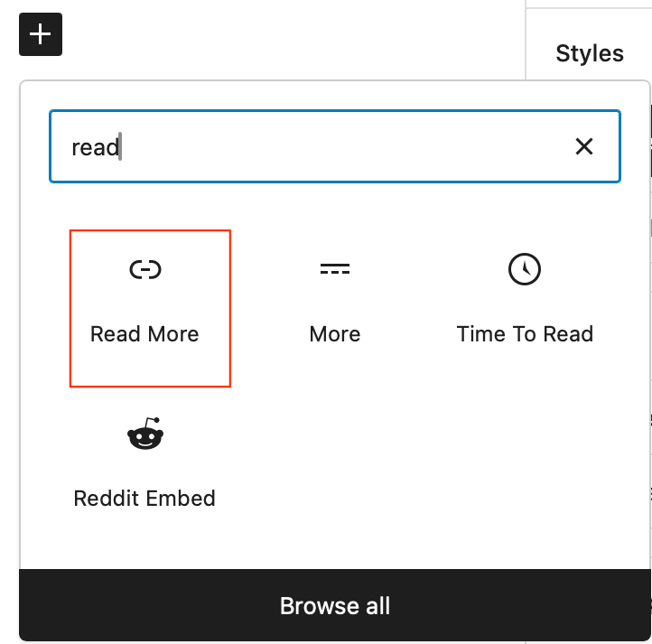

> [!NOTE]
> [Detailed instructions on adding blocks](../block-editor/adding-a-new-block.md)

## Block toolbar

Each block has its own toolbar which contains unique controls that let you customize or configure the block.

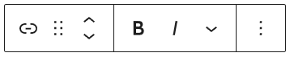

The Read More block has the following options on its toolbar:

**Transform to:**

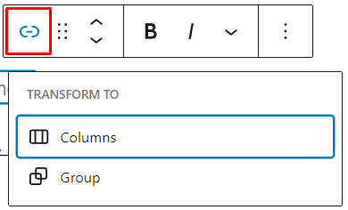

If you click the Transform button, you’ll see the options to convert the Read More block into Columns and Group blocks.

**Block moving tools**

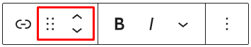

There are two block-moving tools for the Read More block. The six dots icon lets you drag and drop the Read More block and reposition it anywhere on the editor, while the up and down arrows let you move the Read More block up or down on the editor.

> [!NOTE]
> [Get more information about moving a block within the editor.](../block-editor/moving-blocks.md)

### Text editing options

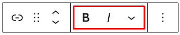

**Bold and Italics**

Bold and italics formatting have their own formatting buttons on the toolbar for your convenience. Alternatively, use keyboard shortcuts when formatting. The shortcuts are as follows:

-   CTRL+b (Windows) or Command+b (macOS) for bold
-   CTRL+i (Windows) or Command+i (macOS) for italics

**More Text Formatting Options**

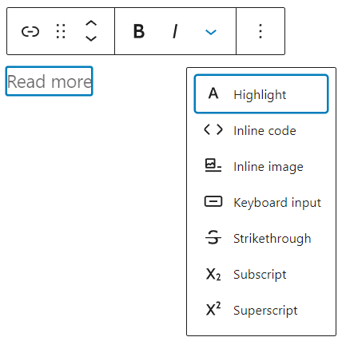

If you click the down arrow icon, the toolbar will open a drop-down menu that contains more text formatting options.

-   Highlight lets you pick custom text and background colors to make the text more noticeable.

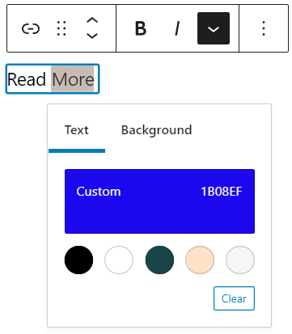

-   Inline code formats the text into a code snippet and prevents the code from being executed.
-   Inline image allows you to add an image to the text. You can set the desired pixel width for the image.

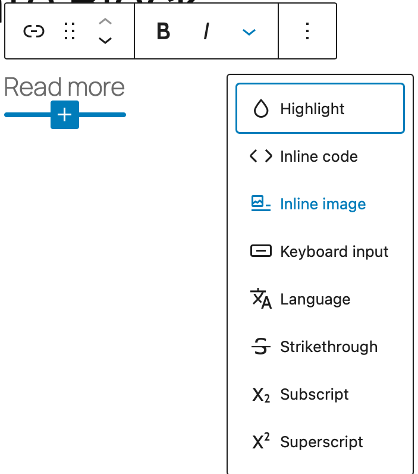

-   Keyboard input adds the &lt;kbd> tag to the text, making it render using the monospace font in the browser.
-   Strikethrough adds a line that runs through the selected text.
-   Subscript and superscript allow you to change the text to a subscript or superscript format.

### More options

These controls give you the option to copy, duplicate, and edit your block as HTML.

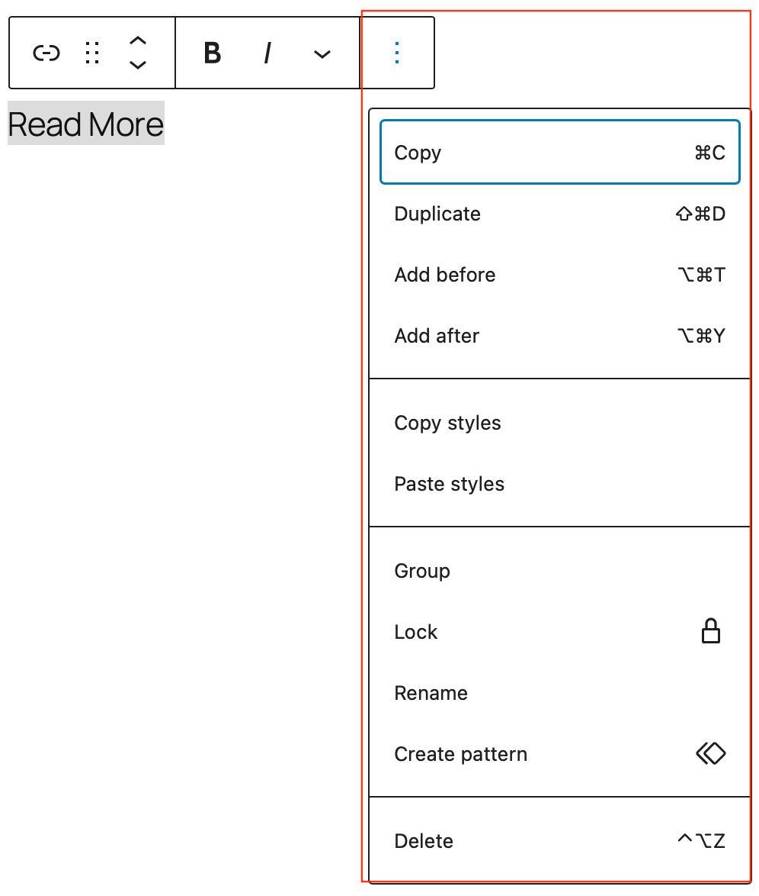

> [!NOTE]
> [Read about these and other settings.](../block-editor/more-options.md)

## Block settings

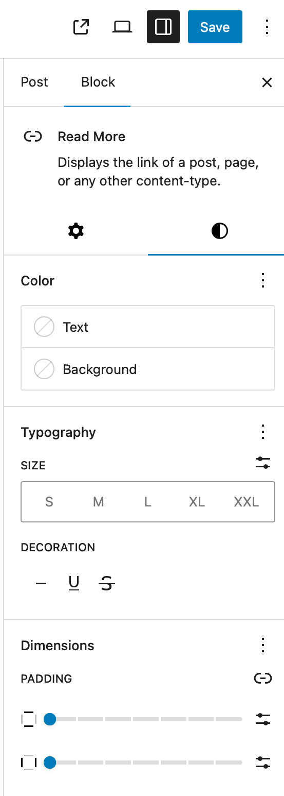

Every block has specific options in the block settings panel. To open it, select the block and click the cog icon next to the Publish button.

### Link

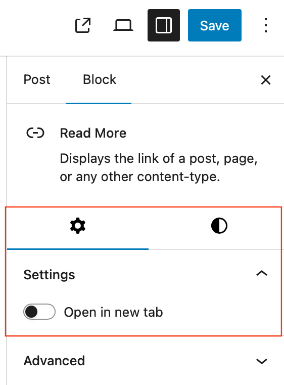

If you enable the *Open in new tab* option, the link will load the post in a new tab.

### Color

Text and background colors can be set on a per-block basis, allowing you to call attention to important content. Pick a color from the suggestions, or add a custom color using the color picker or by adding a color code.

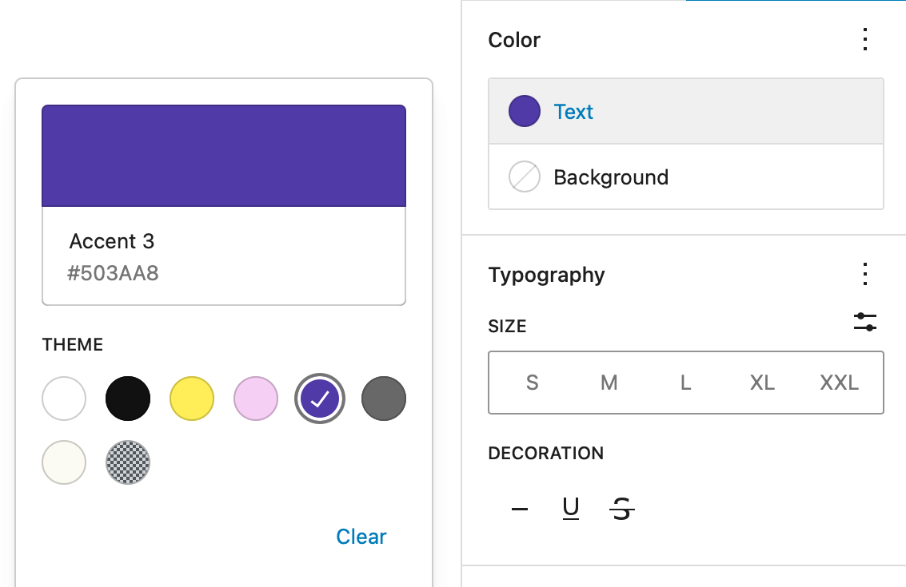

> [!NOTE]
> [See this guide for more information about changing colors.](../block-editor/colors-settings-overview.md)

### Typography

Typography settings allow you to change a block’s font size, appearance, line height, letter casing, and spacing.

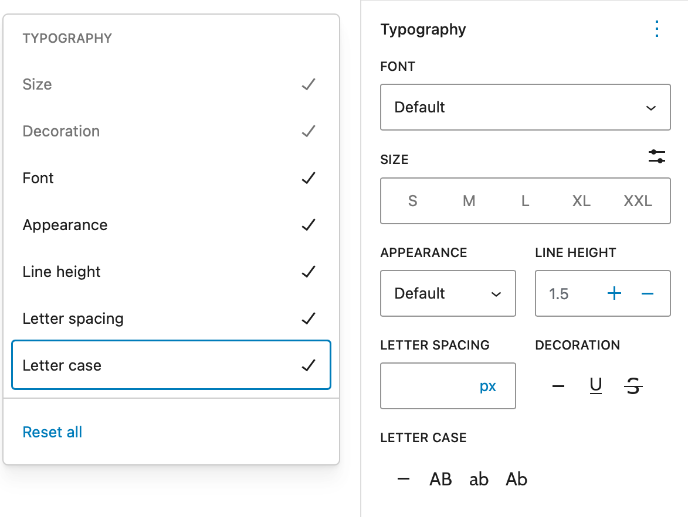

> [!NOTE]
> [Get more details about changing typography settings.](../block-editor/typography-settings-overview.md)

### Dimensions

The Dimensions settings allow you to customize the padding and margin for the block. Padding is the space between the block outline and the block content, while margin is the gap to other blocks.

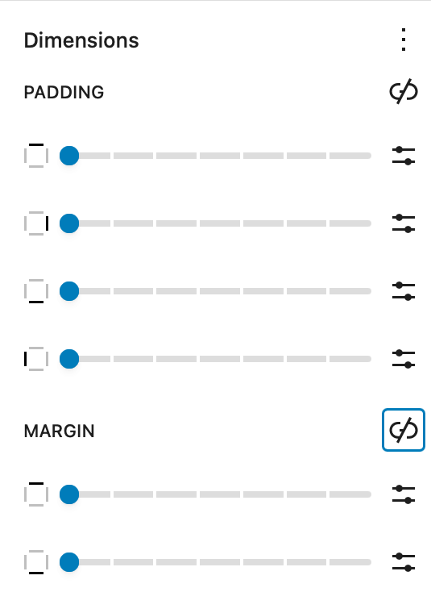

> [!NOTE]
> [Learn more about dimension controls.](../block-editor/dimension-controls-overview.md)

### Border

The Border settings allow you to create a border for the selected block. You can define the border width value using one of the six available unit options, similar to padding and margin.

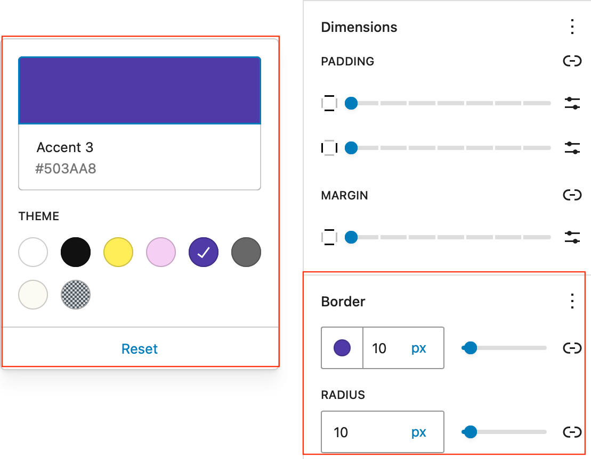

> [!NOTE]
> [Learn more about border settings.](../block-editor/border-settings-overview.md)

### Advanced

The following Advanced settings options are available: HTML Anchor, Additional CSS Class(es), Additional CSS, and Styles.

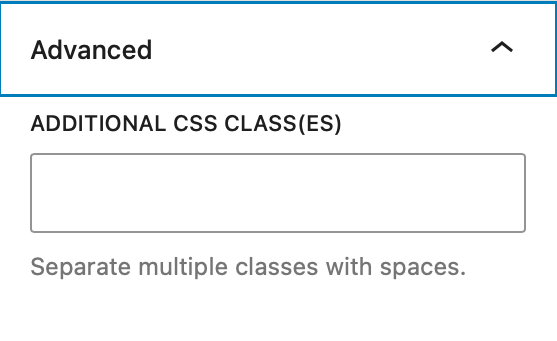

> [!NOTE]
> [Learn more about advanced settings.](../block-editor/advanced-settings-overview.md)

## Changelog

-   Updated 2026-06-29
    -   Linked to advanced settings
-   Created 2022-07-18
