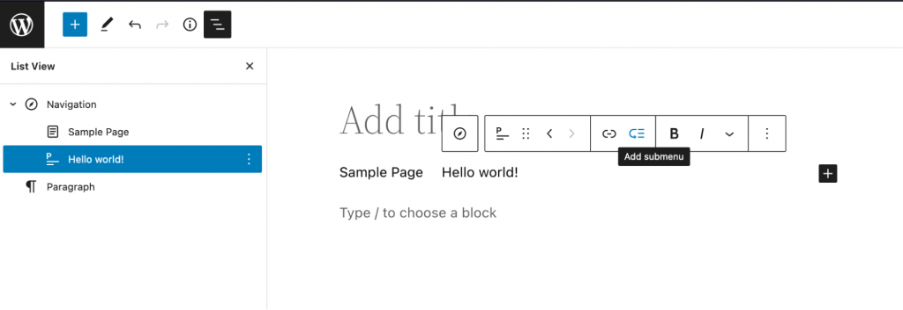
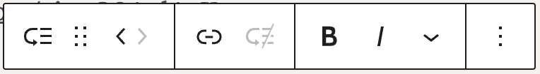
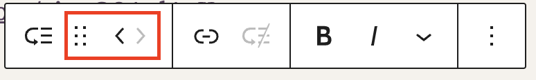
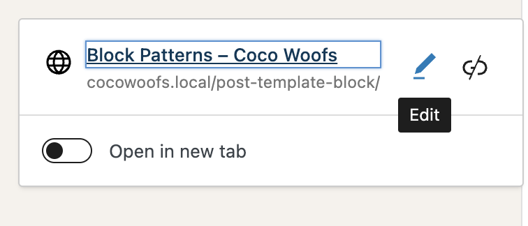
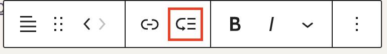
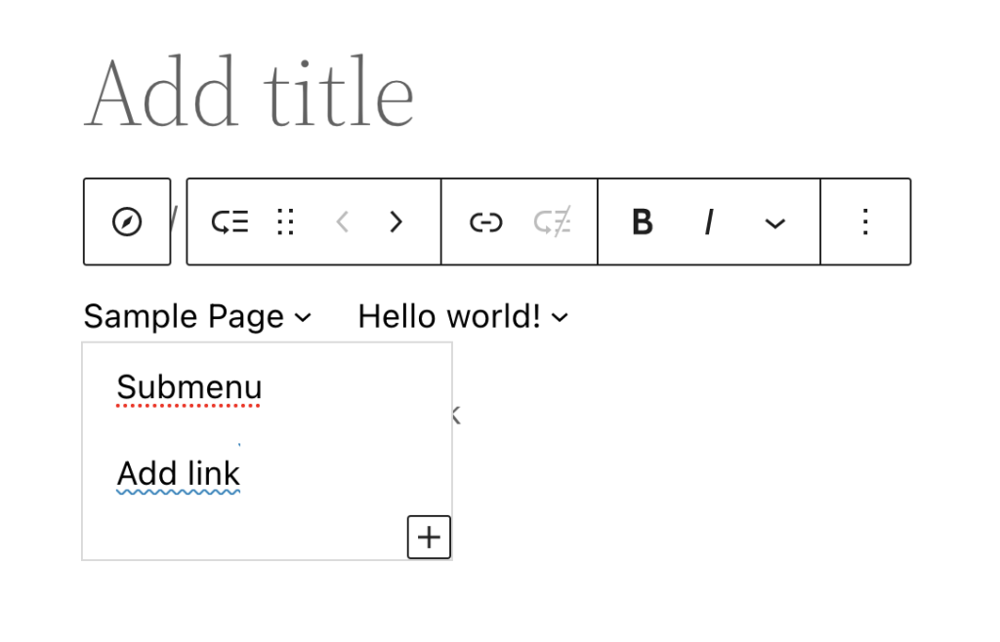
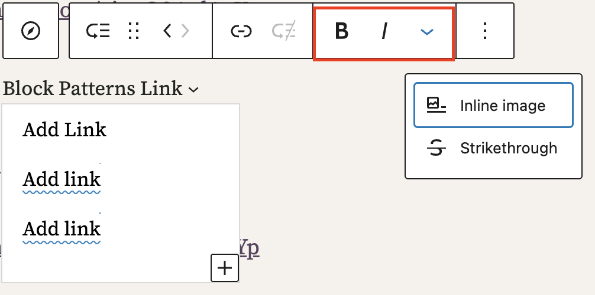
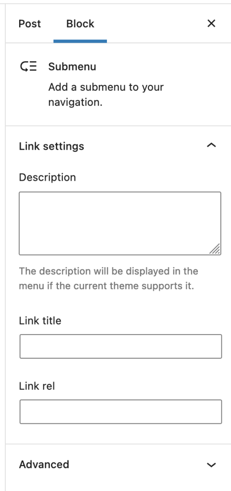

# Submenu block

[Go to the list of Blocks](../block-editor/blocks-list.md)

The **Submenu Block** is an advanced block that can only be used as a child block of the [Navigation Block](navigation-block.md) released with WordPress 5.9. It allows you to create and edit the structure and appearance of submenus within your site’s navigation menus. The **Submenu** **Block** can be used with a [block theme](https://wordpress.org/themes/tags/full-site-editing/) or a theme that supports [template editing](https://wordpress.org/themes/tags/template-editing/).

To add a submenu block to your content in the block editor, select the menu item where you want to add a submenu, inside an existing navigation block. In the block toolbar, search and add the Submenu block by clicking the **Block inserter** (+) icon or typing /<kbd>submenu</kbd> in the editor. You can also click the **Add Submenu** icon in the Block toolbar. This will automatically add a submenu item below the block you selected.

> [!NOTE]
> [Detailed instructions on adding blocks](../block-editor/adding-a-new-block.md)

## Block toolbar

Each block has its own toolbar, which contains unique controls that let you customize or configure the block. The **Submenu Block**  has the following options on its toolbar:

**Block moving tools**

There are two ways you can move blocks once you’ve added them to the **Submenu block**. Using these tools, you can reorder the **Submenu block** inside a **Navigation** section. Use the toolbar to *move* the items *left and righ*t or *drag* them to a new position.

**Link tool**

The Link tool lets you edit the link and title of your **Submenu block**.

To change the title, you can edit the text in the submenu block directly.

To edit the link, select the block and click the link icon in the toolbar. From the popup, click the **Pencil** icon to edit the link. Click the **Unlink** icon to remove the link.

In the edit popup, you can change the text and URL to edit what the submenu item links to and the title. You can also decide whether you want to open the link in a new tab.

<video controls preload="metadata" src="https://wordpress.org/support/files/2023/02/Screen-Recording-2023-02-10-at-6.05.04-PM.mp4"></video>

**Add additional submenu items**

To add additional submenu items to the **Submenu block**, click the **Add submenu** icon in the Block toolbar.

Select the **+** button that appears upon doing so. After selecting the + icon, you will see a new submenu *Add link* item. You can add a link and text title to modify this submenu item.

The blocks you can add below a submenu block are:

-   Custom links
-   Post links
-   Page links
-   Category links
-   Tag links
-   Additional submenus

**Text formatting**

Basic text formatting is available for all **Submenu** blocks. Select your title (or a part of it) to make it Bold, Italic, or Strikethrough, or turn it into an Inline image to cover your link with an image.

**More options**

These controls give you the option to copy, duplicate, and edit your block as HTML.

> [!NOTE]
> [Read about the More options settings.](../block-editor/more-options.md)

## Block settings

Each link has its **Block settings** you can access by clicking the **settings** button on the upper-right corner of the editor or via **Options** in the toolbar.

**Link** **settings**

The link settings section contains the following options:

-   **Description** to display with your link if the selected theme includes that option.
-   **Link title** to provide more information about the link for search engine optimization. Leave this field empty if you want the title used in URL settings to stay.
-   **Link rel** to specify how your external link is related to the page you’re working on and if its authority should be higher than your website’s.

### Advanced

The Submenu block provides the following Advanced settings options: HTML Anchor, Additional CSS Class(es), Additional CSS and Styles.

> [!NOTE]
> [Learn more about advanced settings.](../block-editor/advanced-settings-overview.md)

## Changelog

-   Updated 2026-06-23
    -   Added advanced settings
-   Created 2023-02-11
