# Archives block

[Go to the List of Blocks](../block-editor/blocks-list.md)

Use the Archives block to display a date archive of your posts.

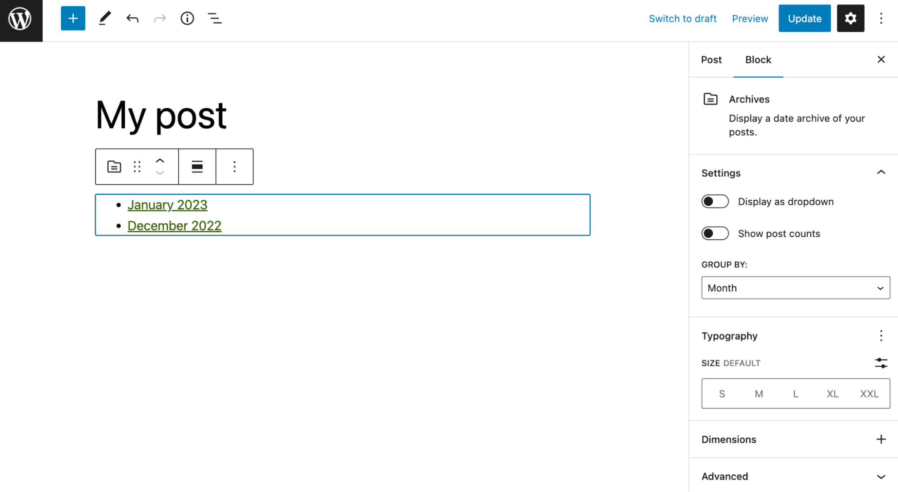

To add the Archives block to a page, click the **block inserter** (+) icon to open the block inserter pop-up window and choose the Archives block.

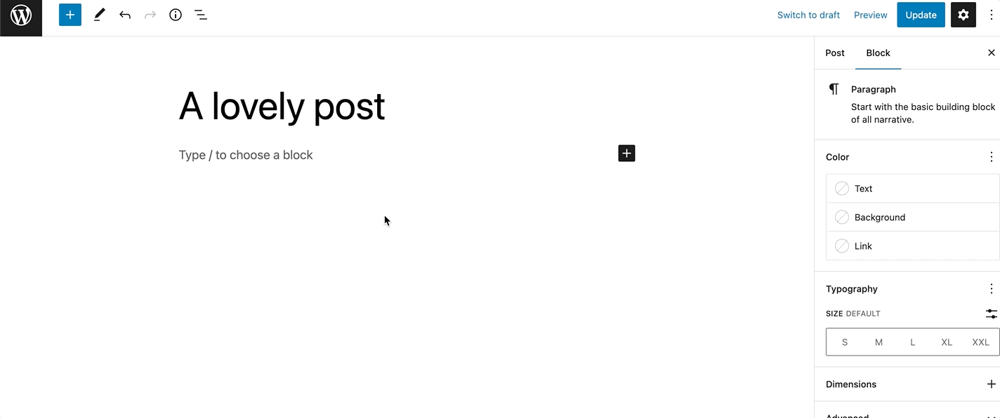

You can also use the keyboard shortcut <kbd>/archives</kbd> to quickly insert an Archives block.

> [!NOTE]
> [Detailed instructions on adding blocks](../block-editor/adding-a-new-block.md)

## Block toolbar

To view the block toolbar, click on the block, and the toolbar will be displayed.

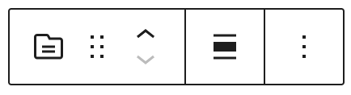

Every block comes with unique toolbar icons and blocks specific user controls that allow you to manipulate the block right in the editor.

The Archives block shows five buttons in the block toolbar:

-   Transform to
-   Drag icon
-   Move arrows
-   Change alignment
-   More options

**Transform to**

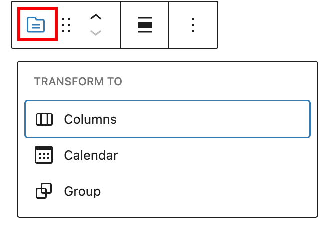

Click on the **Transform** button to convert the Archives block into a Group, Columns or Calendar block.

**Drag icon**

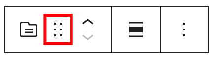

To drag and drop the block to a new location on the page template, click and hold the rectangle of dots, then drag it to the new location. The blue separator line indicates where the block will be placed. Release the left mouse button when you find the new location to place the block.

**Move arrows**

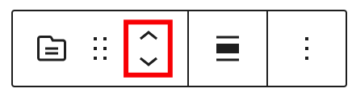

The up and down arrow icons can be used to move the block up and down on the page.

> [!NOTE]
> [Get more information about moving a block within the editor.](../block-editor/moving-blocks.md)

**Change block alignment**

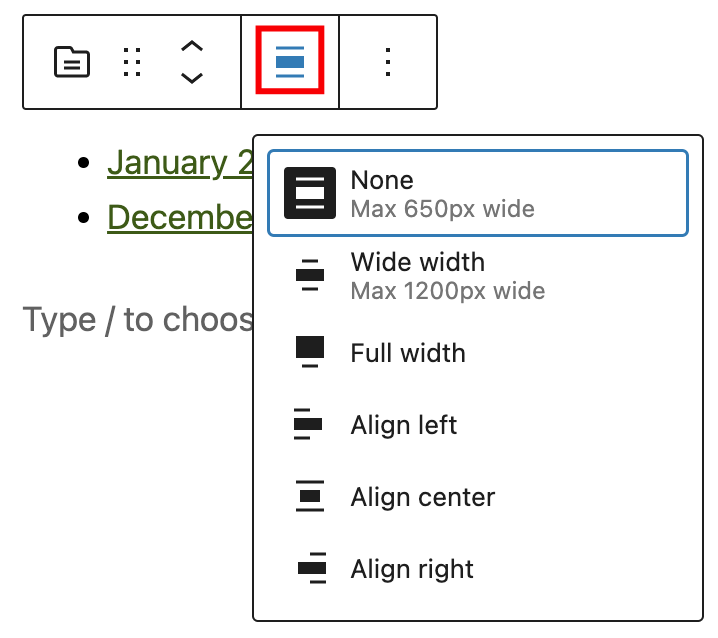

Use the change alignment tool to align the Archive block. Choose one of the following options:

-   **None –** leaves the block the current size.
-   **Wide width –** increase the width of the block beyond the content size.
-   **Full width –** extend the block to cover the full width of the screen.
-   **Align left –** aligns the block left.
-   **Align center –** aligns the block to the center.
-   **Align right –** aligns the block right.

The “Wide width” and “Full width” alignment settings must be enabled by your WordPress theme.

**Options**

The Options button on a block toolbar gives you more features to customize the block.

> [!NOTE]
> [Read about these and other settings.](../block-editor/more-options.md)

## Block settings

The block settings panel contains customization options specific to the block. To open it, select the block and click the **Settings** icon next to the **Publish** button.

**Settings**

The settings section provides four possible options:

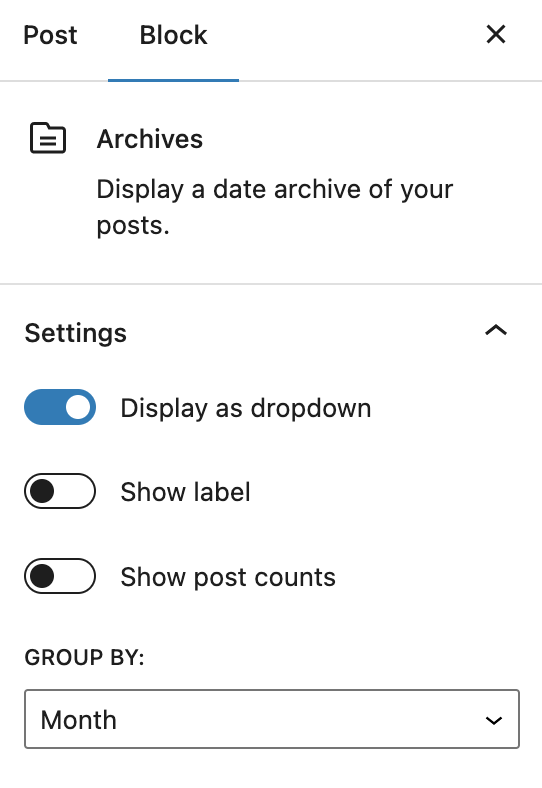

**Display as dropdown** – display the archives as a dropdown, rather than the default bulleted list.

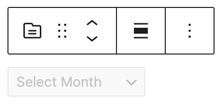

**Show label** – displays the archives label on top of the dropdown list. It can only be enabled together with the *Display as dropdown* option.

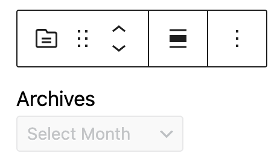

**Show post count** – shows posts count.

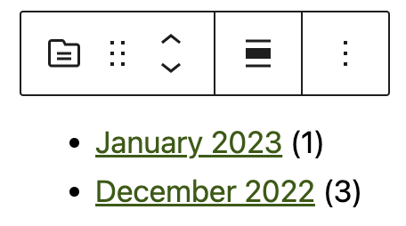

**Group by** – sets and groups the posts by year, month, week, and day.

### Color

Text and background colors can be set on a per-block basis, allowing you to call attention to important content. Using the Color settings, you can customize the block by adding text, background, and link colors.

> [!NOTE]
> [See this guide for more information about changing colors.](../block-editor/colors-settings-overview.md)

### Typography

The *Archives* block provides typography settings to change the font family, size, appearance, line height, letter case, letter spacing, and decoration.

> [!NOTE]
> [Get more details about changing typography settings.](../block-editor/typography-settings-overview.md)

**Dimensions**

The *Archive* block provides dimension settings options to change padding and margin size.

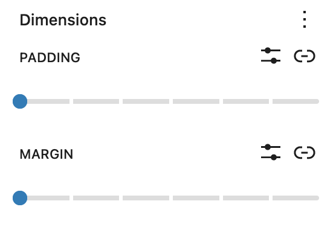

> [!NOTE]
> For details refer to this support article: [Dimension settings overview](../block-editor/dimension-controls-overview.md)

### Border

The Archive block provides border settings options to add border color, width, and radius.

> [!NOTE]
> For details refer to this support article: [Border settings overview](../block-editor/border-settings-overview.md)

### Advanced settings

The Archives block provides the following Advanced settings options: HTML anchor, Additional CSS Class(es), Additional CSS, and Styles.

> [!NOTE]
> [Learn more about advanced settings](../block-editor/advanced-settings-overview.md)

## Changelog

-   Updated 2026-05-25 (props @kjoyner @awetz583)
    -   Updated “Advanced” section to refer to new overview page
-   Updated 2025-12-08
    -   Change capitalization in title to Archives block
-   Updated 2025-04-15
    -   Add color and border block support.
-   Updated 2023-02-07
    -   Updated screenshots
-   Updated 2022-11-21
    -   Removed redundant content
-   Updated 2022-08-01
    -   Added screenshots and updated content for 6.0
    -   Added ALT tags for images
-   Created 2019-03-07
