# Latest Posts block

[Go back to the list of **Blocks**](../block-editor/blocks-list.md)

The *latest posts block* displays your most recent posts, making it easy for your readers to see what’s new on your blog.

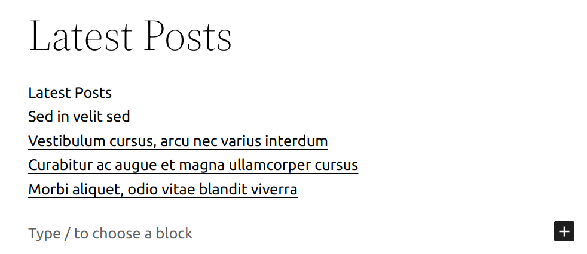

*Here’s what it looks like when it’s embedded in the Editor.*

The *latest posts block* can be added to a page by clicking on the Add Block button. It can be found in *Widgets* section. Alternatively, you can type `/latest` and click on Latest Posts.

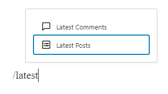

*Latest Posts Slash Command*

You can also choose the Latest Posts from the Add Block button.

> [!NOTE]
> [Detailed instructions on adding blocks](../block-editor/adding-a-new-block.md)

## Block toolbar

Each block has its own block-specific controls that allow you to manipulate the block right in the editor.

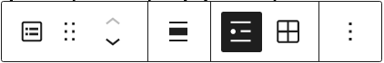

*The Latest Posts Block toolbar*

The block toolbar for the *latest posts block* has options for:

**Changing Alignment**

-   **None** – default
-   **Wide width** – Increase the width of the Latest Post block beyond the content size
-   **Full width** – Extend the Latest Post block to cover the full width of the screen
-   **Align left** – Make the Latest Post block left aligned
-   **Align center** – Make the Latest Post block alignment centered
-   **Align right** – Make the Latest Post block align right

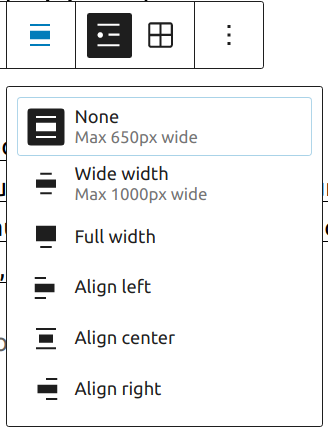

*Alignment Settings*

### List view (default)

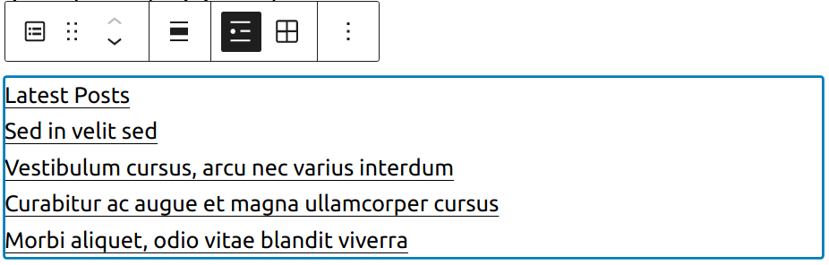

*List view*

### Grid view

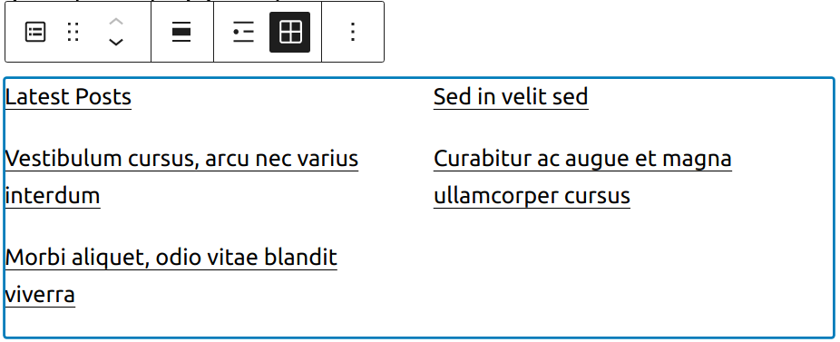

*Grid View*

### More options

These controls give you the option to copy, duplicate, and edit your block as HTML.

> [!NOTE]
> [Read about these and other settings.](../block-editor/more-options.md)

## Block settings

Every block has specific options in the editor sidebar in addition to the options found in the block toolbar. If you do not see the sidebar, simply click the ‘cog’ icon next to the Publish button.

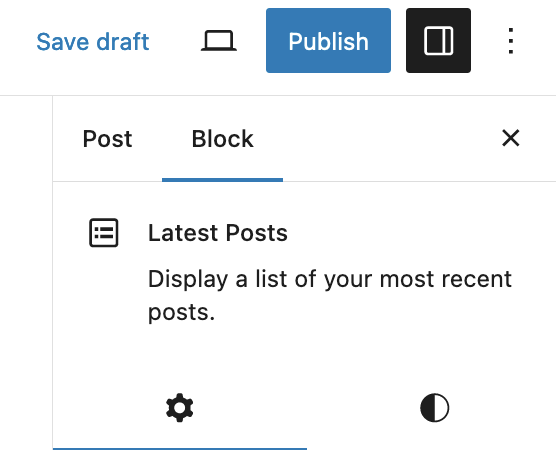

*Block Settings*

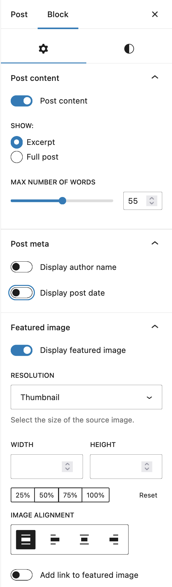

*Latest Posts settings*

### Post content settings

You can choose to show full post content or post excerpt with the option to modify the number of words for the excerpt.

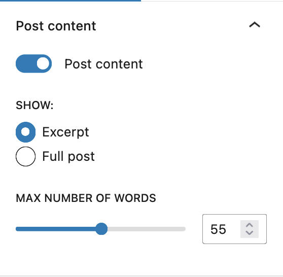

*Post content settings*

### Post meta settings

Meta settings allow you to show or hide author’s name and post publish date.

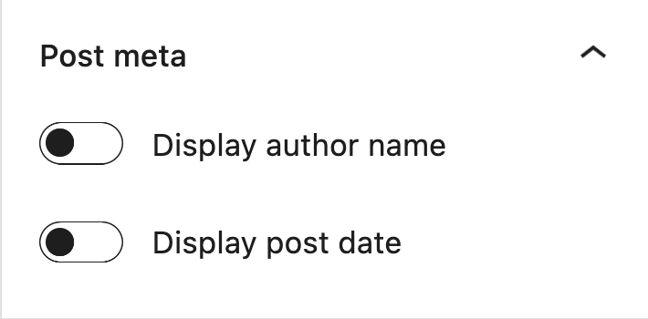

*Post meta settings*

### Featured image settings

With Featured image settings you can select resolution, dimensions, alignment and whether you want image to link to the article itself.

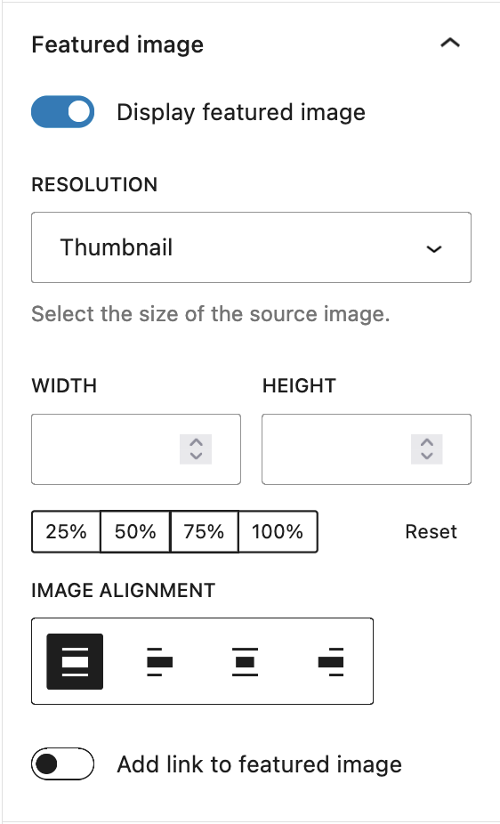

*Featured image settings*

### Sorting and filtering

The Latest Posts Settings allow you to choose how you wish to order the posts, with choices of:

-   Newest to Oldest (default)
-   Oldest to Newest
-   Alphabetical A to Z
-   Alphabetical Z to A

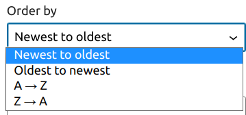

*Order by settings*

You also have the option to choose a specific category or subcategory to display the posts from. You may also specify the number of posts to display (if you have fewer posts than the limit, that number of posts will show), as well as toggle the post date on and off.

If you select Grid view, you’ll also have the option to choose how many columns the grid should have. Since WordPress 7.1, the Columns option has been moved from the Settings tab to the Layout section in the Styles tab.

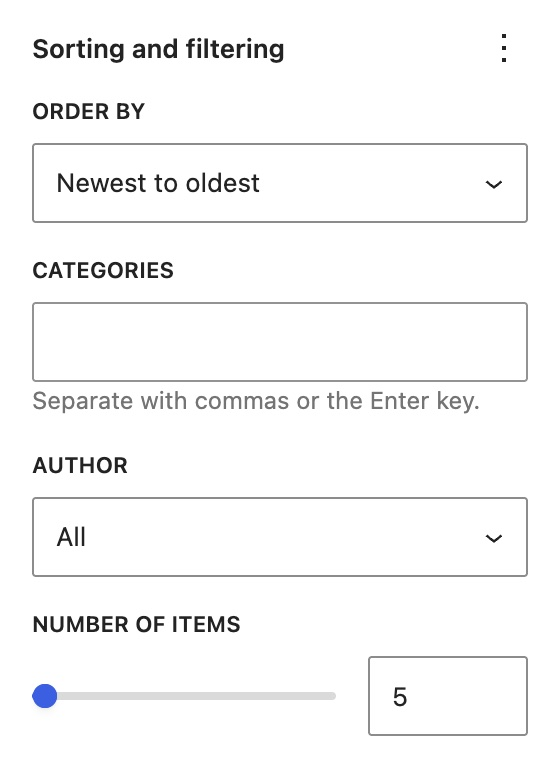

*Sorting and filtering*

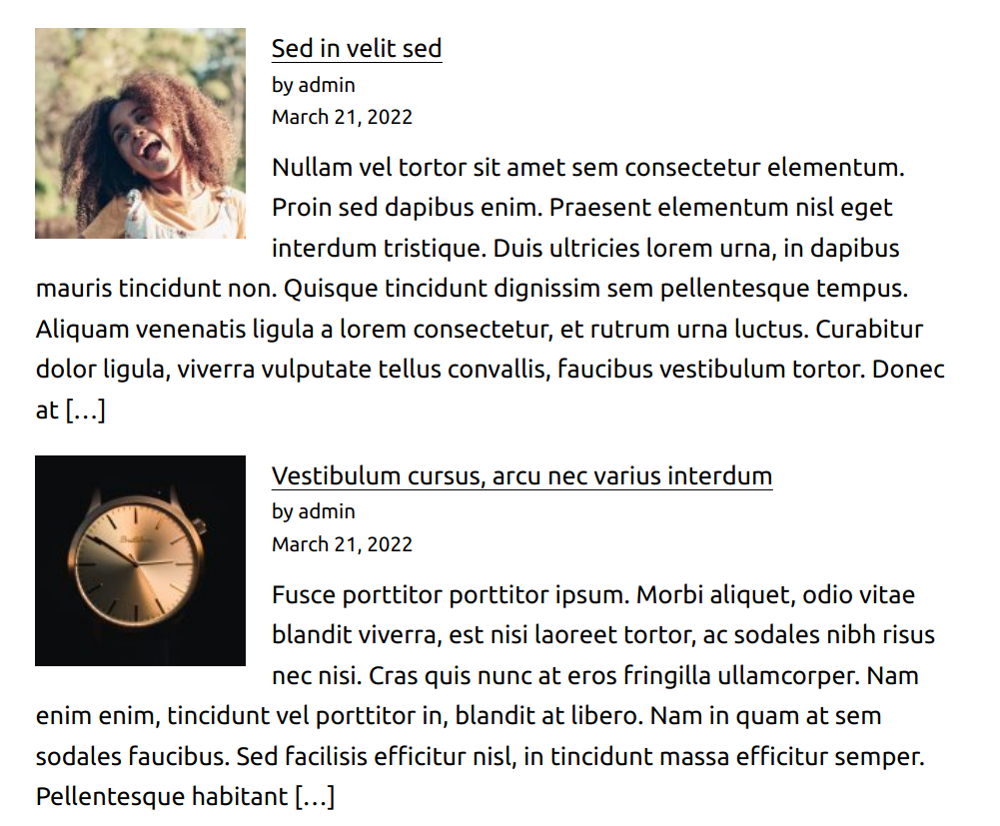

*List view with all settings enabled*

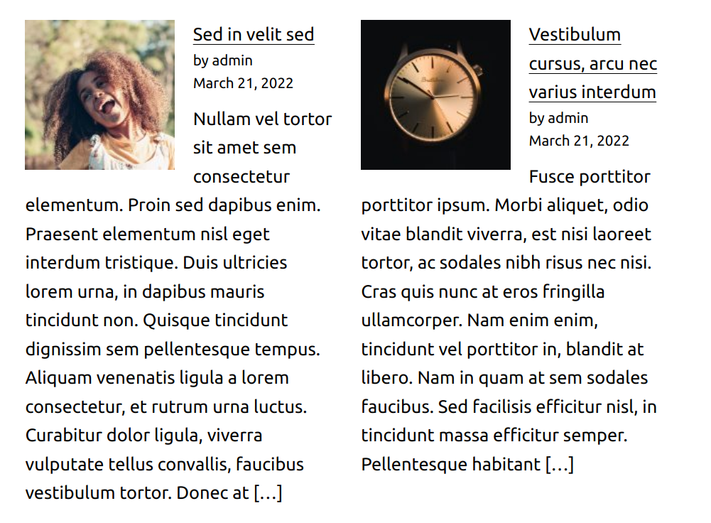

*Grid view with all settings enabled*

### Advanced

The Latest Posts block provides the following Advanced settings options: HTML anchor, Additional CSS Class(es), Additional CSS, and Styles.

> [!NOTE]
> [Learn more about advanced settings](../block-editor/advanced-settings-overview.md)

## Styles settings

### Typography

The Typography settings enable you to customize the font and text appearance of the content within the block. The settings have various options, such as font size, font style, font family, and letter spacing.

> [!NOTE]
> [Get more details about changing typography settings.](../block-editor/typography-settings-overview.md)

### Background

Background colors and gradients can be set on a per-block basis, allowing you to call attention to important content.

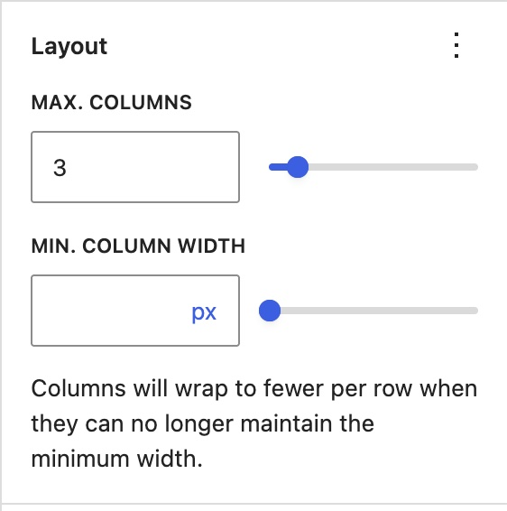

### Layout

In List view, you can choose whether inner blocks use the content width and adjust their justification. In Grid view, you can set the maximum number of columns and the minimum column width. Columns will wrap to fewer columns per row when they can no longer maintain the minimum width.

> [!NOTE]
> For details refer to this support article: [Layout settings overview](../appearance/layout-settings-overview.md)

### Dimensions

This block provides various options to adjust its dimensions, such as width and height, allowing you to customize the text layout to ensure visual consistency.

> [!NOTE]
> For details refer to this support article: [Dimension settings overview](../block-editor/dimension-controls-overview.md)

### Border

The border settings add border color, width, and radius.

> [!NOTE]
> For details refer to this support article: [Border settings overview](../block-editor/border-settings-overview.md)

### Elements

The Elements settings allow you to customize the color of links, including their default and hover states.

## Changelog

-   Updated 2026-08-28 @atachibana
    -   WordPress 7.1 moved the Grid View’s Columns option to the Layout section in the Styles tab.
-   Updated 2026-05-25 (props @kjoyner @awetz583)
    -   Updated “Advanced” section to refer to new overview page
-   Update 2025-11-10 @milana_cap
    -   Add Styles settings: Color, Typography, Dimensions, and Border.
-   Updated 2025-09-23 @milana_cap
    -   Improve article readability with different content formatting
-   Updated 2022-07-05
    -   Updated screenshots for 6.0
    -   Added new settings sections
-   Updated 2020-12-15
    -   Updated Block Settings.
-   Updated 2020-08-23
    -   WP 5.5 overall updates
    -   Updated images to WP 5.5
    -   Updates to Alignment, List & Grid View sections
    -   Added changelog
    -   Added list of blocks reusable block
-   Created 2019-03-07
