# Page List block

[Go back to the list of **Blocks**](../block-editor/blocks-list.md)

The **Page List** block allows you to display your website’s published pages in a page, post, and sidebar.

To add a **Page List** block, click the **Block Inserter** (+) icon and search for Page List.

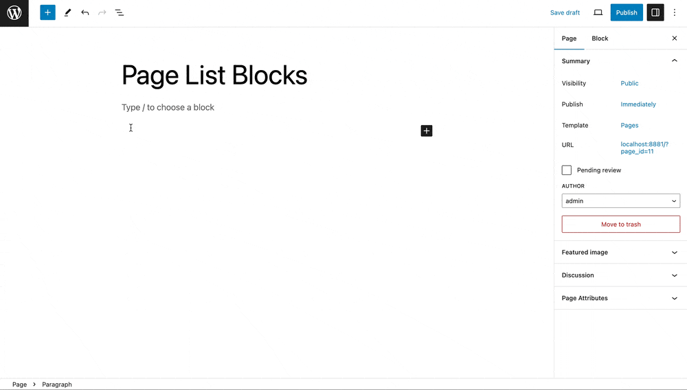

Another way you can add the **Page List** block is by typing `/page list` and hitting enter in a new paragraph block.

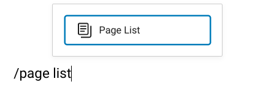

> [!NOTE]
> Detailed instructions for adding blocks are [in this support article](../block-editor/adding-a-new-block.md).

Using this block on your website sidebar makes pages easily accessible to visitors. Each page name on the list links to its respective page.

Here’s how the block looks on your website sidebar:

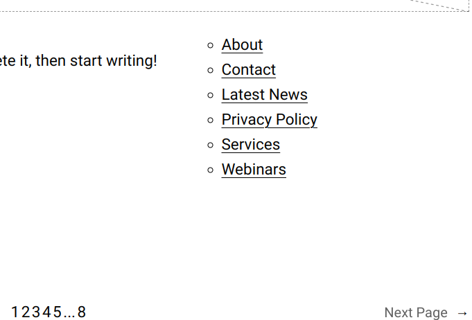

## Block toolbar

Every block has unique toolbar icons, and block-specific user controls that let you customize the block right in the editor. The **Page List** block has the following options on its **Block Toolbar**:

-   Transform to
-   Drag icon
-   Move handles
-   More options

Note: Move and Drag option is only available if you have more than 1 block in the editor.

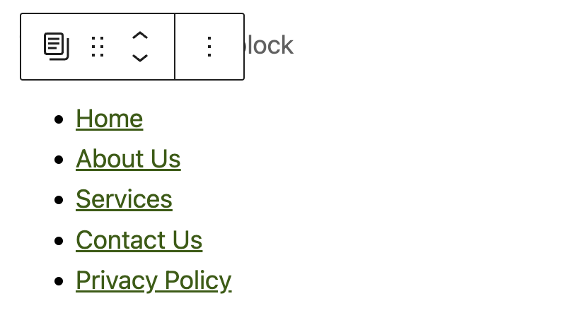

### Transform to

The **Transform to** button helps change the **Page List** block into **Columns**, **Details**, or **Group** blocks.

-   **Details** – Convert the Page List into a collapsible Details block, allowing sections to be expanded or collapsed for a cleaner interface.
-   **Group** – Wrap the Page List within a Group block for easier styling and layout control.
-   **Columns** – Distribute the Page List items into multiple columns to optimize space usage and improve readability.

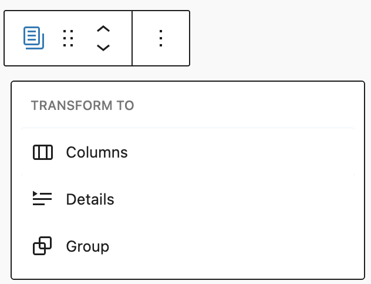

### Drag icon

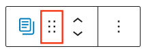

To drag and drop the block to a new location on the page, select and hold the rectangle of dots, then move it to that location. As you drag the block, the blue separator line shows where it can be dropped. When you find the desired location, release the left mouse button.

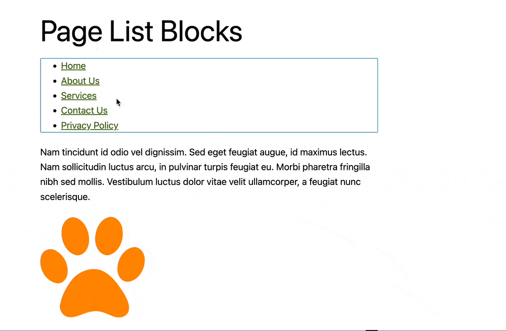

### Move handles

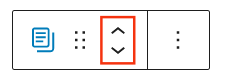

The up and down arrow icons let you move a block up and down on the page.

> [!NOTE]
> Here are more details on [moving blocks](../block-editor/moving-blocks.md) in the editor.

### More options

This control give you many other options like copy or duplicate your block, copy/page styles etc.

> [!NOTE]
> [Read about these and other settings.](../block-editor/more-options.md)

## Block settings

Every block has specific options in the editor sidebar in addition to the options found in the **Block Toolbar**. If you do not see the sidebar, simply click the ‘sidebar’ icon next to **Publish** or **Update** button.

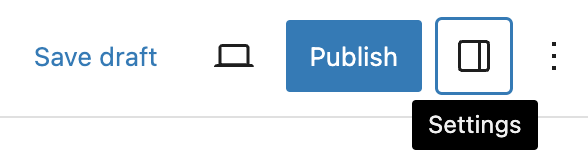

This block has controls categorised under **Settings** and **Styles** tab.

### Settings

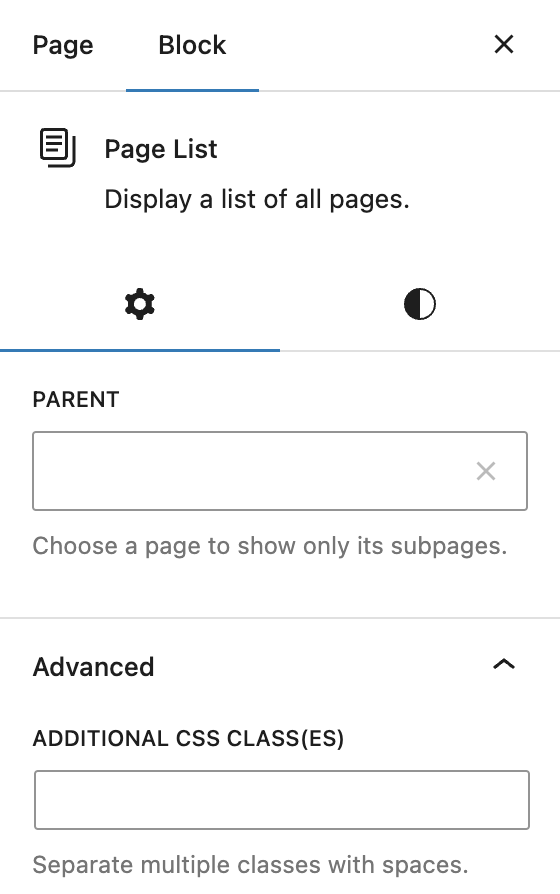

#### Parent

If you only want to list the child pages of any specific page, then select that parent page in this option. Start typing the page title and you will get the option to select.

#### Advanced

The Page List block provides the following Advanced settings options: HTML anchor, Additional CSS Class(es), Additional CSS, and Styles.

> [!NOTE]
> [Learn more about advanced settings](../block-editor/advanced-settings-overview.md)

### Styles

This block has only **Typography** settings under Styles

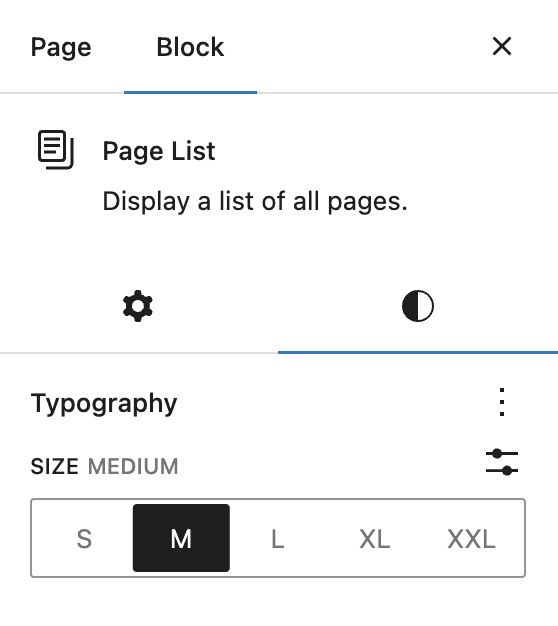

> [!NOTE]
> Read more about [Typography Settings](../block-editor/typography-settings-overview.md)

#### Dimensions

The Paragraph block provides various options to adjust its dimensions, such as width and height, allowing you to customize the text layout to ensure visual consistency.

> [!NOTE]
> For details refer to this support article: [Dimension settings overview](../block-editor/dimension-controls-overview.md)

#### Border

The Paragraph block provides border settings options to add border color, width, and radius.

> [!NOTE]
> For details refer to this support article: [Border settings overview](../block-editor/border-settings-overview.md)

## Changelog

-   Updated 2026-05-25 (props @kjoyner @awetz583)
    -   Updated “Advanced” section to refer to new overview page
-   Updated 2025-04-15 (props to [@karthickmurugan](https://profiles.wordpress.org/karthickmurugan/))
    -   Updated screenshots for 6.8
    -   Add Dimensions and Border sections.
-   Updated 2023-10-31
-   Updated 2023-08-04
-   Created 2022-12-12
