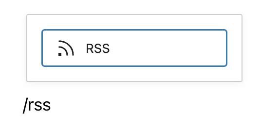
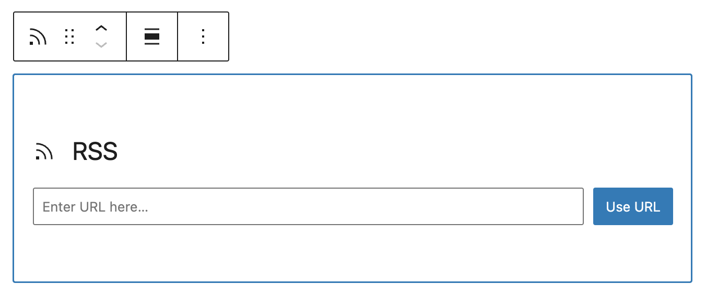
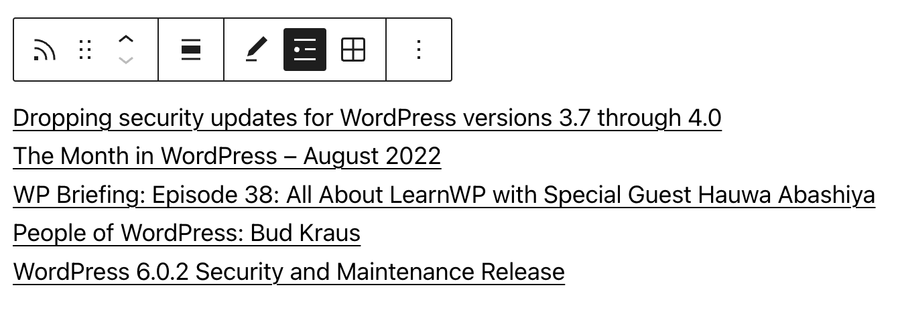
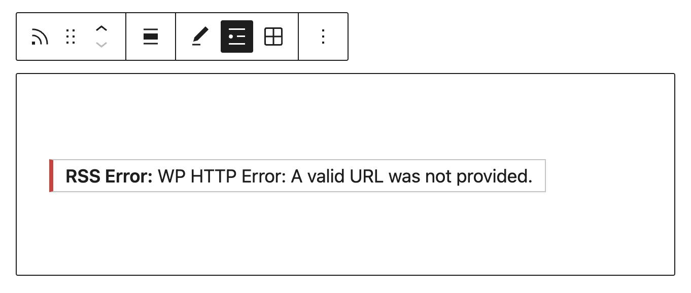
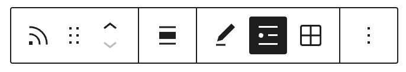
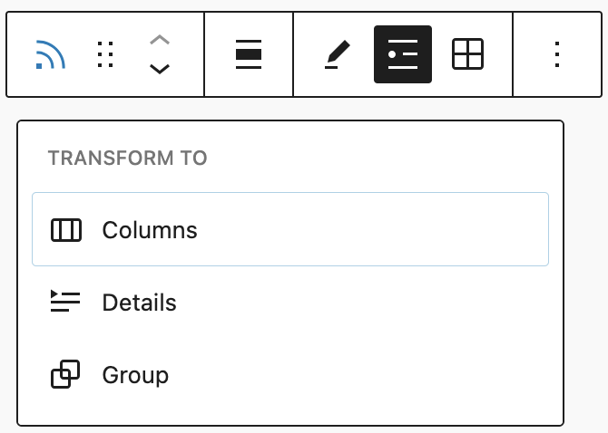
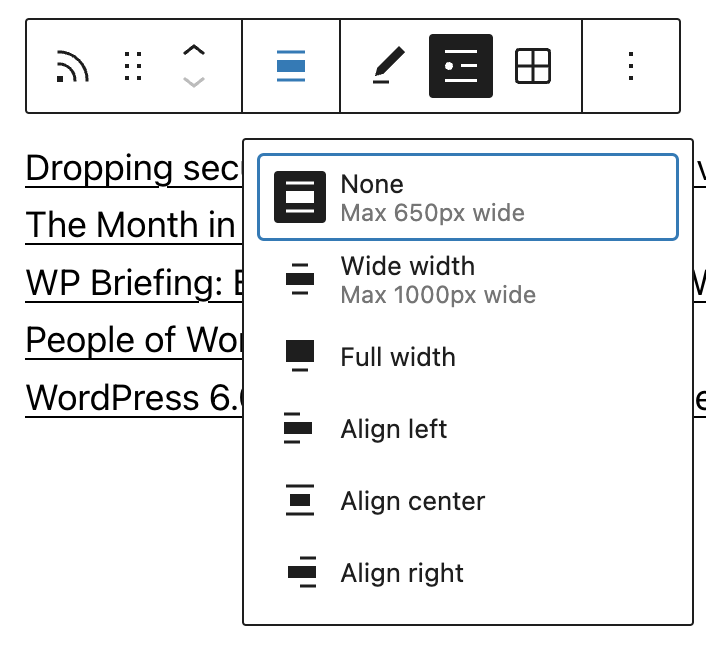
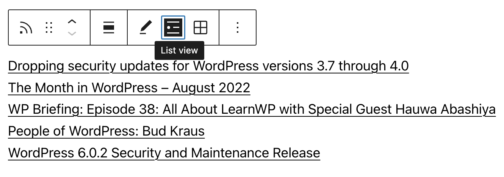
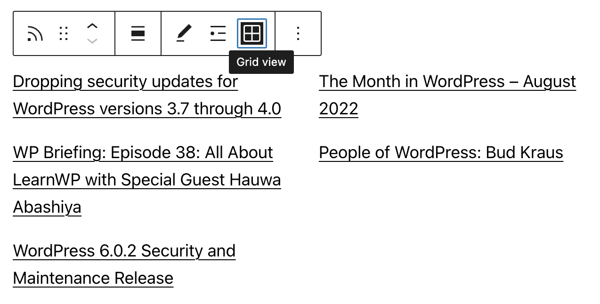
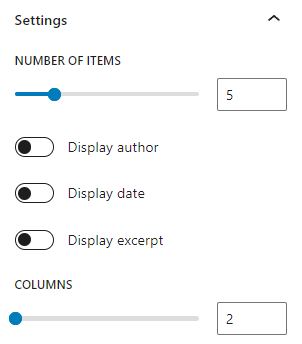

# RSS block

[Go back to the list of Blocks](../block-editor/blocks-list.md)

An RSS feed is a machine-readable version of the content of a blog or a website.

With the *RSS* block, you can display content from any site’s RSS feed on your website. You can choose to display the Title, Author, Date, and Excerpt for each item in the feed. You can display the items in a list or as a grid in a set number of columns.

<video controls preload="metadata" src="https://wordpress.org/documentation/files/2019/11/rss-overview.mp4"></video>

Steps to embed an RSS block

1.  First, you need to know the URL of the RSS feed that you want to embed. Some websites display an orange icon  with the link of the feed. You can usually find this icon together with social network icons. 
    Our example uses the feed of the [News](https://wordpress.org/news/) section on WordPress.org.  <https://wordpress.org/news/feed>

2.  Click the **Block Inserter** (+) icon to add an *RSS* block to your WordPress page/post. Alternatively, you can type <kbd>/rss</kbd> and hit enter in a new *paragraph block* to add one quickly.

> [!NOTE]
> [Detailed instructions on adding blocks](../block-editor/adding-a-new-block.md)

3.  Paste the link of the RSS feed into the text box and click on the **Use URL** button

The *RSS* block now displays the titles of the feed items.

If you use an URL that can’t be embedded, the block shows the message *“RSS Error: WP HTTP Error: A valid URL was not provided.”*.

Use the options in the **Block Toolbar** and the controls in the **Block Settings** panel in your editor’s sidebar to fine-tune the display.

## Block toolbar

Besides the *Mover* and *Drag & Drop* handle, the Block Toolbar for the *RSS* block shows six other buttons:

-   Transform To
-   Change alignment
-   Edit RSS URL
-   List view
-   Grid view
-   More options

### Transform to

You can transform the **RSS block** into **Columns, Details**, or a **Group** block to better suit your layout and design preferences:

-   **Group** – Wrap the RSS block in a Group to gain access to additional layout and styling options, such as background color, spacing, and borders.
-   **Columns** – Organize the RSS feed into multiple columns for a more structured, grid-like layout.
-   **Details** – Use the Details block to wrap the RSS content inside a collapsible section, helping manage long or dense feeds.

### Change alignment

-   **Align left** – Make the block left-aligned.
-   **Align center** – Make the block alignment centered.
-   **Align right** – Make the block right-aligned.
-   **Wide width** – Increase the width of the block beyond the content size.
-   **Full width** – Extend the block to cover the full width of the screen.

The “Wide width” and “Full width” alignment settings must be enabled by your WordPress theme.

### Edit RSS URL

Via the edit URL, you can change the RSS feed URL in the block. Overwrite the existing URL and click on the **Use URL** button.

### List view

The **List view** option displays the feed items in an unordered list. Use the Block settings controls to customize the **List view**.

### Grid view

Display the feed items in a grid. Use the Block settings controls to adjust the number of columns and the other display options.

### More options

These controls give you the option to copy, duplicate, and edit your block as HTML.

> [!NOTE]
> [Detailed instructions on adding blocks](../block-editor/adding-a-new-block.md)

## Block settings

Every block has specific options in the editor sidebar in addition to the options found in the block toolbar. If you do not see the sidebar, simply click the ‘cog’ icon.

### Settings

**Number of items**: Slider and number box to adjust the number of feed items you’d like to display. To change the number move the dot on the slider or update the number in the box next to it.

**Display author**: Switch on/off the display of the author’s name

**Display date**: Switch on/off the display of the published date of the feed items

**Display excerpt**: Switch on/off the display of an excerpt from the feed items’ content.

**Max number of words in excerpt**: Slider and number box to choose the maximum number of words that can be displayed in the excerpt. The minimum number is 10. This section is not visible if **Display excerpt** is in the OFF position.

**Columns**: Slider and number box to control the number of columns for the grid view. This option is only visible when you select the **Grid view** on the Block Toolbar.

### Dimensions

The *paragraph* block provides various options to adjust its dimensions, such as width and height, allowing you to customize the text layout to ensure visual consistency.

> [!NOTE]
> For details refer to this support article: [Dimension settings overview](../block-editor/dimension-controls-overview.md)

### Border

The Paragraph block provides border settings options to add border color, width, and radius.

> [!NOTE]
> For details refer to this support article: [Border settings overview](../block-editor/border-settings-overview.md)

### Advanced

The RSS block provides the following Advanced settings options: HTML anchor, Additional CSS Class(es), Additional CSS, and Styles.

> [!NOTE]
> [Learn more about advanced settings](../block-editor/advanced-settings-overview.md)

## Resources

-   [Learn more about RSS on Wikipedia](https://en.wikipedia.org/wiki/RSS)
-   [Learn more about WordPress Feeds](https://developer.wordpress.org/advanced-administration/wordpress/feeds/)

## Changelog

-   Updated 2026-05-25 (props @kjoyner @awetz583)
    -   Updated “Advanced” section to refer to new overview page
-   Update 2025-04-22 (props to [@karthickmurugan](https://profiles.wordpress.org/karthickmurugan/))
    -   Add Border and Spacing support.
    -   Add Dimensions support.
    -   Update screenshots and videos to 6.8.
    -   Add missing ALT tags.
    -   Update headings to sentence case.
-   Updated 2022-11-20
    -   Aligned images for mobile view
    -   Removed redundant content
    -   Added heading
-   Updated 2022-11-08
    -   Updated “RSS Settings” screenshot
-   Updated 2022-09-28
    -   Fixed font sizing under “Block Settings”
-   Updated 2022-09-12
    -   Video walkthrough created
    -   Updated with images from WordPress 6.0
    -   Added new “Transform to” setting (Column)
    -   Added “Lock” information under More Options
    -   Added ALT tags for the images
-   Updated 2022-02-08
    -   Update screenshots for 5.9
-   Updated 2020-08-17
    -   Converted More Options reusable block to regular blocks
-   Updated 2020-04-28
    -   changed category to “Widget Blocks”
    -   changed dates in Changelog to universal format
-   Updated 2020-04-18
    -   Converted reusable block to regular blocks
    -   Added to “Core Blocks” category
-   Updated: 2019-11-25
    -   change the first sentence and
    -   aligned images to the right of the text where it adds to readability
-   Created: 2019-11-23 / WordPress 5.3
