# Search block

[Go back to the list of **Blocks**](../block-editor/blocks-list.md)

Use the Search block to place a search widget on your page or post.

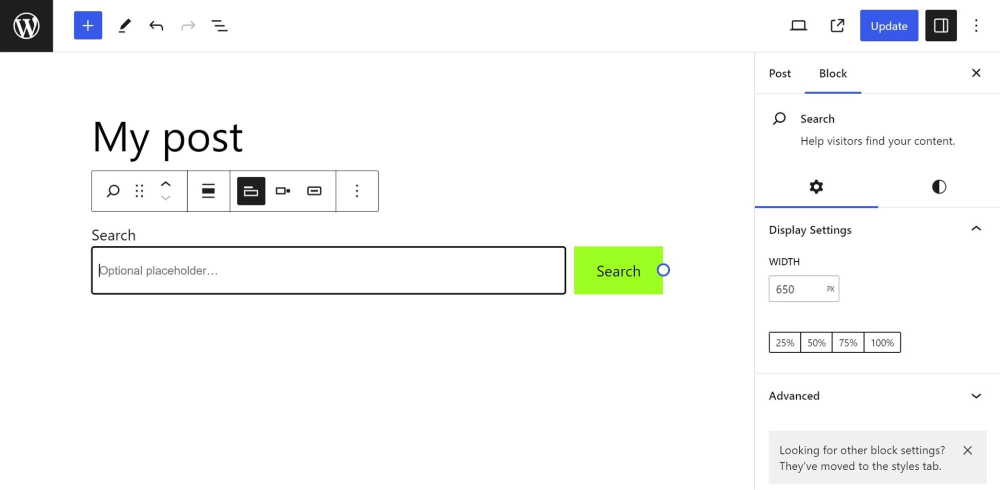

Click **Block inserter** (**+**) icon to open the block inserter pop-up window and search for the *Search block*.

<video controls preload="metadata" src="https://wordpress.org/documentation/files/2023/08/Loom-Message-5-August-2023.mp4"></video>

*Demonstration to add a search block*

You can also use the keyboard shortcut <kbd>/search</kbd> to quickly insert a *Search block*.

> [!NOTE]
> Detailed instructions on adding blocks can be found [here](../block-editor/adding-a-new-block.md).

## Block toolbar

To view the block toolbar, click on the block, and the toolbar will be displayed.

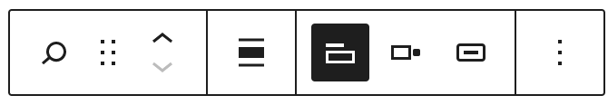

Every block comes with unique toolbar icons and blocks specific user controls that allow you to manipulate the block right in the editor.

The Search block shows standard eight buttons:

-   Transform to
-   Drag icon
-   Move handles
-   Change text alignment
-   Toggle search label
-   Change button position
-   Use button with Icon
-   More options

### Adding placeholder text

When you add a Search block, you have an option to add placeholder text inside the search field. The placeholder text is displayed until the user starts typing in a search term in the search field.

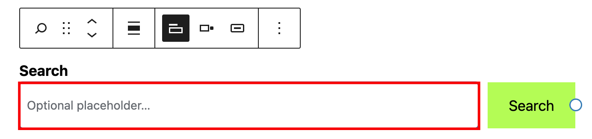

### Transform to

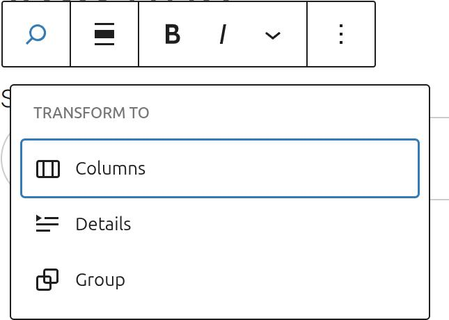

When you click on the **Transform** button you can convert the *Search block* into another block type while keeping the existing content.

Click on the **Transform** button to convert the Search block into a *Columns*, *Details* or *Group* block. *Group* block gives you the ability to change the background color around the *Search block*.

### Drag icon

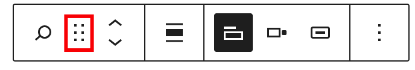

To drag and drop the block to a new location on the page template, click and hold the **drag** icon, then drag it to the new location. The blue separator line indicates where the block will be placed. Release the left mouse button when you find the new location to place the block.

### Move arrows

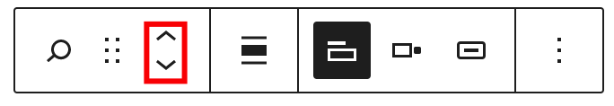

The **up** and **down** arrow icons can be used to shift a block up and down on the page.

> [!NOTE]
> Detailed instructions on moving a block within the editor can be found [here](../block-editor/moving-blocks.md)

### Change text alignment

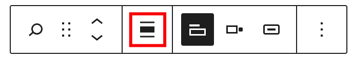

Use the change alignment tool to align the *Search block*. The following is a list of the block align options:

-   None
-   **Align left** – Make the block left-aligned.
-   **Align center** – Make the block alignment centered.
-   **Align right** – Make the block right aligned.

### Toggle search label

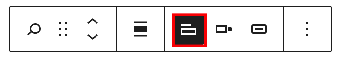

This button can be used to hide the search field label.

### Change button position

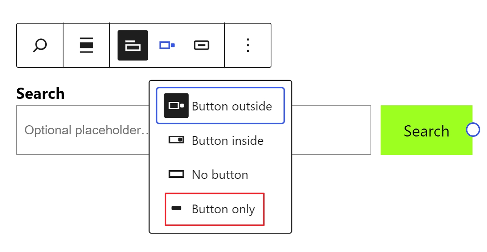

This button can be used to change the position of the search button. There are three options to choose from:

-   **Button outside** – the default setting.
-   **Button inside** – the search button is part of the search text field.
-   **No button** – removes the Search button and only displays the Search text field on the page.
-   **Button only** – displays only the Search button and hides the Search input text field

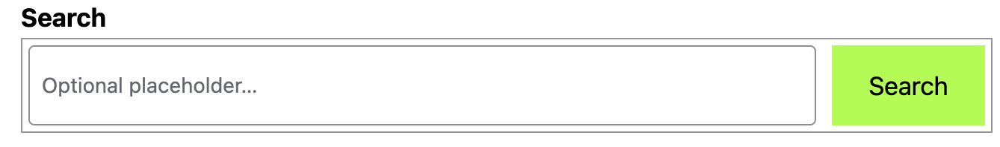

*Button inside setting*

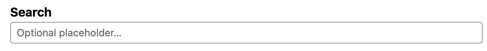

*No button setting*

*Button only setting*

### Use button with icon

The search button can be either text or icon.

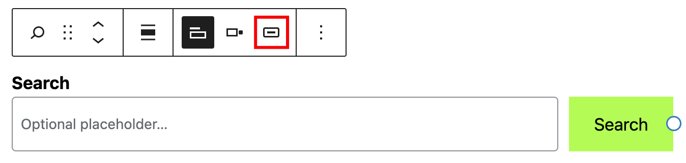

*Search button with text*

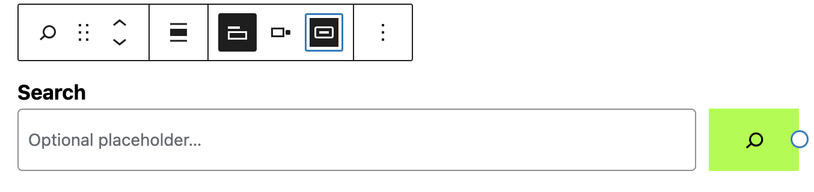

*Search button with icon*

Clicking on the Search button or the Search title in the search block will display three more buttons in the Block Toolbar – Bold, Italic and More Rich Text controls.

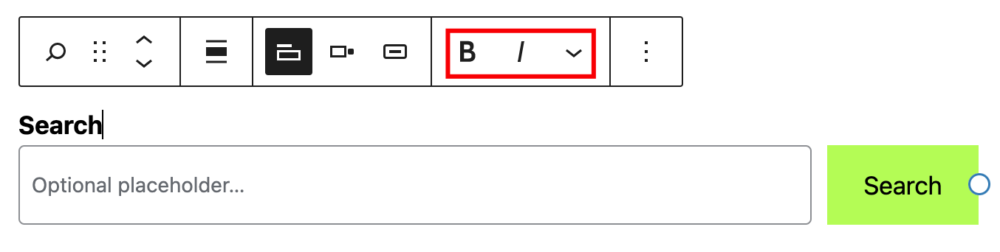

### Bold

You can select the text in the Search title or the Search button and use the **Bold** option or <kbd>Ctrl+B</kbd> / <kbd>Cmd+B</kbd> on your keyboard to bold it, which is usually heavier than the surrounding text.

### Italic

You can select the text in the Search title or the Search button and use the **Italic** option or <kbd>Ctrl+I</kbd> / <kbd>Cmd+I</kbd> on your keyboard to italicize it, which usually appears slanted to the right.

### More rich text options

The drop-down menu to the left of the [More options menu](../block-editor/more-options.md) contains a range of additional rich text editing options such as highlighting, inline code, strikethrough, and more.

> [!NOTE]
> [Read about more rich text editing options.](../block-editor/more-text-editing-overview.md)

### More options

The Options menu represented by three vertical dots on the far right of the toolbar gives you more features such as the ability to duplicate or remove the block.

> [!NOTE]
> [Read about these and other settings.](../block-editor/more-options.md)

## Block settings

The block settings panel contains customization options specific to the block. To open it, select the block and click the **Settings** icon next to the **Publish** button.

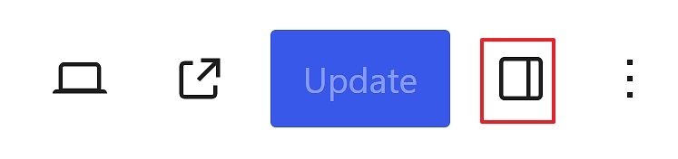

### Display settings

It’s possible to adjust the **Search** block width with the help of the Display Settings:

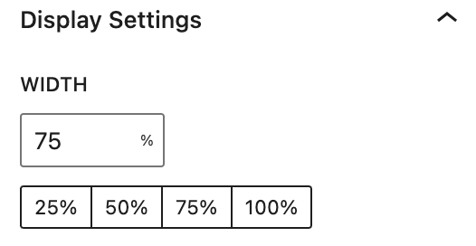

Alternatively, you can drag the block itself with your mouse:

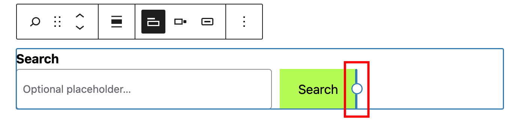

### Color

The **Search** block provides Color settings options to change the text and background colors.

> [!NOTE]
> For details, refer to this support article: [Color settings overview](../block-editor/colors-settings-overview.md)

### Typography

The **Search** block provides typography settings to change the font family, size, appearance, line height, letter case, letter spacing, and decoration.

> [!NOTE]
> For details, refer to this support article: [Typography settings overview](../block-editor/typography-settings-overview.md)

### Border

The **Search** block provides border settings options to change border and radius size.

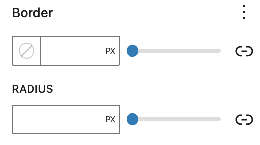

> [!NOTE]
> For details, refer to this support article: [Border settings overview](../block-editor/border-settings-overview.md)

### Dimensions

The **Search** block provides dimension settings options to change padding and margin size.

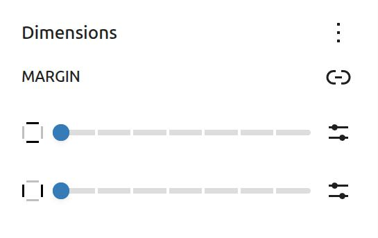

> [!NOTE]
> For details, refer to this support article: [Dimension settings overview](../block-editor/dimension-controls-overview.md)

### Advanced

The Search block provides the following Advanced settings options: HTML anchor, Additional CSS Class(es), Additional CSS, and Styles.

> [!NOTE]
> [Learn more about advanced settings](../block-editor/advanced-settings-overview.md)

## Changelog

-   Updated 2026-04-22
    -   Add dimension support since 6.7 – (rollybueno)
    -   Updated “Transform to” screenshot – (rollybueno)
-   Updated 2023-08-24
    -   Updated screennshots and videos for 6.3
-   Updated 2023-06-20
    -   Updated rich text options section
-   Updated 2023-02-07
    -   Updated screenshots
    -   Fixed formatting
-   Updated 2022-11-26
    -   Removed redundant content
-   Updated 2022-06-16
    -   Updated screenshots, added video for 6.0
    -   Updated content for 6.0
    -   Added ALT tags for images
-   Updated 2022-06-06
    -   Update settings screenshot for 6.0
    -   Add “Use button with icon” section
-   Updated 2022-02-04
    -   Updated screenshots to 5.9
-   Created 2020-12-03
