# Social Icons block

[Go back to the list of Blocks](../block-editor/blocks-list.md)

The Social Icons block allows you to add icons linking to your social media profiles or sites. This helps to increase the visibility of your social media profiles and drive traffic to them. You can add icons to a page, post or a site-wide template or pattern using the [Site editor](../appearance/site-editor.md).

<!-- VideoPress embed (iframe removed): https://videopress.com/embed/NWPtz7kp -->

https://videopress.com/v/NWPtz7kp

## Add a Social Icons block

To add the Social Icons block, click the **+ Block Inserter** button in the top-left corner of the editor. Search for the Social Icons block and click on the block to add it to the page.

You can also type <kbd>/social icons</kbd> and hit enter in a new paragraph block to quickly insert a Social Icons block.

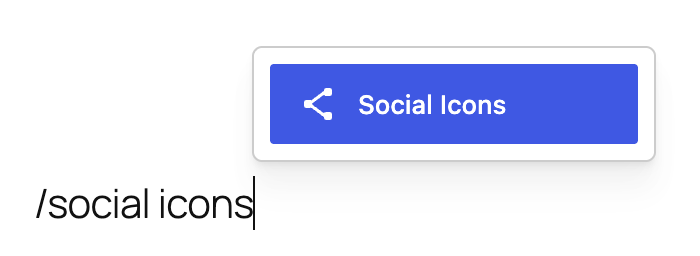

> [!NOTE]
> [Detailed instructions on adding blocks.](../block-editor/adding-a-new-block.md)

Once you add the Social Icons block, you will see the following placeholder where you can add social icons.

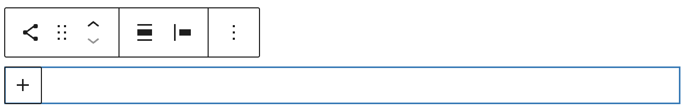

## How to add icons and links

1.  Select the Social Icons block and click on the (+) button to show the list of available social media platforms.

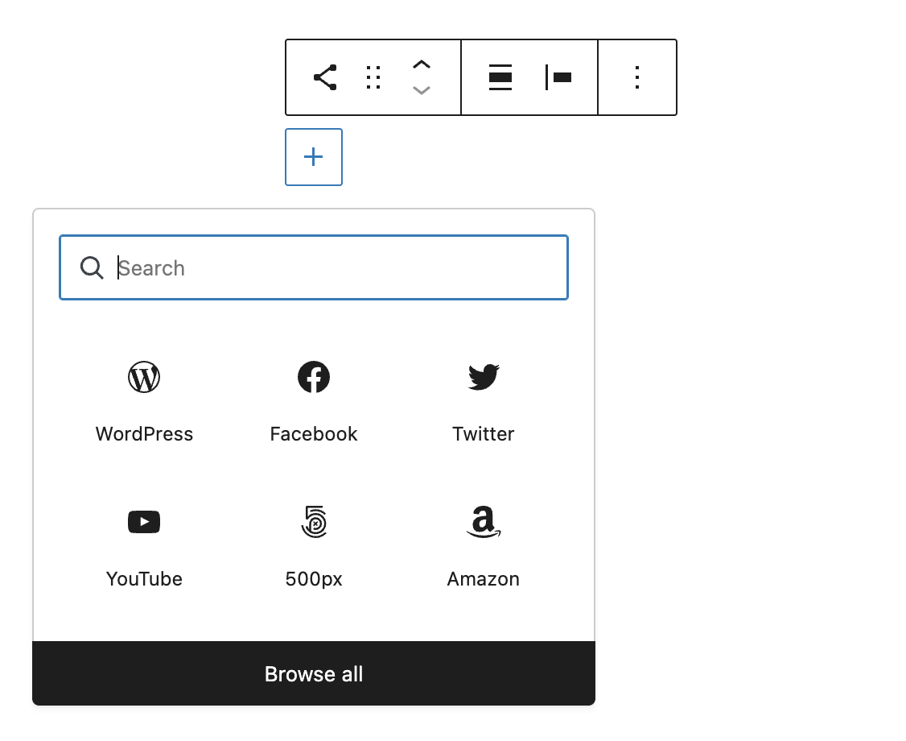

2.  If you do not find the platform you are looking for in the menu, type the name of the platform in the search box or choose the Browse all button.

3.  Select the icon from the menu to add it to the Social Icons block.

4.  Click on the icon within the block to show the URL input field.

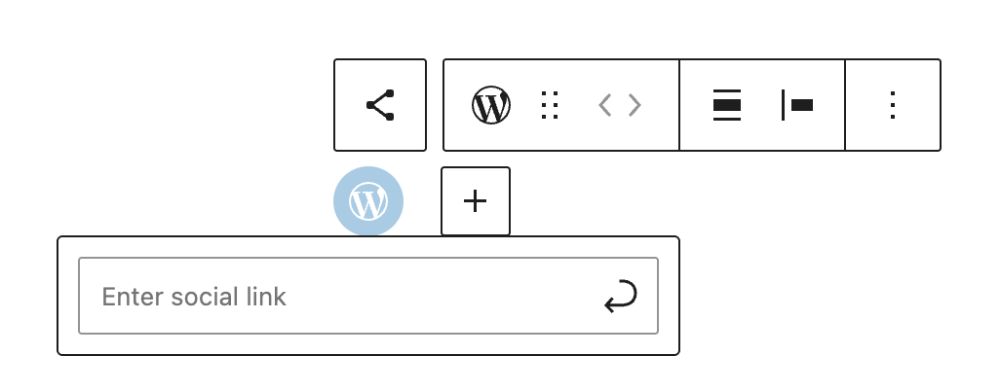

5.  Add the URL for the social media profile in the input field and press <kbd>Enter</kbd>. If omitted, WordPress will automatically set the default protocol to `https`.

6.  Repeat these steps for each of the social media profiles you want to add.

**Note**: when adding email icon you only need to enter an email address. WordPress will automatically create link which will, when clicked on, open new email screen in email client.

## Available social media icons

-   WordPress
-   500px
-   Amazon
-   Bandcamp
-   Behance
-   Bluesky
-   Link
-   CodePen
-   DeviantArt
-   Discord
-   Dribbble
-   Dropbox
-   Etsy
-   Facebook
-   RSS Feed
-   Flickr

-   Foursquare
-   Goodreads
-   Google
-   GitHub
-   Gravatar
-   Instagram
-   Last.fm
-   LinkedIn
-   Mail
-   Mastodon
-   Meetup
-   Medium
-   Patreon
-   Pinterest
-   Pocket
-   Reddit

-   Snapchat
-   SoundCloud
-   Spotify
-   Telegram
-   Threads
-   TikTok
-   Tumblr
-   Twitch
-   Twitter
-   Vimeo
-   VK
-   WhatsApp
-   X
-   Yelp
-   YouTube

## Block toolbars

Each block has its own block-specific controls that allow you to manipulate the block right in the editor.

The Social Icons block has two toolbars:

-   The parent toolbar that appears when you select the Social Icons block
-   A second toolbar appears when you select an individual Social Icon inside the parent block

### Social Icons block toolbar

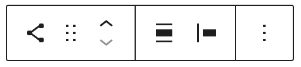

#### Transform to

You can transform the Social Icons block into a Group or Columns. You can also transform the style of the Social Icons block. There are three styles available: **Default**, **Logos only**, and **Pill Shape**. Your theme may have different style variations available for this block.

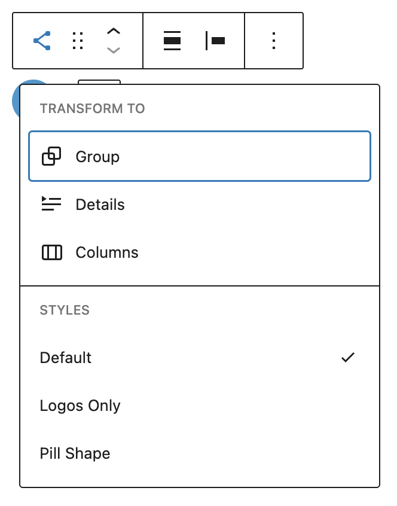

#### Block moving tools

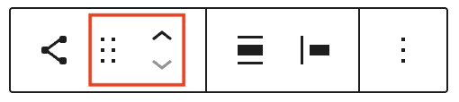

The block-moving tools allow you to move the block in the editor. Use the six dots icon to drag and drop the block and place it anywhere on the page. Alternatively, click on the up and down arrows to move the block up or down.

> [!NOTE]
> [Get more information about moving a block within the editor.](../block-editor/moving-blocks.md)

#### Align

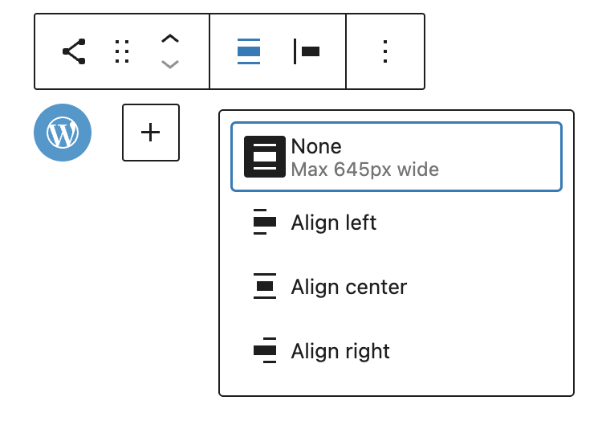

Using the alignment drop-down from the toolbar, you can align the block to the left, make it center-aligned, or align it to the right.

#### Change items justification

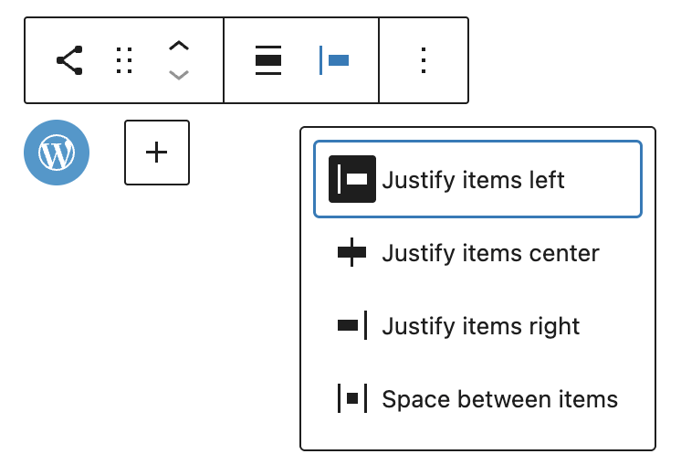

The items justification setting allows justifying the icons to the left, center, or right. There is also an option to “Space between items”. If it is selected, the Social Icons will appear with equal spacing between them.

#### More options

These controls give you the option to copy, duplicate, and edit your block as HTML.

> [!NOTE]
> [Read about these and other settings.](../block-editor/more-options.md)

### Individual icon block toolbar

The toolbar that appears when you press on the individual icons has four buttons:

#### Select Parent Block: Social Icons

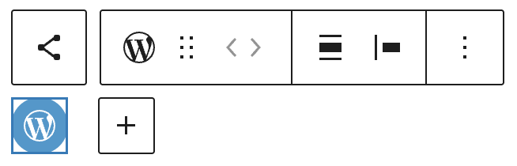

This will take you to the parent Social Icons block toolbar.

#### Transforms

There are no transforms for individual Social Icon blocks

#### Block moving tools

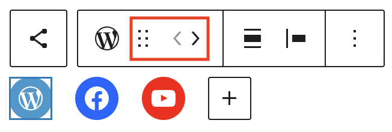

The block-moving tools allow you to move the block in the editor. Use the six dots icon to drag and drop the Social Icon inside the Social Icons Block. Alternatively, click on the left and right arrows to move the Social Icon horizontally.

> [!NOTE]
> [Get more information about moving a block within the editor.](../block-editor/moving-blocks.md)

#### Align and Justify buttons

If you make changes to the align and justify buttons at the Social Icon level, the settings will be applied to the Social Icons block (parent block). [See align and justify button descriptions above.](#align)

#### More options

The More options menu represented by three vertical dots on the far right of the toolbar gives you more features such as the ability to duplicate or remove the block.

> [!NOTE]
> [Read about these and other settings.](../block-editor/more-options.md)

## Block settings

Every block has specific options in the editor sidebar in addition to the options found in the block toolbar. If you do not see the sidebar, click on the **Settings button** next to the Save/Publish button.

The Social Icons block settings panel is divided into three tabs – **List View**, **Settings**, and **Styles**.

### List View

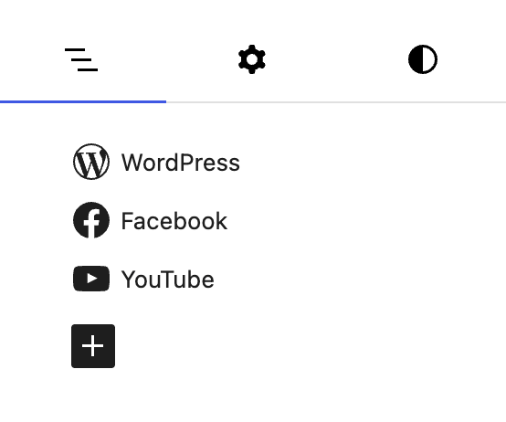

The **List view tab**, represented by three horizontal lines, allows you to re-order social icons within the Social Icons block.

> [!NOTE]
> [Learn more about options and settings available in list view.](../block-editor/list-view.md)

### Settings

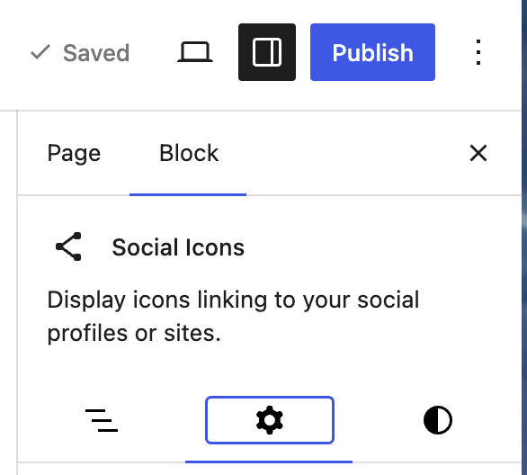

When you select the Social Icons block **Settings tab**, represented by a gear icon, you will see the following settings in the sidebar:

#### Layout

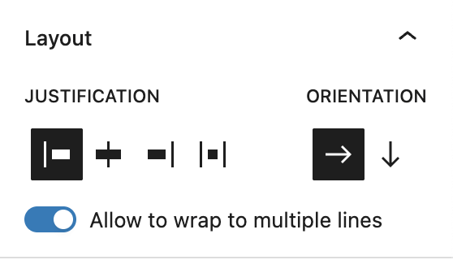

**Justification** – allows you to move the block to the left, right or center. You can also choose space between items to distribute space between Social Icons equally.

**Orientation** – allows you to change the horizontal list of icons into a vertical format

**Allow to wrap multiple lines toggle** – this setting helps ensure the block works on a small screen, especially when a Social Icon block has many icons

**Icon size** – Choose the size you wish your icons to display

**Show text toggle** – Choose to show or hide the labels for the Social Icons

**Open links in a new tab toggle** – Control whether the linked profile will open in a new browser tab or not.

#### Advanced

The Social Icons block provides the following Advanced settings options: HTML anchor, Additional CSS Class(es), Additional CSS, and Styles.

> [!NOTE]
> [Learn more about advanced settings.](../block-editor/advanced-settings-overview.md)

### Styles

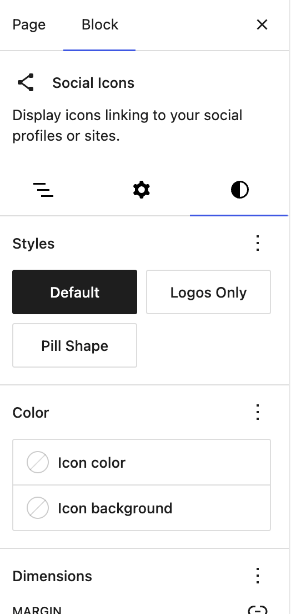

When you click on the **Styles tab**, represented by a half-filled circle, within the Block Settings sidebar, you will see the following options:

#### Styles

It’s possible to change the individual button style depending on your theme. Hover over a particular style to see how a style such as fill or outline will look.

#### Color

Default icons have their respective brand colors. With the Color settings, you can change the background and foreground color for all icons in the block to match your website branding. Pick a color from the suggestions, or add a custom color using the color picker or by adding a color code.

> [!NOTE]
> [See this guide for more information about changing colors.](../block-editor/colors-settings-overview.md)

#### Dimensions

Dimension controls are used to control how groups of blocks are placed alongside one another, by changing the values for padding, margin, and other dimensions

> [!NOTE]
> [Learn more about dimension controls.](../block-editor/dimension-controls-overview.md)

#### Border

The Social Icons block provides border settings options to add border color, width, and radius. If there are custom border settings, custom border will be visible on image placeholder.

> [!NOTE]
> [Learn more about border and shadow settings.](../block-editor/border-settings-overview.md)

### Individual icon settings

When you select an individual icon within the Social Icons block, you will see a set of Settings to apply only to that selected social icon.

#### Text

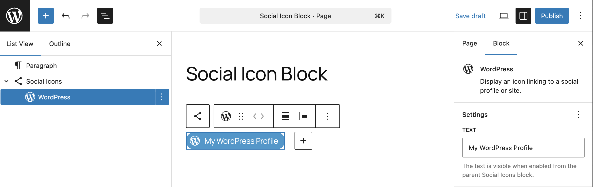

You can customize the text label for buttons by choosing an individual Social Icon and adding your prefered text into the the settings box.

#### Advanced

Each individual social icon within the Social Icons block provides the following Advanced settings options: HTML anchor, Additional CSS Class(es), Additional CSS, and Styles.

> [!NOTE]
> [Learn more about advanced settings.](../block-editor/advanced-settings-overview.md)

## Changelog

-   Updated 2027-07-21 (props @awetz583, @adrianpiedra @atachibana)
    -   Updated screenshots and video for 7.0
-   Updated 2026-05-25 (props @kjoyner @awetz583)
    -   Updated “Advanced” section to refer to new overview page
-   Updated 2026-04-17 (props to @n8finch @awetz583 @bobmatyas @cgarofalo @PaulHHM)
    -   Added border support
    -   Updated video, images, and block toolbar and block settings information to 6.9
-   Updated 2026-04-06 (props to @smithkyle45 @amitraj2203 @awetz583)
    -   Updated list of supported embeds to include Bluesky, Discord, Gravatar, Threads, X and remove Skype
-   Updated 2025-06-05 (props to [@rollybueno](https://profiles.wordpress.org/rollybueno/))
    -   Update screenshots to 6.8
-   Updated 2023-06-15
    -   Add Link rel section and screenshot.
    -   Add alpha filter section for color setting.
    -   Add background color section for color settings.
    -   Add note about automatic linking email addresses for the email icon.
    -   Add not about `https` being default protocol if not specified.
    -   Add WhatsApp to available social media icons list.
    -   Add video for block styles preview on hover.
    -   Update screenshots to 6.2 version.
    -   Reorder sections to match new order in screenshots.
-   Updated 2022-11-22
    -   Removed redundant content
    -   aligned images for mobile view
-   Updated 2022-08-17
    -   Added screenshots for 6.0
    -   Updated content for 6.0 – Change items justification, block settings items, dimension control
    -   Added ALT tags for the images
    -   Reformatted the article, corrected spellings
    -   Converting Reusable blocks to regular block
-   Updated 2022-03-01
    -   Add icon sizes
    -   Add icon background and foreground color
    -   Add justification settings
-   Updated 2022-02-28
    -   Add Available icons section
-   Updated 2022-02-24
    -   Update screenshots for 5.9
-   Created 2020-11-13
