# Buttons block

Use the Buttons block to add one or more buttons to your page or post.

<video controls preload="metadata" src="https://wordpress.org/documentation/files/2021/10/buttons-Kapture-2026-04-08-at-14.15.17.mp4"></video>

## Add a Button block

To add the Buttons block to a page, click the **+ Block Inserter** button in the top-left corner of the editor and choose the Buttons block.

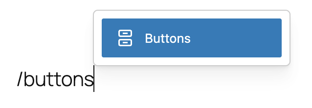

You can also type <kbd>/buttons</kbd> and hit enter in a new paragraph block to quickly insert a Buttons block.

> [!NOTE]
> [Detailed instructions on adding blocks.](../../working-with-blocks/adding-a-new-block.md)

The Buttons block comes with one individual button block by default. You can customize the text, link, and style for this button. To add more buttons, click the plus **Add block** button in the bottom right corner within the Buttons block, and a new button will appear. Note that the new button will follow the same style as the existing button.

## Block toolbar

To view the block toolbar, click on the block, and the toolbar will be displayed.

Every block comes with unique toolbar icons and blocks specific user controls that allow you to manipulate the block right in the editor.The Buttons block has a toolbar for the individual button and a toolbar for the entire block.

### For the entire block

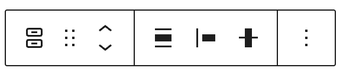

The main toolbar for the entire block has the following buttons:

-   Transform to
-   Move controls
-   Change items justification
-   Change vertical alignment
-   Align
-   Options

#### Transform to

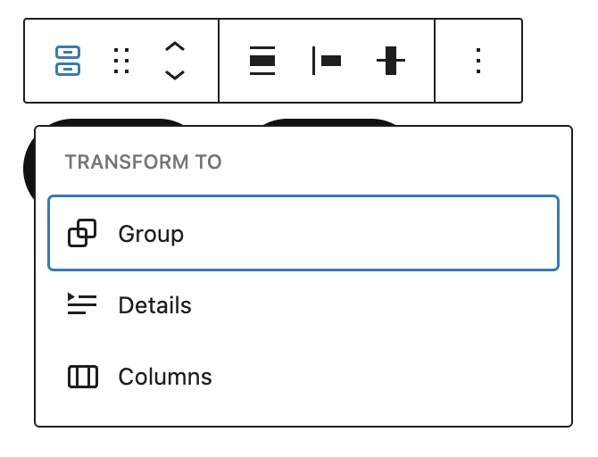

Click on the Transform button to convert the Buttons block into a Group, Details or Columns block.

#### Move tools

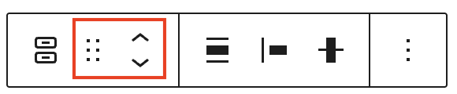

Use the block-moving tools to move the Buttons block.

The **drag** or **six dots** icon allows you to freely reposition the block anywhere within the editor by holding the icon and dragging it to the new location.

You can also use the **arrow icons** to move the block up or down within the group of nested blocks or when there are multiple blocks.

> [!NOTE]
> [Get more information about moving a block within the editor.](../../working-with-blocks/moving-blocks.md)

#### Align

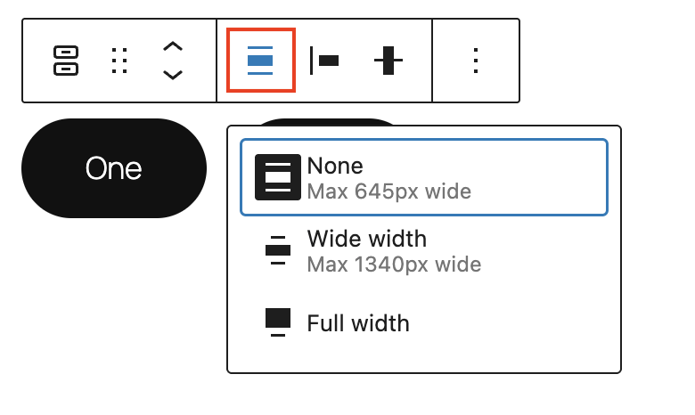

Use the change alignment tool to align the Buttons block. Choose one of the following options:

-   None – leaves the block the current size.
-   Wide width – increase the width of the block beyond the content size.
-   Full width – extend the block to cover the full width of the screen.

The Wide width and Full width alignment settings must be enabled by your WordPress theme.

#### Change items justification

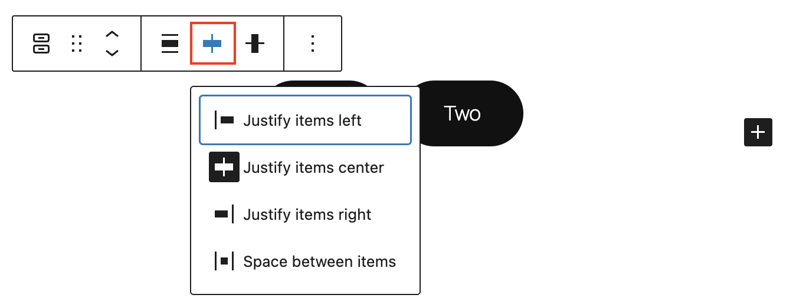

The items justification setting allows justifying the buttons to the left, center, or right. There is also an option to “Space between items”. If it is selected, the Buttons block will be centered with equal spacing between the buttons.

#### Change vertical alignment

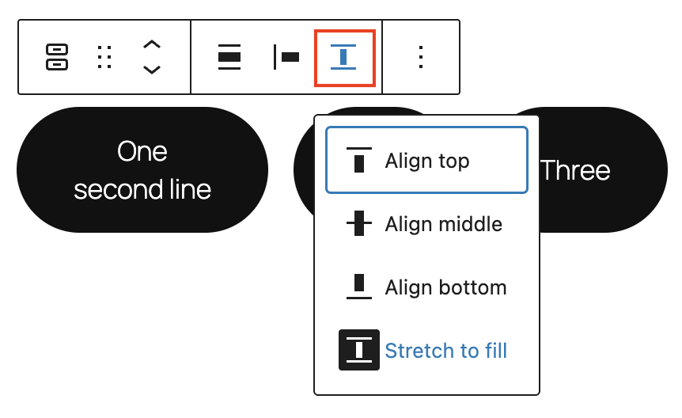

Use the change vertical alignment option to align buttons vertically with four possible options:

-   Align top
-   Align middle
-   Align bottom
-   Stretch to fill

#### More options

The [More Options menu](../../working-with-blocks/more-options.md) represented by **three vertical dots on the far right of the toolbar** gives you more features such as the ability to duplicate or remove a block.

> [!NOTE]
> [Read about these and other settings.](../../working-with-blocks/more-options.md)

### For an individual button

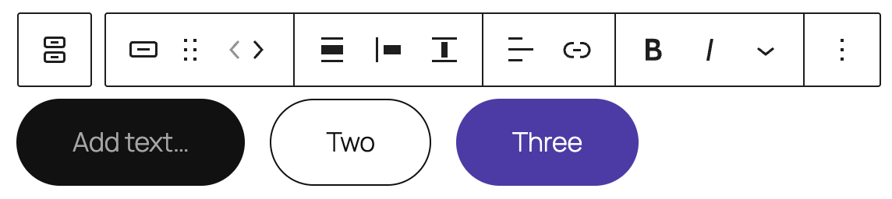

If you select a specific button, a new toolbar will appear with these new options:

-   Change block style
-   Block-moving tools
-   Align block
-   Justification
-   Vertical alignment
-   Align text
-   Link
-   Bold
-   Italic
-   More Rich Text controls
-   Options

#### Change block style

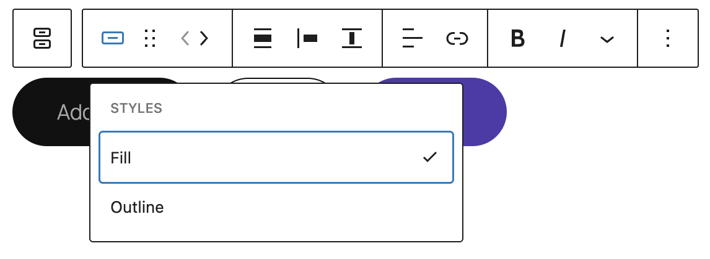

Use the change block style option to change the style of a particular button.

#### Link

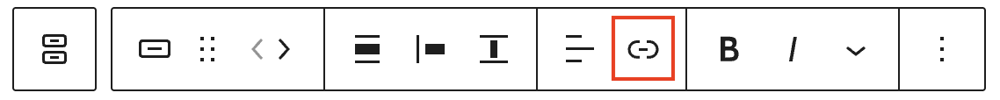

Use the link option to add a link to the button. It’s also possible to set it to open the link in a new tab

> [!NOTE]
> [Read about more link editing options.](../../working-with-blocks/link-editing.md)

#### Bold and Italics

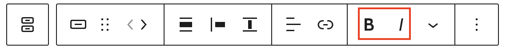

You can select the text of the block and use the “Bold” option or “Ctrl+B” / “Cmd+B” on your keyboard to bold it, which is usually heavier than the surrounding text.

You can select the text of the block and use the “Italic” option or “Ctrl+I” / “Cmd+I” on your keyboard to italicize it, which usually appears slanted to the right.

#### More rich text options

The drop-down menu to the left of the [More options menu](../../working-with-blocks/more-options.md) contains a range of additional rich text editing options such as highlighting, inline code, strikethrough, and more.

> [!NOTE]
> [Read about more rich text editing options.](../../working-with-blocks/more-text-editing-overview.md)

#### More options

The [More Options menu](../../working-with-blocks/more-options.md) represented by **three vertical dots on the far right of the toolbar** gives you more features such as the ability to duplicate or remove a block.

> [!NOTE]
> [Read about these and other settings.](../../working-with-blocks/more-options.md)

## Block settings

Every block has specific options in the editor sidebar in addition to the options found in the block toolbar. If you do not see the sidebar, click on the **Settings button** next to the Save/Publish button.

The Buttons block settings panel is divided into three tabs – **List View**, **Settings**, and **Styles**.

### List View

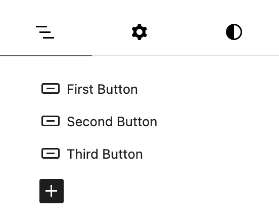

The **List view tab**, represented by three horizontal lines, allows you to re-order single Button blocks within the Buttons block.

> [!NOTE]
> [Learn more about options and settings available in list view.](../../working-with-blocks/list-view.md)

### Settings

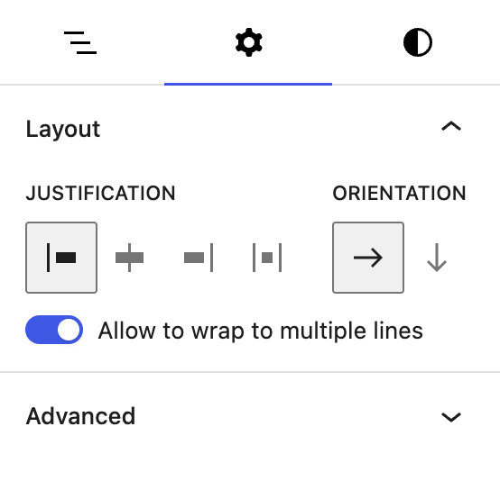

When you select the **Settings tab**, represented by a gear icon, you will see the following settings in the sidebar:

#### Layout

The Buttons block provides layout settings to change item justification and orientation.

There is also an option to un-toggle “Allow to wrap to multiple lines” to keep all of the buttons in one horizontal line even on smaller viewports such as mobile.

> [!NOTE]
> [This article provides details about layout settings.](../../working-with-blocks/block-settings/layout-settings-overview.md)

#### Advanced

The Buttons block provides the following Advanced settings options: HTML anchor, Additional CSS Class(es), Additional CSS, and Styles.

> [!NOTE]
> [Learn more about advanced settings](../../working-with-blocks/block-settings/advanced-settings-overview.md)

### Styles

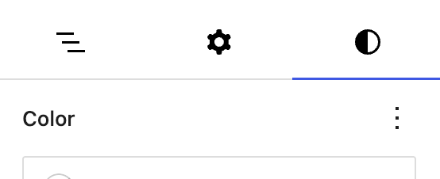

When you click on the **Styles tab**, represented by a half-filled circle, within the Block Settings sidebar, you will see the following options:

#### Color

The Buttons block provides Color settings options to change the background colors.

> [!NOTE]
> [See this guide for more information about changing colors.](../../working-with-blocks/block-settings/colors-settings-overview.md)

#### Typography

The Buttons block provides typography settings to change the font family, size, appearance, line height, letter case, letter spacing, and decoration.

> [!NOTE]
> [Get more details about changing typography settings.](../../working-with-blocks/block-settings/typography-settings-overview.md)

#### Dimensions

The Buttons block provides dimensions settings options to change padding and margin size.

> [!NOTE]
> [Learn more about dimension controls.](../../working-with-blocks/block-settings/dimension-controls-overview.md)

#### Border

Border settings provide options to control the width and radius for the Buttons block.

> [!NOTE]
> [Learn more about border settings.](../../working-with-blocks/block-settings/border-settings-overview.md)

## Individual Button block settings

When an individual button is selected there are several settings and styles you can apply.

### Interactive states

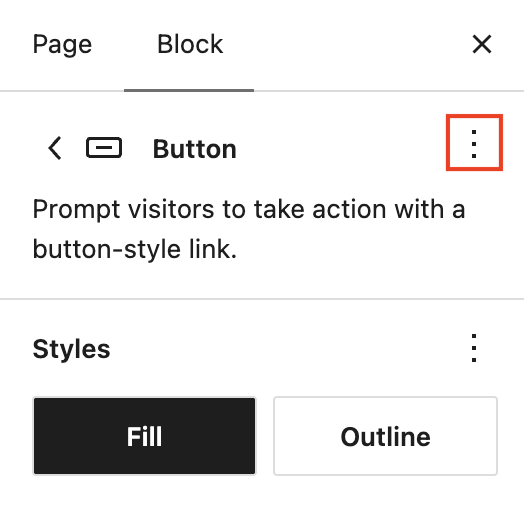

Interactive states let you give a single button its own hover, focus, and active styles. With interactive states you can style one button’s hover appearance without affecting the others.

When a button is selected, a state selector appears at the top of the block settings sidebar, in the block card header. Use it to switch between the default state and the interactive states:

-   **Hover** – how the button looks when a visitor moves their pointer over it.
-   **Focus** – how the button looks when it is focused, for example when a visitor tabs to it with the keyboard.
-   **Active** – how the button looks while it is being pressed.

#### Set styles for a state

1.  Select the button you want to style.
2.  Open the state selector in the block settings header and choose a state, such as **Hover**.
3.  Adjust the styles for that state. The same style panels available for the default state can be set per state: Color, Background, Typography, Border, and Dimensions.
4.  Switch back to the default state, or to another state, to continue editing.

The styles you set apply only to the selected state, and only to that individual button. Resetting the styles for one state leaves the button’s other states unchanged.

#### Show state on canvas

A **Show state on canvas** toggle is turned on by default. While it is on, the editor previews the selected state’s styles live on the canvas, so you can see the hover, focus, or active appearance without having to hover or focus the button yourself. Turn it off to view the button in its default state while you keep editing.

When you save and view the post, the state styles apply only to the button you set them on. Other buttons on the page keep their own styling.

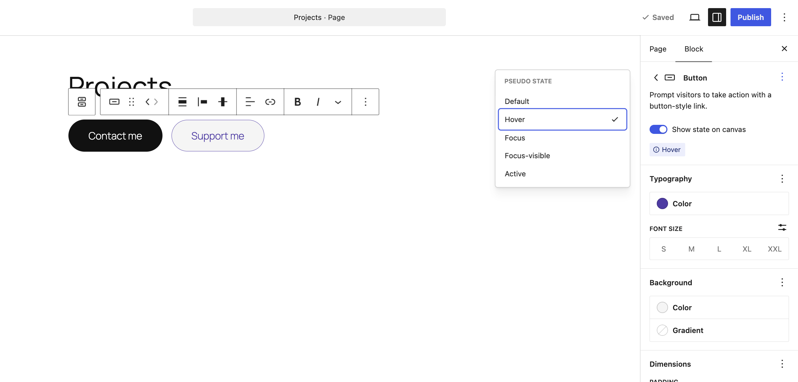

### Styles

It’s possible to change the individual button style depending on your theme. Hover over a particular style to see how a style such as fill or outline will look. Style options may be different depending on your theme.

### Typography

The Button block provides typography settings to change the font family, size, appearance, line height, letter case, letter spacing, and decoration.

> [!NOTE]
> [Get more details about changing typography settings.](../../working-with-blocks/block-settings/typography-settings-overview.md)

### Color

The Button block provides Color settings options to change the text and background colors and apply a background gradient.

> [!NOTE]
> [See this guide for more information about changing colors.](../../working-with-blocks/block-settings/colors-settings-overview.md)

### Dimensions

The Button block provides dimensions settings options to change the padding and margin size.

> [!NOTE]
> [Learn more about dimension controls.](../../working-with-blocks/block-settings/dimension-controls-overview.md)

### Border & Shadow

Border settings provide options to control the width and radius for the Button block. You can also apply a shadow.

> [!NOTE]
> [Learn more about border & shadow settings.](../../working-with-blocks/block-settings/border-settings-overview.md)

### Advanced settings

The Button block provides the following Advanced settings options: HTML anchor, Additional CSS Class(es), Additional CSS, HTML element, Link relation, and Styles.

Use the **Link relation** setting to add a `rel` attribute to the button link. This tells browsers and search engines what the relationship is between your page and the page you are linking to.

To learn more about common values, such as `nofollow`, `noopener`, and `noreferrer`, refer to [MDN’s documentation on the rel attribute](https://developer.mozilla.org/en-US/docs/Web/HTML/Reference/Attributes/rel).

> [!NOTE]
> [Learn more about advanced settings](../../working-with-blocks/block-settings/advanced-settings-overview.md)

## Changelog

-   Updated 2026-08-26 (props @rajat1192)
    -   Width settings moved under dimensions for individual buttons
    -   Settings and style panels combined for individual buttons in 7.1
-   Updated 2026-08-18 (props @annezazu @clk87)
    -   Added pseudo state support information.
-   Updated 2026-07-23 (props @awetz583)
    -   Added Settings list view tab
-   Updated 2026-05-25 (props @kjoyner @awetz583)
    -   Updated “Advanced” section to refer to new overview page
-   Updated 2026-04-08 (props to @karks88 @zunaid321 @ShatilKhan @lumiblog @karthickmurugan @awetz583)
    -   Added shadow setting for button block
    -   Updated images and video
-   Updated 2025-12-02
    -   Added HTML Element under Advanced section (props to @annezazu)
-   Updated 2023-11-21
    -   Updated screenshots for 6.4
-   Updated 2023-11-11
    -   Updated title in sentence case
-   Updated 2023-06-09
    -   Replaced “More rich text options” section with short summary linking to new dedicated page for rich text editing options.
-   Updated 2023-03-07
    -   Revised formatting for the whole article
    -   Updated content and all screenshots for 6.2
-   Updated 2022-11-22
    -   Change alignment for images
    -   Replaced redundant content
-   Updated 2022-08-18
    -   Updated content, screenshots, and videos for 6.0.
    -   Added explanation for adding individual buttons and style preservation.
    -   Added new block toolbar options.
    -   Added images and info for space between items and change vertical alignment.
    -   Added details for the block settings sidebar info.
    -   Updated info for the More options for the individual button block.
    -   Removed Text Color from the block toolbar for the individual button block.
    -   Added ALT tags for the images.
-   Updated 2022-02-15
    -   Updated screenshots to 5.9
    -   Updated video to 5.9
    -   Added new settings for previous versions
    -   Added Live example
