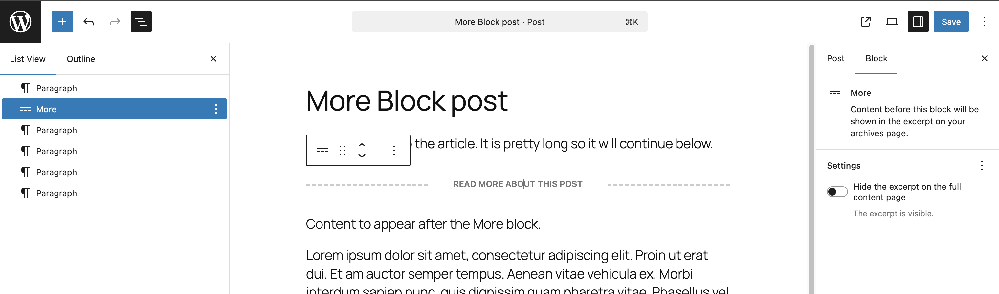
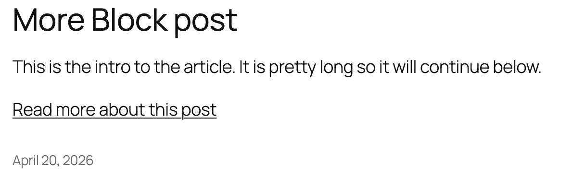
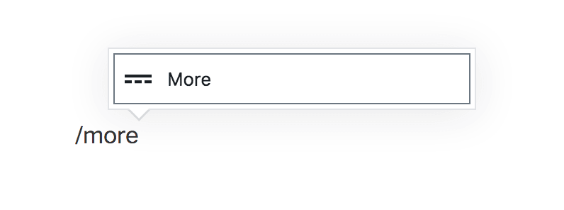
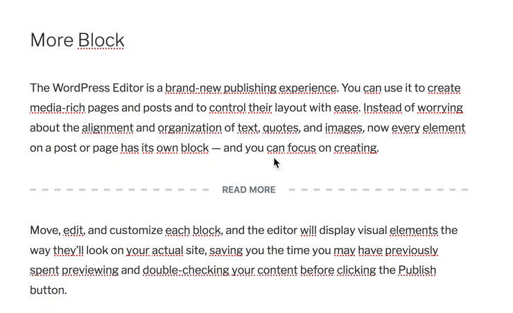
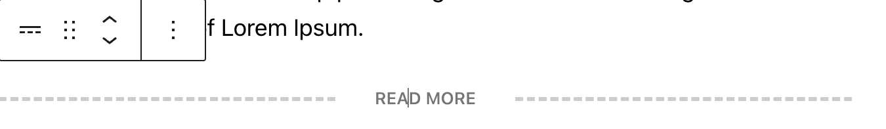
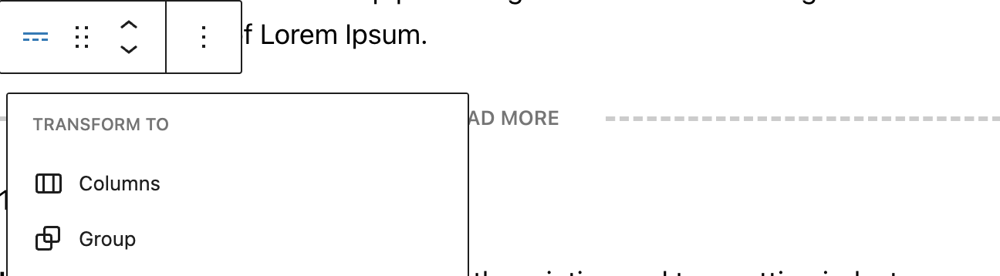
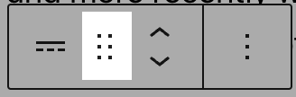
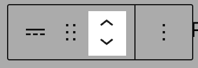
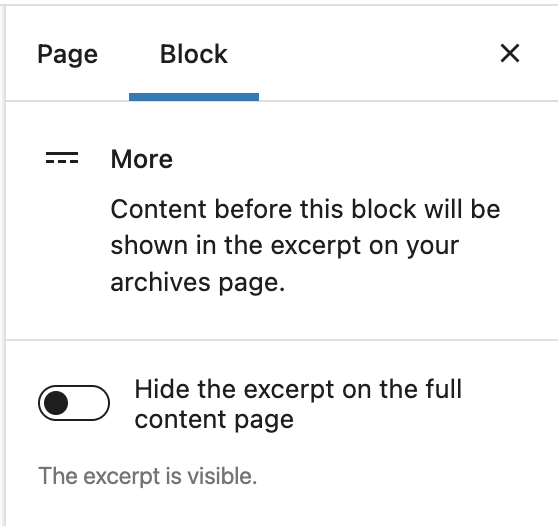
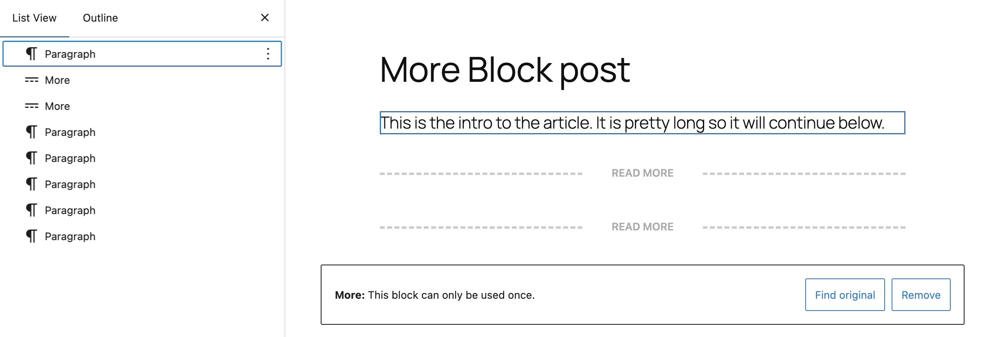

# More block

The More block is used to display a Read More link to the full blog post, on the blog home page, or on the archive pages.

If your theme is set to show the post’s full content on archive pages or the blog home page, then a post using the More block truncates your blog entries so that only the part of the post before the More block is displayed on the home page and archive pages, followed by a “Read More” link. Clicking on the ‘Read More’ link directs the reader to the full blog post.

If your theme is set to show only the excerpts on the archives page and the blog home page, the More block is ignored. The excerpt displayed is the one [manually entered for the post](../../../../classic-wordpress/classic-editor/what-is-an-excerpt-classic-editor.md).

A post’s More block may also be displayed within a post list generated by a [Query Loop block](../theme/query-loop-block.md) depending block’s settings. The More block primarily works only for Posts but could be used for pages if the theme allows or within a Query Loop block.

The More block can be placed anywhere in a post. You can customize the link to say whatever you want. You can only insert one More block in each Post.

<video controls preload="metadata" src="https://wordpress.org/documentation/files/2019/03/Kapture-2026-04-20-at-10.22.12.mp4"></video>

*This video demonstrates starting with an existing blog post, editing the post and placing a More block. Then switching back to the post list to see changes in the Read more link.*

The More block can be added to a post to change the “read more” link behavior from a post list.

This is how it will look on your site’s post list (Styles may vary depending on your theme).

## Add a More block

To add a More block, click on the **Block Inserter** icon.

You can also type `/more` and hit enter in a new *paragraph block* to add one quickly.

> [!NOTE]
> [Detailed instructions on adding blocks](../../working-with-blocks/adding-a-new-block.md)

## Edit read more text

Once you add the block, you can edit the Read More text that appears by default by clicking in the middle of the dashed lines, erasing the text, and typing anything you want. To revert back to the default text that your theme displays, remove all the text from the More block and save your Post.

## Block toolbar

Each block has its own block-specific controls that allow you to manipulate the block right in the editor. The *More block* offers the following buttons on the Block toolbar:

Transform to 
Drag icon 
Move handles 
More options

*You can click on the block to reveal the Block Toolbar.*

**Transform to**

Click on the Transform button to convert the More block into a Group, Details or Columns block.

**Drag icon**

To drag and drop the block to a new location on the page template, click and hold the rectangle of dots, then drag to the new location. The blue separator line indicates where the block will be placed. Release the left mouse button when you find the new location to place the block.

**Move handles**

The up and down arrow icons can be used to shift a block up and down on the page.

> [!NOTE]
> [Get more information about moving a block within the editor.](../../working-with-blocks/moving-blocks.md)

**More options**

These controls give you the option to copy, duplicate, and edit your block as HTML.

> [!NOTE]
> [Read about these and other settings.](../../working-with-blocks/more-options.md)

## Block settings

Every block has specific options in the editor sidebar in addition to the options found in the block toolbar. If you do not see the sidebar, click on the **Settings button** next to the Save/Publish button.

### Hide the excerpt on a full content page

*Block Settings for More block*

By enabling the ‘Hide the excerpt’ toggle button, the content that appears before the More block will not display on the full post, once the user clicks on the More link after the excerpt.

This option is disabled by default. This feature is helpful if you would like to display custom excerpt on the homepage and archive pages but when the user clicks to read the full post, the excerpt is hidden.

<video controls preload="metadata" src="https://wordpress.org/documentation/files/2022/06/Screen-Recording-2022-06-23-at-9.54.42-AM-1.mp4"></video>

## More block limited to one per post

You will be unable to add a second More block to your page if you are using the block inserter or slash command. If your page does have a second More block, you will see a message in the editor “More: This block can only be used once” with Find original and Remove buttons.

## Changelog

-   2026-04-20 (props @awetz583 @katmoody @vbbhatt22 @atachibana)
    -   Updated video and screenshots
    -   Added Limitation: one per post section with screenshot of error
    -   Added link to Query Loop block under introduction and removed limitation that the block only works with posts
-   2022-11-27
    -   Removed redundant content
    -   Added headings
    -   Aligned images for mobile view
-   Updated 2022-06-23
    -   Added content, images, video for 6.0
    -   Added ALT tags for the images
-   Updated 2021-02-10
    -   Added Note section
-   Created 2019-03-07
