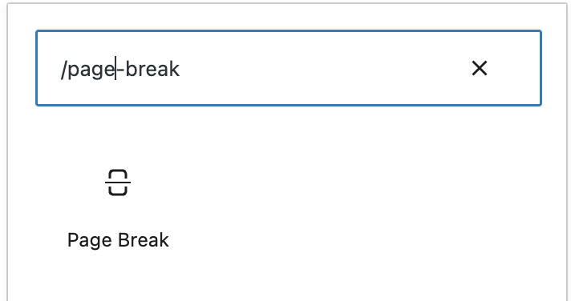
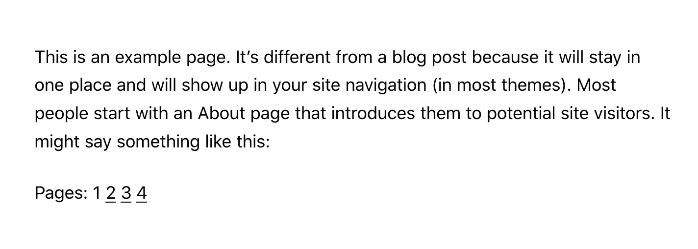
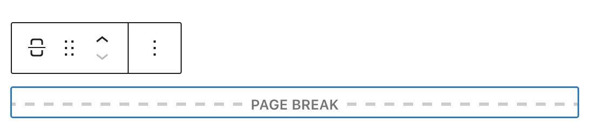
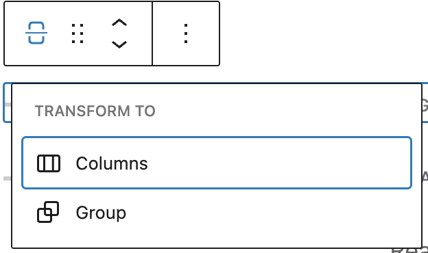
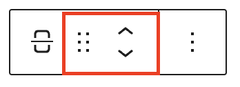
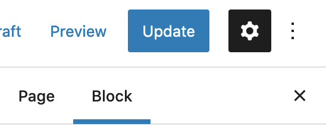

# Page Break block

Use the *page break block* to separate your content into a multiple-page experience and add pagination, or page breaks, to a page or post. This can be useful if you are writing a step-by-step tutorial or if you’d like to split your page into multiple chapters, for instance.

<video controls preload="metadata" src="https://wordpress.org/documentation/files/2022/08/171639717-40c88ae3-6e4c-4994-b8fc-355893b92053.mp4"></video>

*Page break overview*

In order to add a *page break block*, click on the **Block Inserter** icon.

You can also type <kbd>/page-break</kbd>and hit enter in a new *paragraph block* to add one quickly.

*Page break block – Add typing*

> [!NOTE]
> [Detailed instructions on adding blocks](../../working-with-blocks/adding-a-new-block.md)

You can add as many page breaks as you want to your post or page. Each *page break block* adds a new number to the multi-page link that appears at the bottom, splitting the content into more pages.

*Page break links*

## Block Toolbar

Each block has its own block-specific controls that allow you to manipulate the block right in the editor. The *page break block* has the following options in the Block toolbar.

*Page break block interface*

**Transform to**

You can transform a *Page Break block* into a Columns, or a Group block.

**Block-moving tools**

Use the block-moving tools to move the block up and down inside the editor. Use the six dots icon to drag and drop the *Page Break Block* and reposition it anywhere on the editor. Alternatively, click on the up and down arrows to move the block up or down the editor.

> [!NOTE]
> [Get more information about moving a block within the editor.](../../working-with-blocks/moving-blocks.md)

**More options**

These controls give you the option to copy, duplicate, and edit your block as HTML.

> [!NOTE]
> [Read about these and other settings.](../../working-with-blocks/more-options.md)

## Block Settings

Every block has specific options in the editor sidebar in addition to the options found in the block toolbar. *If you do not see the sidebar, simply click the ‘cog’ icon next to the Publish button.*

*The block settings can be found in the sidebar.*

The page break block doesn’t have any additional options on the sidebar. Once you add it to your page or post you are all set!

## Changelog

-   Updated 2022-11-28
    -   Removed redundant content
    -   Aligned images for mobile view
-   Updated 2022-08-03
    -   Screenshots, video and content updated for 6.0
    -   Added ALT tags for the images
-   Created 2019-03-07
