# Row block

Row block is one of the container blocks that can be used to arrange blocks in a single horizontal line.

<!-- VideoPress embed (iframe removed): https://videopress.com/embed/Bta2lzVx -->

https://videopress.com/v/Bta2lzVx

## Add a Row block

To add a Row block, click the **+ Block Inserter** button in the top-left corner of the editor. Search for the Row block and click on the block to add it to the page.

You can also use the keyboard shortcut <kbd>/row</kbd> to quickly insert a Row block in the editor.

> [!NOTE]
> [Get detailed instructions on adding blocks](../../working-with-blocks/adding-a-new-block.md).

## Block toolbar

To view the block toolbar, click on the block, and the toolbar will be displayed.

Every block comes with unique toolbar icons. These block-specific controls allow you to manipulate the block right in the editor.

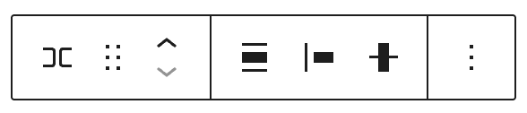

The Row block has the following block toolbar options:

-   Transform to
-   Drag
-   Move up/down
-   Change items justification
-   Change vertical alignment
-   Align
-   Options

### Transform to

Click on the **Transform to** button to convert the Row block into Group, Stack, Grid, Cover, Columns, or Details block.

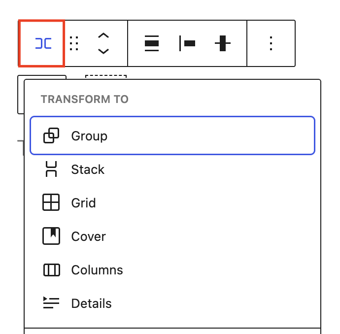

### Drag button

To drag and drop the block to a new location on the page template, click and hold the **Drag** button, then drag it to the new location.

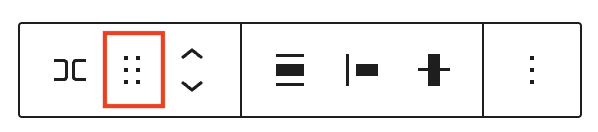

The blue separator line indicates where the block will be placed. Release the left mouse button when you find the new location to place the block.

### Move arrows

The **Move** **up** and **Move down** buttons can be used to move the block up and down on the page.

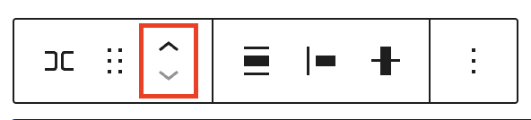

> [!NOTE]
> [Get more information about moving a block within the editor](../../working-with-blocks/moving-blocks.md)

### Change items justification

Click the **Change items justification** button in the Block toolbar to display the justification drop-down. You can justify the items inside of the Row block to the left, make them center-justified, align them to the right or leave a space between items.

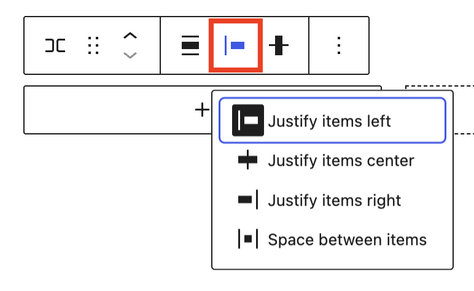

### Change vertical alignment

Use the **Change vertical alignment** tool to reposition items inside of the Row block. The following is a list of the block alignment options:

-   Align top
-   Align middle
-   Align bottom
-   Stretch to fill

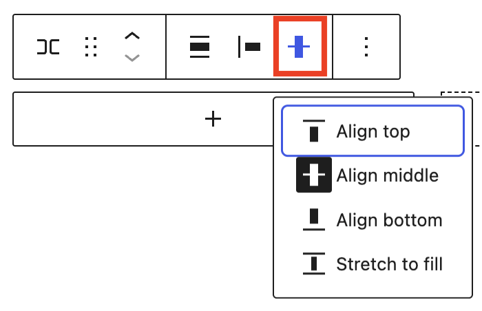

### Change alignment

Use the **Change alignment tool** to change the width of the Row block. The following is a list of the block width options:

-   None
-   Wide width
-   Full width

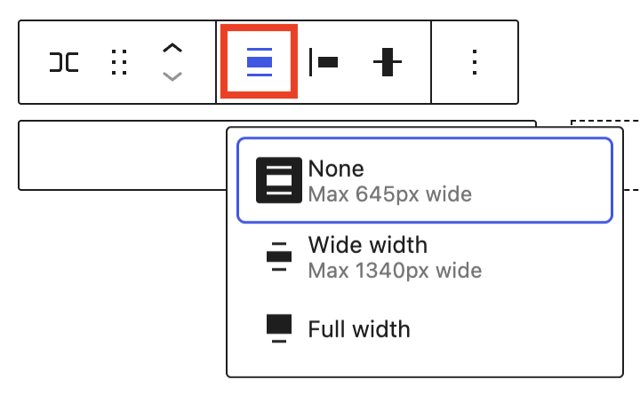

### More options

The More options menu (three vertical dots) on a block toolbar gives you more features to customize the block.

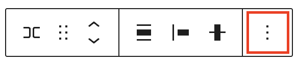

> [!NOTE]
> [Read about the More options menu and its settings](../../working-with-blocks/more-options.md)

## Block settings

The block settings panel contains customization options specific to the block. To open it, select the block and click the **Settings** button next to the Save/Publish button

Click **Group**, **Stack**, or **Grid** button in the Block Settings to transform the block into one of these variations.

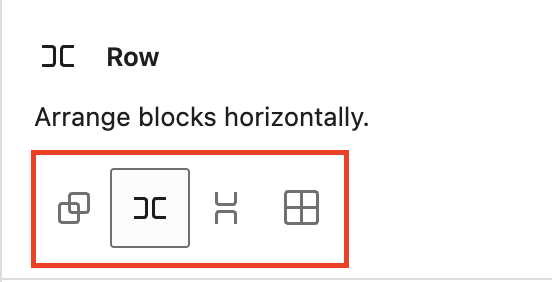

### Typography

The Row block provides typography settings to change the font family, color, appearance, line height, letter spacing, decoration, letter case, and font size.

> [!NOTE]
> For details, refer to this support article: [Typography settings overview](../../working-with-blocks/block-settings/typography-settings-overview.md)

### Background

The Background settings allow you to customize the appearance of supported blocks using background images, colors, and gradients.

> [!NOTE]
> For details, refer to the [Background Settings Overview](../../working-with-blocks/block-settings/background-settings-overview.md).

### Layout

The Row block provides Layout settings options to change the justification or orientation of the text and to wrap to multiple lines.

> [!NOTE]
> For details, refer to this support article: [Layout settings overview](../../working-with-blocks/block-settings/layout-settings-overview.md)

### Dimensions

The Row block provides dimension settings options to add padding and margin.

#### Width of blocks inside a Row

When you select a block inside a Row, additional options appear under it’s **Dimensions** settings to control its width:

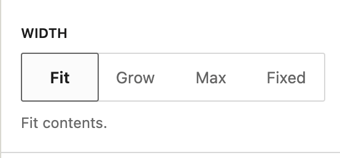

-   **Fit** uses only the space the block needs.
-   **Fill** expand the block to use available space in the Row.
-   **Max** width sets the maximum width of the block.
-   **Fixed** sets a specific width for the block.

> [!NOTE]
> For details, refer to this support article: [Dimension settings overview](../../working-with-blocks/block-settings/dimension-controls-overview.md)

### Border & Shadow

The Row block provides border settings options to add border color, width, and radius.

> [!NOTE]
> For details, refer to this support article: [Border settings overview](../../working-with-blocks/block-settings/border-settings-overview.md)

### Elements

Use the elements panel to change colors for blocks nested inside the selected block.

> [!NOTE]
> [Learn more about changing colors for nested elements](../../working-with-blocks/block-settings/colors-settings-overview.md#elements-panel-for-nested-elements).

### Position

The position setting is only available when the Row block is located at the root-level. The drop-down menu has two options: **Default** and **Sticky**. If the Sticky option is selected, the Row block will remain at the top of the window when you scroll down the page.

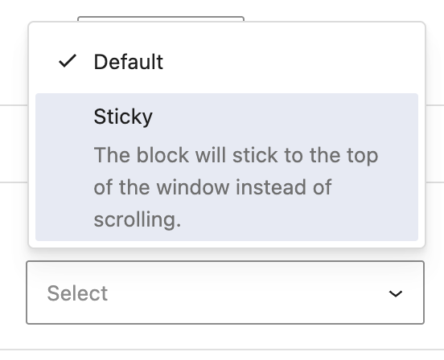

### Advanced

The Row block provides the following Advanced settings options: HTML Anchor, Additional CSS Class(es), Additional CSS, HTML Element, Styles, and Allowed blocks.

> [!NOTE]
> [Learn more about advanced settings](../../working-with-blocks/block-settings/advanced-settings-overview.md)

## Changelog

-   Updated 2026-09-16 (props @kjoyner @awetz583 @vladimiraus @lastsplash)
    -   Updates images for 7.1
    -   Remove Colors from block settings in prep for 7.1
    -   Add Elements, Position, and Background in block settings
    -   Add preview video
    -   Add section “Blocks inside of a Row” section under Dimensions
-   Updated 2026-05-25 (props @kjoyner @awetz583)
    -   Updated “Advanced” section to refer to new overview page
    -   Conver paragraphs to heading blocks
-   Updated 2022-11-25
    -   Added link to Border and layout settings overview page and removed content from this page
-   Created 2022-11-24
