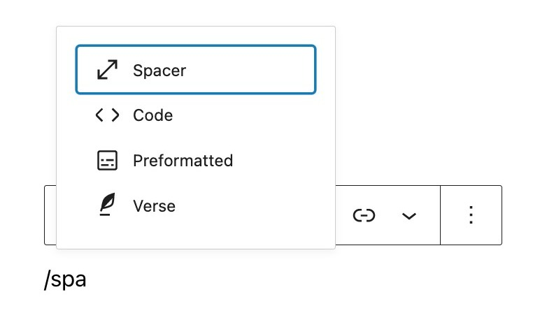
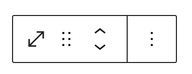
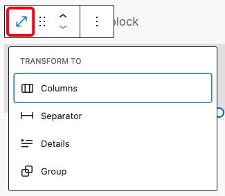
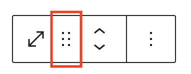
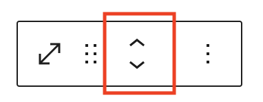
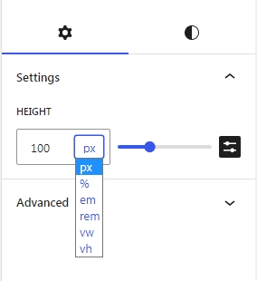
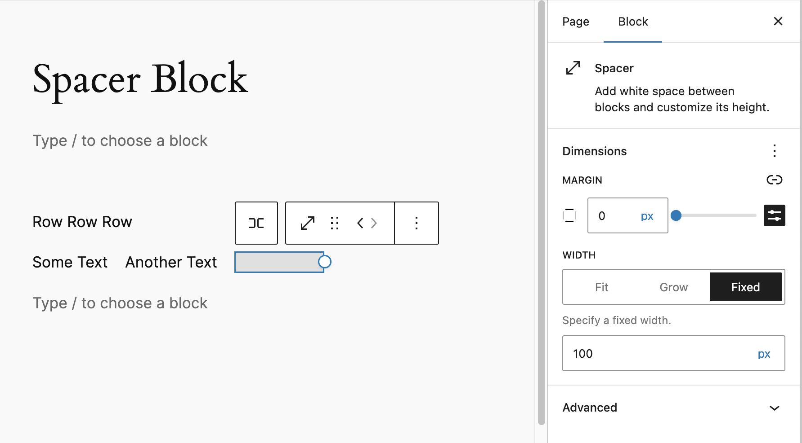
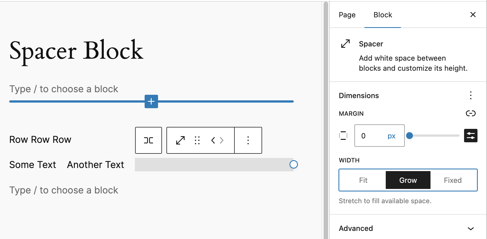

# Spacer block

If you want to have a space between two blocks, the Spacer block is what you will use. 
A **vertical** spacer adds space between blocks in a column (as in a page or post). 
A **horizontal** spacer adds space between blocks in a row (as in a [Navigation block](../theme/navigation-block.md)).

(Note: Using a Navigation block requires a [block theme](https://wordpress.org/themes/tags/full-site-editing/) or a theme that has support for [template editing](https://wordpress.org/themes/tags/template-editing/).)

In this video, you can see how you can use the spacer block and the different settings to modify it.

<video controls preload="metadata" src="https://wordpress.org/documentation/files/2019/03/spacer-1.mp4"></video>

*Demo of inserting Spacer block into post content and modifying its settings.*

## Add a Spacer block

To add an Spacer block, click on the **Add Block** icon.

You can also type `/spacer` and hit enter in a new *paragraph block* to add one quickly.

*Add Spacer Block*

## Block toolbar

In order to reveal the block toolbar, you can click on the block and the toolbar will display.

Every block comes with unique toolbar icons and blocks specific user controls that allow you to manipulate the block right in the editor.

The Spacer block shows four buttons in the block toolbar:

-   Transform to
-   Move controls
-   More options

*Spacer Block Toolbar*

### Transform to:

*Transform options for Spacer Block*

When you click on the **“Transform”** button, you can convert the **Spacer** block into **Columns**, **Separator**, **Details**, or **Group** blocks.

-   **Separator**: Changes the Spacer into a visual horizontal line that helps divide content, providing a cleaner visual break between sections.
-   **Group**: Allows you to wrap the Spacer inside a Group, enabling background color, padding, margin, and border customization for better layout styling.
-   **Columns**: Useful if you want to place multiple blocks side-by-side; this transformation helps shift the layout into a multi-column structure.
-   **Details**: Converts the Spacer into a collapsible content block, allowing additional context or content to be toggled by the user.

### Move controls

*Drag icon in the Spacer block*

To drag and drop the block to a new location on the page template, click and hold the six dotted icon, then drag to the new location. The blue separator line indicates where the block will be placed. Release the left mouse button when you find the new location to place the block.

*Move arrows in the Spacer block*

The up and down arrow icons can be used to move a block up and down in your document.

> [!NOTE]
> [Get more information about moving a block within the editor.](../../working-with-blocks/moving-blocks.md)

### More options

These controls give you the option to copy, duplicate, and edit your block as HTML.

> [!NOTE]
> [Read about these and other settings.](../../working-with-blocks/more-options.md)

## Block settings

Every block has specific options in the editor sidebar in addition to the options found in the block toolbar. If you do not see the sidebar, click on the **Settings button** next to the Save/Publish button.

### Spacer settings

The Height setting adjusts the height of the space. The Width setting adjusts the width of the space. You can adjust the settings by either:

-   Typing the number in the “Spacer Settings” box, or
-   Dragging the handle at the bottom of the spacer (for the vertical spacer) or at the side of the spacer (for the horizontal spacer).

You can also change the unit by clicking on PX to display a dropdown with the other supported units- PX, %, EM, REM, VW, and VH.

<video controls preload="metadata" src="https://wordpress.org/documentation/files/2019/03/spacer-2.mp4"></video>

*The interactive resizable box and the sidebar preset controls used to tweaks the Spacer block.*

When Spacer is a child of a flex layout block (Row, Stack, Navigation) custom size controls are removed and flex child controls added instead.

*Fixed size flex control for Spacer block*

*Fill size flex control for Spacer block*

### Dimensions

The paragraph provides dimension settings options to add margin. For details refer to this support article:

> [!NOTE]
> [Learn more about dimension controls](../../working-with-blocks/block-settings/dimension-controls-overview.md)

### Advanced

The Separator block provides the following Advanced settings options: HTML Anchor, Additional CSS Class(es), Additional CSS, and Styles.

> [!NOTE]
> [Learn more about advanced settings](../../working-with-blocks/block-settings/advanced-settings-overview.md)

## Changelog

-   Updated 2026-05-25 (props @kjoyner @awetz583)
    -   Updated “Advanced” section to refer to new overview page
-   2026-04-20 (props to @awetz583 @hu55nain)
    -   Remove reference to padding
    -   Text formatting updates
-   2025-04-17 (props to [@karthickmurugan](https://profiles.wordpress.org/karthickmurugan/))
    -   Update screenshots and videos to 6.8
    -   Update Transform to section with new options.
-   Updated 2024-01-30
    -   Updated screenshots for 6.4
-   Updated 2023-10-24
    -   Update screenshots for 6.3
    -   Add custom units for height and width
    -   The resizable box and controls
    -   Add dimnesions support for margin
    -   Add spacing presets
    -   Add flex child controls for Spacer
-   Updated 2022-11-25
    -   Removed redundant content
    -   Added alt text
    -   Aligned images for mobile view
-   Update 2022-03-21
    -   Updated all screenshots to WordPress 5.9
-   Update 2021-06-22
    -   Updated more options block
-   Updated 2020-09-28
    -   Updated 5.5 screenshots
    -   Updated the block toolbar
    -   Updated the block settings
-   Created 2019-03-07
