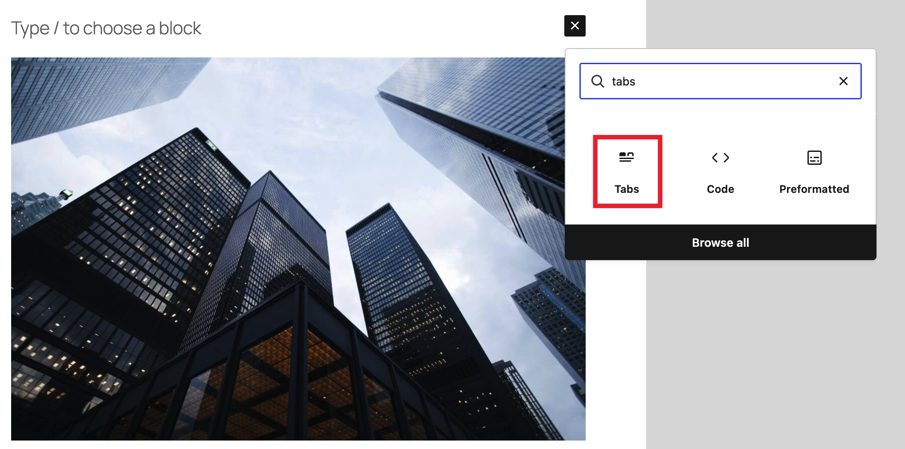
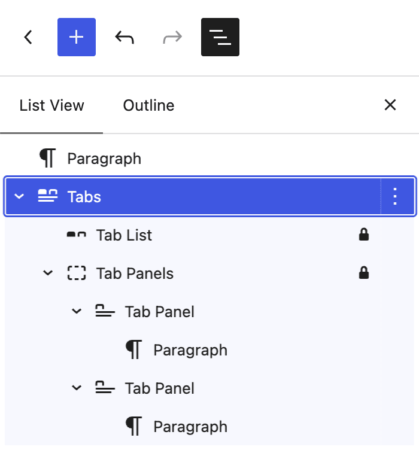
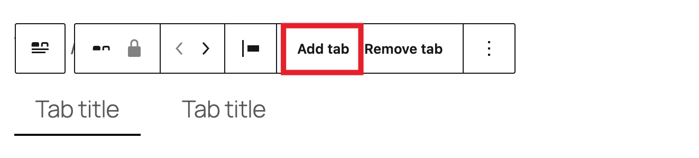
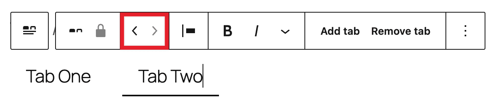
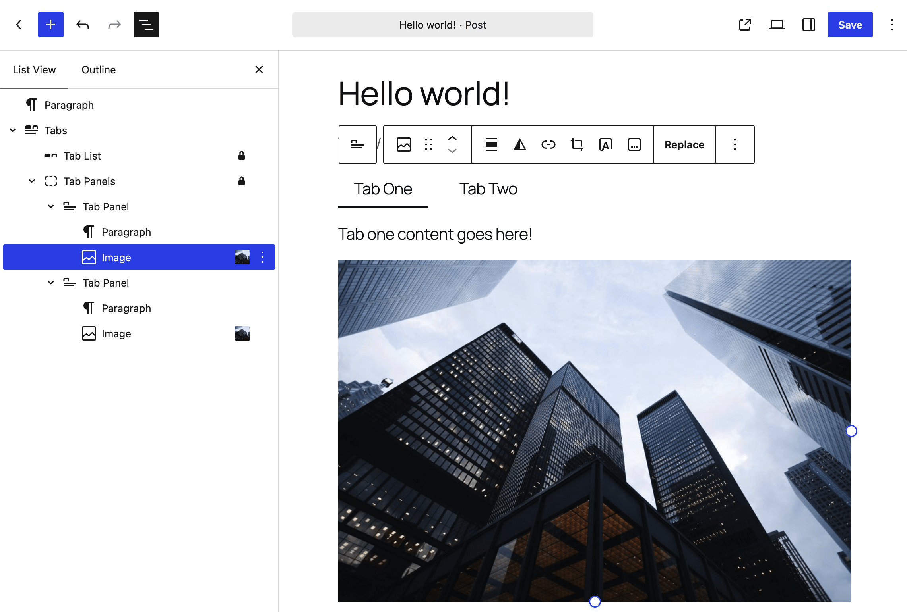
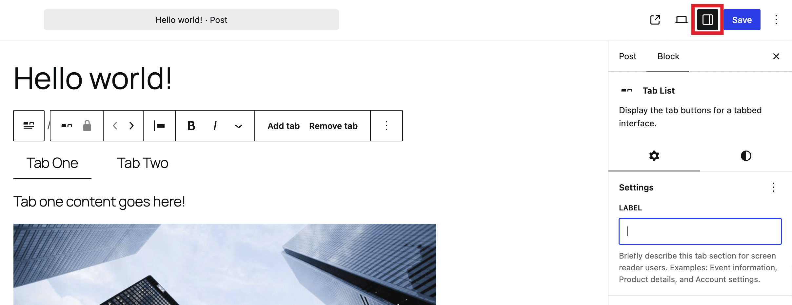
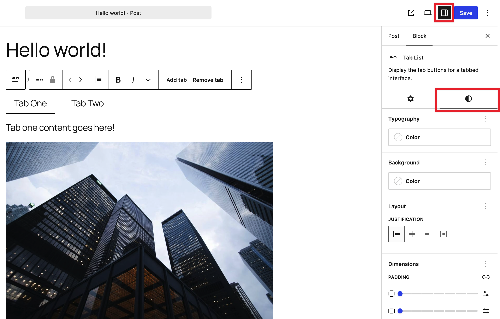

# Tabs block

The Tabs block lets you organize content into separate tabbed sections that visitors click through one at a time, instead of showing everything on the page at once. It’s useful for FAQs, product specifications, or any content where you want to present several related pieces of information without making visitors scroll through them all. The block follows the [Tabs pattern](https://www.w3.org/WAI/ARIA/apg/patterns/tabs/) from the W3C ARIA Authoring Practices Guide, so it comes with accessible keyboard and screen reader behavior built in.

## Requirements

-   WordPress 7.1 or later.

## Add a Tabs block

1.  Open a post or page in the editor.
2.  Place your cursor where you want the tabs to appear.
3.  Open the Block Inserter (+) in the top toolbar, search for “Tabs,” and select the Tabs block.

You can also type `/tabs` in the block editor and press Enter.

[Read detailed instructions on adding blocks.](../../working-with-blocks/adding-a-new-block.md)

When you insert a Tabs block, it starts with two tabs already in place, each with an empty panel ready for content.

## How the Tabs block is structured

The Tabs block is made up of several nested blocks that work together:

-   **Tabs** — the outer block that holds everything together.
    -   **Tab List** — the row of clickable tab buttons.
        -   **Tab** — each individual clickable button in the Tab List, one per tab.
    -   **Tab Panels** — the container that holds the content for every tab.
        -   **Tab Panel** — the content area for one tab. Only the panel matching the currently selected tab is visible at a time.

Each **Tab** in the Tab List is linked to the **Tab Panel** in the same position, so selecting the third tab button shows the third panel’s content, and so on.

## Add and remove tabs

To add a new tab:

1.  Select the last **Tab** in the Tab List.
2.  Place your cursor at the end of its label and press **Enter**.

A new tab is added after it, along with a matching empty Tab Panel.

You can also use the **Add tab** option in the block toolbar to add a new tab at the end of the list.

To remove a tab:

1.  Select the **Tab** you want to remove and place your cursor at the very start of its label.
2.  Press **Backspace**.

The tab and its corresponding Tab Panel are both removed together.

Note: A Tabs block must keep at least one tab available so you can’t delete all tabs.

## Reorder tabs

To reorder tabs:

1.  Select a **Tab** in the Tab List.
2.  Use the reorder buttons in the block toolbar to move it earlier or later in the list.

Reordering a Tab Panel directly – for example, by dragging it in List View – moves its matching Tab in the Tab List to stay in sync.

## Duplicate a tab

Duplicating a tab creates a copy of both the **Tab** button and its **Tab Panel** content, and keeps them linked together as a new tab.

1.  Select the **Tab** you want to duplicate.
2.  Select the **More options** icon (three vertical dots) in the block toolbar and choose **Duplicate**.

[Read more about duplicating blocks.](../../working-with-blocks/more-options.md)

## Add content to a tab panel

Each **Tab Panel** works like a Group block — you can insert any blocks inside it: paragraphs, images, headings, columns, and so on. This means a single tab can hold as much or as little content as you like.

1.  Select the tab you want to add content to.
2.  Click inside its Tab Panel.
3.  Use the Block Inserter (+) to add any block, the same way you would anywhere else in the editor.

## Block toolbar

Each block toolbar comes with different options that let you customize or modify the block in the editor. To view a block’s toolbar, select the block and it will show a list of toolbar options.

Selecting the **Tabs** block, the **Tab List**, an individual **Tab**, or a **Tab Panel** each shows a slightly different toolbar, appropriate to that part of the block.

[Read about these and other settings.](../../working-with-blocks/more-options.md)

## Block settings

In addition to the block toolbar, each block has specific options in the Settings sidebar on the right side of the editor. To view a block’s settings, select it. If the sidebar is closed, click the **Settings button** next to the Save/Publish button in the top toolbar.

*Settings icon in the top toolbar of the editor*

### Tab List settings

Select the **Tab List** to access its settings.

-   **Layout**: By default, the Tab List wraps its buttons onto multiple lines if they don’t all fit on one line — so tabs with longer labels, or a large number of tabs, remain readable instead of overflowing or getting cut off.
-   **Label**: Lets you set a descriptive label for the Tab List, read out by screen readers to identify the set of tabs (for example, “Product details tabs”). This is especially useful if a page has more than one Tabs block.

### Tab (button) settings

Select an individual **Tab** button to access its settings. Tab buttons support the same kinds of controls as many other blocks:

-   **Color**: Set text and background colors for the tab button, including for its selected/active state. Refer to [Color Settings overview](../../working-with-blocks/block-settings/colors-settings-overview.md) for details.
-   **Typography**: Adjust font size and other text settings for the tab label. Refer to [Typography settings overview](../../working-with-blocks/block-settings/typography-settings-overview.md) for details.
-   **Border**: Add a border color, width, and radius to the tab button. Refer to [Border & Shadow settings overview](../../working-with-blocks/block-settings/border-settings-overview.md) for details.
-   **Spacing**: Adjust the padding inside the tab button. Refer to [Dimension settings overview](../../working-with-blocks/block-settings/dimension-controls-overview.md) for details.

Because these are standard block settings, you can also set them once for every Tab button on your site through **Styles > Blocks** in the Site Editor. See [Styles overview](../../../site-editor/styles-overview.md).

## Demo

The demo below shows an example of styling the various pieces of a tabs block.

<!-- VideoPress embed (iframe removed): https://videopress.com/embed/MwTNElXP -->

https://videopress.com/v/MwTNElXP

## Changelog

-   Created 2026-08-19. Props to @clk87 and @annezazu
