# Animoto Embed

With the Animoto Embed block, you can embed your own Animoto video which you have created on your Animoto account. You need an account to create/customize your own videos and embed them into your post. A user who does not have an Animoto account can play the full video from the post.

**Embedded Animoto Video**

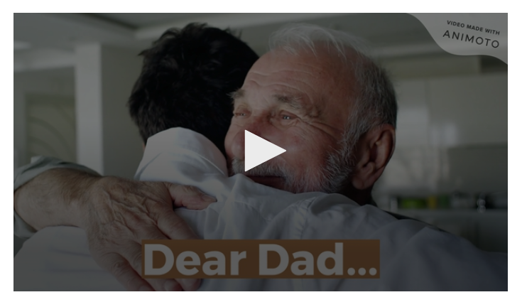

*Embedded Animoto video*

**Steps to Embed a video from Animoto**

1\. Find the video URL on Animoto- Open your video which you can find in your **Animoto Account** > **My video** area and click on the **Share** button.

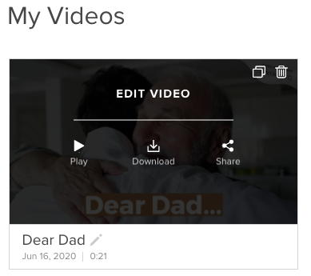

*Open video you want to embed from Animoto*

2\. Click on the **Share** icon- From the share tab, click on the link icon which will open a pop-up window.

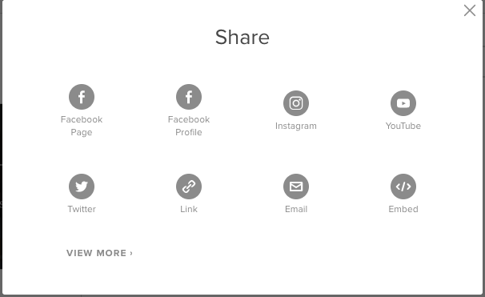

*Click the share option and then choose the link option*

3\. Copy the link of the Animoto video – Click on the **Copy to Clipboard** button to copy your video link easily.

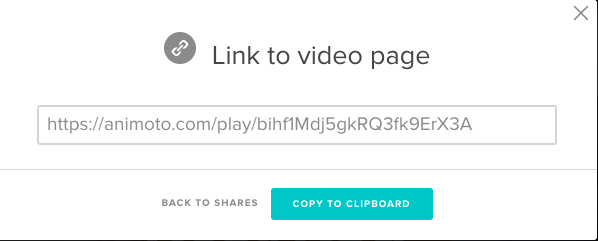

4\. Add the Animoto Block from the Block list

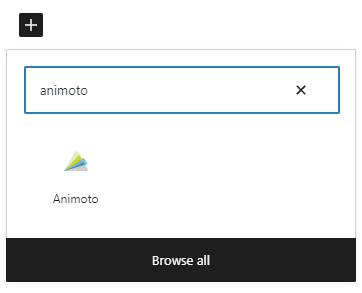

> [!NOTE]
> [Detailed instructions on adding blocks](../../working-with-blocks/adding-a-new-block.md)

5\. Paste the video link in the URL box

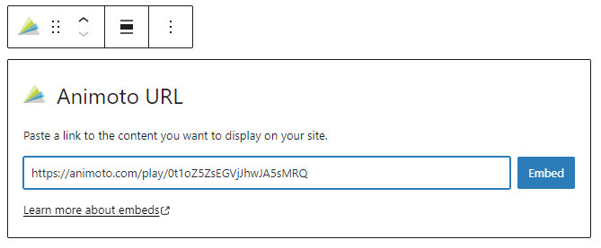

6\. Click the **Embed** button-If it’s a link that can be successfully embedded you will see a preview in your editor.

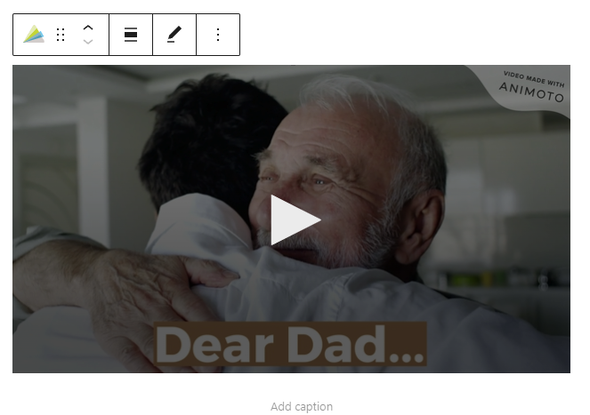

If you use a URL that can’t be embedded, the block shows the message “Sorry, this content could not be embedded.” You will have two choices: **Try again** with a different URL or **Convert to link**.

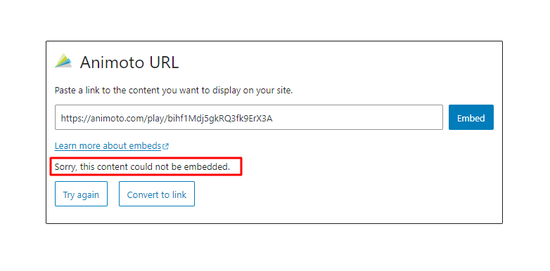

## Block toolbar

Besides the Mover and Drag & Drop Handle, the Block Toolbar for the Animoto embed block shows four buttons:

-   Transform to
-   Change alignment
-   Edit URL, and
-   More options.

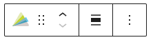

**Transform to**

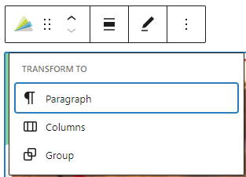

The Animoto embed can be transformed into a group. This gives the ability to change the background color around the Animoto embed.

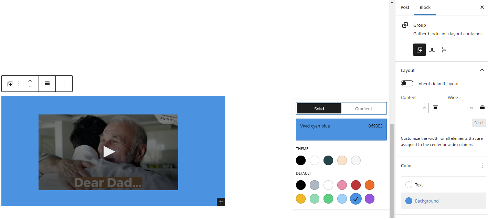

*Editor view of an Animoto Embed as a group with Color Settings controls*

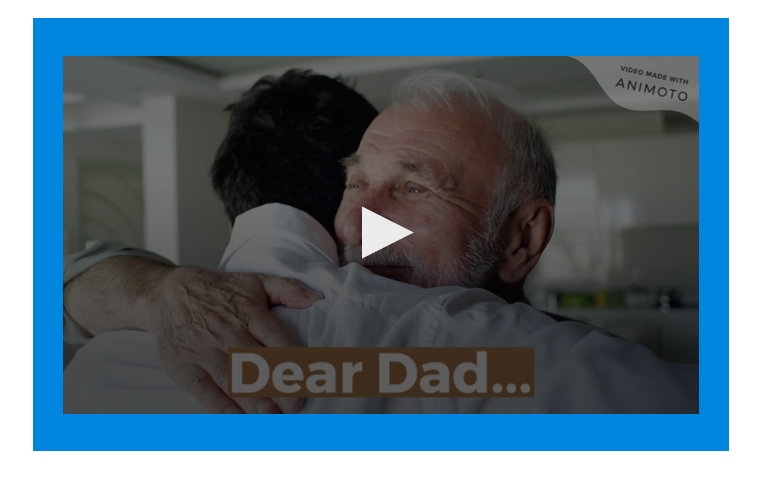

*Animoto embed with a blue background.*

**Change alignment**

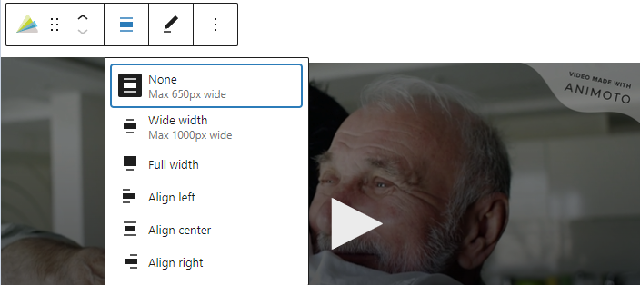

-   **Align left** – Make the Animoto post left aligned
-   **Align center** – Make the Animoto post alignment centered
-   **Align right** – Make the  Animoto post, align right
-   **Wide width** – Increase the width of the post beyond the content size
-   **Full width** – extend the Animoto post to cover the full width of the screen.

**Wide width** and **Full width** alignment need to be enabled by the theme of your site.

**Edit URL**

Via the **Edit URL**, you can change the Animoto Embed URL in the embed block. Overwrite the existing URL and click on the **Embed** Button.

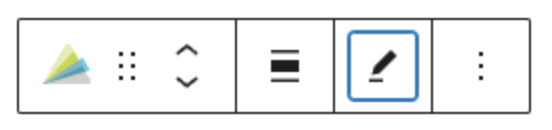

**More options**

These controls give you the option to copy, duplicate, and edit your block as HTML.

> [!NOTE]
> [Read about these and other settings.](../../working-with-blocks/more-options.md)

## Block settings

**Advanced**

The following Advanced settings options are available: HTML Anchor, Additional CSS Class(es), Additional CSS, and Styles.

> [!NOTE]
> [Learn more about advanced settings.](../../working-with-blocks/block-settings/advanced-settings-overview.md)

## Changelog

-   Updated 2026-06-29
    -   Linked to advanced settings
-   Updated 2022-11-26
    -   Removed redundant content
    -   Added alt text to images
-   Updated 2020-09-04
    -   Screenshots updated to 5.5
-   Updated 2020-08-18
    -   Replaced “More Options” – new screenshot
    -   Added “Move To” and “Copy” section under More Options
-   Update 2020-08-10
    -   fixed graphics, captions, removed residue from the template.
-   Created 2020-07-05
