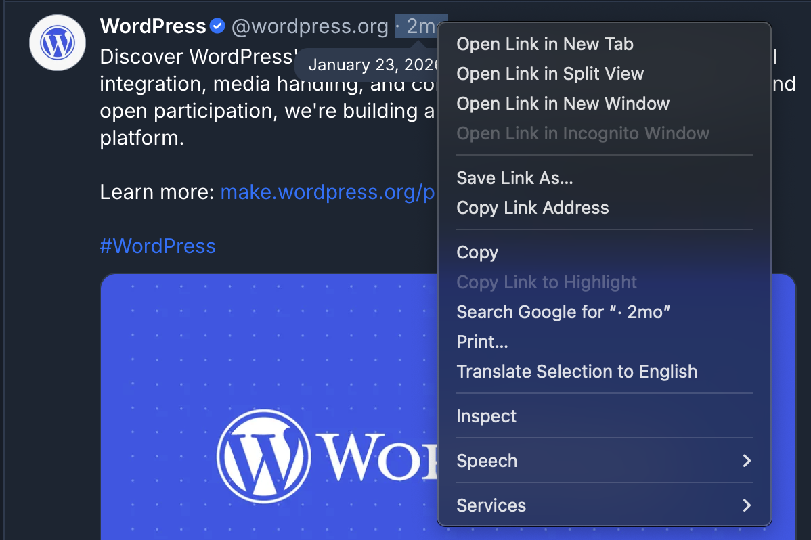
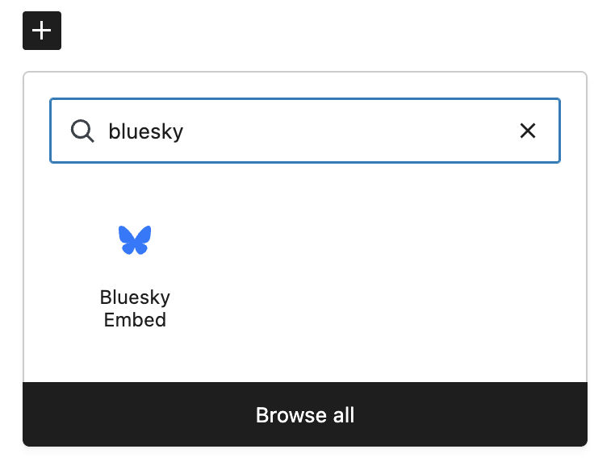
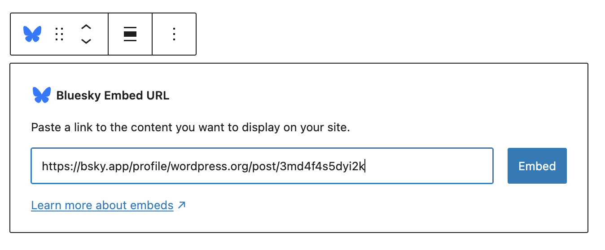
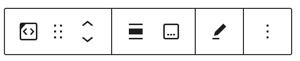
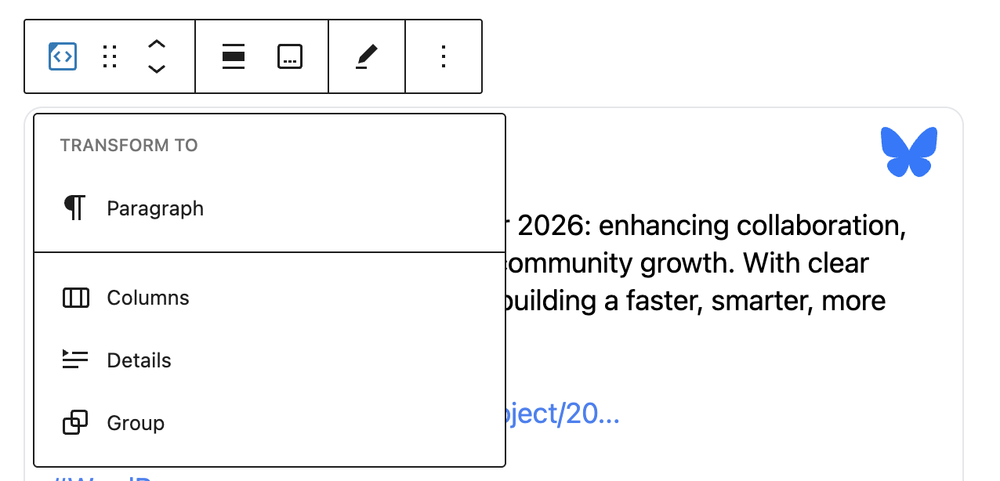
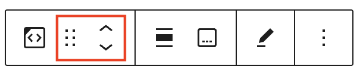
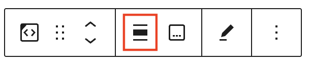
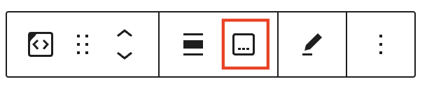
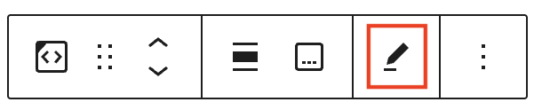
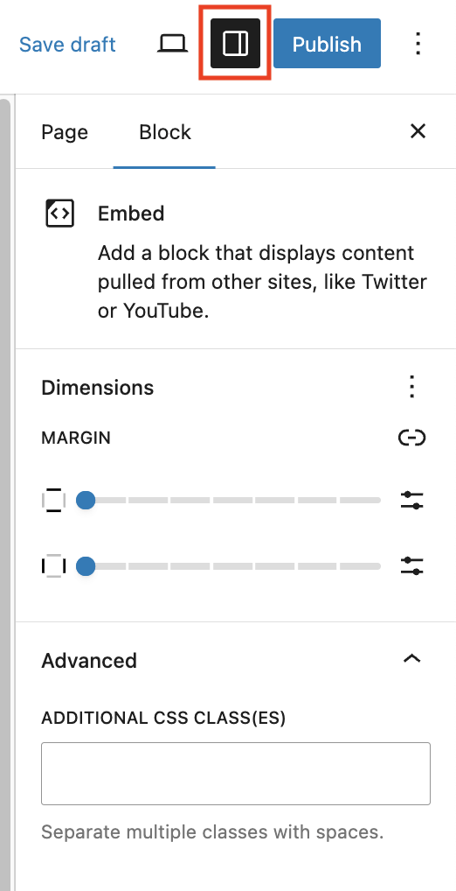

# Bluesky embed

With the Bluesky Embed block, you can embed Bluesky content into your posts and pages. You don’t need to have a Bluesky account to be able to use it

<!-- bluesky embed -->

https://bsky.app/profile/did:plc:r2no5dzwjjkp4cysp43tqzxa/post/3md4f4s5dyi2k?ref_src=embed

## Steps to embed a Bluesky post

First, find the URL of the Bluesky post

If you are looking at a feed of posts, you can find an individual post URL in the date/time the post was published. To grab the URL, point your mouse to the date, using the right mouse click menu select Copy Link Address.

Next, edit your post or page and add a Bluesky Embed block.

To add a Bluesky Embed block, click on the “Block Inserter” (+)  and select the Bluesky Embed block.

You can also type `/bluesky` and hit enter in a new paragraph block to add one quickly.

> [!NOTE]
> [Detailed instructions on adding blocks](../../working-with-blocks/adding-a-new-block.md)

Then, add the URL to the input that reads “Enter URL to embed here…” and press the Embed button

If the URL is a link that can be successfully embedded, you will see a preview in your editor.

## Block toolbar

Every block comes with unique toolbar icons and block-specific user controls that allow you to manipulate the block right in the editor.

### Transform

Transform the block to a paragraph, columns, details or group.

### Block moving tools

The block-moving handles allow you to move the block up and down the editor. Use the six dots icon to drag and drop the block and place it anywhere on the page. Alternatively, click on the up and down arrows to move the block up or down.

> [!NOTE]
> [Get more information about moving a block within the editor.](../../working-with-blocks/moving-blocks.md)

### Align

Toggle the block between a none, wide-width display and a full-width display (if supported by your site’s theme).

### Caption

If you wish to add a caption, click on the Add caption button on the Block toolbar. Then enter your caption text into the space below the Bluesky embed. You can remove the caption by toggling the caption button off.

### Edit URL

Via the edit URL, you can change the Bluesky Embed URL in the embed block. Overwrite the existing URL and click on the **Embed** button on the right.

### More options

These controls give you the option to copy, duplicate, and edit your block as HTML.

> [!NOTE]
> [Read about these and other settings.](../../working-with-blocks/more-options.md)

## Block settings

Every block has specific options in the editor sidebar in addition to the options found in the block toolbar. If you do not see the sidebar, simply click the settings icon next to the Publish or Save button.

### Dimensions

The Bluesky embed block provides dimension settings options to add margin.

> [!NOTE]
> [Learn more about dimension controls.](../../working-with-blocks/block-settings/dimension-controls-overview.md)

### Advanced

The following Advanced settings options are available: HTML Anchor, Additional CSS Class(es), Additional CSS, and Styles.

> [!NOTE]
> [Learn more about advanced settings.](../../working-with-blocks/block-settings/advanced-settings-overview.md)

## Changelog

-   Updated 2026-06-29
    -   Linked to advanced settings
-   Added 2026-04-15
