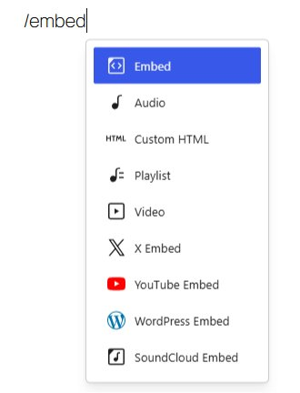
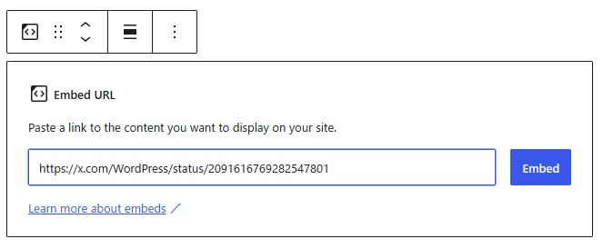
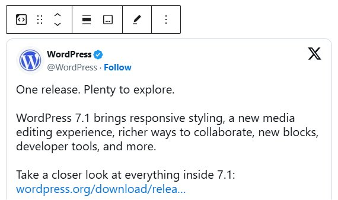
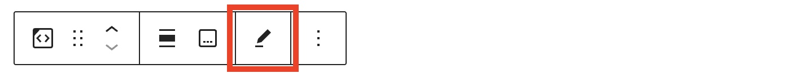
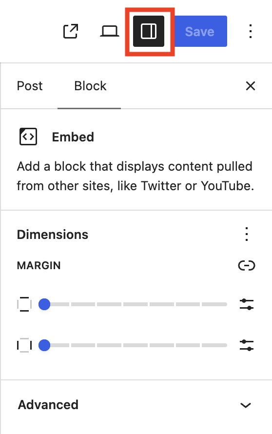

# Embed block

The Embed block lets you add content from a third-party site to your post or page.

When you are embedding content, you don’t need to upload the content to your WordPress site. You are creating a link to the content, from within your post or page.

**Steps to embed content from a third-party site on your post or page**

1.  Copy the URL from the [site you want to embed from](README.md#list-of-sites-you-can-embed-from).
2.  Add the Embed block by clicking on the + Block Inserter and searching for the Embed block.  Alternatively, you can use the slash command, `/embed` in a new *paragraph block* then press `enter` to add one quickly.

> [!NOTE]
> [Detailed instructions on adding blocks](../../working-with-blocks/adding-a-new-block.md)

3.  Paste the URL from step 1 into the block.
4.  Click on the “Embed” button.

5.  Now you can see the content in your editor. The Embed block will be transformed into the embed block type based on the third-party site from where the content is copied from.

## Block Toolbar

The block toolbar contains tools that allow you to customize the block.

> [!NOTE]
> For details about the block toolbar and basic block operations, refer to the [Work with blocks](../../working-with-blocks/work-with-blocks.md) article.

### Edit URL

*Edit URL button in the toolbar*

Use Edit URL to change the URL used by the Embed block. Replace the existing URL and click the “Embed” button.

*Screenshot*

## Block Settings

Every block has specific options in the editor sidebar in addition to the options found in the block toolbar. If you don’t see the sidebar, click on the Settings button next to the Save/Publish button.

### Dimensions

This block provides dimension settings options to adjust margins.

> [!NOTE]
> For details, refer to this support article: [Dimension settings overview](../../working-with-blocks/block-settings/dimension-controls-overview.md).

### Advanced

The following Advanced settings options are available: HTML Anchor, Additional CSS Class(es), Additional CSS, and Styles.

> [!NOTE]
> [Learn more about advanced settings.](../../working-with-blocks/block-settings/advanced-settings-overview.md)

## Changelog

-   Updated 2026-09-22
    -   Updated screenshots and instructions for WordPress 7.1.
-   Updated 2026-06-29
    -   Linked to advanced settings
-   Updated 2022-11-26
    -   Removed redundant content
    -   Removed reusable blocks
-   Updated 2022-08-16
    -   Added ALT tags for the images
-   Created 2022-04-30
