# Flickr embed

With the Flickr embed block, you can add photos and videos from Flickr to your posts and pages. However, when you click any photo or video, it will take you to Flickr where you can see photos and play videos.

You can also embed photo albums and galleries with the next/previous arrow links. You don’t need a Flickr account to embed photos or videos.

<video controls preload="metadata" src="https://wordpress.org/documentation/files/2022/10/Flickr-Embed-HelpHub-Oct-2022.mp4"></video>

Note: With video, the page/post only displays the image of the video. There will be no play/pause button. By clicking on the video, it will be redirected to the corresponding Flickr page to play.

You can only share those photos and videos which are visible to everyone(public). Some publishers put restrictions by setting privacy.

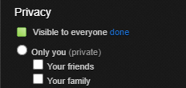

**Embedded image from flickr**

**Steps to embed Flickr photos or videos to your post or page**

1.  Find your photo or video on Flickr.com, and copy the URL of the photo, album, gallery or video from the browser bar.

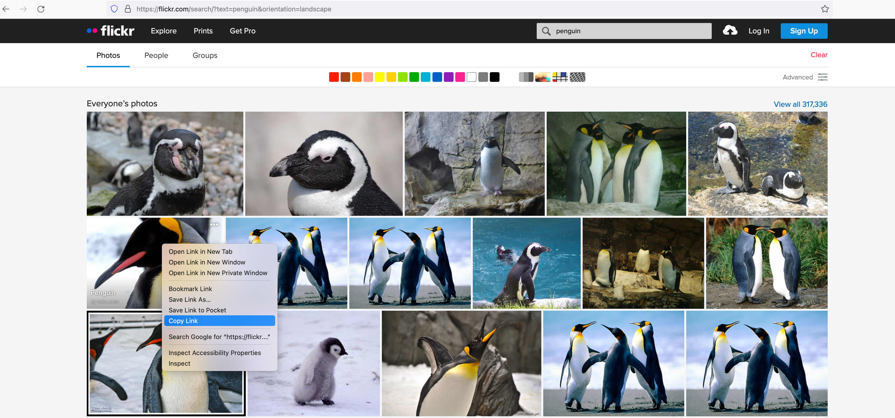

2.  Add Flickr embed block to your post or page

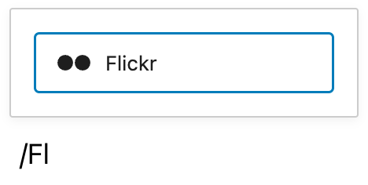

> [!NOTE]
> [Detailed instructions on adding blocks](../../working-with-blocks/adding-a-new-block.md)

3.  Paste the link into the textbox.

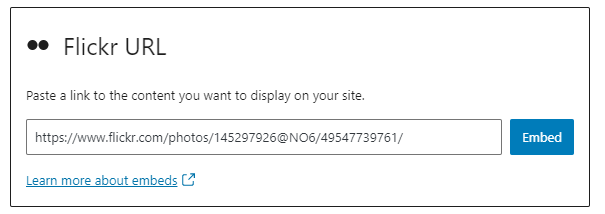

4.  Click the “Embed” button

If the link can be successfully embedded into the post/page, you will see the preview in your block editor.

If you use a URL that can’t be embedded, the block shows the message “Sorry, this content could not be embedded.” You will have two choices: Try again with a different URL or convert to link.

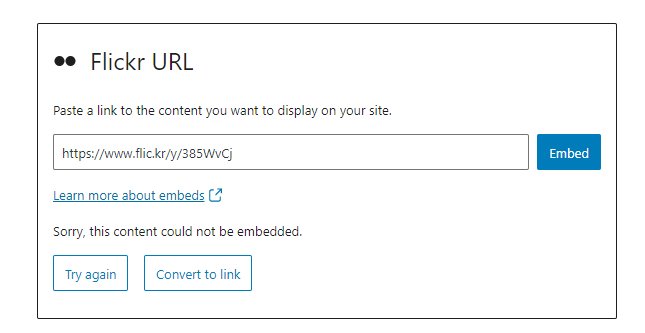

5.  Click on the Preview button on the top right corner of the page/post.

**Embed Photo Album and Gallery**

You can embed a photo album and gallery to your post/page. The page/post will display the first photo of the album or gallery with the next and previous arrow link.

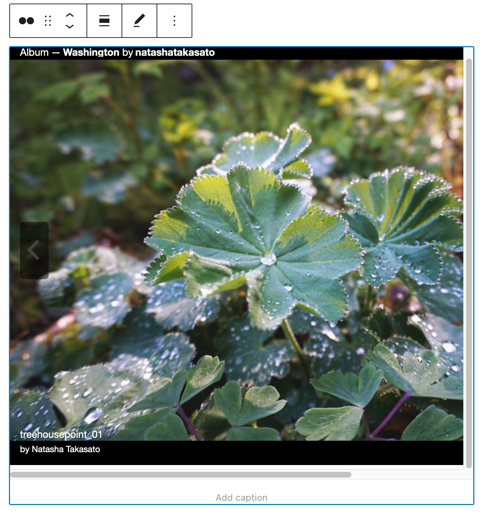

## Block Toolbar

The Block Toolbar for the Flickr embed shows six buttons:

-   Embed
-   Change block type or style
-   Drag / Move down
-   Change alignment
-   Edit URL
-   Options.

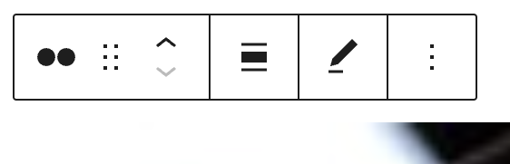

**Transform to:**

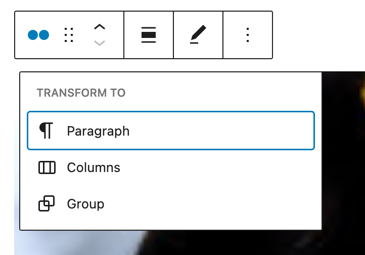

**Group**

You can transform a Flickr embed into a Group. This would give you the ability to change the background color around the Flickr embed.

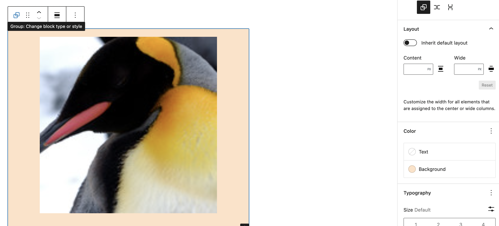

Left: Editor view of a Flickr Embed as a group with Color Settings controls

Right: Flickr embeds with a green background.

**Change Alignment**

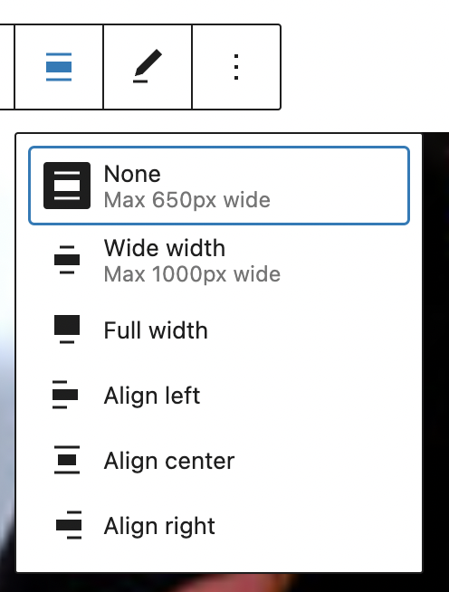

-   **Align left** – Make the Flickr post left aligned
-   **Align center** – Make the Flickr post alignment centered
-   **Align right** – Make the  Flickr post-align-right
-   **Wide width** – Increase the width of the post beyond the content size
-   **Full width** – extend the Flickr post to cover the full width of the screen.

**Note:** “Wide width” and “Full width” alignment needs to be enabled by the Theme of your site.

**Edit URL**

Via the edit URL, you can change the Flickr Embed URL in the embed block. Overwrite the existing URL and click on the “Embed” Button.

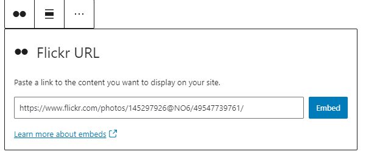

**More Options**

These controls give you the option to copy, duplicate, and edit your block as HTML.

> [!NOTE]
> [Read about these and other settings.](../../working-with-blocks/more-options.md)

## Block Settings

### Media settings

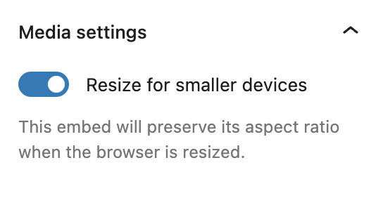

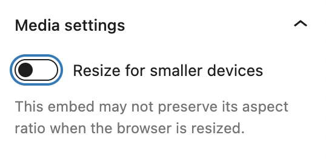

Via the Media Settings, you can control the behavior of your post embed when viewed from a smaller device, like on a phone screen.

The Toggle switch turns on or off the resize functionality for smaller devices. The default setting is “on” or blue.

“Off:” This embed may not preserve its aspect ratio when the browser is resized. In the off position, the toggle switch is gray.

“On:” This embed will preserve its aspect ratio when the browser is resized. The toggle switch turns blue in the “On” position.

**Advanced**

The following Advanced settings options are available: HTML Anchor, Additional CSS Class(es), Additional CSS, and Styles.

> [!NOTE]
> [Learn more about advanced settings.](../../working-with-blocks/block-settings/advanced-settings-overview.md)

## Changelog

-   Updated 2026-06-29
    -   Linked to advanced settings
-   Updated 2022-11-25
    -   Removed redundant content
-   Updated 2022-10-28
    -   Added Video walkthrough
    -   Updated Screenshots as per WordPress 6.0
    -   Added Alt text to images
    -   Added locking functionality
-   Updated 2020-08-18
    -   Added “Move To” and “Copy” section under More Options
-   Updated 2020-08-17
    -   Screenshots as per WordPress 5.5
-   Created 2020-06-30
