# Instagram embed

> [!NOTE]
> Due to Facebook’s [decision to close the oEmbed end](<http://Facebook%20announced%20updates%20to%20their%20Marketing%20API>) point for embedding Instagram links, the block will not work anymore after October 24, 2020. Publishers who want to embed Facebook links into their sites will require a developer account and an appid, and provide an authenication token with their call to the endpoint. Facebook Documentation: [create an app](https://developers.facebook.com/docs/apps/)

*WordPress leadership reached out to Facebook but it seems the policy change is final. Apart from alerting users here and other place, WordPress contributors can’t do anything about it.*

---

The Facebook embed block was removed for the Gutenberg plugin version 9.0 and will be removed from the upcoming WordPress core version in 5.6

With the Instagram Embed block, you can embed Instagram posts on your posts and pages. You don’t need an Instagram account to be able to use it. You can only embed public posts, though.

**An Example:**

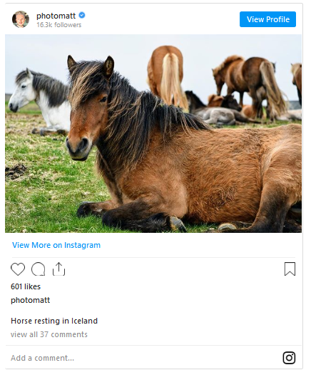

**Steps to embed an Instagram Post**

1.  **Find the URL of the post**

FinNavigate to the Instagram post you want to embed on your page. Copy the link of that post by clicking on it, then on the more options button, and then on the Copy Link. The process is similar for mobile devices.

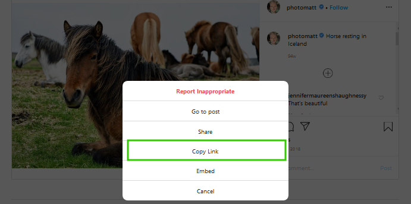

2.  **Go to your post or page**
3.  **Add the Instagram block**
4.  **Paste the link into the text box and click the “Embed” button**

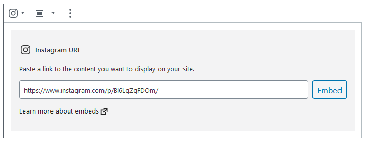

If the link is embedded successfully, you’ll see a preview in your editor.

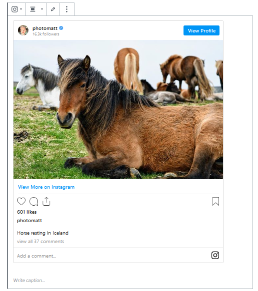

If you’re using a link that cannot be embedded, the block shows a message, “*Sorry, this content could not be embedded.*”

You will have two choices: Try again with a different URL or convert it to a link.

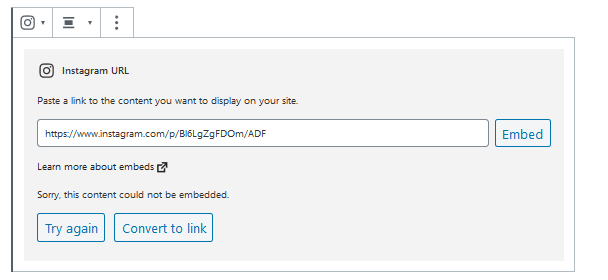

**6. Click on “Preview” to see how it will look on the front-end.**

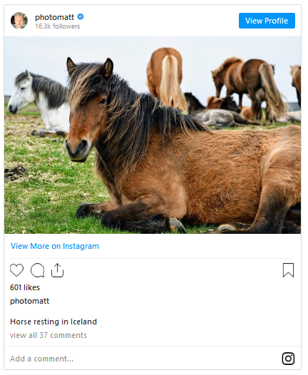

## Block Toolbar

Besides the Mover and Drag & Drop Handle, the Block Toolbar for the Instagram embed shows four buttons:

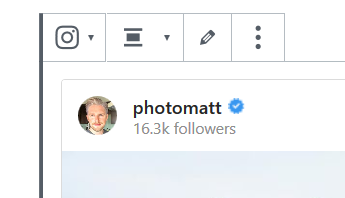

-   Transform to
-   Change alignment
-   Edit URL, and
-   More Options.

**Transform to**:

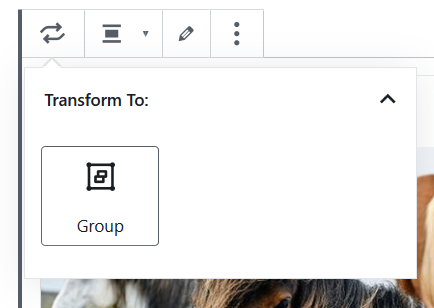

You can transform an Instagram embed to a Group. This would give you the ability to change the background color around the Instagram embed.

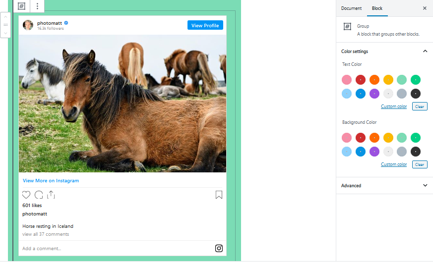

*Editor view of an Instagram Embed as a group with Color Settings controls*

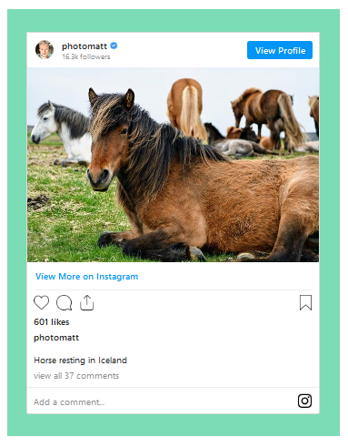

*Instagram embed with a green background*

**Change Alignment**

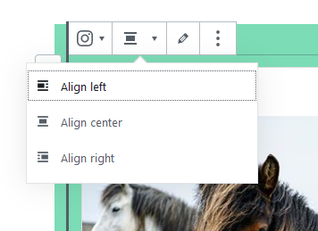

-   **Align left** – Make the Instagram post left aligned
-   **Align center** – Make the Instagram post alignment centered
-   **Align right** – Make the  Instagram post align right

**Edit URL**

Via the edit URL, you can change the Instagram Embed URL in the embed block. Overwrite the existing URL and click on the “Embed” Button.

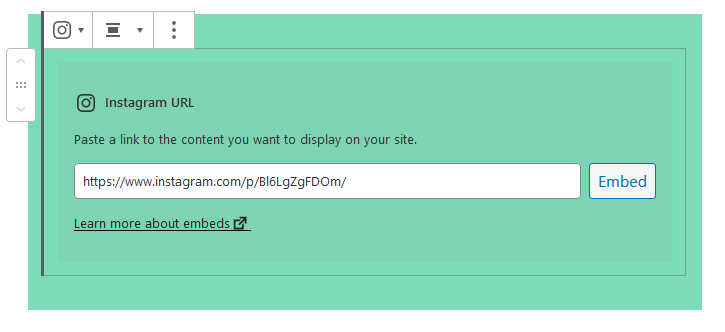

**More Options:**

These controls give you the option to copy, duplicate, and edit your block as HTML.

> [!NOTE]
> [Read about these and other settings.](../../working-with-blocks/more-options.md)

## Block Settings

**Media Settings**

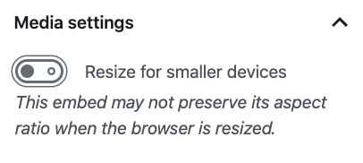

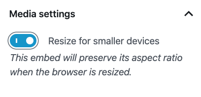

Via the *Media Settings* you can control the behavior of your post embed when viewed from a smaller device, like on a phone screen.

The Toggle switch turns on or off the resize functionality for smaller devices. The default setting is “on” or blue.

**“Off:”** This embed may not preserve its aspect ratio when the browser is resized. In the off position the toggle switch is gray.

**“On:”** This embed will preserve its aspect ratio when the browser is resized. The toggle switch turns blue in the “On” position.

**Advanced**

The advanced tab lets you add a CSS class to your block, allowing you to write custom CSS and style the block as you see fit.

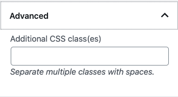

*The advanced section lets you add a CSS class to your block.*

## Changelog

-   Updated 2022-11-27
    -   Removed redundant content
    -   Aligned images for mobile view
    -   Added alt text to images
-   Updated 2020-09-21
-   Updated 2020-08-18
    -   Replaced ‘More Options’ – new screenshot
    -   Added “Move To” and “Copy” section under More Options
-   Created 2020-06-05
