# Pinterest embed

With the Pinterest embed block, you can embed pins, boards (a collection of pins), and Pinterest profiles into your posts and pages. You don’t need a Pinterest account to be able to use it, but only public pins, boards, and profiles can be embedded.

**Examples of Pinterest embeds**:

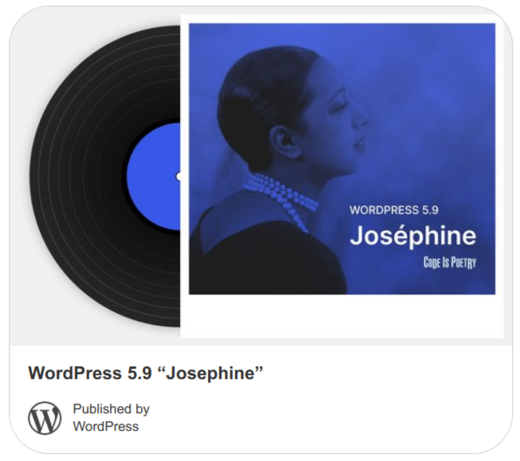

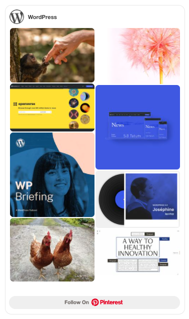

*Left image: Example of an individual pin embed. Right image: Example of a Pinterest profile embed.*

**Steps to embed Pinterest pins, boards, and profiles**

1.  First, find the pin, board, or profile on Pinterest that you want to embed, and copy its URL from the browser bar.

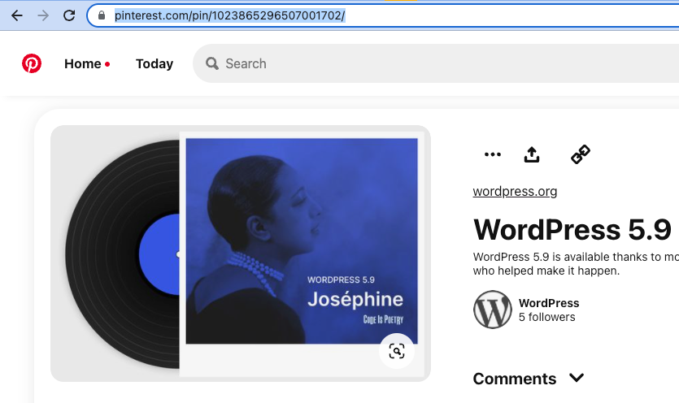

2.  Go to your post or page and add the Pinterest embed block. One way to do this is to press the “/” key to open the block inserter and type /pinterest.

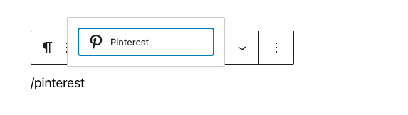

> [!NOTE]
> *Detailed instructions on adding blocks can be found in [this guide](../../wordpress-block-editor.md#adding-a-block).*

3.  Paste the link into the text box and click the “Embed” button.

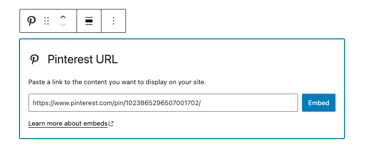

If the link can be successfully embedded into your post/page, you will see the preview in your block editor.

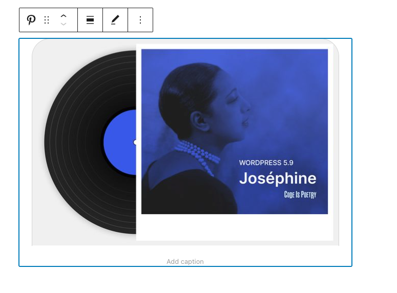

If you use a URL that can’t be embedded, the block displays the message: *“Sorry, this content could not be embedded.”* You will have two choices: try again with a different URL or convert it to a link.

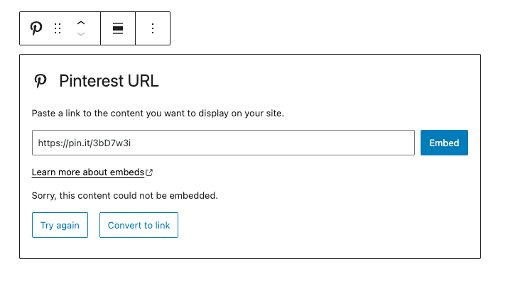

4.  Click the “Preview” button in the top right corner of the post/page to see how it will look on the front-end.

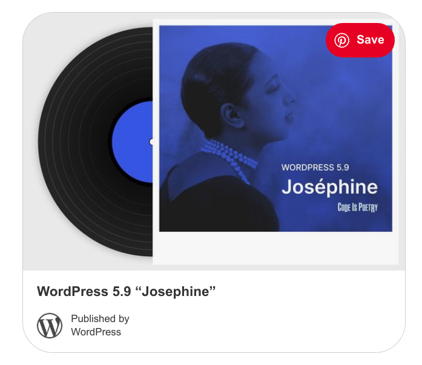

## Block Toolbar

Besides the “Mover” and “Drag & Drop Handle”, the Block Toolbar for the Pinterest embed block shows four buttons:

-   Transform to – also the icon for the block
-   Change alignment
-   Edit URL, and
-   More Options

### Transform to

The first option will allow you to transform a Pinterest embed into a Paragraph. This will convert the pin, board, or Pinterest profile embedded to a link. You also can transform a Pinterest embed into Columns or into a Group.

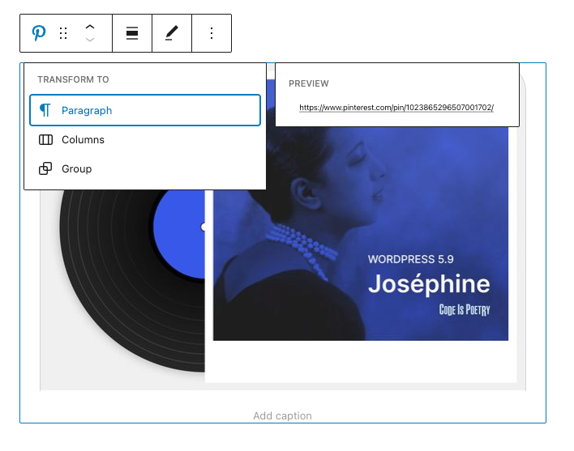

Transforming it into a Group will give you the ability to change the following, among other options:

-   The background color around the Pinterest embed
-   The padding, margin, and block spacing dimensions
-   The border settings of the block (width, style, color, and radius)

**Note**: you can preview what each block (paragraph, column, or group) will look like by hovering the mouse over each option.

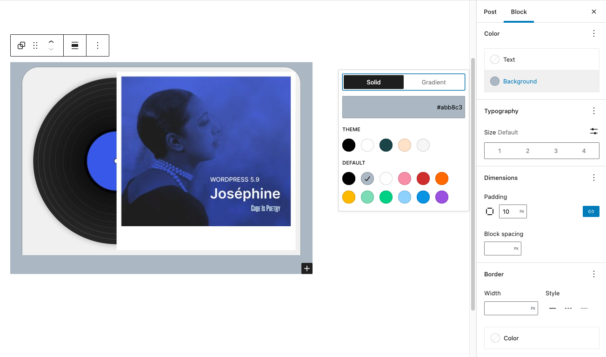

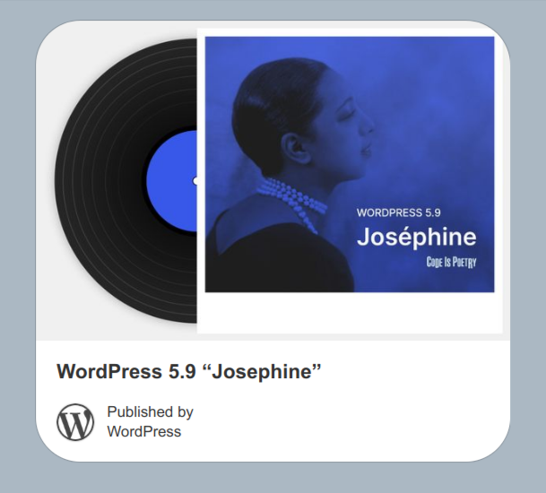

*Left image: Editor view of a Pinterest embed as a group with color, dimension, and border settings. Right image: Front-end preview of a Pinterest embed with a grey background.*

### Change Alignment

-   **None** – Default alignment option
-   **Wide width** – Increase the width of the post beyond the content size
-   **Full width** – Extend the block to cover the full width of the screen
-   **Align left** – Make the block left-aligned
-   **Align center** – Make the block alignment centered
-   **Align right** – Make the block right-aligned

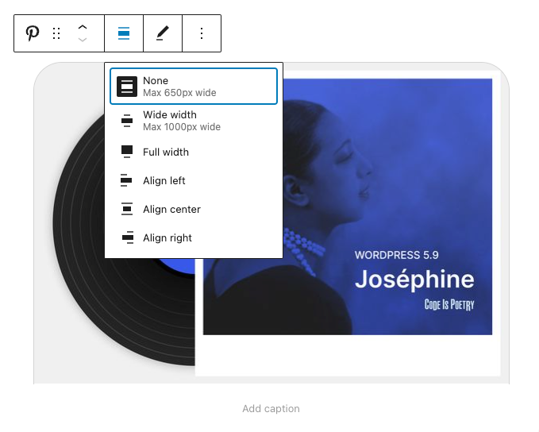

### Edit URL

Via the edit URL, you can change the Pinterest embed URL in the embed block. Overwrite the existing URL and click on the “Embed” button on the right.

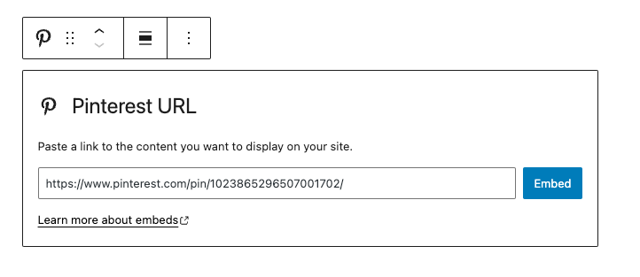

### More Options

Details about **More options** can be found in this [support article](../../working-with-blocks/more-options.md).

## Block Settings

**Advanced**

The following Advanced settings options are available: HTML Anchor, Additional CSS Class(es), Additional CSS, and Styles.

> [!NOTE]
> [Learn more about advanced settings.](../../working-with-blocks/block-settings/advanced-settings-overview.md)

## Changelog

-   Updated 2026-06-29
    -   Linked to advanced settings
-   Updated 2023-08-08
    -   Link “More Options” to article
-   Created 2022-03-24
