# Reddit embed

Reddit is one of the most popular websites. It hosts a considerable number of communities that share content on an astonishing number of topics. The Reddit block allows you to embed content from Reddit to your post. You do not need to have an account to be able to share the Reddit post. However, you can only embed publicly shared posts.

The screenshot below is an example of what an embed with the Reddit block may look like (in the Twenty Twenty-Three theme):

*Reddit embed (with image) within the Twenty Twenty-Three theme*

The example above is from an URL that contains an image. However, you can also embed posts that contain only text. In that case, your embed may look like this:

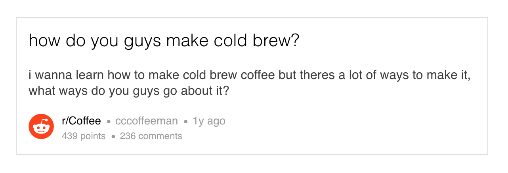

*Preview of Reddit embed within the Twenty Twenty-Three theme*

**Steps to embed a Reddit post**

The Reddit block makes it quite simple to embed a Reddit post. These are the required steps:

1.  **Go to the Reddit post you want to embed.** Please make sure it’s a public post.

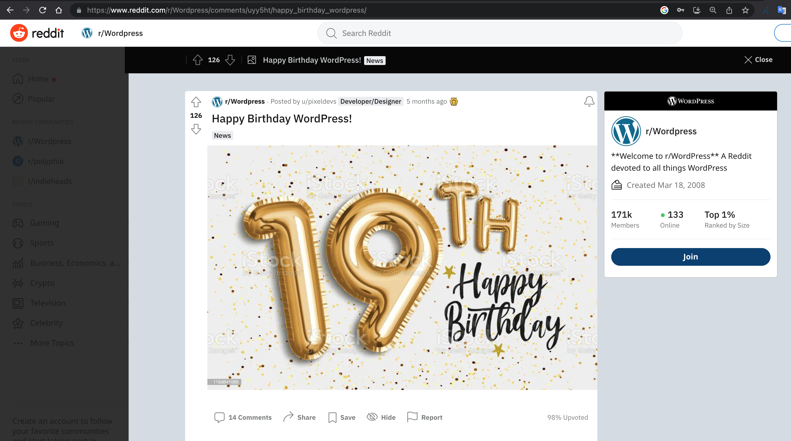

2.  **Copy the URL.** 
    You can find the URL at the top of the screen (marked in red in the image below)

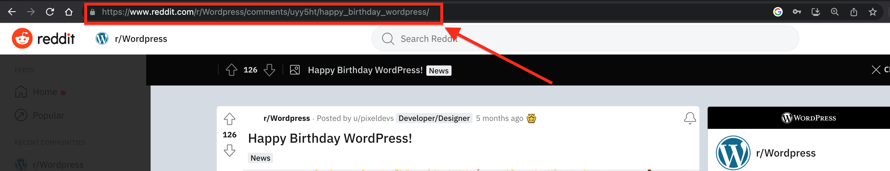

3.  **Go back to your editing screen and add a Reddit block to your post.** 
    The fastest way to add a block is to use the slash command. In the empty field in the block editor type “**/reddit**”. The Reddit block will appear, and you can click to select it and add it to the post. Alternatively, [see the detailed instructions on how to add a block](../../wordpress-block-editor.md#adding-a-block).

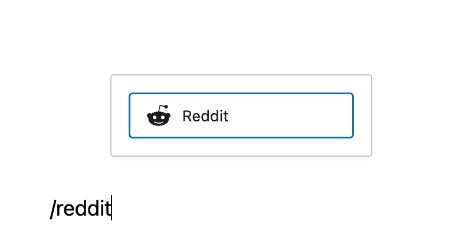

> [!NOTE]
> [Detailed instructions on adding blocks](../../working-with-blocks/adding-a-new-block.md)

4.  **Paste the Reddit URL you copied into the block’s input field.**

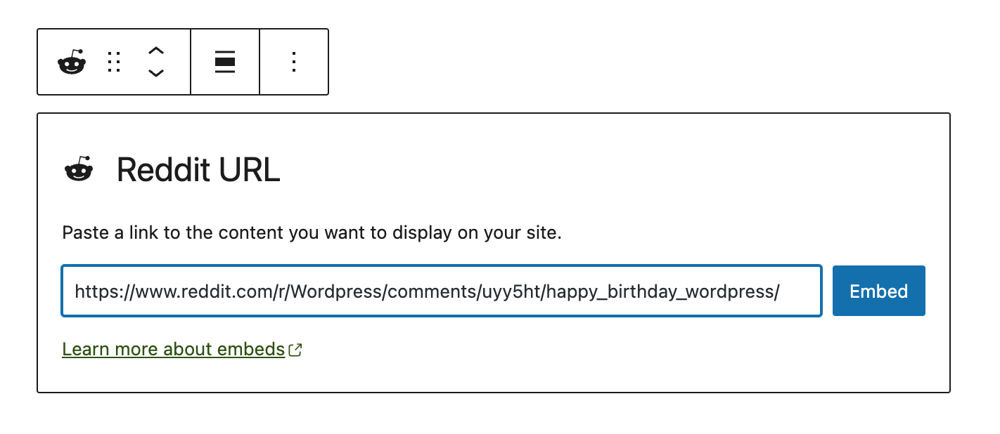

5.  **Click the Embed button to embed the post.** 
    You will see a preview of the embedded post in your editor.

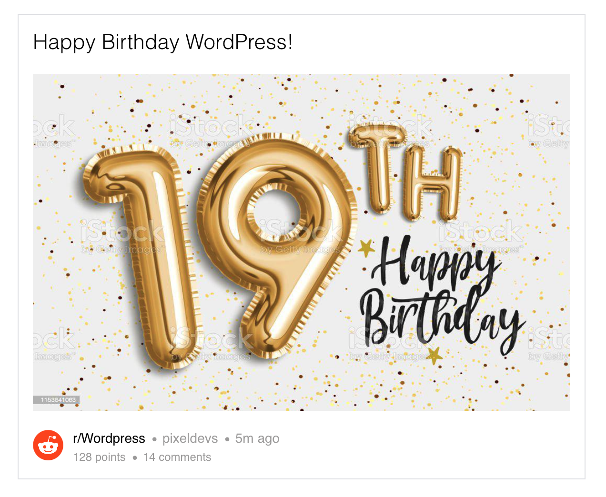

**Note**: In most cases, you should get this result. However, if the URL cannot be embedded, you will be notified with the message, “Sorry, this content could not be embedded.” In that case, you can try to embed an alternative URL or simply add the URL as a link instead of an embed.

## Block Toolbar

The toolbar of the Reddit block contains several useful buttons. Besides the Mover and Drag & Drop Handle, the Block Toolbar for the Reddit embed also features the buttons:

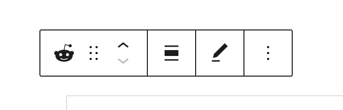

-   Transform
-   Block moving tools (Drag, move up, move down)
-   Align
-   Edit URL
-   More options

**Transform**

You can transform a Reddit embed into a Paragraph, Group, or Columns block.

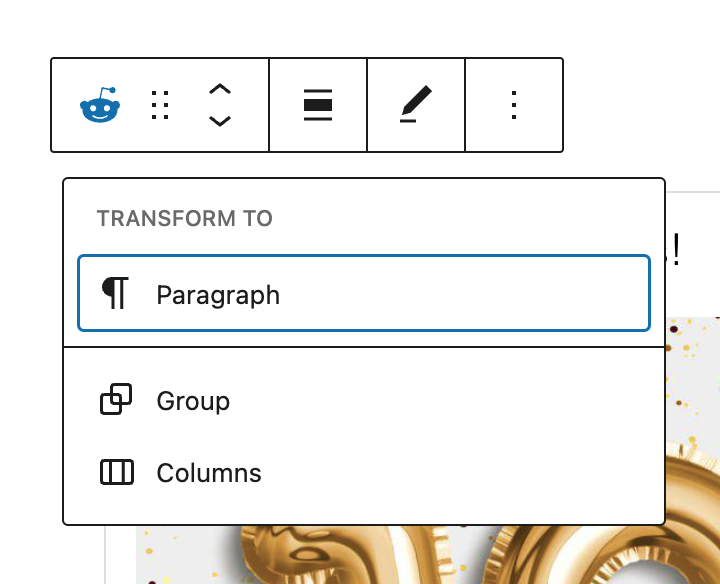

Transforming it into a **Paragraph** will turn the embed into a simple link.

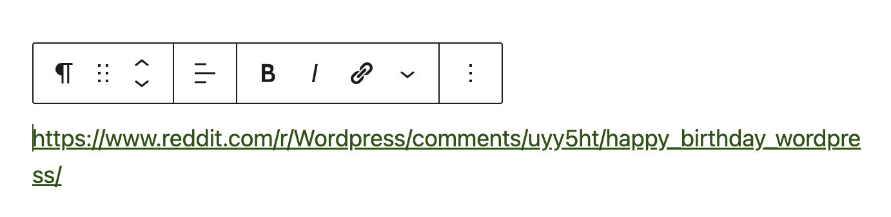

Transforming the Reddit block into a **Group block** gives you the ability to change the Reddit embed’s background color.

Once you transform the embed into a Group block, you will get the Color settings in the sidebar (as seen in the image below, on the right)

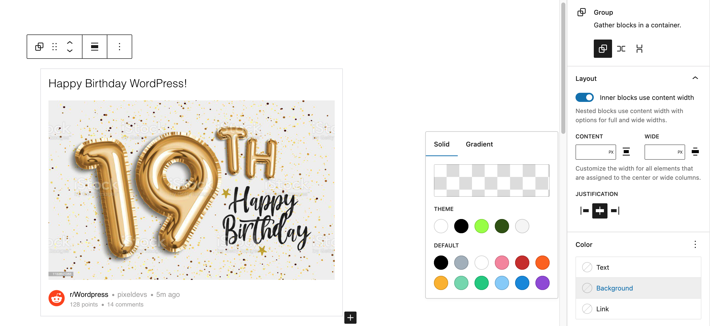

Choose a color in the Background color settings, and the background will be added to the block.

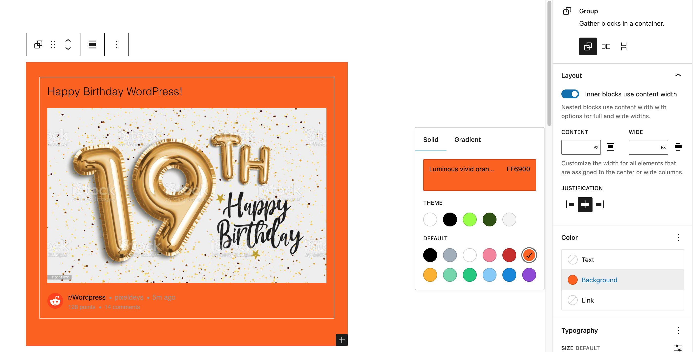

Transforming the Reddit block into a **Columns block** will give you added customization options if you’d like to group or organize your content into columns.

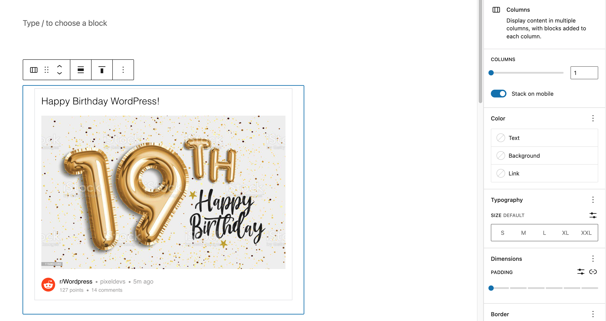

**Block-moving tools**

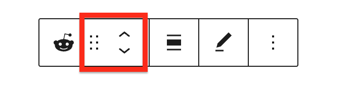

Use the block-moving tools to move the Reddit block up and down the editor. Use the six dots icon to drag and drop the Reddit Embed block and reposition it anywhere on the editor. Alternatively, click on the move up and move down arrows to move the block up or down the editor.

> [!NOTE]
> [Get more information about moving a block within the editor.](../../working-with-blocks/moving-blocks.md)

**Change Alignment**

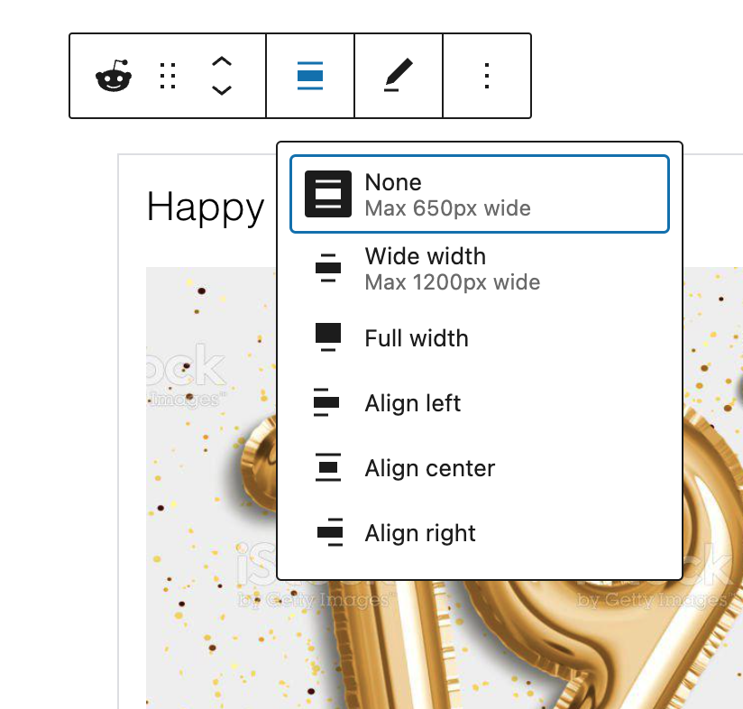

The change alignment button allows you to:

-   **None** – No Alignment
-   **Wide width** – Increase the width of the post beyond the content size.
-   **Full width** – extend the Reddit post to cover the full width of the screen.
-   **Align left** – Make the Reddit post left-aligned.
-   **Align center** – Make the Reddit post alignment centered.
-   **Align right** – Make the Reddit post align right.

Note: “Wide width” and “Full width” alignment need to be enabled by your site’s Theme.

**Edit URL**

With the Edit URL, you can change the Reddit URL in the Reddit block. Once you click on ’embed’, it will change the embed automatically.

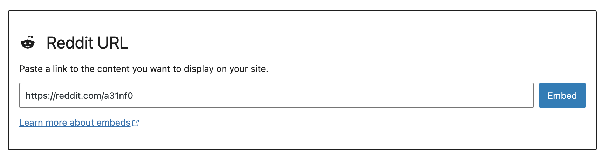

**More options**

These controls give you the option to copy, duplicate, and edit your block as HTML.

> [!NOTE]
> [Read about these and other settings.](../../working-with-blocks/more-options.md)

## Block settings

With the Reddit block selected, there are additional settings in the ‘Block’ option of the block editor sidebar.

### Media Settings

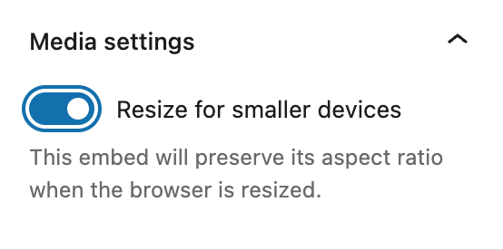

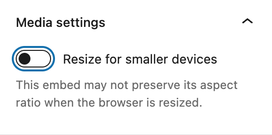

With the *Media settings*, you can control the behavior of your Reddit embed when viewed from a smaller device, like on a smartphone screen.

The Toggle switch turns on or off the resize functionality for smaller devices. The default setting is “on” or blue.

**“On:”** This embed will preserve its aspect ratio when the browser is resized. The toggle switch turns blue in the “On” position.

**“Off:”** This embed may not preserve its aspect ratio when the browser is resized. In the off position, the toggle switch is gray.

**Advanced**

The following Advanced settings options are available: HTML Anchor, Additional CSS Class(es), Additional CSS, and Styles.

> [!NOTE]
> [Learn more about advanced settings.](../../working-with-blocks/block-settings/advanced-settings-overview.md)

## Changelog

-   Updated 2026-06-29
    -   Linked to advanced settings
-   Updated 2022-11-25
    -   Removed redundant content
    -   Aligned images for mobile view
    -   Expanded the alt text for images
-   Screenshots and information updated for WordPress 6.1 (2022-11-04)
-   Updated 2022-08-01
    -   Added ALT Tags for the images
    -   Added drag and move tool info
-   Screenshots updated for 6.0 version 2022-07-26
-   Created 2020-09-04
