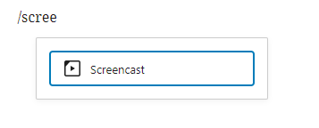
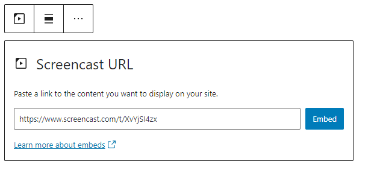
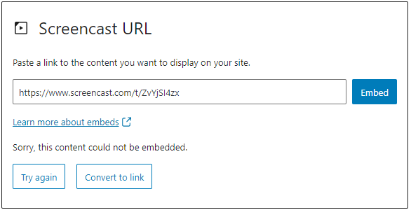
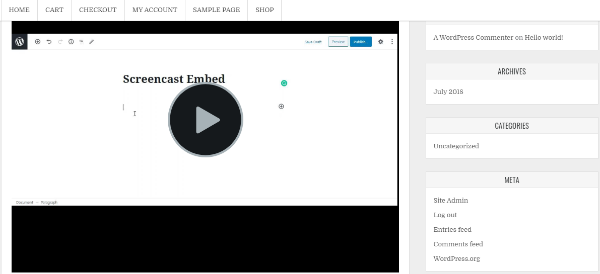
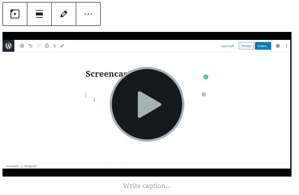
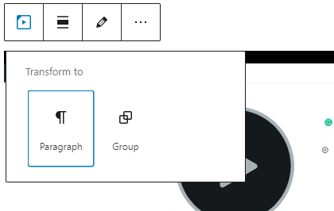
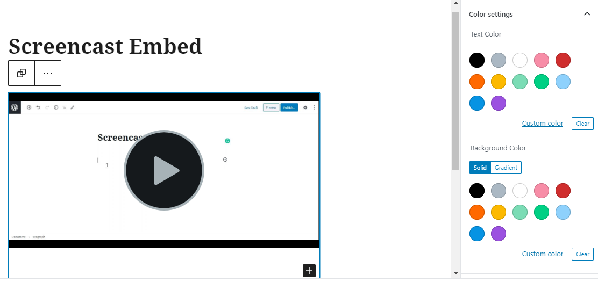
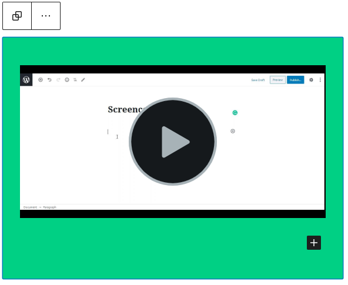
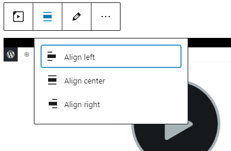
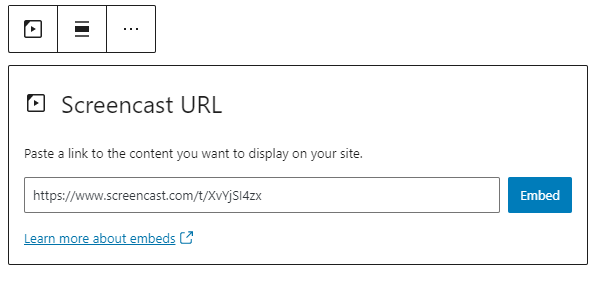

# Screencast embed

Screencast is a digital recording of your computer screen. It usually includes audio narration and is a different type of instructional video.

With the [Screencast](https://www.techsmith.com/screencast.html) Embed block, you can add Screencast videos on your posts/pages. You need a Screencast account to embed a video.

**Steps to embed a Screencast video to your post or page:**

1.  Create and upload a Screencast video in your [Screencast](https://app.screencast.com/) account and copy the URL of the video.

2.  Add a Screencast embed block to your post or page

> [!NOTE]
> [Detailed instructions on adding blocks](../../working-with-blocks/adding-a-new-block.md)

3.  Paste the link into the textbox. Press the “Embed” button.

If the link can be successfully embedded into the post/page, you will see the preview in your block editor.

If you use a URL that can’t be embedded, the block shows the message “Sorry, this content could not be embedded.” You will have two choices: Try again with a different URL or convert to link.

4.  Click on the Preview button on the top right corner of the page/post to see how it will look on the front-end

## Block Toolbar

Besides the Mover and Drag & Drop Handle, the Block Toolbar for the  Screencast embed shows four buttons:

-   Transform to
-   Change alignment
-   Edit URL, and
-   More Options.

**Transform to**

You can transform a Screencast embed to a Group. This would give you the ability to change the background color around the Screencast embed.

Left: Editor view of an Screencast Embed as a group with Color Settings controls

Screencast embed with a green background.

**Change alignment**

-   **Align left** – Make the Screencast post left aligned
-   **Align center** – Make the Screencast post alignment centered
-   **Align right** – Make the  Screencast post align right
-   **Wide width** – Increase the width of the post beyond the content size
-   **Full width** – extend the Screencast post to cover the full width of the screen.

**Note:** “Wide width” and “Full width” alignment need to be enabled by the Theme of your site.

**Edit URL**

Via the edit URL, you can change the Screencast Embed URL in the embed block. Overwrite the existing URL and click on the “Embed” Button.

**More options**

These controls give you the option to copy, duplicate, and edit your block as HTML.

> [!NOTE]
> [Read about these and other settings.](../../working-with-blocks/more-options.md)

## Block Settings

No block settings for this particular block

**Advanced**

The following Advanced settings options are available: HTML Anchor, Additional CSS Class(es), Additional CSS, and Styles.

> [!NOTE]
> [Learn more about advanced settings.](../../working-with-blocks/block-settings/advanced-settings-overview.md)

## Changelog

-   Updated 2026-06-29
    -   Linked to advanced settings
-   Updated 2023-02-10
    -   Added info about the screencast account and links to the site
-   Updated 2022-11-25
    -   Removed redundant content
    -   Aligned images for mobile view
    -   Added alt text to images
-   Updated 2020-08-19
    -   Replaced “More Options” – new screenshot
    -   Added “Move To” and “Copy” section under More Options
-   Updated 2020-08-11
    -   screenshots as per WordPress 5.5
-   Created 2020-07-24
