# Slideshare embed (Removed)

> [!NOTE]
>  
> **The SlideShare Embed block was removed in WordPress 6.6. 
> This article is retained for reference purposes only and may be removed at any time.**

## Steps to embed a Slideshare presentation on your post or page

1.  Find the [presentation on slideshare.net](https://www.slideshare.net/photomatt/state-of-the-word-2016) and copy the presentation URL from the browser bar.

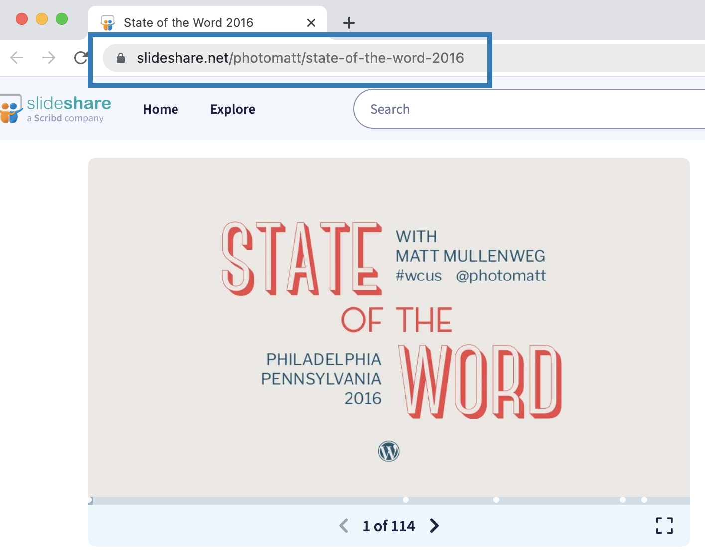

2.  Add the Slideshare Embed block to your post.

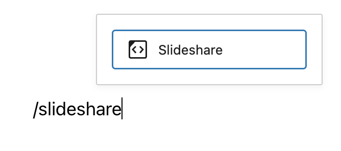

*Adding a block via the “Slash” command from an empty row*

> [!NOTE]
> [Detailed instructions on adding blocks](../../working-with-blocks/adding-a-new-block.md)

3.  Paste the Slideshare URL from step 1 into the block.
4.  Click on the “Embed” button.

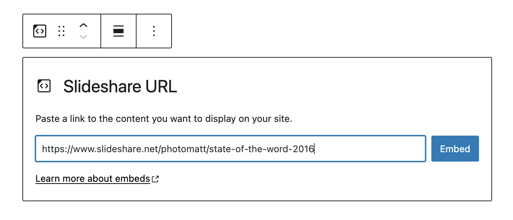

5.  Now you can see the Slideshare presentation in your editor.

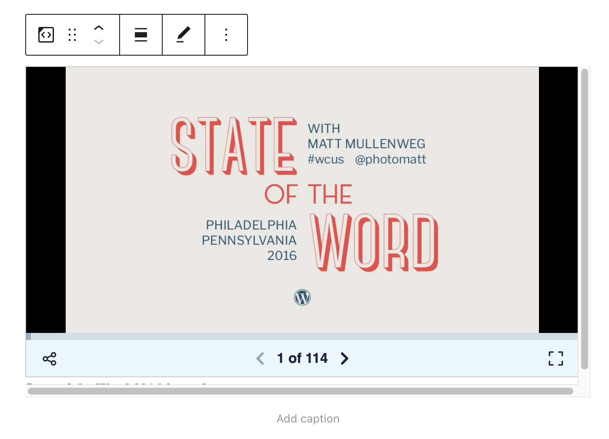

6.  Click on Preview to see how the presentation is displayed on the front end of your page.

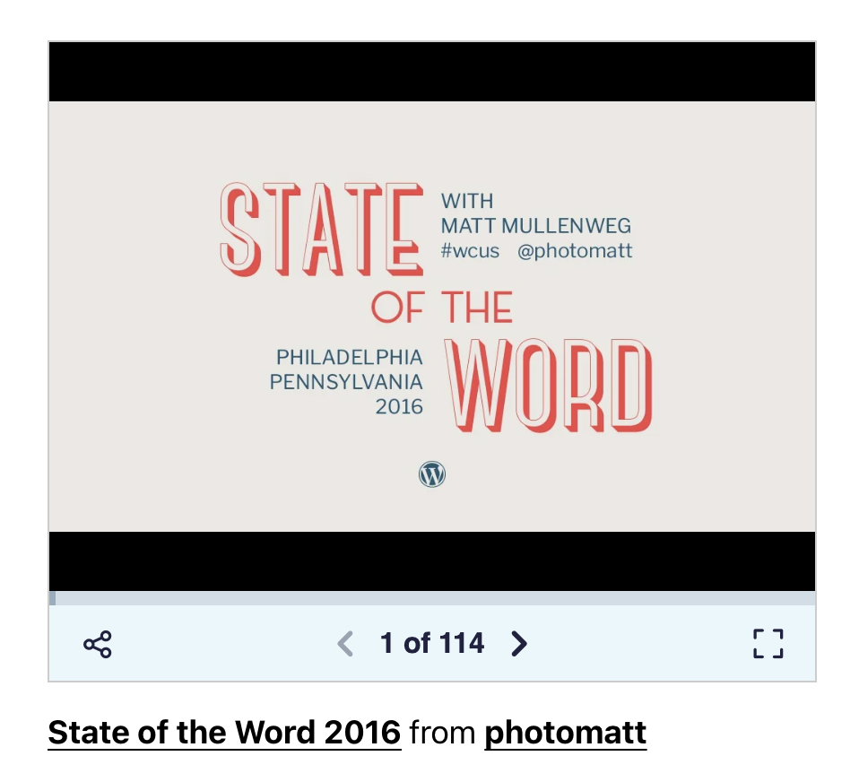

## Block Toolbar

Besides the Mover and Drag & Drop Handle, the Block Toolbar for the Slideshare embed shows four buttons:

-   Transform to
-   Change alignment
-   Edit URL, and
-   More Options.

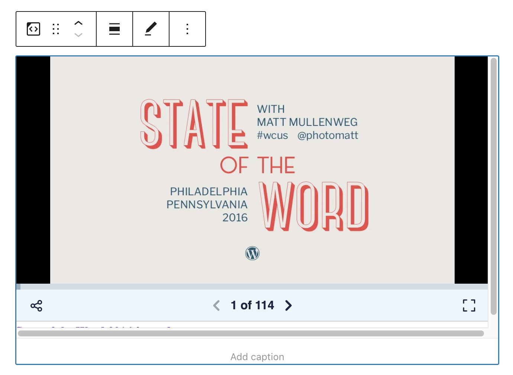

**Transform to:**

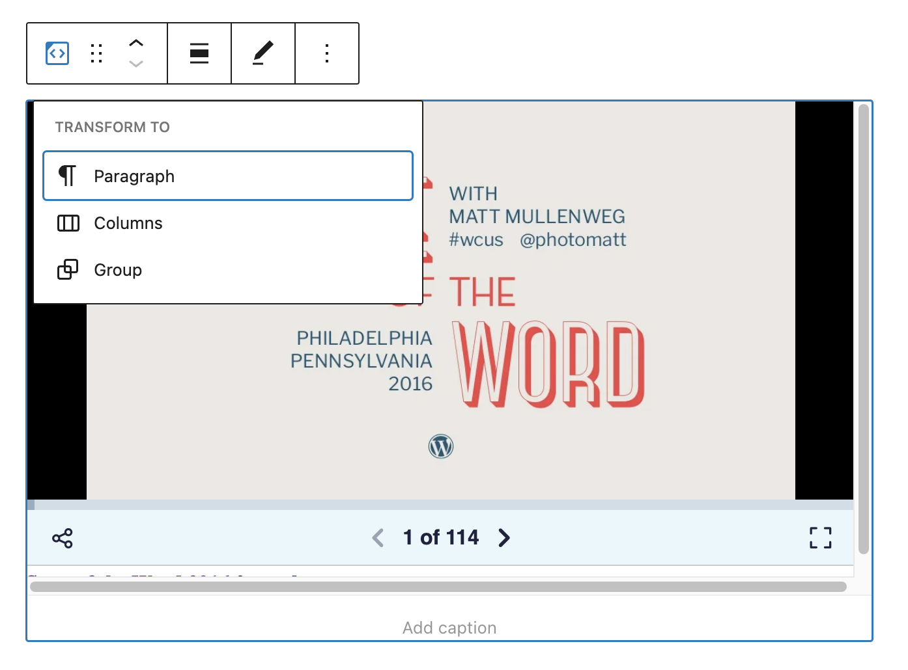

You can transform a Slideshare embed to Columns or a Group. This would give you the ability to change the background color around the Slideshare embed.

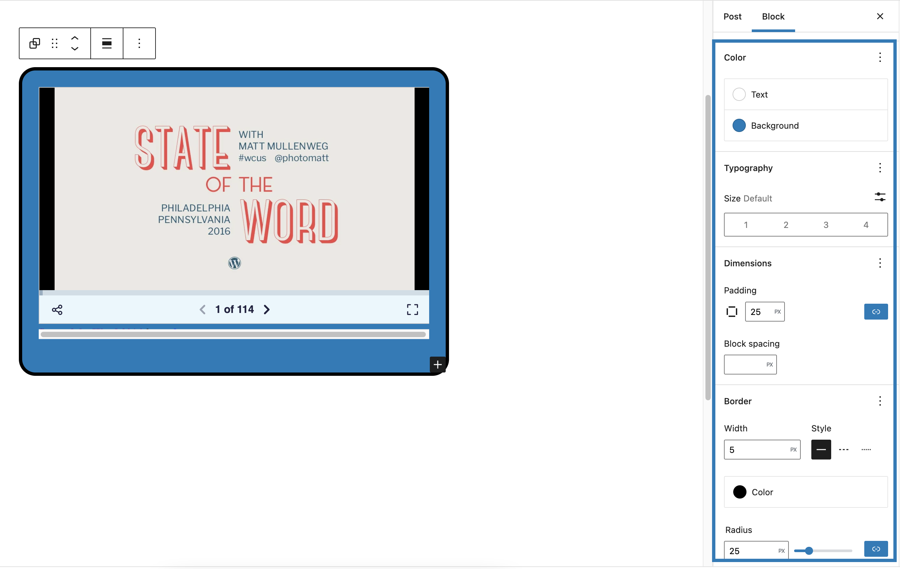

*Shown: Changing text, background color, padding, border and border-radius settings*

**Change Alignment:**

-   **Wide width** – Increase the width of the post beyond the content size
-   **Full width** – extend the Slideshare embed post to cover the full width of the screen.
-   **Align left** – Make the Slideshare embed post left aligned
-   **Align center** – Make the Slideshare embed post alignment centered
-   **Align right** – Make the Slideshare embed post right aligned

*“Wide width” and “Full width” alignment need to be enabled by the Theme of your site.*

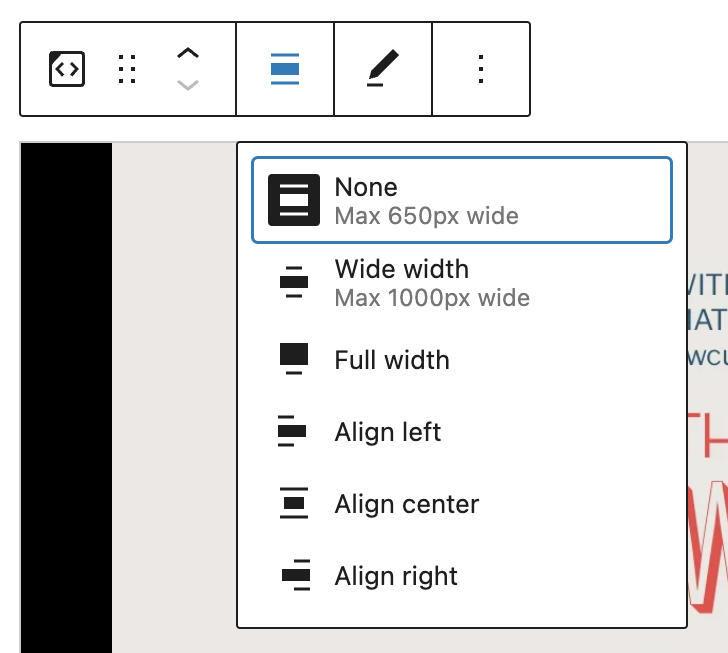

**Edit URL**:

Via the edit URL, you can change the Slideshare Embed URL in the embed block. Overwrite the existing URL and click on the “Embed” Button.

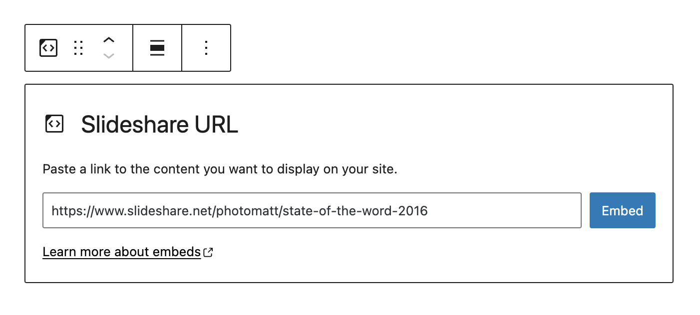

**More Options:**

These controls give you the option to copy, duplicate, and edit your block as HTML.

> [!NOTE]
> [Read about these and other settings.](../../working-with-blocks/more-options.md)

## Block Settings

**Media Settings**

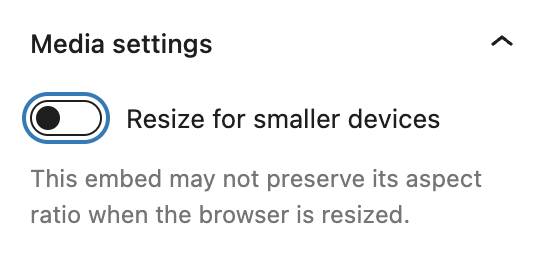

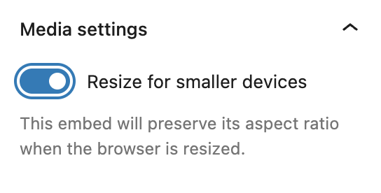

Via the *Media Settings* you can control the behavior of your post embed when viewed from a smaller device, like on a phone screen.

The Toggle switch turns on or off the resize functionality for smaller devices. The default setting is “on” or blue.

**“Off:”** This embed may not preserve its aspect ratio when the browser is resized. In the off position, the toggle switch is gray.

**“On:”** This embed will preserve its aspect ratio when the browser is resized. The toggle switch turns blue in the “On” position.

**Advanced**

The following Advanced settings options are available: HTML Anchor, Additional CSS Class(es), Additional CSS, and Styles.

> [!NOTE]
> [Learn more about advanced settings.](../../working-with-blocks/block-settings/advanced-settings-overview.md)

## Changelog

-   Updated 2026-09-22
    -   Added note about this block was removed in WordPress 6.6.
-   Updated 2026-06-29
    -   Linked to advanced settings
-   Updated 2022-11-25
    -   Removed redundant content
    -   Aligned images for mobile view
    -   Added alt text to images
-   Updated 2022-08-19
    -   Updated with images from WordPress 6.0
    -   Added new “Transform to” setting (column)
    -   Added “Lock” information under More Options
    -   Added ALT tags for the images
-   Updated 2020-08-19
    -   Replaced “More Options” – new screenshot
    -   Added “Move To” and “Copy” section under More Options
-   Updated 2020-08-18
    -   Updated with images from WordPress 5.5
-   Created 2020-06-18
