# SoundCloud embed

With the SoundCloud Embed block, you can embed tracks, playlists & albums from SoundCloud into your posts and pages. You don’t need a SoundCloud account to embed a track, playlist, or album, although the track needs to be public.

_**Embedded SoundCloud track**_

_**Embedded SoundCloud Album**_

**Steps to embed a track from SoundCloud**

1.  Find your track link on SoundCloud: In SoundCloud, select the track and click on the “Share” button.

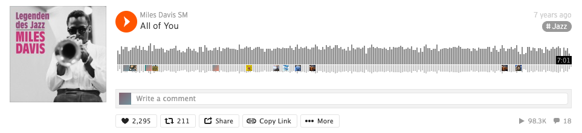

2.  Highlight the track’s link and copy it from the “Share” popup window.

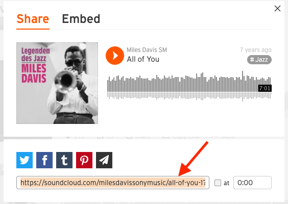

3.  Add a SoundCloud Embed block to your page/post by clicking on the **Block Inserter** icon. You can also type<kbd>/SoundCloud</kbd> and hit enter in a new *paragraph block* to add one quickly.

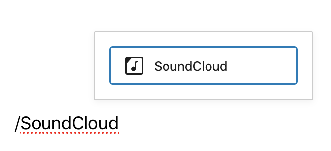

> [!NOTE]
> [Detailed instructions on adding blocks](../../working-with-blocks/adding-a-new-block.md)

4.  Paste the track’s link into the text box.

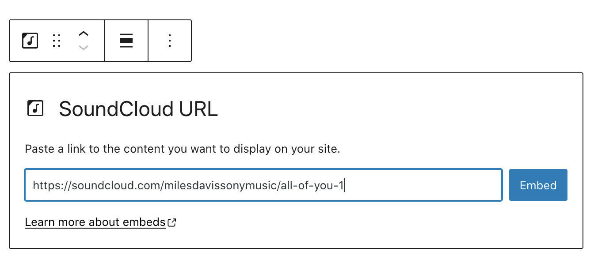

5.  Click the “Embed” button. If the link is successfully embedded you will see a preview in your editor.

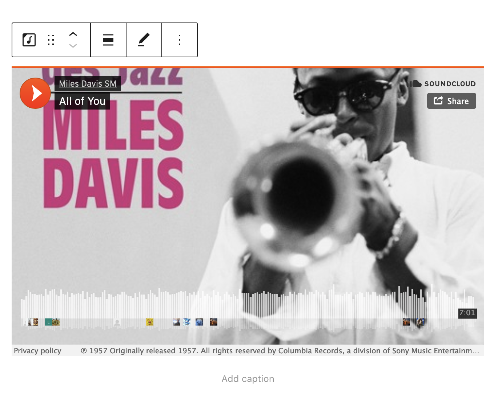

If you use a URL that can’t be embedded, the block shows the message *“Sorry, this content could not be embedded”. You will have two choices: Try again with a different URL or convert to a* link.

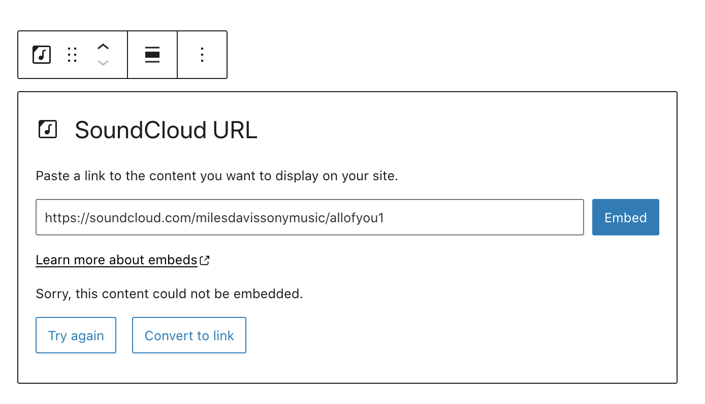

6.  Click on “Preview” to see how it will look on the front end.

7\. A album or playlist URL can be embedded the same way and the complete track list shows in the embed box.

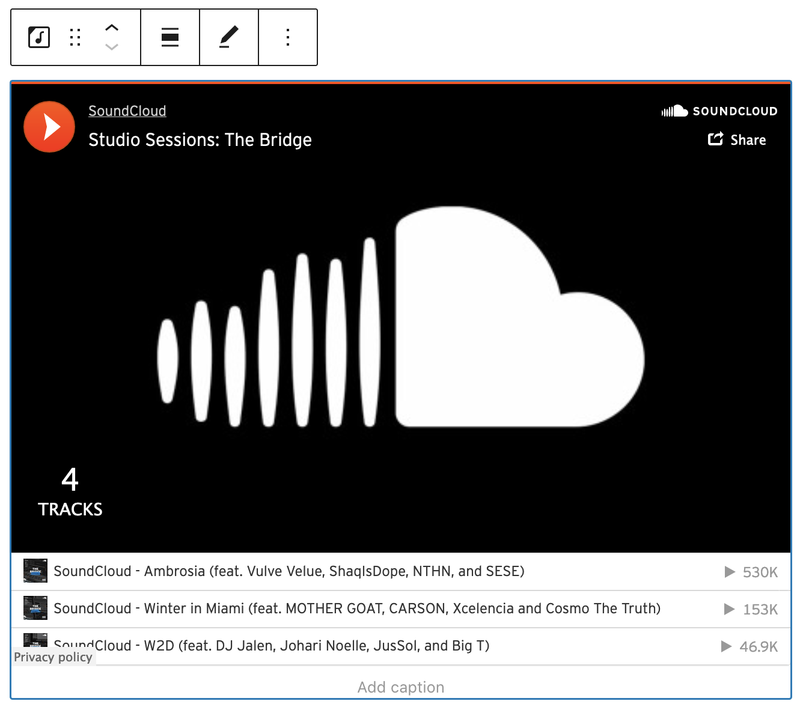

## Block Toolbar

Each block has its own block-specific controls that allow you to manipulate the block right in the editor. The *SoundCloud Embed block* has the following options in the Block toolbar.

-   Transform to
-   Block moving tools
-   Change alignment
-   Edit URL, and
-   More options.

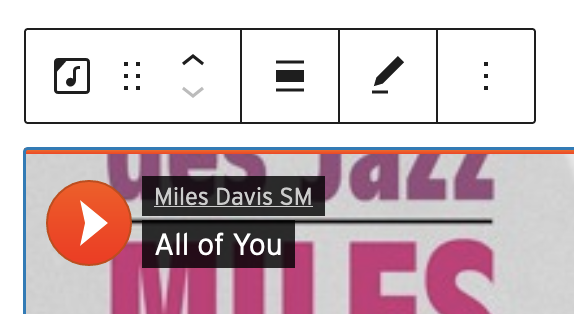

**Transform to**:

You can transform a *SoundCloud Embed block* into a Paragraph, Columns, or a Group block.

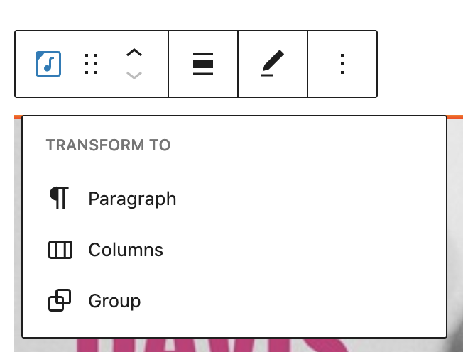

When you transform a SoundCloud embed to a Group block, you can change the background color around the SoundCloud embed.

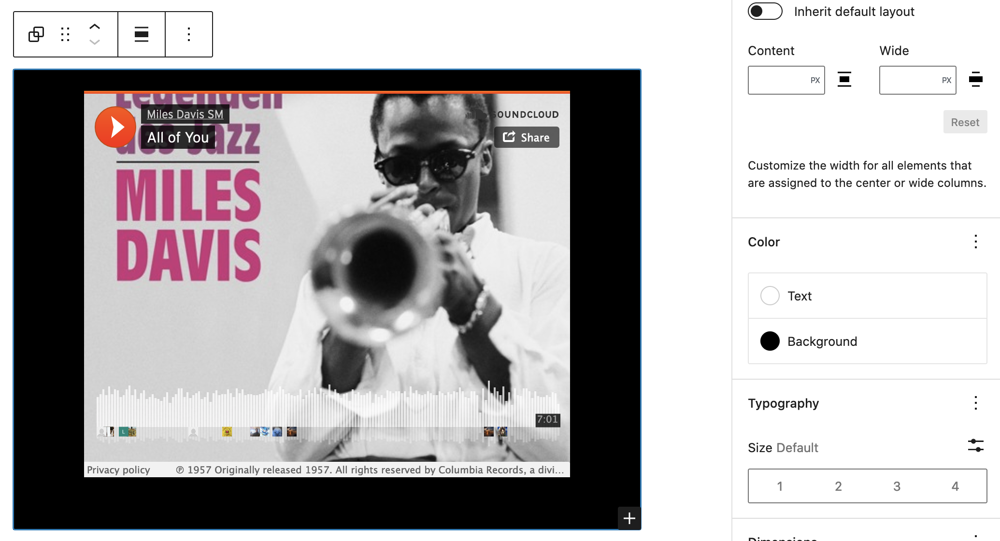

*Editor view of a SoundCloud Embed as a group with Color Settings controls*

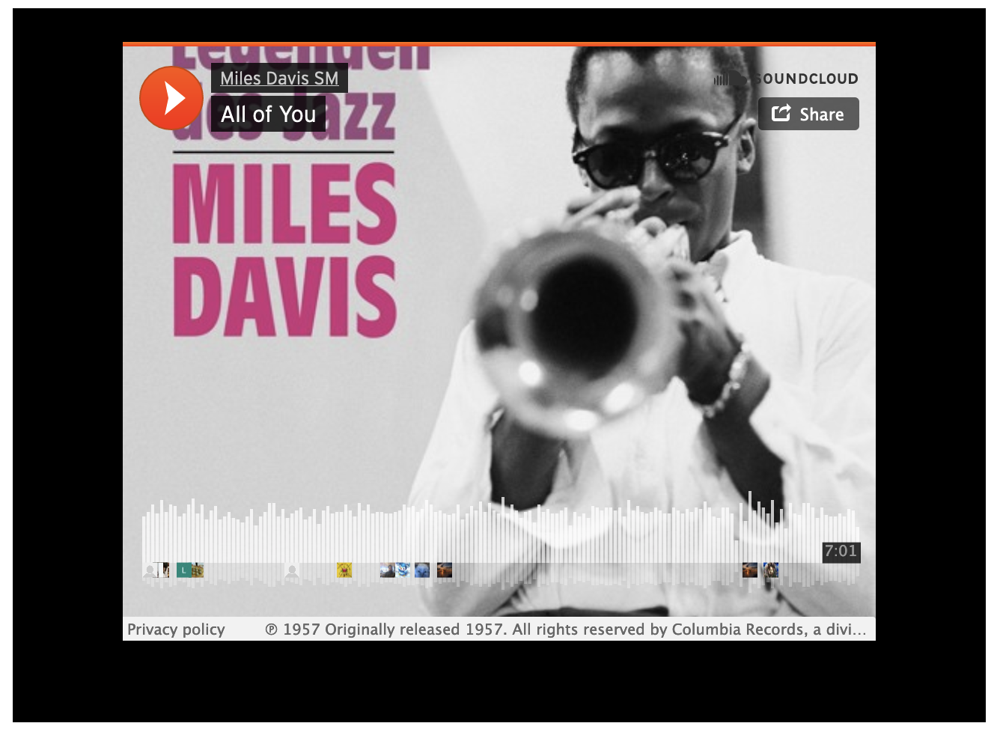

*SoundCloud embed with a background.*

**Block-moving tools**

Use the block-moving tools to move the block up and down inside the editor. Use the six dots icon to drag and drop the *SoundCloud Embed block* and reposition it anywhere on the editor. Alternatively, click on the up and down arrows to move the block up or down the editor.

> [!NOTE]
> [Get more information about moving a block within the editor.](../../working-with-blocks/moving-blocks.md)

**Change alignment**

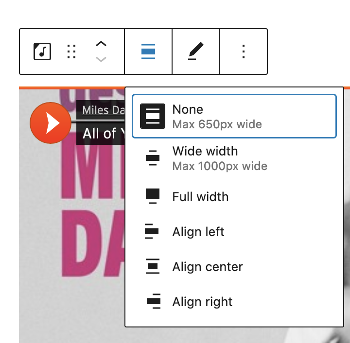

-   **Align left** – Make the SoundCloud post left aligned
-   **Align center** – Make the SoundCloud post alignment centered
-   **Align right** – Make the SoundCloud post align right
-   **Wide width** – Increase the width of the post beyond the content size
-   **Full width** – Extend the SoundCloud post to cover the full width of the screen

“Wide width” and “Full width” alignment need to be enabled by the Theme of your site.

**Edit URL**

You can change the SoundCloud Embed URL in the embed block. Overwrite the existing URL and click on the “Embed” Button.

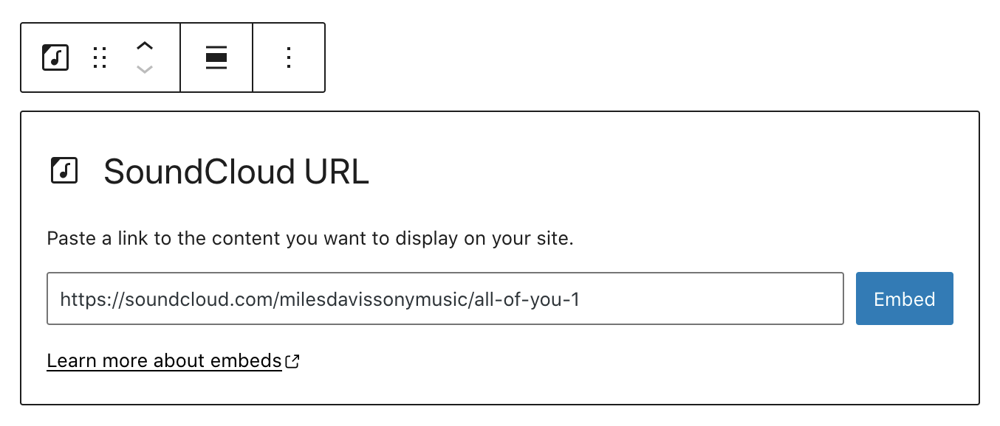

**More options**

These controls give you the option to copy, duplicate, and edit your block as HTML.

> [!NOTE]
> [Read about these and other settings.](../../working-with-blocks/more-options.md)

## Block Settings

**Media Settings**

From the Media Settings, you can control the behavior of your post embed when viewed from a smaller device, like on a phone screen.

The Toggle switch turns on or off the resize functionality for smaller devices. The default setting is “on” or blue.

**“Off:”** This embed may not preserve its aspect ratio when the browser is resized. In the off position, the toggle switch is gray.

**“On:”** This embed will preserve its aspect ratio when the browser is resized. The toggle switch turns blue in the “On” position.

**Advanced**

The following Advanced settings options are available: HTML Anchor, Additional CSS Class(es), Additional CSS, and Styles.

> [!NOTE]
> [Learn more about advanced settings.](../../working-with-blocks/block-settings/advanced-settings-overview.md)

## Changelog

-   Updated 2026-06-29
    -   Linked to advanced settings
-   Updated 2022-11-26
    -   Removed redundant content
    -   Aligned images for mobile view
-   Updated 2022-08-04
    -   Screenshots, content updated for 6.0
    -   Added ALT tags for the images
-   Updated 2020-08-18
    -   Updated images to WP 5.5
    -   Added “Move To” and “Copy” section under More Options
-   Updated 2020-06-05
    -   Uploaded images to media library and replaced deprecated images
-   Created 2020-06-04
