# TikTok embed

With the TikTok Embed block, you can include a TikTok video into your post/page. You don’t need a TikTok account to embed a video, although the video should be public.

Embedded TikTok video

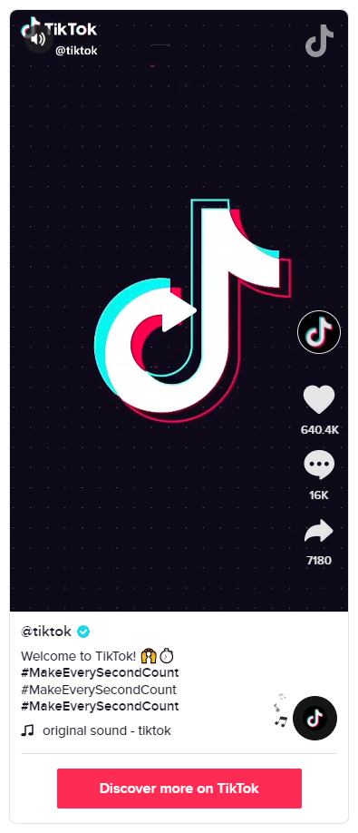

**Steps to embed a video from TikTok**

1.  Find your video link on TikTok

In the web player select the video and click on the link icon to copy the link.

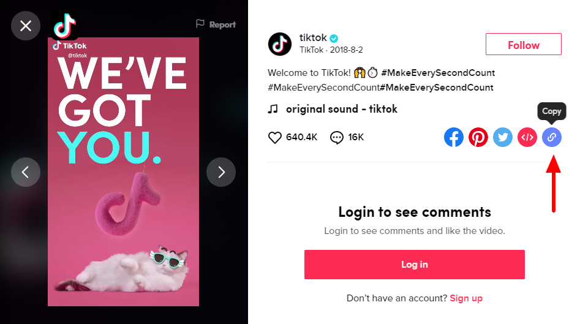

2.  Add a TikTok embed block to your page/post

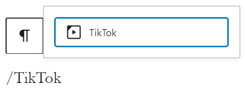

> [!NOTE]
> [Detailed instructions on adding blocks](../../working-with-blocks/adding-a-new-block.md)

3.  Paste the link into the text box and click on the “Embed” button

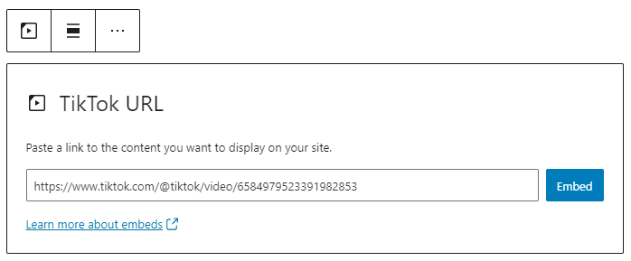

If the embed is successful, you will see a preview in your editor.

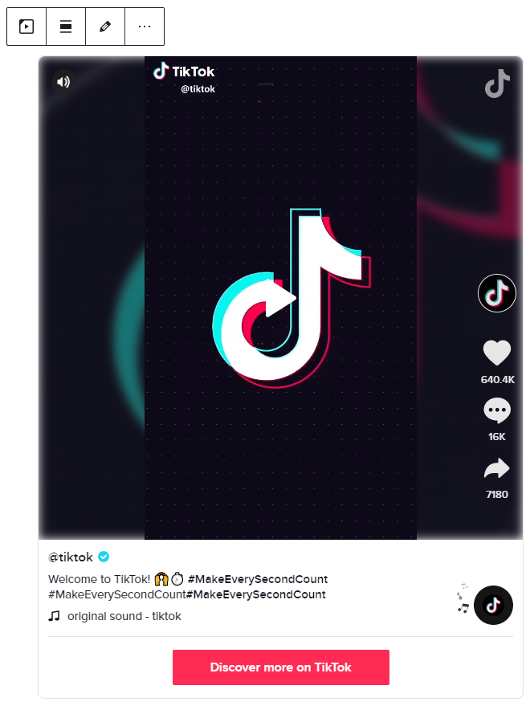

If you use an URL that can’t be embedded, the block shows the message *“Sorry, this content could not be embedded.”*

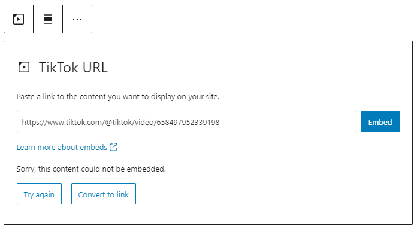

You will have two choices: Try again with a different URL or convert it to a link.

4.  Click on “Preview” to see how it will look on the front-end

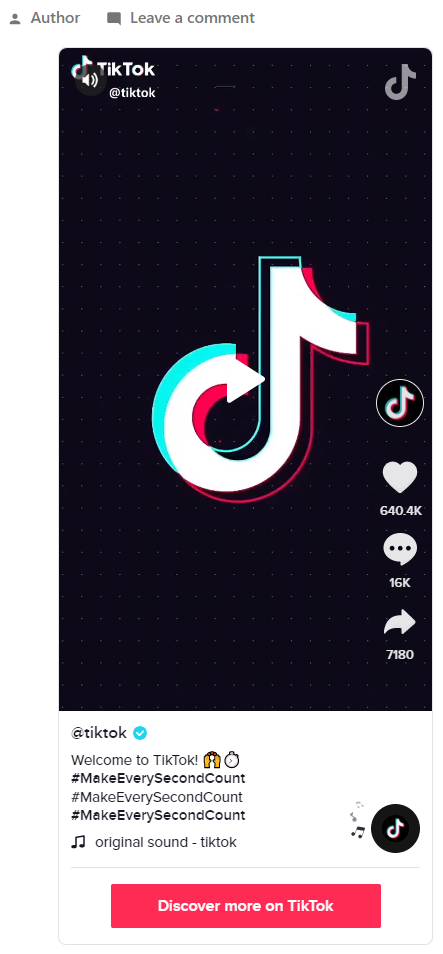

## Block Toolbar

Besides the “Mover” and “Drag & Drop Handle”, the Block Toolbar for the TikTok Embed block shows four buttons:

-   Transform to
-   Change Alignment
-   Edit URL, and
-   More Options

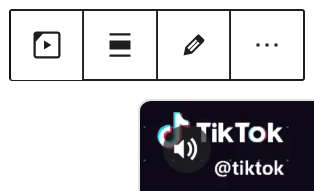

**Transform to**

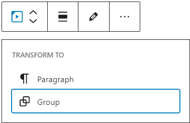

You can transform a TikTok embed into a Group. This would give you the ability to change the background color around the TikTok embed.

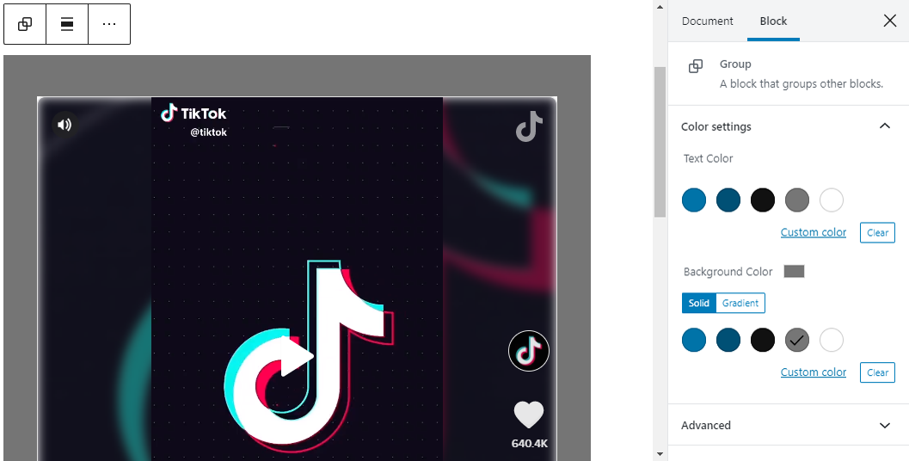

*Editor view of a TikTok embed as a group with Color Settings controls*

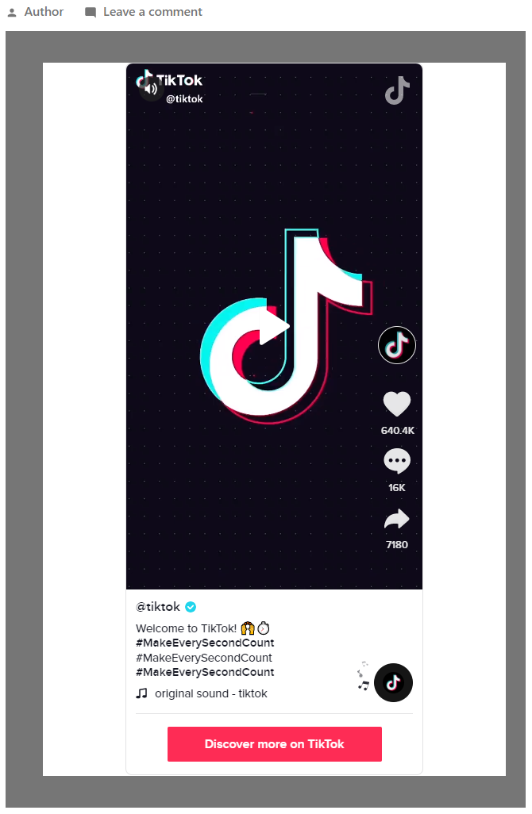

*TikTok embed with a gray background-color*

**Change alignment**

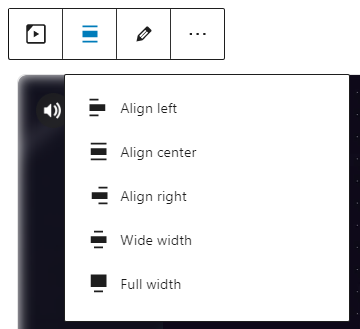

-   **Align left** – Make the TikTok post left aligned.
-   **Align center** – Make the TikTok post alignment centered.
-   **Align right** – Make the TikTok post right aligned.
-   **Wide width** – Increase the width of the post beyond the content size.
-   **Full width** – Extend the TikTok post to cover the full width of the screen.

“Wide width” and “Full width” alignment need to be enabled by the Theme of your site.

**Edit URL**

Via the edit URL, you can change the TikTok Embed URL in the embed block. Overwrite the existing URL and click on the “Embed” button.

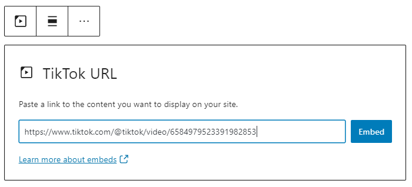

**More options**

These controls give you the option to copy, duplicate, and edit your block as HTML.

> [!NOTE]
> [Read about these and other settings.](../../working-with-blocks/more-options.md)

## Block Settings

Besides the Advanced section, the TikTok embed has only one setting in the “Block Settings” sidebar: Media Settings.

**Media Settings**

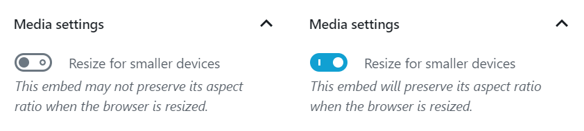

Via the *Media Settings,* you can control the behavior of your post embed when viewed from a smaller device, like on a phone screen.

The Toggle switch turns on or off the resize functionality for smaller devices. The default setting is “on” or blue.

**“Off:”** This embed may not preserve its aspect ratio when the browser is resized. In the off position, the toggle switch is gray.

**“On:”** This embed will preserve its aspect ratio when the browser is resized. The toggle switch turns blue in the “On” position.

**Advanced**

The following Advanced settings options are available: HTML Anchor, Additional CSS Class(es), Additional CSS, and Styles.

> [!NOTE]
> [Learn more about advanced settings.](../../working-with-blocks/block-settings/advanced-settings-overview.md)

## Changelog

-   Updated 2026-06-29
    -   Linked to advanced settings
-   Updated 2022-11-25
    -   Removed redundant content
    -   Aligned images for mobile view
    -   Added alt text to images
-   Updated 2020-08-11
    -   Screenshots as per WordPress 5.5
    -   Added “Move To” and “Copy” section under More Options
-   Created 2020-07-05
