# Tumblr embed

With the Tumblr Embed block, you can embed several types of posts from the microblogging platform.

The post needs to be public to embed. It cannot be a standalone image (with the URL name.tumblr.com/image). You can, however, embed image posts (with the URL name.tumblr.com/post/etc) and the rest of Tumblr’s post types including: Text, Quote, Link, Chat, Audio and Video.

An Example:

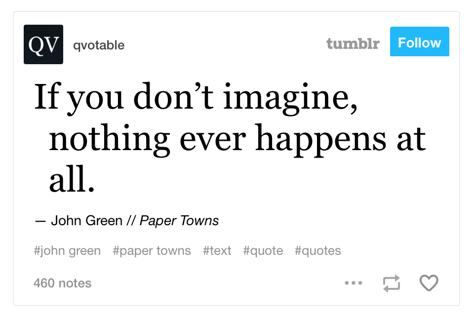

If you are looking to [import your Tumblr posts into WordPress](https://developer.wordpress.org/advanced-administration/wordpress/import/#tumblr), there is a process in the Tools section of your Dashboard.

Steps to embed a Tumblr post

1.  You need to find the link to the post. The easiest way to do this is to click on the three dots in the lower-right corner of the post and select Permalink.

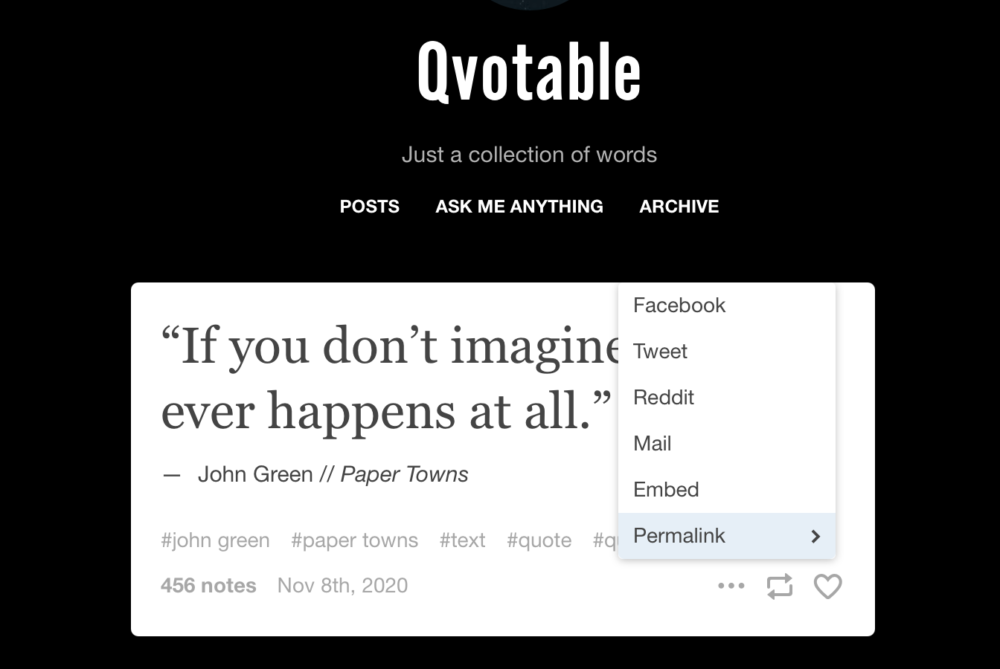

2.  Copy the URL at the top of your browser. On a PC, press CTRL+A in the URL field and then CTRL+C to copy the URL. On a Mac, press ⌘+ A and then ⌘+C.
3.  Go to your post or page.
4.  Add the Tumblr block.

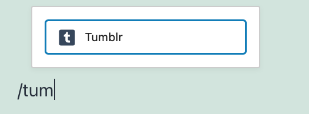

> [!NOTE]
> [Detailed instructions on adding blocks](../../working-with-blocks/adding-a-new-block.md)

5.  Paste the link in the text box and click the “Embed” button.

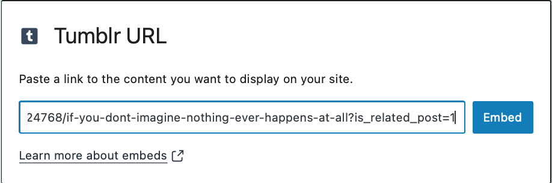

6.  If the link can be embedded, you will see a preview in your editor.

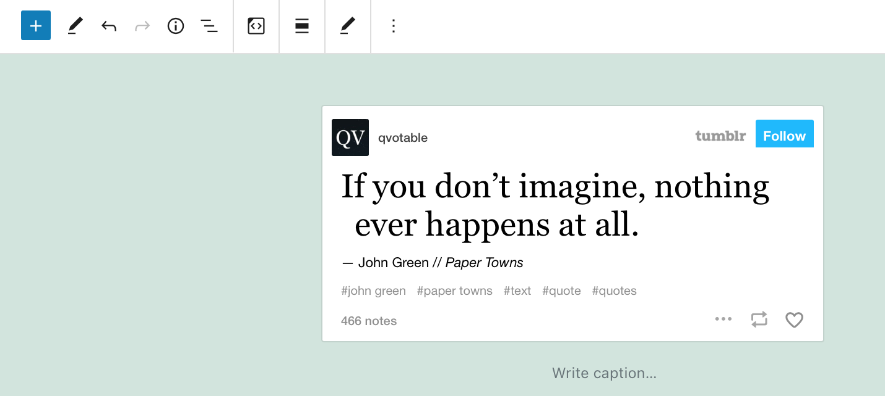

If you cannot use that URL, an error message will popup saying “Sorry, this content could not be embedded.”

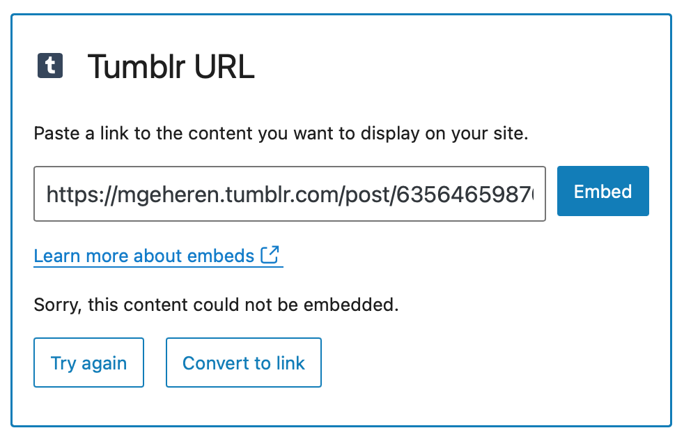

If this happens you can: Try again with a different URL or convert it to a link.

## Block Toolbar

Besides the Mover and Drag & Drop Handle, the Block Toolbar for the Tumblr embed shows four buttons:

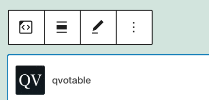

-   Transform to
-   Change alignment
-   Edit URL, and
-   More Options.

**Transform to**:

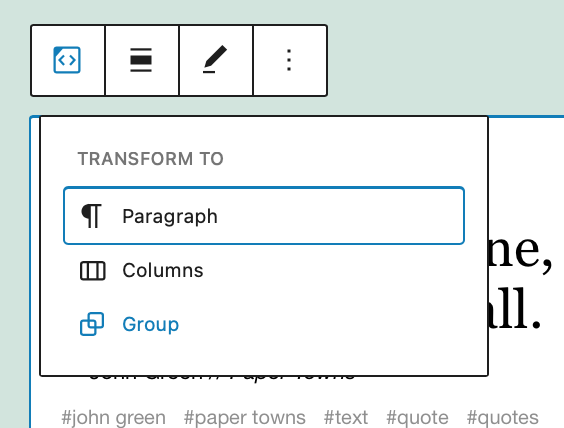

You can transform a Tumblr embed to a Group. This would give you the ability to change the background color around the Tumblr embed.

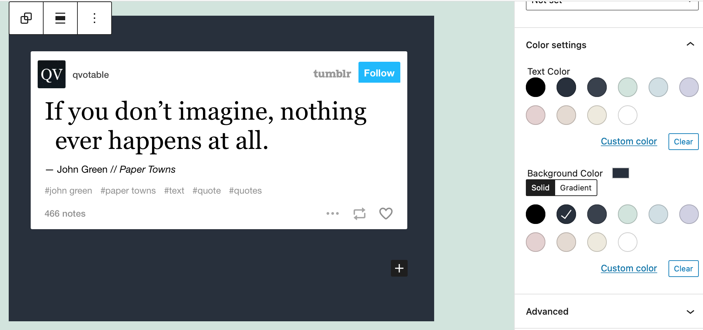

*Editor view of an Tumblr Embed as a group with Color Settings controls*

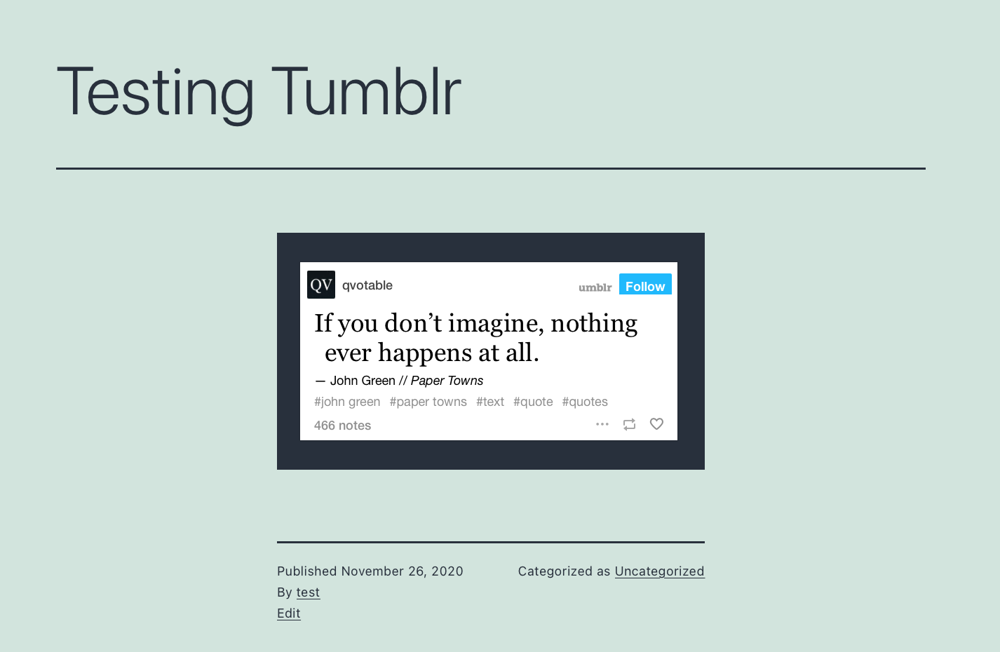

*Tumblr Embed with a green background.*

**Alignment:**

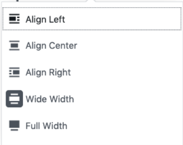

-   **Align left** – Make the Tumblr post left aligned
-   **Align center** – Make the Tumblr post alignment centered
-   **Align right** – Make the  Tumblr post align right
-   **Wide width** – Increase the width of the post beyond the content size
-   **Full width** – extend the Tumblr post to cover the full width of the screen.

“Wide width” and “Full width” alignment need to be enabled by the Theme of your site.

**Edit URL**

Via the edit URL, you can change the Tumblr Embed URL in the embed block. Overwrite the existing URL and click on the “Embed” Button.

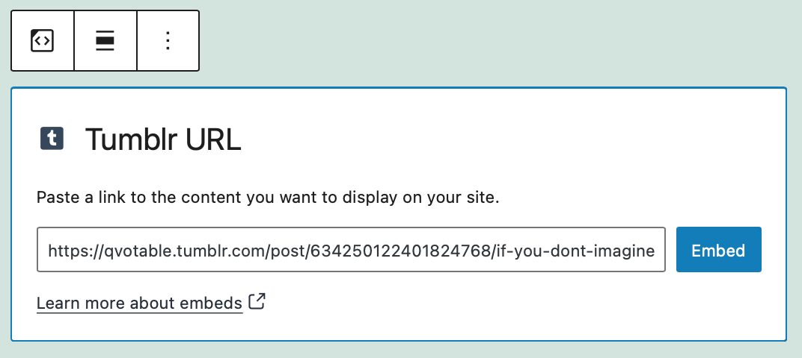

**More Options:**

These controls give you the option to copy, duplicate, and edit your block as HTML.

> [!NOTE]
> [Read about these and other settings.](../../working-with-blocks/more-options.md)

## Block Settings

**Media Settings**

New in 5.6: Resize the Tumblr post for smaller devices. It will preserve its aspect ratio when resized.

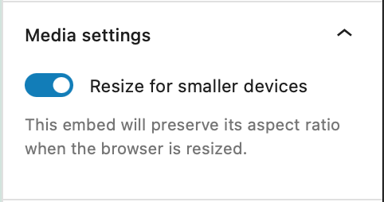

**Advanced**

The following Advanced settings options are available: HTML Anchor, Additional CSS Class(es), Additional CSS, and Styles.

> [!NOTE]
> [Learn more about advanced settings.](../../working-with-blocks/block-settings/advanced-settings-overview.md)

## Changelog

-   Updated 2026-06-29
    -   Linked to advanced settings
-   Updated 2022-11-25
    -   Removed redundant content
    -   Aligned images for mobile view
    -   Added alt text to images
-   Updated 2020-11-26
    -   Screenshots as per WordPress 5.6
    -   Hide Block Settings changed to Hide More Settings
    -   Edit as HTML and Add to Reusable blocks removed
    -   Added Media Settings
-   Created 2020-11-25
