# Vimeo embed

Vimeo is a popular video-sharing service. With the Vimeo block, you can embed videos from Vimeo into your WordPress website. You don’t need a Vimeo account to be able to use it. You can only embed all public Vimeo videos.

When embedded, a Vimeo video would look like this inside your WordPress post or page.

**Embedded Vimeo Video**:

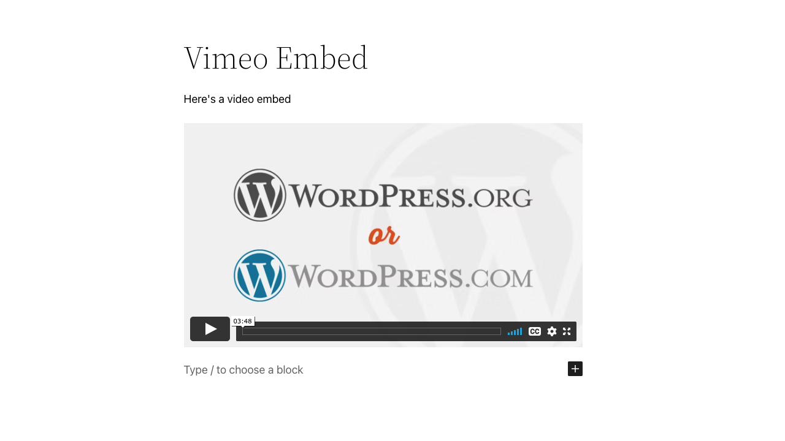

**Steps to Embed a Vimeo Video**:

**1. Find the URL of the Vimeo video**

Find your video on vimeo.com, and copy the URL of the video from the browser bar.

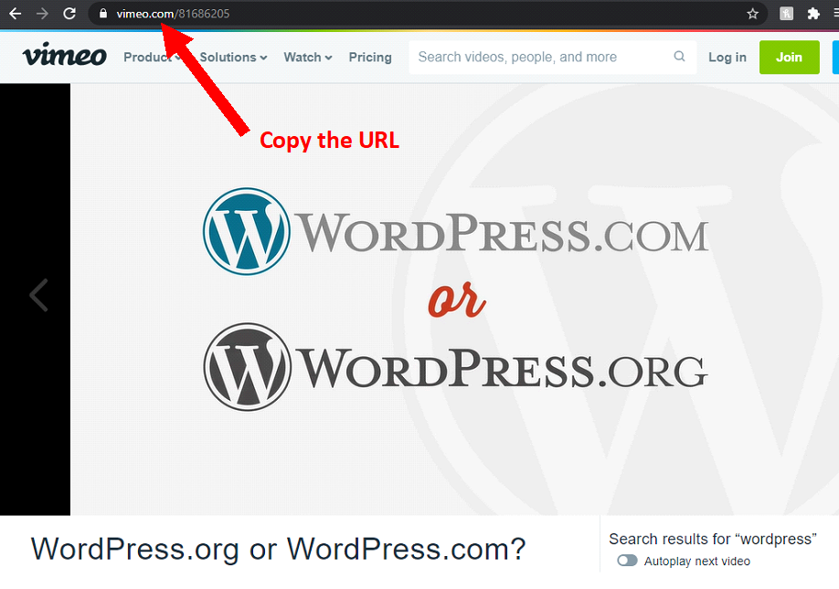

**2. Add a Vimeo Embed block to your post**

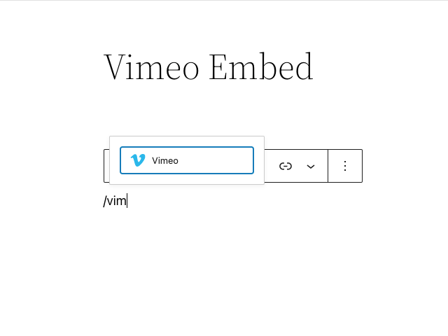

> [!NOTE]
> [Detailed instructions on adding blocks](../../working-with-blocks/adding-a-new-block.md)

**3. Paste the Vimeo URL *from Step 1***

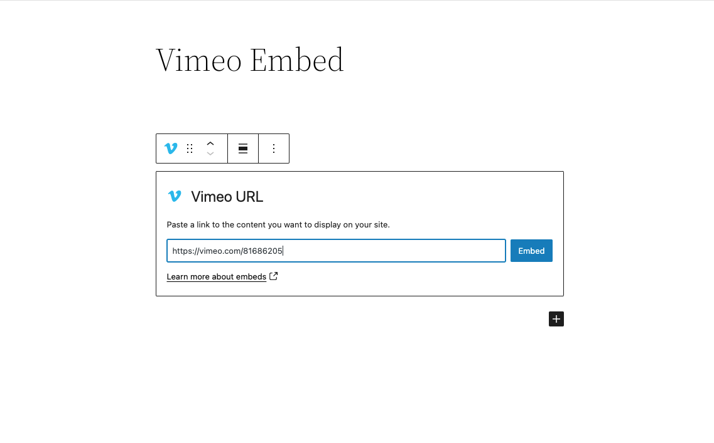

**4. Click the *Embed* button**

If it’s a link that can be successfully embedded you will see a preview in your editor.

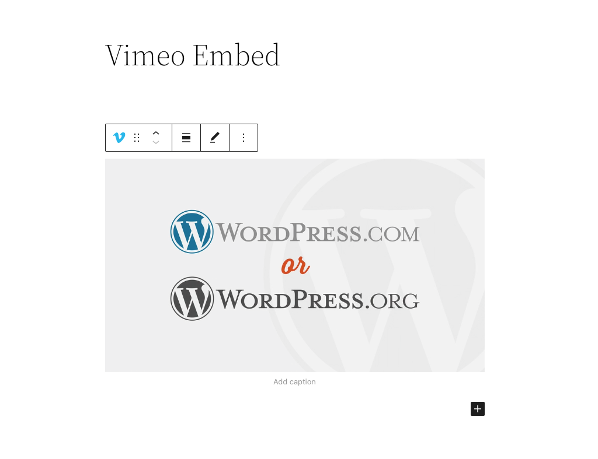

If you use a URL that can’t be embedded, the block shows the message *“Sorry, this content could not be embedded.”*

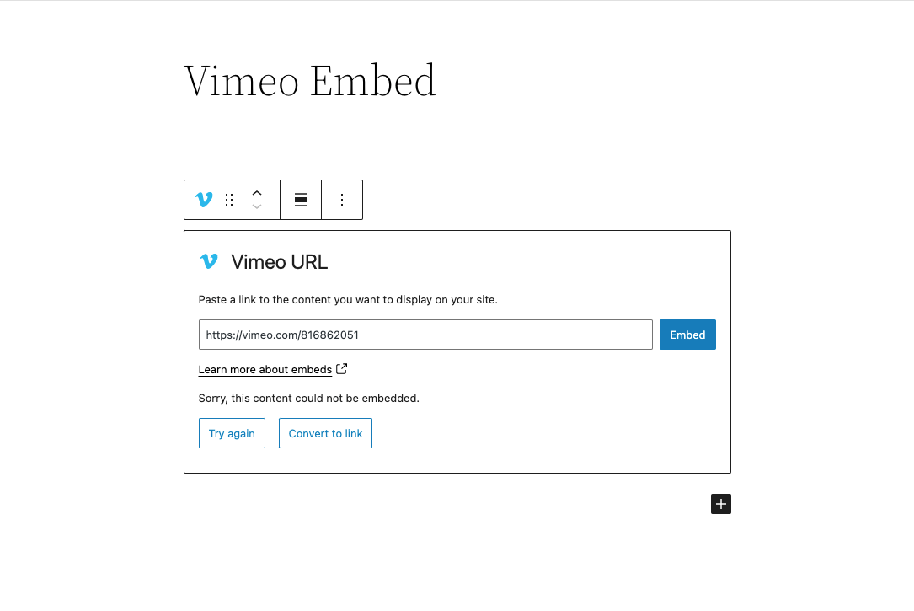

You will have two choices: Try again with a different URL or convert to link.

**5. You’ll see the Vimeo player on your WordPress editor if you successfully embed a Vimeo video**

## Block Toolbar

Besides the Mover and Drag & Drop Handle, the Block Toolbar for Vimeo embed shows four buttons:

-   Transform to
-   Change alignment
-   Edit URL, and
-   More Options

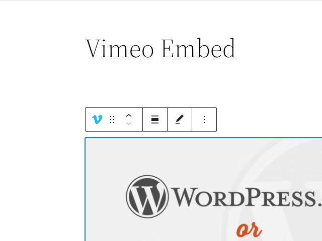

**Transform to**

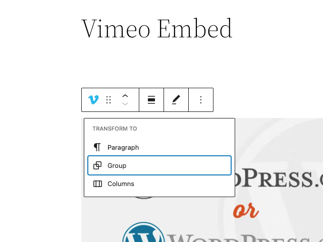

You can transform a Vimeo embed block into a Group. This would give you the ability to change the background color around the Vimeo embed.

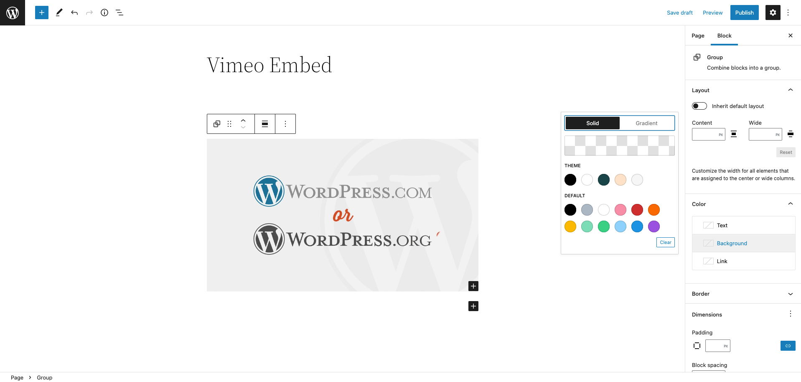

*Editor view of a Vimeo embed as a group with Color Settings controls*

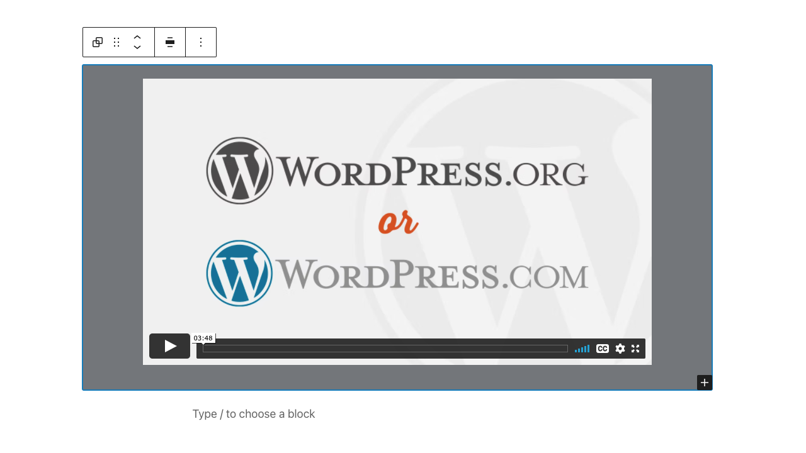

*Vimeo embed with a gray background-color*

**Change Alignment**

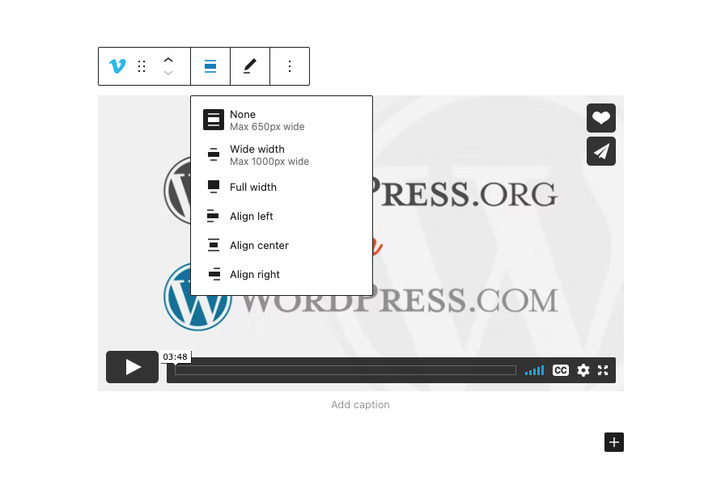

-   **None** – Default alignment option.
-   **Wide width** – Increase the width of the post beyond the content size.
-   **Full width** – Extend the block to cover the full width of the screen.
-   **Align left** – Make the block left-aligned.
-   **Align center** – Make the block alignment centered.
-   **Align right** – Make the block right aligned.

**Edit URL**

Via the **Edit URL**, you can change the Vimeo Embed URL in the embed block. Overwrite the existing URL and click on the **Embed** button.

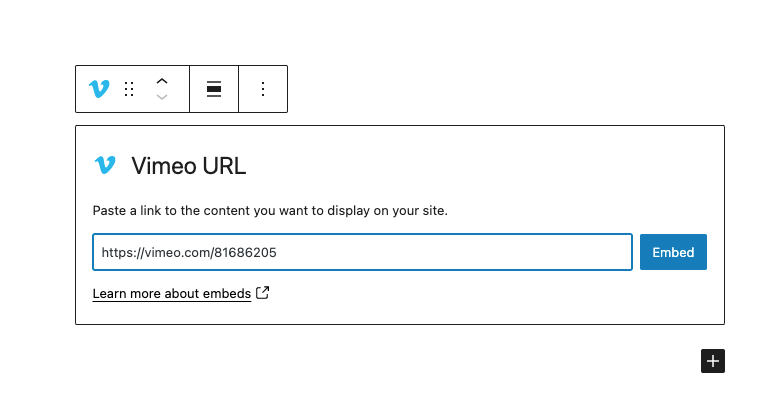

**More options**

These controls give you the option to copy, duplicate, and edit your block as HTML.

> [!NOTE]
> [Read about these and other settings.](../../working-with-blocks/more-options.md)

## Block Settings

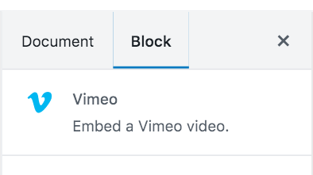

Besides the Advanced section, the Vimeo embed has only one setting in the “Block Settings” sidebar: Media Settings.

**Media Settings**

Via the *Media Settings*, you can control the behavior of your post embed when viewed from a smaller device, like on a phone screen.

The Toggle switch turns on or off the resize functionality for smaller devices. The default setting is “on” or blue.

**“Off:”** This embed may not preserve its aspect ratio when the browser is resized. In the off position, the toggle switch is gray.

**“On:”** This embed will preserve its aspect ratio when the browser is resized. The toggle switch turns blue in the “On” position.

**Advanced**

The following Advanced settings options are available: HTML Anchor, Additional CSS Class(es), Additional CSS, and Styles.

> [!NOTE]
> [Learn more about advanced settings.](../../working-with-blocks/block-settings/advanced-settings-overview.md)

## Changelog

-   Updated 2026-06-29
    -   Linked to advanced settings
-   Updated 2022-11-25
    -   Removed redundant content
    -   Added alt text to images
    -   Aligned images for mobile view
-   Created on 2022-03-01
