# Wolfram embed

With the Wolfram embed block, you can embed [Wolfram Notebook](https://www.wolfram.com/featureset/notebooks/) content into your posts and pages (deployed through the Wolfram Cloud). All of the Wolfram services are tied together by the Wolfram Language: Wolfram Cloud Notebooks are the cloud-hosted version of Wolfram Language Notebooks.

**Example of a Wolfram embed:**

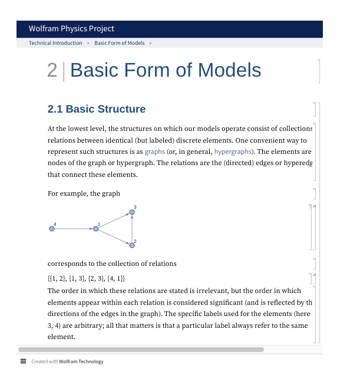

**Steps to embed Wolfram Notebook content**

1.  First, find the Wolfram Notebook content that you want to embed. If already embedded in a page, open the Notebook in the Wolfram Cloud to locate and copy its wolframcloud.com URL.

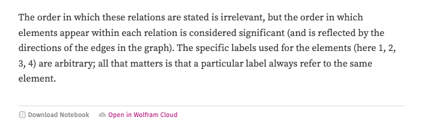

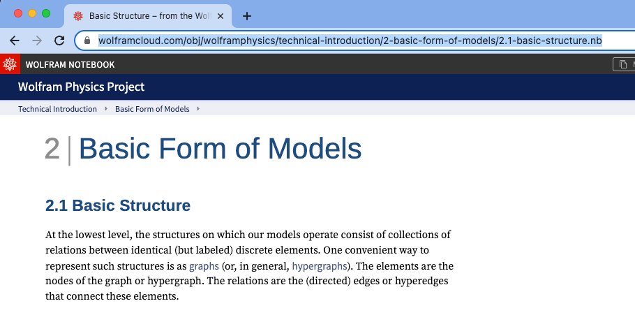

2.  Go to your post or page and add the Wolfram embed block. One way to do this is to press the “/” key to open the block inserter and type /wolfram.

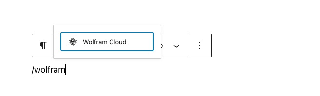

> [!NOTE]
> [Detailed instructions on adding blocks](../../working-with-blocks/adding-a-new-block.md)

3.  Paste the link into the text box and click the “Embed” button.

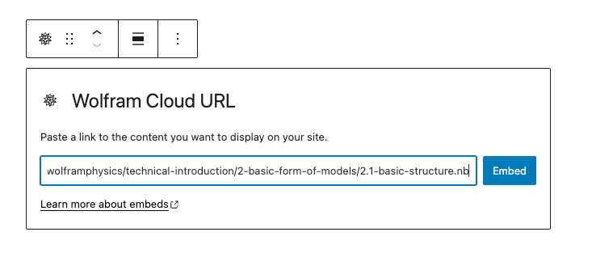

If the link can be successfully embedded into your post/page, you will see the preview in your block editor.

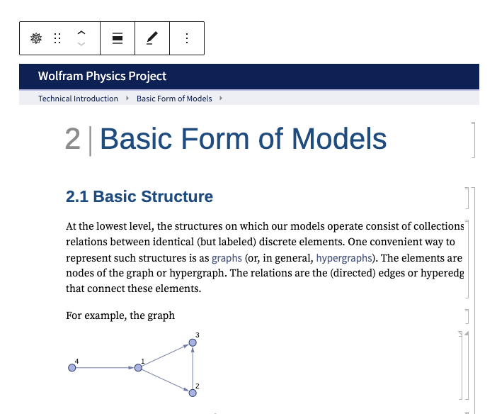

If you use a URL that can’t be embedded, the block displays the message: *“Sorry, this content could not be embedded.”* You will have two choices: try again with a different URL or convert it to a link.

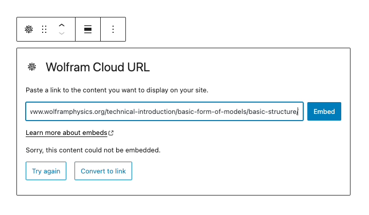

4.  Click the “Preview” button in the top right corner of the post/page to see how it will look on the front end.

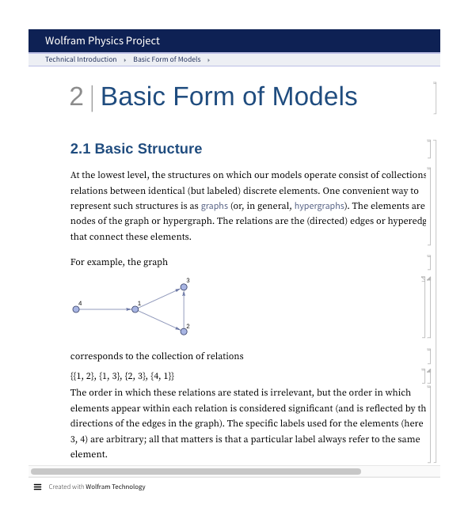

## Block Toolbar

Besides the “Mover” and “Drag & Drop Handle”, the Block Toolbar for the Wolfram embed block shows four buttons:

-   Transform to – also the icon for the block
-   Change alignment
-   Edit URL, and
-   More options

**Transform to**

The first option will allow you to transform a Wolfram embed into a Paragraph. This will convert the Notebook content embedded to a link. Additionally, you can transform a Wolfram embed into Columns or into a Group.

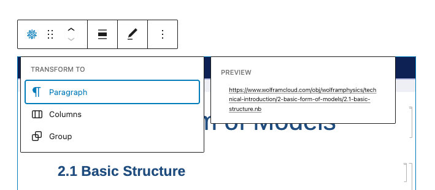

Transforming it into a Group will give you the ability to change the following, among other options:

-   The background color around the Wolfram embed
-   The padding, margin, and spacing dimensions of the block
-   The block border settings (width, style, color, and radius)

**Note**: you can preview what each block (paragraph, column, or group) will look like by hovering the mouse over each option.

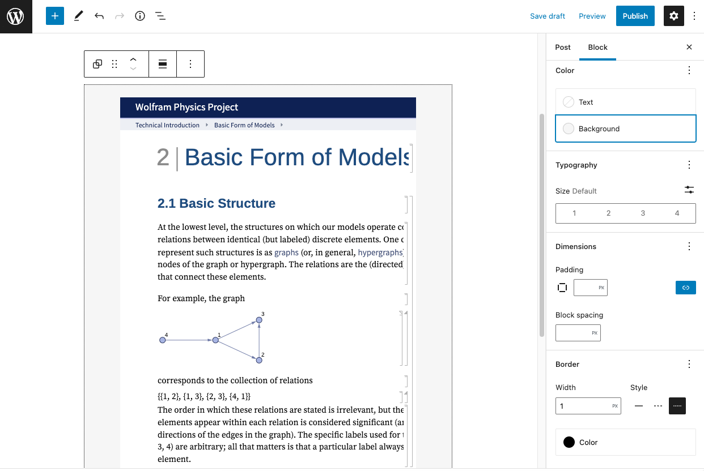

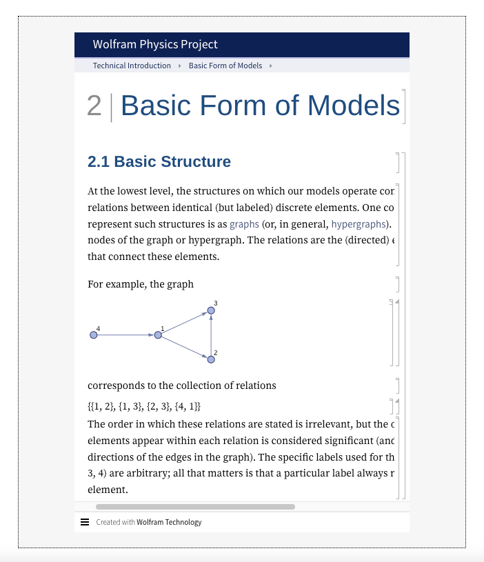

*Left image: Editor view of a Wolfram embed block as a group with color, dimension, and border settings. Right image: Front-end view of a Wolfram embed block with a border and a light grey background.*

**Change Alignment**

-   **None** – Default alignment option
-   **Wide width** – Increase the width of the post beyond the content size
-   **Full width** – Extend the block to cover the full width of the screen
-   **Align left** – Make the block left-aligned
-   **Align center** – Make the block alignment centered
-   **Align right** – Make the block right-aligned

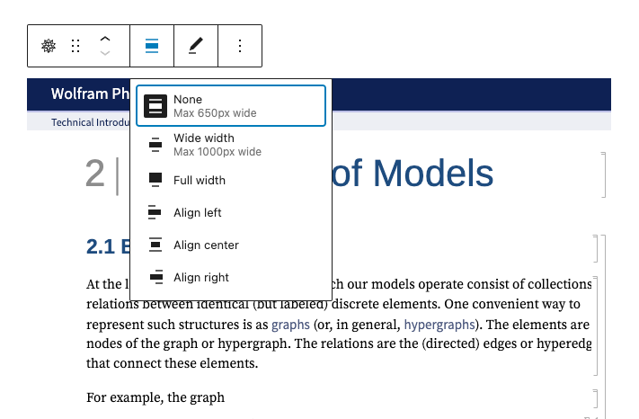

**Edit URL**

Via the edit URL, you can change the Wolfram embed URL in the embed block. Overwrite the existing URL and click on the “Embed” button on the right.

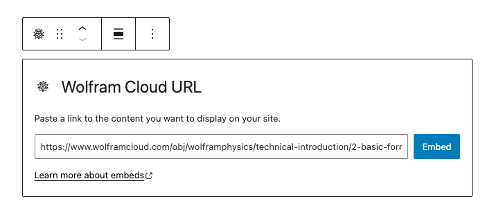

**More Options**

These controls give you the option to copy, duplicate, and edit your block as HTML.

> [!NOTE]
> [Read about these and other settings.](../../working-with-blocks/more-options.md)

## Block Settings

There are two additional options in the block settings sidebar: Media Settings and Advanced.

**Media Settings**

Via the Media Settings, you can control the behavior of the Wolfram embed block when viewed on the screen of a smaller device.

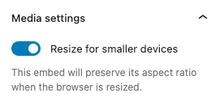

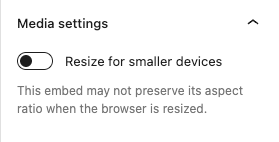

The toggle switch turns on or off the resize functionality for smaller devices. The default setting is “on” or blue.

-   “On”: This embed will preserve its aspect ratio when the browser is resized. The toggle switch turns blue in the “On” position.
-   “Off”: This embed may not preserve its aspect ratio when the browser is resized.

**Advanced**

The following Advanced settings options are available: HTML Anchor, Additional CSS Class(es), Additional CSS, and Styles.

> [!NOTE]
> [Learn more about advanced settings.](../../working-with-blocks/block-settings/advanced-settings-overview.md)

## Changelog

-   Updated 2026-06-29
    -   Linked to advanced settings
-   Updated 2022-11-25
    -   Removed redundant content
    -   Aligned images for mobile view
    -   Added alt text to images
-   Updated 2022-05-14
    -   Added link to Wolfram Notebooks for more information
-   Created 2022-04-29
