# WordPress.tv embed

Using WordPress.tv embed block, you can add a WordPress.tv video to a post or page. The embedded video includes a robust set of playback controls, so viewers can remain on your site while they watch the video. You don’t need WordPress.tv account to embed a video, although it needs to be public.

Embedded WordPress.tv video

<!-- VideoPress embed (iframe removed): https://video.wordpress.com/embed/qhbfoKqs -->

https://videopress.com/v/qhbfoKqs

**Steps to Embed a video from WordPress.tv:**

1.  Find the video permalink

In the web player select the video and click on the “Share” button.

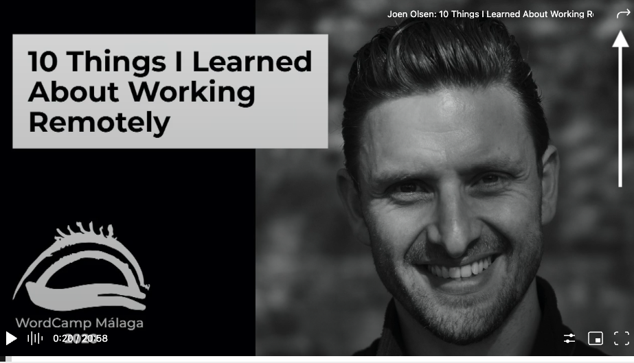

2.  In the share section, click on the permalink and it will be automatically copied, or alternatively, you can highlight the link and copy it.

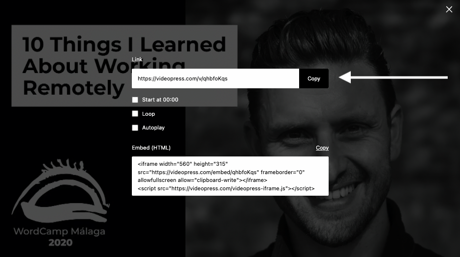

If you add a link in some other way and the link can’t be embedded, you have the option of trying again or converting the URL to a link.

3.  Add a WordPress.tv embed block to your page/post

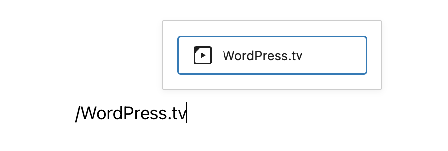

> [!NOTE]
> [Detailed instructions on adding blocks](../../working-with-blocks/adding-a-new-block.md)

4.  Paste the link into the text box and click on the “Embed” button

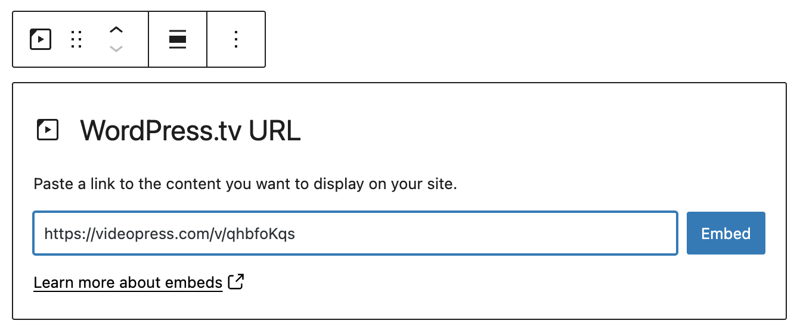

If it’s a link that can be successfully embedded you will see a preview in your editor.

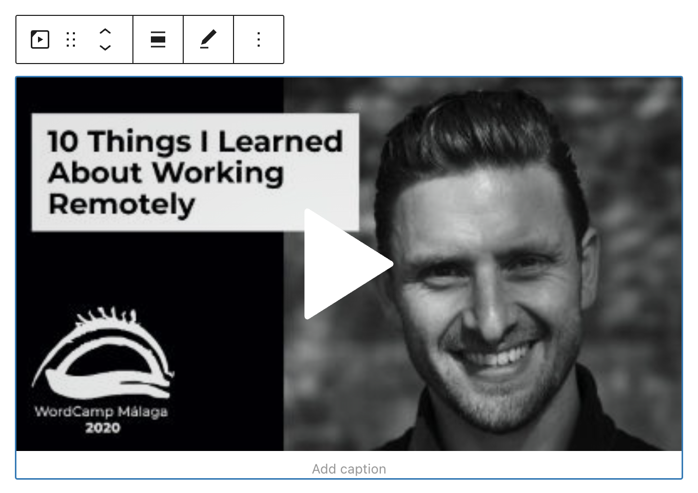

If you use an URL that can’t be embedded, the block shows the message *“Sorry, this content could not be embedded.”*

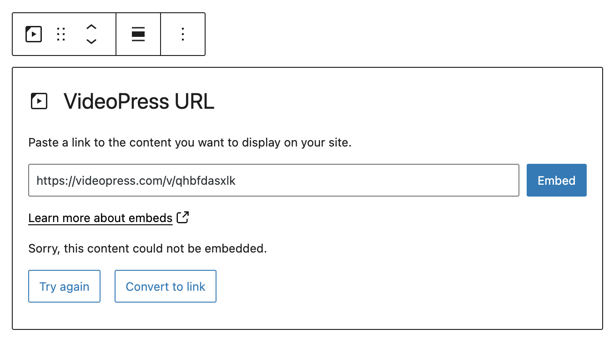

You will have two choices: Try again with a different URL or convert it to a link.

5.  Click on “Preview” to see how it will look on the front-end

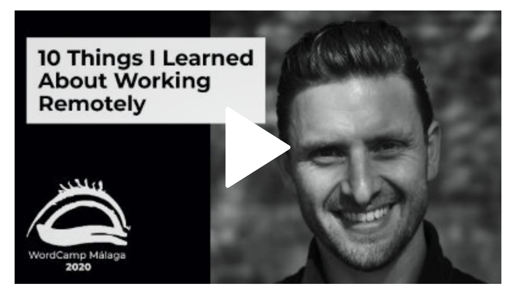

## Block Toolbar

Besides the *Mover* and *Drag & Drop* handle, the Block Toolbar for the WordPress.tv embed shows four buttons:

-   Transform To
-   Block moving tools
-   Change Alignment
-   Edit URL
-   More Options

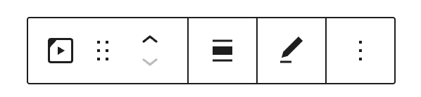

**Transform To**:

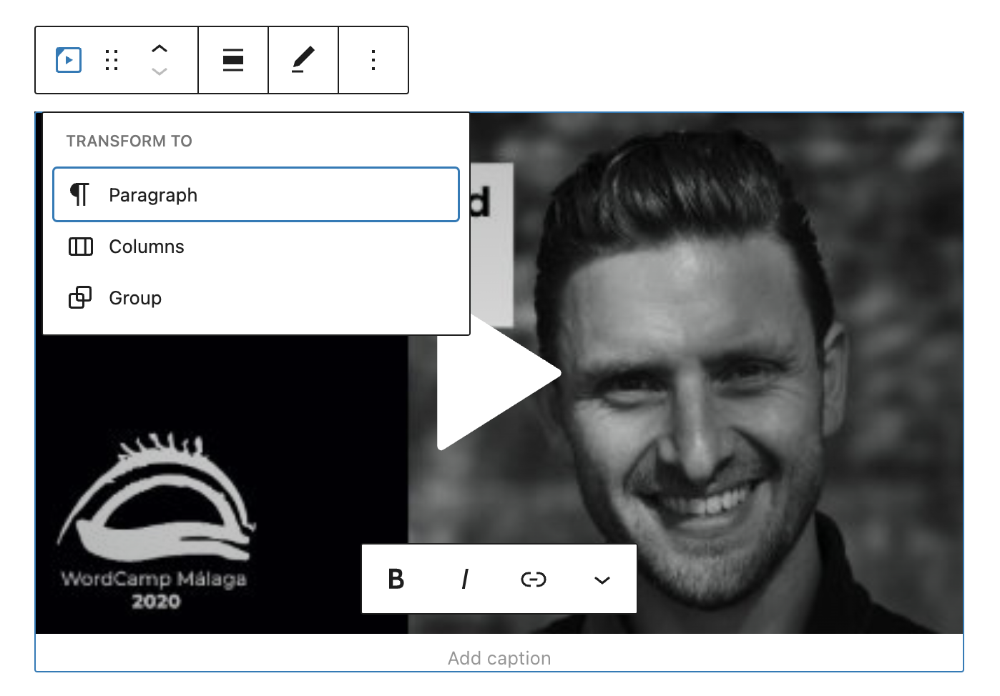

You can transform WordPress.tv embed block to a Group. This would give you the ability to change the background color around WordPress.tv embed.

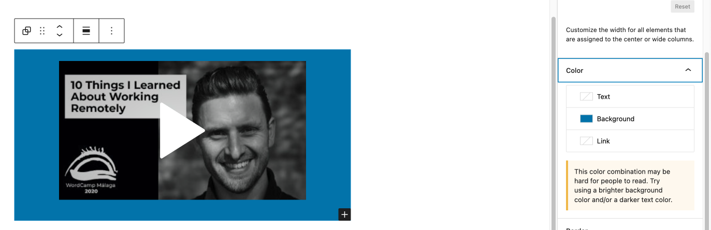

*Editor view of a WordPress.tv embed as a group with Color Settings controls*

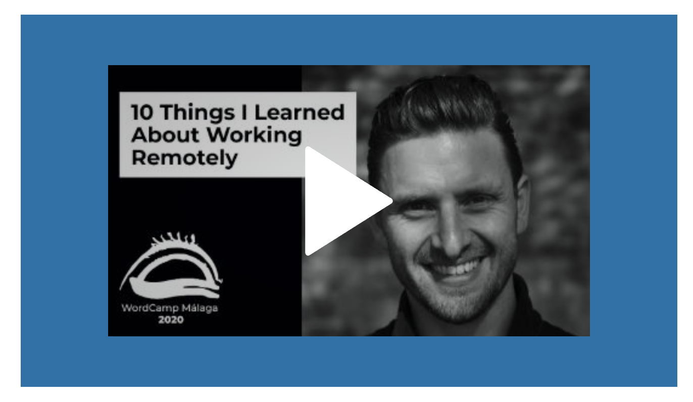

*WordPress.tv embeds with a blue background-color*

**Block-moving tools**

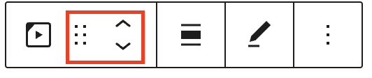

Use the block-moving tools to move the block up and down the editor. Use the six dots icon to drag and drop the WordPress.tv embed block and reposition it anywhere on the editor. Alternatively, click on the up and down arrows to move the block up or down the editor.

> [!NOTE]
> Get the details on [moving a block within the editor.](../../working-with-blocks/moving-blocks.md)

**Change Alignment**

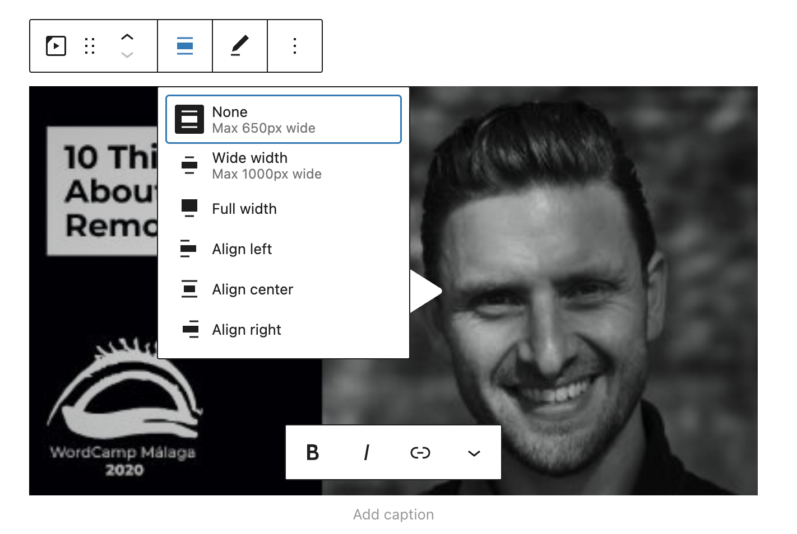

-   **Align left** – Make the block left-aligned.
-   **Align center** – Make the block alignment centered.
-   **Align right** – Make the block right-aligned.
-   **Wide width** – Increase the width of the block beyond the content size.
-   **Full width** – Extend the block to cover the full width of the screen.

The “Wide width” and “Full width” alignment settings must be enabled by your WordPress theme.

**Edit URL**

Via the edit URL, you can change the WordPress.tv Embed URL in the embed block. Overwrite the existing URL and click on the “Embed” button.

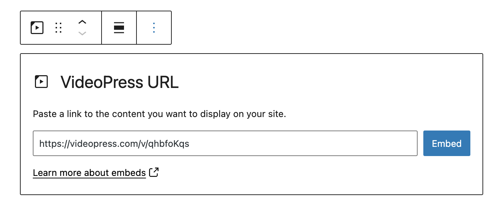

**More Options**

These controls give you the option to copy, duplicate, and edit your block as HTML.

> [!NOTE]
> [Read about these and other settings.](../../working-with-blocks/more-options.md)

## Block Settings

**Media Settings**

Besides the Advanced section, the WordPress.tv embed has only one setting in the “Block Settings” sidebar: Media Settings.

**Media Settings**

Via the *Media Settings* you can control the behavior of your post embed when viewed from a smaller device, like on a phone screen.

The Toggle switch turns on or off the resize functionality for smaller devices. The default setting is “on” or blue.

**“Off:”** This embed may not preserve its aspect ratio when the browser is resized. In the off position, the toggle switch is gray.

**“On:”** This embed will preserve its aspect ratio when the browser is resized. The toggle switch turns blue in the “On” position.

**Advanced**

The following Advanced settings options are available: HTML Anchor, Additional CSS Class(es), Additional CSS, and Styles.

> [!NOTE]
> [Learn more about advanced settings.](../../working-with-blocks/block-settings/advanced-settings-overview.md)

## Changelog

-   Updated 2026-06-29
    -   Linked to advanced settings
-   Updated 2022-08-01
    -   Screenshots and content for 6.0
    -   Added Media settings, Lock etc.
    -   Converted reusable blocks to regular blocks.
    -   Added ALT tags for the images
-   Updated 2022-07-25
    -   Screenshots as per WordPress 5.9
-   Updated 2020-09-02
    -   Screenshots as per WordPress 5.5
    -   Embedded WordPress.tv video
-   Updated 2020-08-19
    -   Replaced “More Options” – new screenshot
    -   Added “Move To” and “Copy” section under More Options
-   Created 2020-07-24
