# Gallery block

The Gallery block allows you to easily add multiple photos and automatically arrange them in a gallery. You can control the number of columns and the size of the images in the gallery.

## Add a Gallery block

Add the Gallery block to a page by clicking on the **Block Inserter +** icon and selecting the Gallery block.

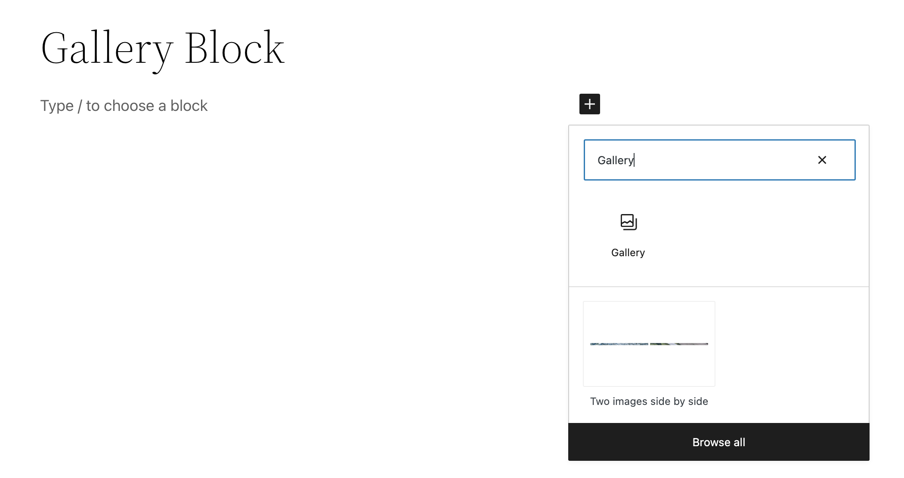

*Adding the Gallery block*

Alternatively, you can type `/gallery` and press Enter.

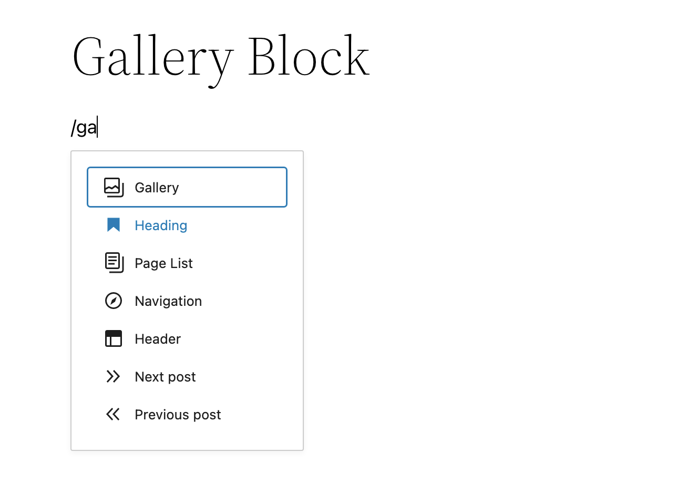

_Adding the Gallery block with */gallery* shortcut_

> [!NOTE]
> [Detailed instructions on adding blocks](../../working-with-blocks/adding-a-new-block.md)

### Use attached images

<!-- VideoPress embed (iframe removed): https://videopress.com/embed/Pj4XiuBr -->

https://videopress.com/v/Pj4XiuBr

Select the **Use attached images** button after adding a gallery block to create a dynamic gallery that will automatically add images that are attached to your post. If you add a new image, the gallery will automatically update.

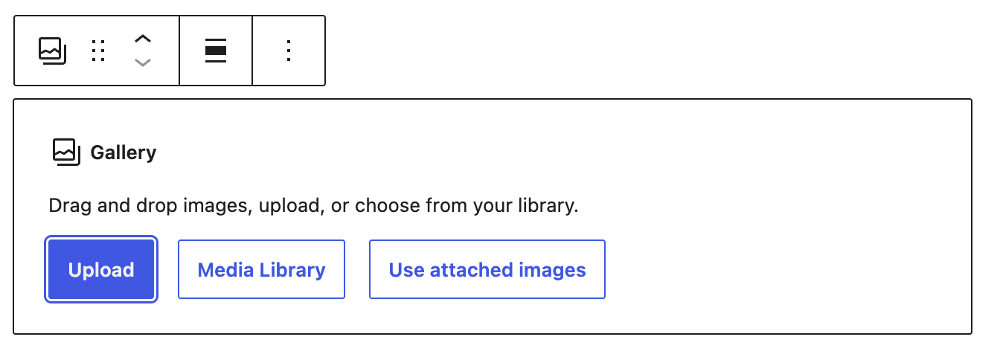

If you wish to convert the dynamic gallery to a regular gallery, you can use the Detach button from the block toolbar or the Detach Gallery button in the block settings sidebar.

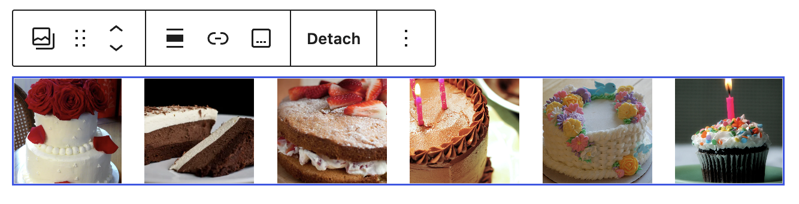

> [!NOTE]
> [Learn more about image and file attachments.](../../../../using-wordpress/media/use-image-and-file-attachments.md)

## Block toolbar

Each block has its own block-specific controls that allow you to manipulate the block right in the editor.

### For the entire block

The Gallery block has a toolbar for the individual images as well as a toolbar for the entire Gallery block.

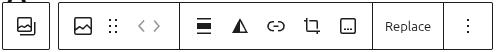

*Block editor toolbar showing image tools and formatting options, with a Replace button on the right.*

#### Transform to

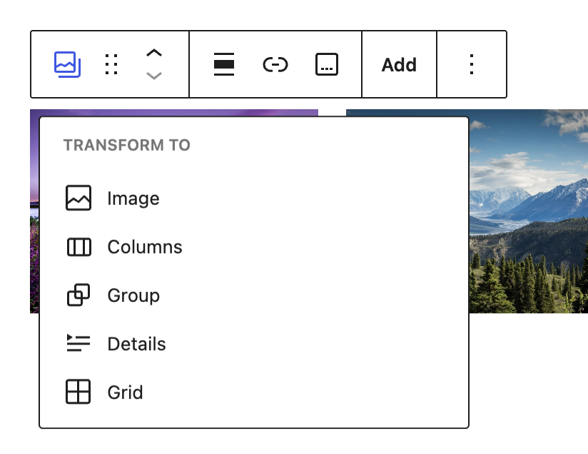

_**Transform to** menu showing the blocks the Gallery block can convert to._

The buttons in **Transform to** let you change the block to an Image, Columns, Group, Details, or Grid block.

Choosing Image converts each gallery image into its own Image block. Choosing Grid places those Image blocks inside a Grid block.

#### Block moving handles

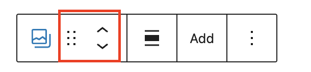

The block-moving handles allow you to move the block up and down the editor. Use the grab handle (six dots button) to drag and drop the Gallery block and place it anywhere on the page. Alternatively, click on the up and down arrows to move the block up or down by one step.

> [!NOTE]
> [Get more information about moving a block within the editor.](../../working-with-blocks/moving-blocks.md)

#### Change alignment

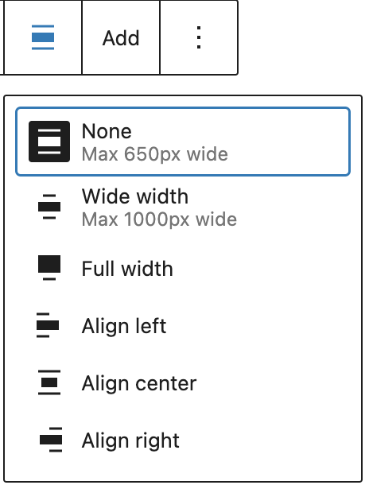

-   **Align left** – Align the block to the left
-   **Align center** – Center the block
-   **Align right** – Align the block to the right
-   **Wide width** – Increase the width of the block beyond the content size
-   **Full width** – Extend the block to cover the full width of the screen

**Wide width** and **Full width** alignment options are only available if they are enabled in your theme.

#### Link

You can choose link options to apply to all images in your gallery.

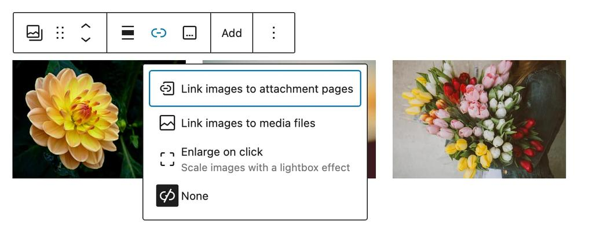

-   **Link images to attachment pages** – Selecting this option will link the image to its WordPress media [attachment](../../../../classic-wordpress/classic-editor/inserting-images-into-posts-and-pages-classic.md#step-4-attachment-details) page.
    -   This is an informational page about your image, which includes the image, the caption, the image description, and a comment field.
-   **Link images to media files** – Selecting this option will link the image to the image file in the original size in a new browser window.
-   **Enlarge on click** – Selecting this option lets visitors open gallery images in a larger view, also known as a lightbox, without leaving the page. Visitors will be able to move forward and backward through each image in the lightbox.
-   **None**: Selecting this option will not link the image to anything.

#### Caption for the gallery

You can add a caption to the whole gallery by clicking on the **Caption** icon on the block settings toolbar.

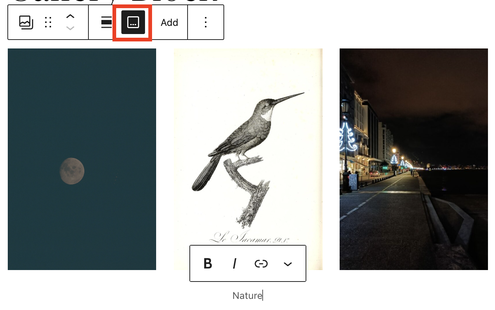

*Adding a caption to the Gallery block*

You can add captions for individual images using the caption button in each image block’s toolbar.

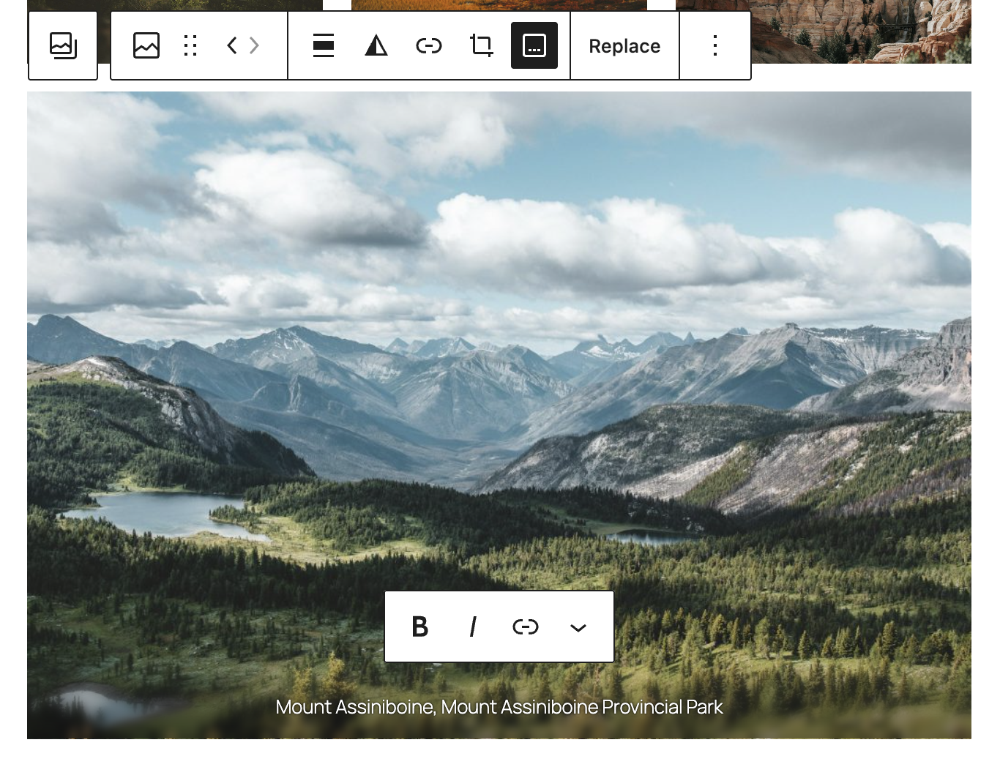

*Caption text on an individual image in the Gallery block*

#### Adding images

The **Add** button in the Gallery block lets you add images to the gallery. You have two ways of doing this: **Open Media Library** and **Upload**.

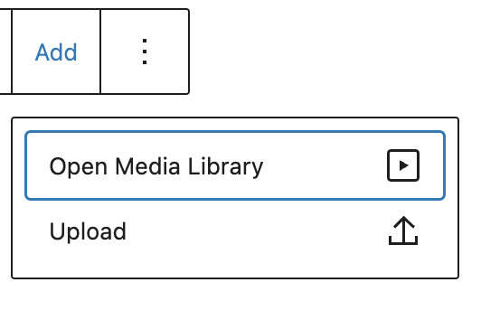

*Adding images to the Gallery block*

The Upload option allows you to upload a new image or multiple images to the Gallery block. It will add them to your Media Library at the same time. The Media Library option lets you choose from images you uploaded to your Media Library earlier.

You can also drag and drop multiple images at the same time from your explorer or finder window into the Gallery block.

Alternatively, you can open the main inserter panel on the editor and open the media tab. Then, you can drag and drop images from the media library and Openverse into the Gallery block.

#### More options

These controls give you the option to copy, duplicate, and edit your block as HTML.

> [!NOTE]
> [Read about these and other settings.](../../working-with-blocks/more-options.md)

### For an individual image

Each image inside a Gallery block is an Image block. When you select an individual image, the toolbar shows Image block controls for that image, such as link, crop, replace, and more. These settings affect only the selected image, not the entire Gallery block.

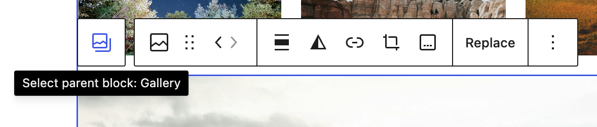

If you want to return to the full Gallery block settings, use the **Select parent block: Gallery** button in the toolbar. This lets you edit gallery-wide settings, such as columns, image resolution, cropping, and layout.

**Note**: Some options such as **Add text over image** or **Align** may not be present or may not work as expected when an Image block is inside a Gallery block.

#### Move images

Once you have added images to your Gallery block, you can change the order of the images in the gallery. Click on an image, and in the block toolbar use the **move left** and **move right** arrow handles or the grab handle (six dots button) to arrange the images as you like.

<video controls preload="metadata" src="https://wordpress.org/documentation/files/2019/03/gallery-block-moving-images.mp4"></video>

> [!NOTE]
> [Learn about additional block settings on the Image block page.](image-block.md)

## Block settings

As well as the options in the block toolbar, every block has specific options in the editor sidebar. If you don’t see the sidebar, click on the **Settings** button next to the **Save/Publish** button.

The Gallery block settings panel is divided into three tabs – **List View**, **Settings**, and **Styles**.

### List View tab

The **List View** tab allows you to drag and drop images within the gallery to reorder them. When hovering over an image in List View, click on the More options (three dots) button for additional block controls like copy, duplicate, hide, delete, and more.

<!-- VideoPress embed (iframe removed): https://videopress.com/embed/oHegtvHd -->

https://videopress.com/v/oHegtvHd

> [!NOTE]
> [Learn about the More options menu](../../working-with-blocks/more-options.md).

### Settings tab

The Gallery block includes the following settings:

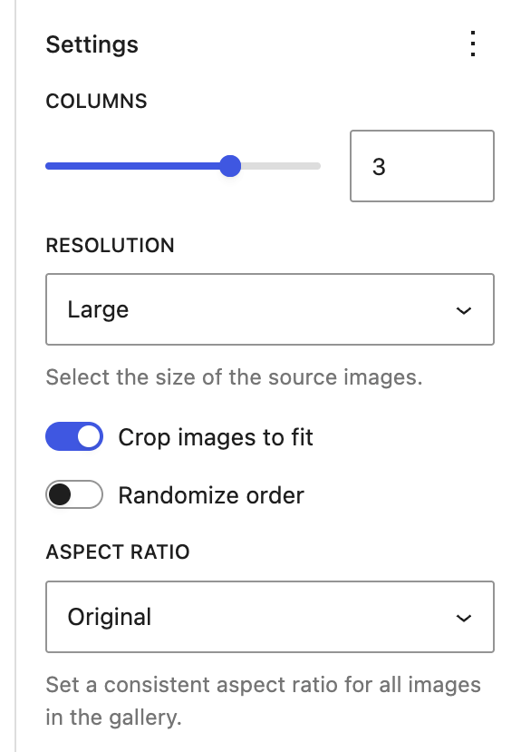

#### Columns

Use the Columns setting to choose how many columns appear in the gallery.

You can choose 1 to 8 columns, but only up to the number of images in the gallery. For example, a gallery with 4 images can have up to 4 columns. Add more images to use more columns, up to the maximum of 8.

To change the number of columns, either:

-   Enter a number in the field
-   Use the slider to increase or decrease the number of columns

#### Resolution

You can also choose the **Resolution** of your image with options that may include **Full Size**, **Large**, **Medium** and **Thumbnail** depending on what your theme supports and the size of the originally uploaded image.

> [!NOTE]
> [Learn more about image size and quality.](../../../../using-wordpress/media/image-size-and-quality.md)

#### Crop images to fit

You can select whether or not you’d like all of your images to be cropped in your Gallery block.

This option is useful if you have images of varying sizes and shapes. Cropping them will make the images in each row of the gallery the same size. Toggle this option on and off to see which way you’d prefer.

#### Open images in a new tab

If any [Link options](#link) are enabled for the gallery, you can choose whether you want images to open in a new browser tab window when the visitor clicks on them.

#### Randomize order

This button will juggle the order of images in the Gallery block.

**Note**: in the block editor, the images will still appear in the order they were added. But on the published post, they will be displayed in a random order.

#### Aspect ratio

This setting changes the aspect ratio of all of the images in the Gallery to one consistent ratio.

<video controls preload="metadata" src="https://wordpress.org/documentation/files/2019/03/gallery-block-aspect-ratio.mp4"></video>

#### Navigation button type

If **Enlarge on click** is enabled in [Link options](#link) for the Gallery, you can choose the style of the lightbox’s previous, next, and close navigation buttons.

-   **Icon**: only icons display
-   **Text**: only text labels display
-   **Both**: both icons and text labels display

<video controls preload="metadata" src="https://wordpress.org/documentation/files/2019/03/gallery-block-lightbox-navigation-buttons.mp4"></video>

#### Advanced settings

The Gallery block provides the following Advanced settings options: HTML Anchor, Additional CSS Class(es), Additional CSS, and Styles.

> [!NOTE]
> [Learn more about advanced settings.](../../working-with-blocks/block-settings/advanced-settings-overview.md)

### Styles tab

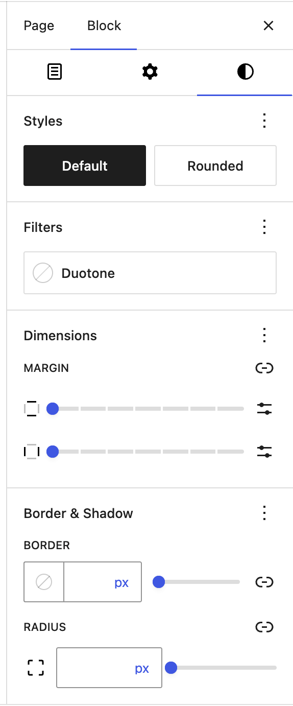

#### Color

The Gallery block provides color settings options to change the background for the block

> [!NOTE]
> For details, refer to this support article: [Color settings overview.](../../working-with-blocks/block-settings/colors-settings-overview.md)

#### Dimensions

The Gallery block provides dimension settings options to add padding and margin.

> [!NOTE]
> For details, refer to this support article: [Dimension settings overview.](../../working-with-blocks/block-settings/dimension-controls-overview.md)

#### Border

The Gallery block provides border settings options to add border color, width, and radius.

> [!NOTE]
> For details, refer to this support article: [Border settings overview.](../../working-with-blocks/block-settings/border-settings-overview.md)

## Changelog

-   Updated 2026-09-18 (props @awetz583 @milana_cap)
    -   Added Dynamic Gallery variation for 7.1
-   Updated 2026-08-24 (props to @kjoyner)
    -   Updated transform to properties and screenshot to include Grid
    -   Updated headings in block settings to match Image block
-   Updated 2026-06-13-26 (props to @andyfinally @kjoyner)
    -   Minor content updates to improve plain language and tense
-   Updated 2026-05-21 (props to @kjoyner @madhudollu @jameskoster @paaljoachim @wildworks @joen @dmsnell)
    -   Updated block toolbar and block settings to include new lightbox controls and settings
    -   Updated Enlarge on click definition to clarify lightbox effect
    -   Updated screenshots and videos for WordPress 7.0
    -   Updated Advanced Settings to refer to new advanced settings overview page
    -   Added video of List View, moving images, and lightbox navigation controls
-   Updated 2026-03-08 (props to @awetz583 @CalolanC @leonnugraha)
    -   Removed duplicate content
    -   Updated gallery link options
    -   Updated block toolbar and settings screenshots
    -   Updated settings with randomize feature
-   Updated 2026-02-15
    -   Updated toolbar & “transform to” screenshots(@rollybueno)
-   Updated 2025-07-05
    -   Added Enlarge on click option of the image
-   Updated 2024-01-16
    -   Updated screenshots and content for 6.3
    -   Fixed text formatting consistecy
    -   Added missing alt text to screenshots
-   Updated 2023-03-29
    -   Added the option to clear duotone
    -   Added information about the style settings tab
    -   Added caption button for Gallery
    -   Updated screenshot and Videos for 6.2
    -   Added Alt text
-   Updated 2022-12-12
    -   Added color settings
-   Updated 2022-11-20
    -   Adjusted images for mobile view
    -   Added caption for images
    -   Removed redundant content
-   Updated 2022-08-21
    -   Added 6.0 screenshots and videos.Updated block toolbar with Add button and replace the info with the updated process for adding images to the gallery.Reordered the info to separate for the block toolbar and block sidebar. Adding Dimensions to the block settings with video.Updating the blosk settings for images.
    -   Adding details for image customizations with content, screenshots and video.
    -   Added ALT tags for images.
-   Updated 2021-12-21
    -   Updated all screenshots for 5.9 with higher resolution.
    -   Added in a context related to the refactoring.
-   Updated 2021-02-02
    -   Updated the 5.5 video with 5.6 gifs
    -   Updated all screenshots with 5.6
    -   Added details to Advanced block settings options
    -   Updated out-of-date contents
-   Updated 2020-10-05
    -   Updated the video
-   Updated 2020-09-14
    -   Updated 5.5 screenshots
    -   Updated Block toolbar new features
    -   Updated Block settings new features
-   Updated 2020-06-18
    -   Added ‘Link back to blocks’ to the top of the page
-   Updated 2020-04-24
    -   Added Drag & Drop multiple images to the Gallery block
    -   Added video to change the background color as group block
    -   Added updated UI displays for WordPress 5.4
    -   Added “More Options” to the Block Toolbar section and updated the existing once to fit other block descriptions.
    -   Reorganized the post into 3 sections: How to add gallery and images, Block Toolbar and Block Settings.
    -   Converted all reusable blocks to regular blocks.
-   Created 2019-03-07
