# Video block

Use the Video block to upload and embed video into your post or page.

<video controls preload="metadata" src="https://wordpress.org/documentation/files/2019/03/video-6.8.mp4"></video>

## Add a Video block

To add the Video block to a page, click the **+ Block Inserter** icon to open the block inserter pop-up window and choose the Video block.

You can also use the keyboard shortcut `/video` to quickly insert a Video block.

> [!NOTE]
> [Detailed instructions on adding blocks can be found here.](../../working-with-blocks/adding-a-new-block.md)

When you add a Video block, you will be prompted with three options to add your content, Upload, Media Library, and Insert from URL.

The Upload will allow you to upload a new video file from your computer. Media Library lets you select a file that’s already uploaded to your site’s media library.

If you insert a URL from a supported block type, such as YouTube, the Video block will automatically transform into a YouTube embed block.

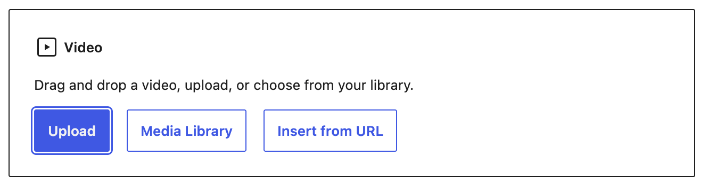

## Block toolbar

To view the block toolbar, click on the block, and the toolbar will be displayed.

Every block comes with unique toolbar icons and blocks specific user controls that allow you to manipulate the block right in the editor. The Video block contains the following specific tools within the block toolbar:

### Transform to

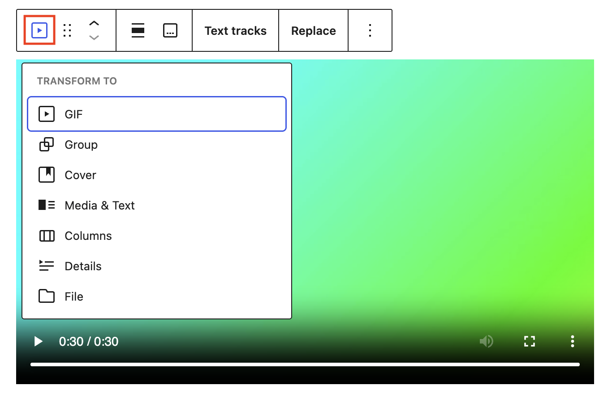

Click on the Transform button to convert the Video block to a Gif variation, Group, Cover, Media & Text, Columns, Details, or File block.

### Block moving tools

Use the block-moving tools to move the Video block.

The **drag** or **six dots** icon allows you to freely reposition the block anywhere within the editor by holding the icon and dragging it to the new location.

You can also use the **arrow icons** to move the block up or down within the group of nested blocks or when there are multiple blocks.

> [!NOTE]
> [Get more information about moving a block within the editor.](../../working-with-blocks/moving-blocks.md)

### Align

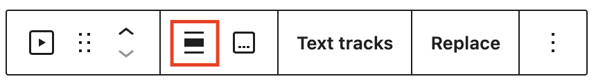

Use the change alignment tool to align the Video block. Choose one of the following options:

-   **None** – Leaves the block the current size
-   **Wide width** – Increase the width of the post beyond the content size
-   **Full width** – Extend the block to cover the full width of the screen
-   **Align left** – Align the block to the left
-   **Align center** – Center the block
-   **Align right** – Align the block to the right

**Wide width** and **Full width** only display if your theme supports these width options.

### Add/Remove caption

Use Add/Remove caption option to toggle the caption of the video.<br>
You can apply bold or italic formatting to captions, or create a link.

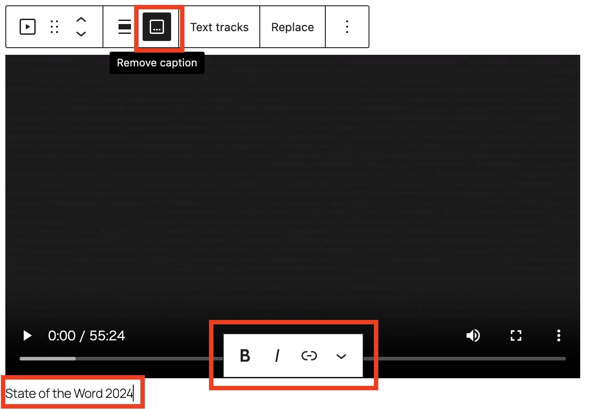

### Text tracks

The Text tracks option will allow you to display timed text tracks (such as subtitles or captions) when the media is playing.

The tracks are formatted in WebVTT format (.vtt files or Web Video Text Tracks).

This is the example of .vtt file

```
WEBVTT

NOTE State of the Word is the annual keynote
address celebrating the progress of the open
source WordPress project and offering a glimpse
into its future.

0:02:14.000 --> 0:02:15.000
Konbanwa

0:02:16.000 --> 0:02:17.000
And howdy.

0:02:18.000 --> 0:02:20.000
And thanks for being here, everyone.
```

Once you upload the track, you will find the edit track option.

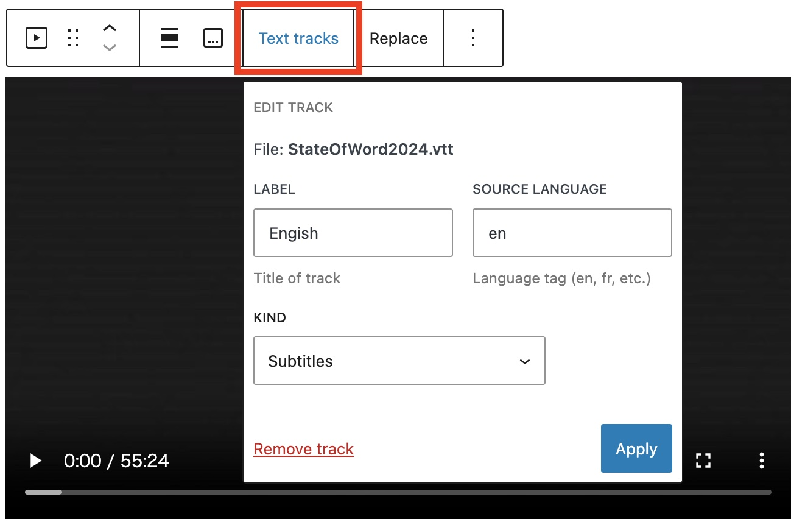

**Label.** A user-readable title of the text track which is used by the browser when listing available text tracks.

**Source language.** Language of the track text data. It must be a valid BCP 47 language tag. If the Kind attribute is set to Subtitles, then the Source language must be defined.

**Kind.** How the text track is meant to be used. If omitted, the default kind is Subtitles. If the attribute contains an invalid value, it will use Metadata.

-   **Subtitles**: Translations of the dialogue in the video for when audio is available but not understood. Subtitles are shown over the video.
-   **Captions:** Transcription of the dialogue, sound effects, musical cues, and other audio information for when the viewer is deaf/hard of hearing or the video is muted. Captions are also shown in the video.
-   **Descriptions:** Text descriptions of what’s happening in the video for when the video portion isn’t available because the viewer is using assistive technology. Descriptions are read by a screen reader or turned into a separate audio track.
-   **Chapters**: Chapter titles that are used to create navigation within the video. Typically they’re in the form of a list of chapters that the viewer can click on to go to a specific chapter.
-   **Metadata**: Tracks with data meant for javascript to parse and do something with. These aren’t shown to the user.

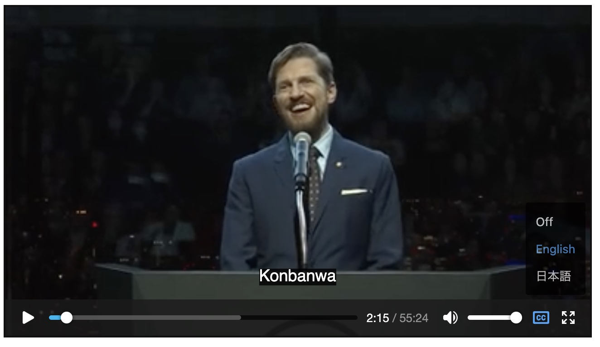

### Replace

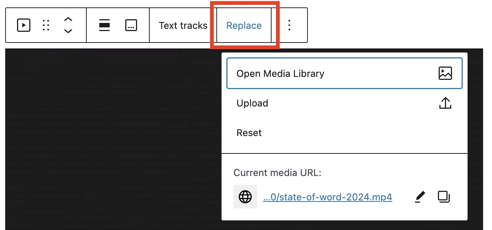

The Replace option will allow you to select a new video file for your block. Use this if you need to replace the video file in your Video block. You’ll have the option to select Open Media Library, Upload, or Current media URL.

### More options

The Options menu represented by three vertical dots on the far right of the toolbar gives you more features such as the ability to duplicate or remove the block.

> [!NOTE]
> [Read about these and other settings.](../../working-with-blocks/more-options.md)

## Block settings

Every block has specific options in the editor sidebar in addition to the options found in the block toolbar. If you do not see the sidebar, click on the **Settings button** next to the Save/Publish button.


The Video block settings panel is divided into three tabs – **Settings**, and **Styles**.

### Transform

The Video block can easily be transformed into a Gif variation of the Video block using the **Transform to variation** button.

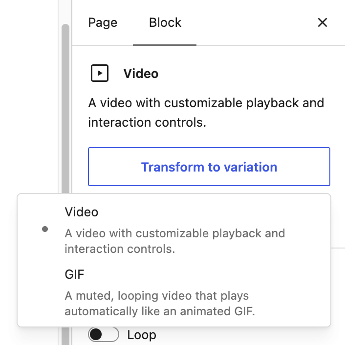

### Settings

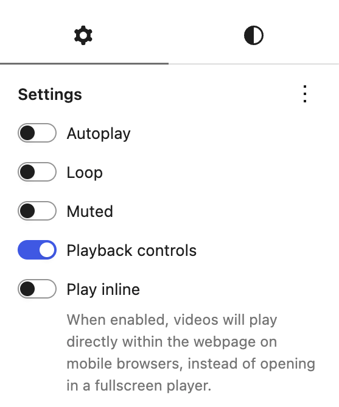

When you select the **Settings tab**, represented by a gear icon, you will see the following settings in the sidebar:

-   **Autoplay, Loop, Muted** – These options let you set your video file to autoplay when someone visits the page or post. Looping lets you choose if the video file repeats after it is finished. You can also choose to mute the video if your circumstance requires it.
-   **Play inline** – This option lets you set your video to be played *inline*, that is within the element’s playback area. Keep in mind that turning this option off does not imply that the video will always be played in fullscreen.
-   **Playback controls** – Toggle this option to show or hide the playback control overlay on the video.

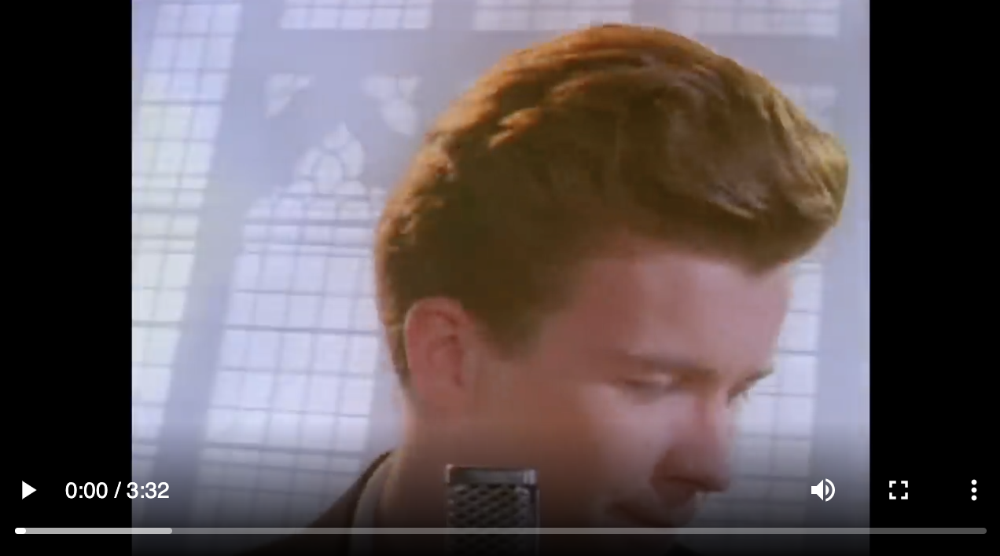

*A video with playback controls:*

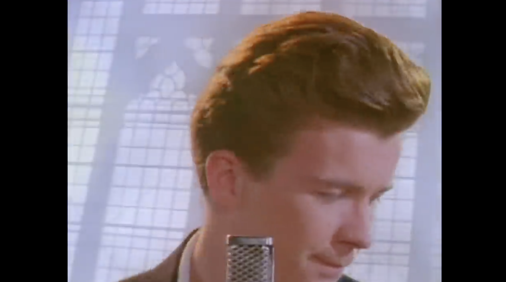

*A video without playback controls:*

#### Preload

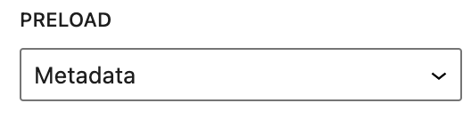

This option allows you to select how much of the video file is downloaded when the page or post is loaded. While it may be tempting to go ahead and have the whole file download automatically, keep in mind that this can slow your page’s load speed down.

There are three settings:

-   **Auto** – The entire video file is downloaded, regardless of whether the visitor clicks the Play button or not. This makes the biggest impact on your page or post’s load speed, especially with larger video files.
-   **Metadata** – Only basic info about the file will be downloaded automatically. Like the None option, the download of the video file only begins when someone clicks Play. This setting is also very fast, as the only thing downloaded is text. On a fundamental level, there’s not a big difference between None and Metadata.
-   **None** – Nothing about the video file is downloaded automatically. The download of the video file only begins when your visitor clicks the Play button. This is the fastest setting.

#### Poster image

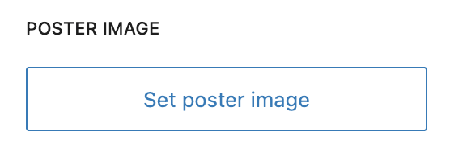

You can choose a poster image that will be displayed before a video is set to play. This can be useful if the first frame of the video isn’t necessarily appealing or indicative of the video content. An eye-catching poster image can really draw attention to your video.

#### Advanced

The Video block provides the following Advanced settings options: HTML Anchor, Additional CSS Class(es), Additional CSS, and Styles.

> [!NOTE]
> [Learn more about advanced settings](../../working-with-blocks/block-settings/advanced-settings-overview.md)

### Styles

When you click on the **Styles tab**, represented by a half-filled circle, within the Block Settings sidebar, you will see the following option:

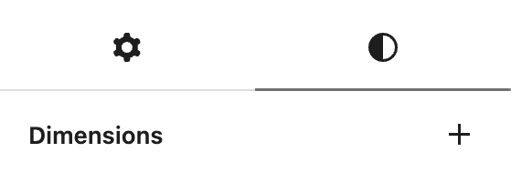

#### Dimensions

The Video block provides dimension settings options to change padding and margin size.

> [!NOTE]
> For details, refer to this support article: [Dimensions Settings Overview](../../working-with-blocks/block-settings/dimension-controls-overview.md)

## Changelog

-   Updated 2026-09-01 (props to @awetz583)
    -   Added Transform to variation button for 7.1
-   Updated 2026-05-25 (props to @kjoyner @awetz583)
    -   Updated “Advanced” section to refer to new overview page
-   Updated 2026-03-02 (props to @awetz583)
    -   Updated formatting and headings
    -   Added Advanced and More options sections
-   Updated 2025-10-18
    -   Added Add/Remove caption
    -   Updated screenshots for 6.8
-   Updated 2023-02-17
    -   Revised formatting for the whole article
    -   Updated all the screenshots for 6.1
-   Updated 2022-11-25
    -   Change screenshot alignment for mobile view
    -   Remove redundant text
    -   Added caption to images
-   Updated 2022-02-04
    -   Changed screenshots
-   Updated 2020-12-07
    -   Added Text tracks in Block Toolbar
    -   Changed screenshots in Block Toolbar
-   Updated 2020-08-25
    -   Screenshots as per WordPress 5.5
    -   Added feature changes in Block Toolbar
    -   Added feature changes in Block Settings
-   Updated 2020-06-18
    -   Added “Go back to the list of Blocks” to the top of the page
    -   Added the Changelog
-   Created 2019-03-07
