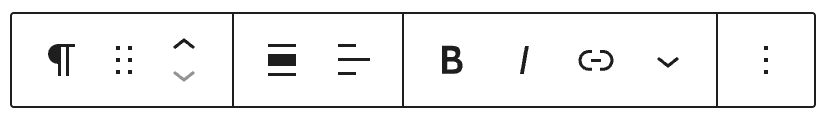
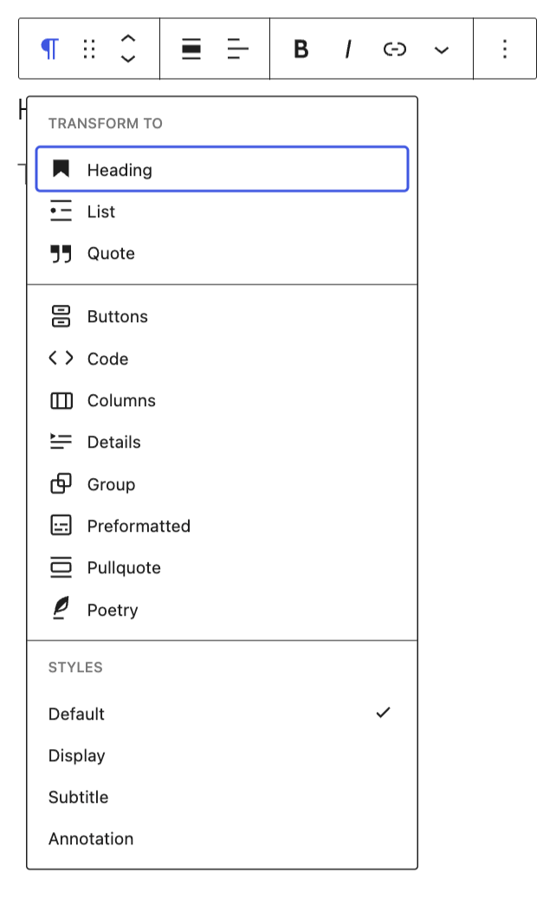
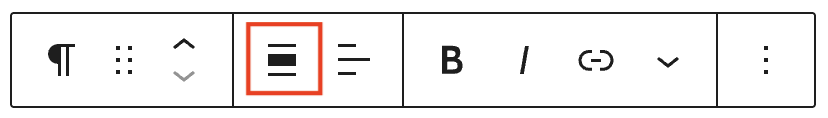
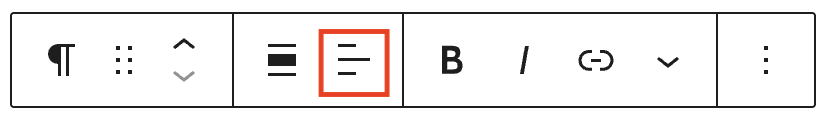
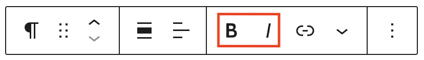
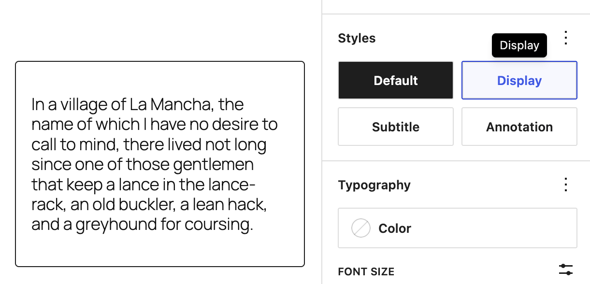

# Paragraph block

The Paragraph block is a basic building block that allows you to add text content to a post or page. It is the default block that appears when you create a new post or page. You can customize the text color, style, and alignment. Additionally, you can add links, inline images, and highlights within a paragraph.

Keyboard shortcuts can quickly bold or italicize text, or transform a Paragraph block into a Heading block.

> [!NOTE]
> [Learn more about the text formatting keyboard shortcuts.](../../keyboard-shortcuts-block-editor.md#text-formatting)

## Add a Paragraph block

To add a Paragraph block, click the **+ Block Inserter** button in the top-left corner of the editor. Search for the Paragraph block and click on the block to add it to the page

<video controls preload="metadata" src="https://wordpress.org/documentation/files/2019/03/paragraph-block.mp4"></video>

You can also choose the Paragraph block from the “Block Inserter” (+) pop-up window when you click on the (+) sign.

> [!NOTE]
> [Get detailed instructions on adding blocks](../../working-with-blocks/adding-a-new-block.md).

## Block toolbar

Each block has its own block-specific controls that allow you to manipulate the block right in the editor. If you hover over the buttons, tooltips will tell you what is behind the buttons, and also show you keyboard shortcuts when available.

### Transform to

The **Transform to** button lets you convert the Paragraph block into a Heading, List, Quote, Buttons, Code, Columns, Details, Group, Preformatted, Pullquote or Poetry blocks. You can also transform to styles such as Display, Subtitle, or Annotation depending on your theme.

### Block-moving tools

Use the block-moving tools to move the Paragraph block.

The **drag** or **six dots** icon allows you to freely reposition the block anywhere within the editor by holding the icon and dragging it to the new location.

You can also use the **arrow icons** to move the block up or down within the group of nested blocks or when there are multiple blocks.

> [!NOTE]
> [Get more information about moving a block within the Editor](../../working-with-blocks/moving-blocks.md).

### Align

Use the change alignment tool to change the width of the Paragraph block. The following is a list of the block width options:

-   **None** – Keep width the same as the content size
-   **Wide width** – Increase the width of the block beyond the content size
-   **Full width** – Extend the block to cover the full width of the screen

**Wide width** and **Full width** alignment options are only available if they are enabled in your theme.

### Text alignment

Use the **Change text alignment** tool to modify the alignment of the Paragraph block. Select the icon to display the alignment dropdown menu. You can align the text to the left, make it center-aligned, or orient it to the right.

### Bold and italics

The Bold and Italics formatting options are used to customize the text in the Paragraph block. You can also use keyboard shortcuts to enable these text formatting:

-   **Ctrl + B** or **Command + B** to bold the text.
-   **Ctrl + I** or **Command + I** to italicize the text.

### Insert links

The Insert links tool lets you add a hyperlink to the selected text.

> [!NOTE]
> [Read about more link editing options.](../../working-with-blocks/link-editing.md)

### More rich text options

The drop-down menu to the left of the More options menu contains a range of additional rich text editing options such as highlighting, inline code, inline image, strikethrough, and more.

> [!NOTE]
> [Read about more rich text editing options.](../../working-with-blocks/more-text-editing-overview.md)

### More options

The [More Options menu](../../working-with-blocks/more-options.md) represented by **three vertical dots on the far right of the toolbar** gives you more features such as the ability to duplicate, remove, or edit your block as HTML.

> [!NOTE]
> [Read about these and other settings.](../../working-with-blocks/more-options.md)

## Block settings

WordPress blocks have specific configuration options in the block settings panel. To access the Paragraph block settings panel, click the Settings button at the top-right corner of the editor. Here is a list of the Paragraph block settings options:

### Styles

You can modify the paragraph block styles by choosing the options under the **Styles** panel. The style options may vary based on your theme.

*Paragraph style options from Twenty Twenty Five theme*

### Typography

The Typography settings enable you to customize the font and text appearance of the content within the block. The settings have various options, such as font size, font style, font family, and letter spacing.

The Paragraph block has additional options to style text including line indent, columns, drop cap, and fit text.

> [!NOTE]
> [Get more details about changing typography settings.](../../working-with-blocks/block-settings/typography-settings-overview.md)

### Background

The Background settings allow you to customize the appearance of supported blocks using background images, colors, and gradients.

> [!NOTE]
> For details, refer to the [Background Settings Overview](../../working-with-blocks/block-settings/background-settings-overview.md).

### Dimensions

This block provides various options to adjust its dimensions, such as width and height, allowing you to customize the text layout to ensure visual consistency.

> [!NOTE]
> For details refer to this support article: [Dimension settings overview](../../working-with-blocks/block-settings/dimension-controls-overview.md).

### Border

The border settings add border color, width, and radius and add a shadow to the block.

> [!NOTE]
> For details refer to this support article: [Border settings overview](../../working-with-blocks/block-settings/border-settings-overview.md).

### Elements

Use the elements panel to change colors for blocks nested inside the selected block.

> [!NOTE]
> [Learn more about changing colors for nested elements.](../../working-with-blocks/block-settings/colors-settings-overview.md#elements-panel-for-nested-elements)

### Advanced

The Paragraph block provides the following Advanced settings options: HTML Anchor, Additional CSS Class(es), Additional CSS, and Styles.

> [!NOTE]
> [Learn more about advanced settings.](../../working-with-blocks/block-settings/advanced-settings-overview.md)

## Changelog

-   Updated 2026-09-01
    -   Added align to block toolbar for 7.0
-   Updated 2026-06-23
    -   Updated typography controls for 7.0
    -   Removed references to stretchy paragraph
    -   Updated advanced settings to link to shared page
    -   Update transforms screenshot (props @darshgupta-wisdm)
-   Updated 2026-02-10 (props to @katmoody @femkreations @awetz583)
    -   Added heading above how to add the block
    -   Removed italics from block name
    -   Removed more options screenshot
-   Updated 2025-11-27
    -   Added in stretchy text information to Transform section.
-   Updated 2025-03-25
    -   Add support for border settings.
    -   Update video from current WordPress version.
-   Updated 2024-05-14
    -   Replaced the long GIF with a video to provide better usability. This allows readers to rewatch missed parts, skip sections, etc.
    -   Fixed: The first image in “Lock Settings” was outdated.
    -   Corrected: Changed “links, inline images, and highlight” to “links, inline images, and highlights” to match plural form.
    -   Corrected: “The paragraph block provides options for dimension settings”.
    -   Corrected: Clarified whether the paragraph block ensures consistency.
    -   Corrected: The “Advanced” guide allowed adding HTML anchors. Inconsistency in the use of quotes around “Advanced” in this menu was fixed.
-   Updated 2023-08-09
    -   Replaced the link section with short summary linking to new dedicated page.
-   Updated 2023-06-08
    -   Replaced “More rich text options” section with short summary linking to new dedicated page for rich text editing options.
-   Updated 2023-05-16
    -   Content and screenshots updated for 6.2
-   Updated 2022-09-26
    -   Updated wording of “Block Toolbar” section
    -   Added Alt Text to images
-   Updated 2022-05-24
    -   All screenshots & videos have been changed for WordPress 6.0.
    -   Added Keyboard Input inline format.
-   Updated 2020-08-23
    -   Added subscript and superscript options
    -   Updated content to WP 5.5
    -   Updated images to WP 5.5
    -   Convert existing blocks to media & text blocks
-   Updated 2020-04-20
    -   Added updated color settings screen
    -   Added video on how to change color in the Custom Color window.
    -   changed date in Changelog from mm/dd/yyyy to yyyy-mm-dd
    -   Added new Category: Common Blocks
    -   Category Hierarchy: `Block Editor > Core Blocks > Common Blocks`
-   Updated 2020-04-18
    -   Added “More Options” 3-dot menu section and explanations of the options.
    -   Added explanations and illustrations to the various toolbar rich content options.
    -   Added screenshots of toolbar drop downs
    -   Replaced previous block tool bar images with WordPress 5.4 views
    -   Added video for tool tips on paragraph toolbar
    -   converted reusable block to Regular block
    -   Added the Changelog
-   Created 2019-03-07
