# Archive Title block

Use the *Archive Title block* to display the name of the Category, Tag, or custom Taxonomy, on the archive pages.

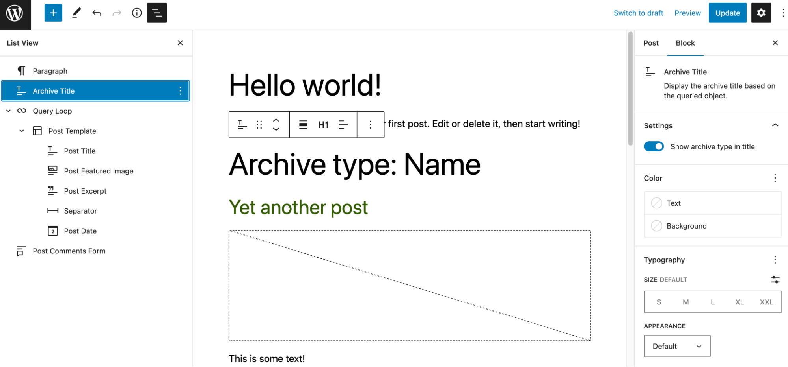

> [!NOTE]
> This block works only in the archive pages and will not be visible on other pages of the website. This block should be used only in the [Site Editor](../../../site-editor/README.md) to edit the archive page templates.

To add an *Archive Title block*, click the **Block Inserter** icon when editing the archive page template. Search for the *Archive Title block*. Click on it to add the block to your page template.

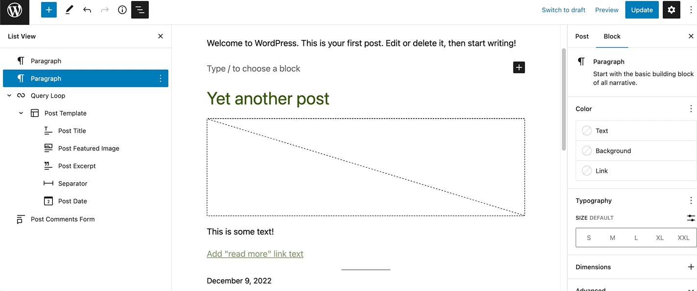

You can also use the keyboard shortcut <kbd>/archive-title</kbd> to quickly insert an *Archive Title block*.

> [!NOTE]
> [Detailed instructions on adding blocks](../../working-with-blocks/adding-a-new-block.md)

## Block toolbar

To view the block toolbar, click on the block, and the toolbar will be displayed.

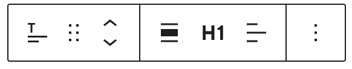

Every block comes with unique toolbar icons and blocks specific user controls that allow you to manipulate the block right in the editor.

The *Archive Title block* shows seven buttons in the block toolbar:

-   Transform to
-   Drag icon
-   Move arrows
-   Change alignment
-   Change heading level
-   Change text alignment
-   More options

**Transform to**

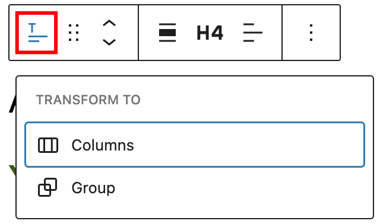

Click on the **Transform** button to convert the *Archive Title bloc*k into a *Group* block or *Columns* block.

**Drag icon**

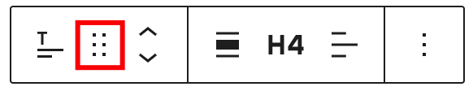

To drag and drop the block to a new location on the page template, click and hold the rectangle of dots, then drag it to the new location. The blue separator line indicates where the block will be placed. Release the left mouse button when you find the new location to place the block.

**Move arrows**

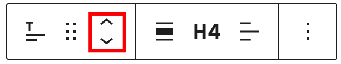

The up and down arrow icons can be used to move the block up and down on the page.

> [!NOTE]
> [Get more information about moving a block within the editor.](../../working-with-blocks/moving-blocks.md)

**Change alignment**

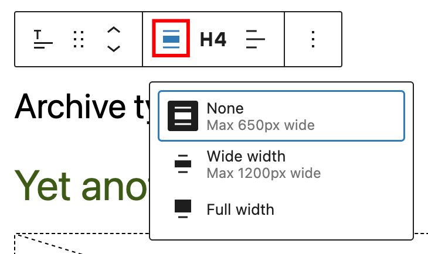

Use the change alignment tool to align the *Archive Title block*. Choose one of the following options:

-   **None –** Leaves the block the current size.
-   **Wide width –** Increase the width of the block beyond the content size.
-   **Full width –** Extend the block to cover the full width of the screen.

**Change heading level**

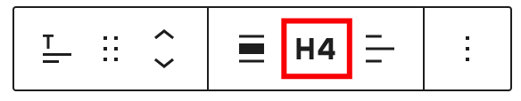

You can choose the heading level for the archive title from H1-H6.

**Change text alignment**

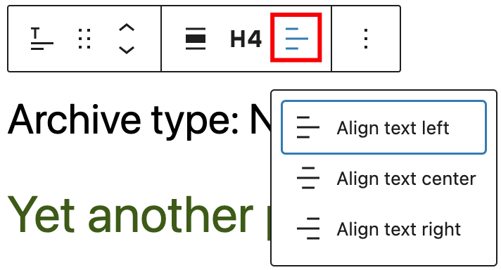

Click the **Change alignment** button in the block toolbar to display the alignment drop-down. You can align the block text to the left, make it center-aligned or align it to the right.

**Options**

The **Options** button on a block toolbar gives you more features to customize the block.

> [!NOTE]
> [Read about these and other settings.](../../working-with-blocks/more-options.md)

## Block settings

The block settings panel contains customization options specific to the block. To open it, select the block and click the **Settings** icon next to the **Publish** button.

Here are the options for the *Archive Title* *block*:

**Settings**

It’s possible to toggle between an option to either show the archive type in the title or not.

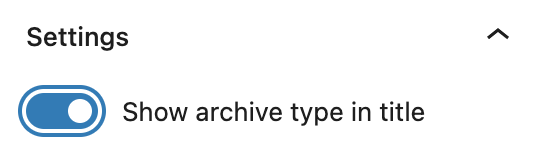

An example with this setting enabled:

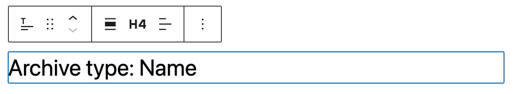

An example with this setting disabled:

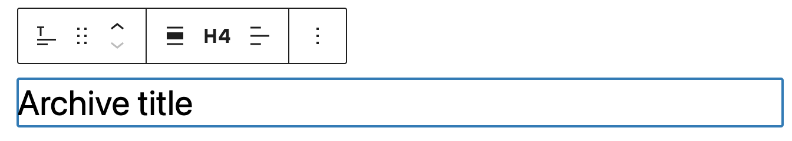

**Color**

The *Archive Title block* provides color settings options to change the text and background colors.

*Color Settings in the Archive Title Block*

> [!NOTE]
> [See this guide for more information about changing colors.](../../working-with-blocks/block-settings/colors-settings-overview.md)

**Typography**

The *Archive Title block* provides typography settings to change the font family, size, appearance, line height, letter case, letter spacing, and decoration.

> [!NOTE]
> [Get more details about changing typography settings.](../../working-with-blocks/block-settings/typography-settings-overview.md)

**Dimensions**

The *Archive Title block* provides dimensions settings options to change padding and margin size.

> [!NOTE]
> [Learn more about dimension controls.](../../working-with-blocks/block-settings/dimension-controls-overview.md)

**Advanced settings**

The following Advanced settings options are available: HTML Anchor, Additional CSS Class(es), Additional CSS, and Styles.

> [!NOTE]
> [Learn more about advanced settings.](../../working-with-blocks/block-settings/advanced-settings-overview.md)

## Changelog

-   Updated 2026-06-29
    -   Linked to advanced settings
-   Updated 2025-12-08
    -   Changed the capitalization in the title to Archive Title block
-   Updated 2023-02-07
    -   Updated screenshots
    -   Fixed some formatting
-   Created 2022-03-10
