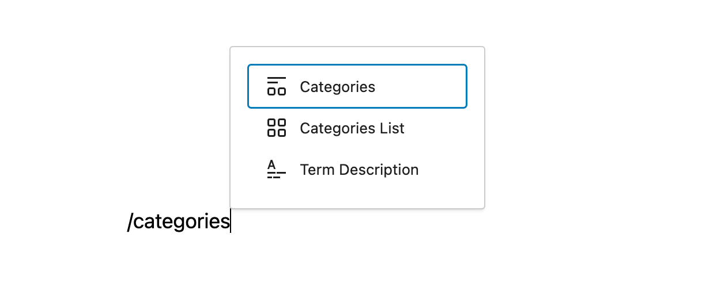
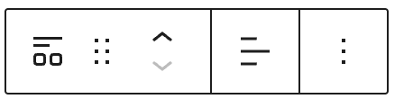
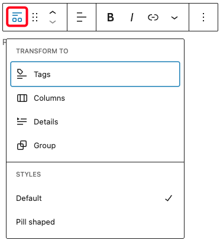
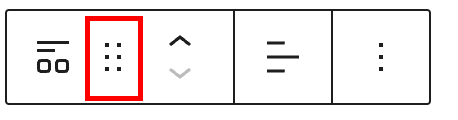
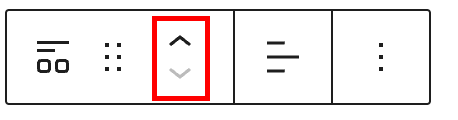
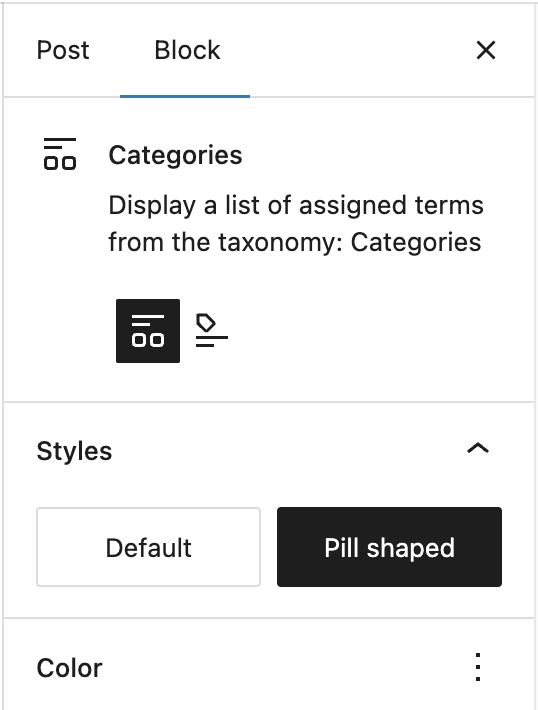
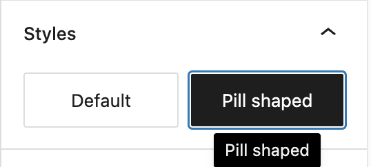

# Categories block

Use the Categories block to display the posts’ categories. This block is primarily nested inside a [query loop](query-loop-block.md) block and helps to customize the appearance of the query loop.

To add a Categories block, click the **Block Inserter** icon when editing the page template. Search for the Categories **block**. Click on it to add the block to your page template.

<video controls preload="metadata" src="https://wordpress.org/documentation/files/2023/06/adding-category-block.mp4"></video>

*Video showing how to add Categories block*

You can also type /categories and hit enter in a new paragraph block to add the Categories block quickly.

*How to add Categories block quickly*

> [!NOTE]
> [Detailed instructions on adding blocks](../../working-with-blocks/adding-a-new-block.md)

## Block toolbar

To view the block toolbar, click on the block and the toolbar will be displayed.

Every block comes with unique toolbar icons. These block-specific controls allow you to manipulate the block right in the editor.

The Categories block shows five buttons in the block toolbar:

-   Transform to
-   Drag icon
-   Move arrows
-   Change text alignment
-   More options

*Categories block toolbar*

**Transform to:**

*Transform options in Categories block*

Click on the “Transform” button to convert the Categories block into **Tags, Columns, Details**, or a **Group** block:

-   **Group**: Place the block inside a Group to apply shared styles like background color, padding, or borders around the entire section.
-   **Tags**: Switch to display a tag list instead of categories, useful for showcasing post tags in a similar layout.
-   **Columns**: Use columns to organize categories into multiple vertical sections, enhancing visual structure.
-   **Details**: Wrap the category list in an expandable/collapsible container to save space and improve readability.

**Drag icon:**

*Drag icon in the Categories block*

To drag and drop the block to a new location on the page template, click and hold the rectangle of dots, then drag to the new location. The blue separator line indicates where the block will be placed. Release the left mouse button when you find the new location to place the block.

**Move arrows:**

*Move arrows in the Categories block*

The up and down arrow icons can be used to move the block up and down on the page.

> [!NOTE]
> [Get more information about moving a block within the editor.](../../working-with-blocks/moving-blocks.md)

**Change text alignment**:

*Change text alignment in Categories block*

Click the “Change alignment” button in the Block toolbar to display the alignment drop-down. You can align the block text to the left, make it center-aligned or align it to the right.

### More options

These controls give you the option to copy, duplicate, and edit your block as HTML.

> [!NOTE]
> [Read about these and other settings.](../../working-with-blocks/more-options.md)

## Block settings

Every block has specific options in the editor sidebar in addition to the options found in the block toolbar. If you do not see the sidebar, click on the **Settings button** next to the Save/Publish button.

*Categories block settings*

### Styles

You can customize “Styles” options to change the appearance of the Categories block. Available options are **Default** or **Pilled shaped**:

-   **Default**: Displays the categories in a standard list format, following the theme’s typography and spacing.
-   **Pilled shaped:** Displays each category inside a rounded pill-like container, making them stand out with a more modern and visually distinct look.

*Change the style of display categories*

### Color

You can customize the text color, background color, gradient background, and link color for the Categories block. *The color options available will vary based on the theme.*

> [!NOTE]
> [See this guide for more information about changing colors.](../../working-with-blocks/block-settings/colors-settings-overview.md)

### Typography

On this tab, you can adjust properties such as the Size, Font, Appearance, Line height, Letter spacing, Decoration and Letter case.

To access all the typography options click on the + button in the right corner of the Typography tab.

> [!NOTE]
> [Get more details about changing typography settings.](../../working-with-blocks/block-settings/typography-settings-overview.md)

### Dimensions

On this tab, you can adjust properties such as the **Padding, Margin, and Block spacing** for the **Categories** block. These options help in defining the spacing around and between elements, ensuring proper alignment and layout consistency across different sections of your site.

> [!NOTE]
> [Get more details about changing dimensions settings.](../../working-with-blocks/block-settings/dimension-controls-overview.md)

### Border

On this tab, you can add **custom border** to the **Categories** block by adjusting **Border width, Style, Color, and Radius**. These options provide greater flexibility in styling, allowing you to create visually distinct category lists that align with your site’s design.

> [!NOTE]
> [Get more details about changing border settings.](../../working-with-blocks/block-settings/border-settings-overview.md)

### Advanced settings

The following Advanced settings options available: HTML Anchor, Additional CSS Class(es), Additional CSS, Separator, and Styles.

The Advanced tab lets you enter character(s) that can be used to separate the category terms. The default setting is a comma.

> [!NOTE]
> [Learn more about advanced settings.](../../working-with-blocks/block-settings/advanced-settings-overview.md)

## Changelog

-   Updated 2026-06-29 (props @awetz583)
    -   Linked to advanced settings
-   Update 2025-06-05
    -   Add border support
    -   Add dimensions support
    -   Add styles support
    -   Update screenshots to 6.8.1
-   Update 2025-04-22 (props to [@karthickmurugan](https://profiles.wordpress.org/karthickmurugan/))
    -   Add color support.
    -   Update screenshots to 6.8.
    -   Add missing ALT tags.
-   Updated on 2023-06-27
    -   Renamed ‘Post Categories Block’ with ‘Categories Block’
    -   Updated screenshots/video to 6.2.2
-   Created 2022-03-21
