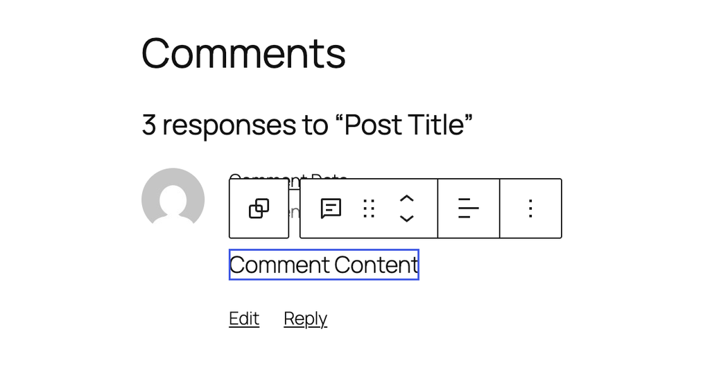
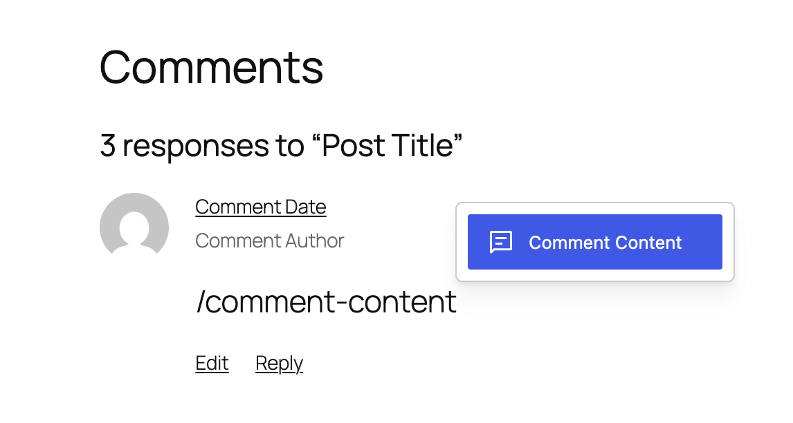
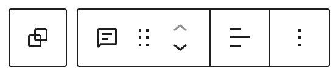
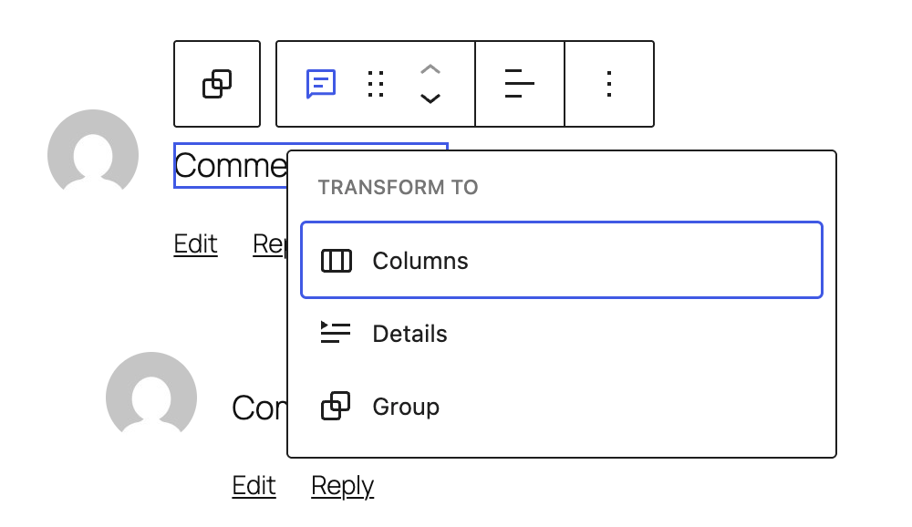
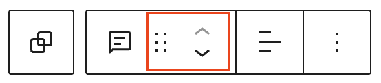
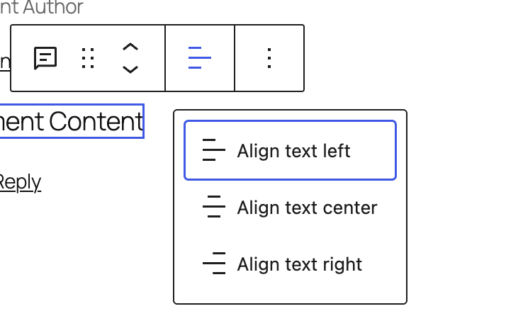
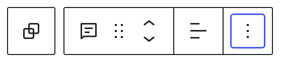
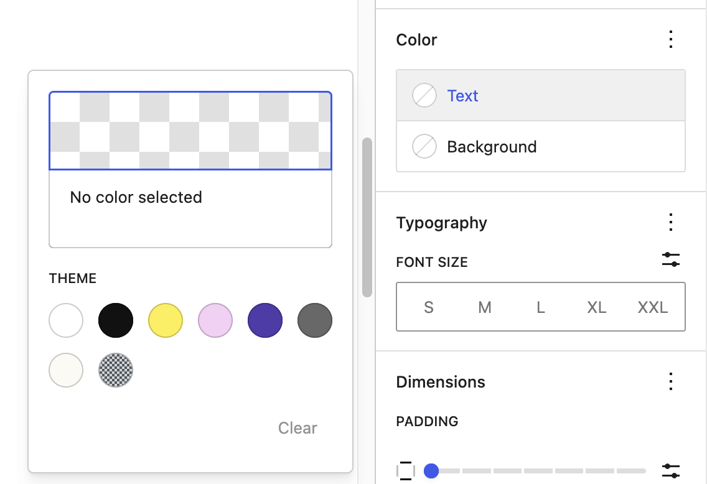
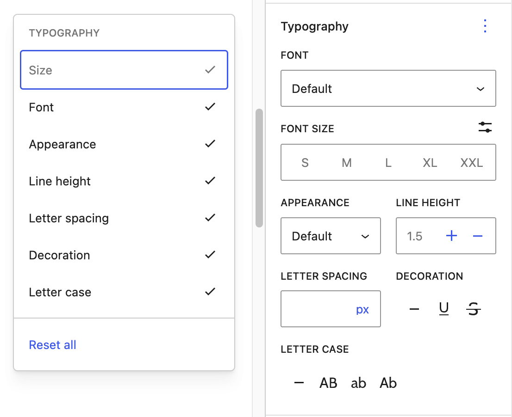
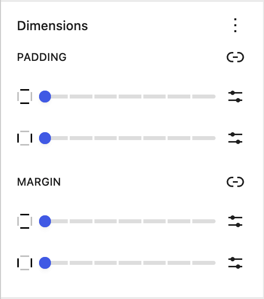

# Comment Content block

The *Comment Content* block displays the content of a comment. This block is located inside a Comment Query Loop block and lets you customize the appearance of the comment’s content.

> [!NOTE]
> You can only insert the *Comment Content* block inside a Comment Template block within the Comment Query Loop block.

Click the (+) icon inside the comment template block to open the block inserter pop-up window and search for the *Comment Content* block.

You can also use the keyboard shortcut <kbd>/comment-content</kbd> to quickly insert a *Comment Content* block inside a Comment Template block.

> [!NOTE]
> [Detailed instructions on adding blocks](../../working-with-blocks/adding-a-new-block.md)

## Block toolbar

The block toolbar contains the tools to customize each block. The *Comment Content* block’s toolbar consists of the following tools:

**Transform to**

You can transform a *Comment Content block* into a Columns, or a Group block.

**Block-moving tools**

Use the block-moving tools to move the block up and down inside the editor. Use the six dots icon to drag and drop the *Comment Content* block and reposition it anywhere on the editor. Alternatively, click on the up and down arrows to move the block up or down the editor.

> [!NOTE]
> [Get more information about moving a block within the editor.](../../working-with-blocks/moving-blocks.md)

**Change text alignment**

Text alignment options let you align the content of a comment towards the left, center, or right.

### More options

The [More Options menu](../../working-with-blocks/more-options.md) represented by **three vertical dots on the far right of the toolbar** gives you more features such as the ability to duplicate, remove, or edit your block as HTML.

> [!NOTE]
> [Read about these and other settings.](../../working-with-blocks/more-options.md)

## Block settings

Every block has specific options in the editor sidebar in addition to the options found in the block toolbar. *If you do not see the sidebar, click the ‘sidebar’ icon.*

Here are the options for the *Comment Content* block:

### Color

The *comment content block* lets you customize the text, and background colors.

Click on any of the options to change the color. Choose from the default color or click the upper rectangle area to pick a custom color using the color picker.

> [!NOTE]
> [See this guide for more information about changing colors.](../../working-with-blocks/block-settings/colors-settings-overview.md)

### Typography

Typography settings allow you to change a block’s font size, appearance, line height, letter casing, and spacing.

> [!NOTE]
> [Get more details about changing typography settings.](../../working-with-blocks/block-settings/typography-settings-overview.md)

### Dimensions

Dimension controls are used to control how groups of blocks are placed alongside one another, by changing the values for padding, margin, and other dimensions.

> [!NOTE]
> [Learn more about dimension controls.](../../working-with-blocks/block-settings/dimension-controls-overview.md)

**Advanced**

The following Advanced settings options are available: HTML Anchor, Additional CSS Class(es), Additional CSS, and Styles.

> [!NOTE]
> [Learn more about advanced settings.](../../working-with-blocks/block-settings/advanced-settings-overview.md)

## Changelog

-   Updated 2026-08-10
    -   Updated screenshots. Props @adnan007.
-   Updated 2026-06-29
    -   Linked to advanced settings
-   Updated 2025-12-08
    -   Changed the capitalization in the title to Comment Content block
-   Created 2022-08-02
