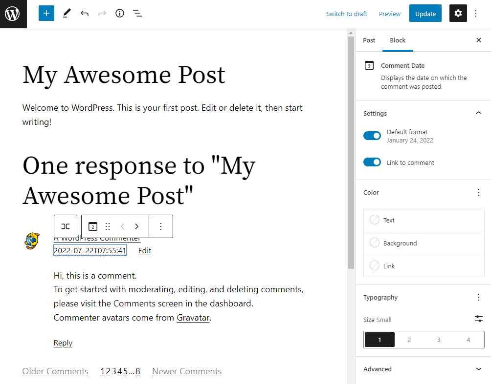
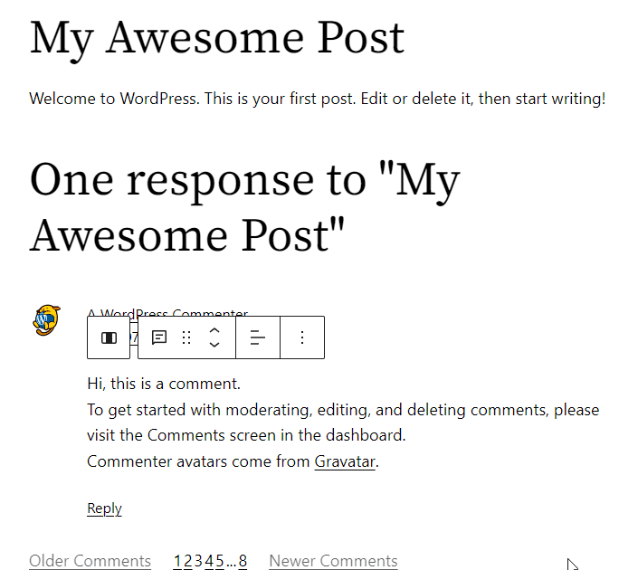
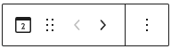
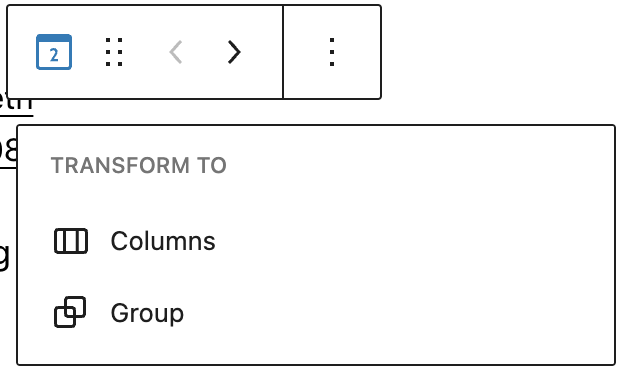
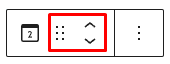
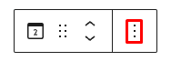
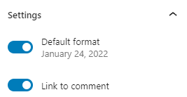
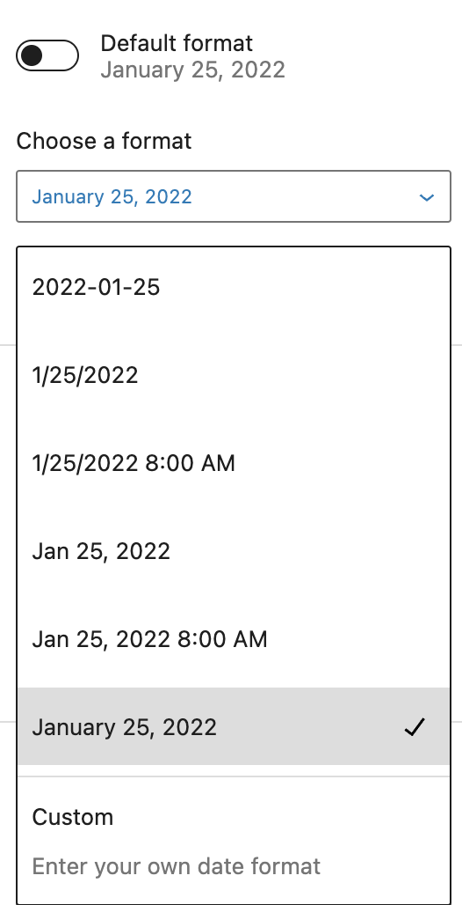
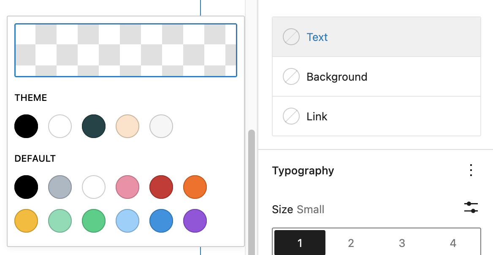
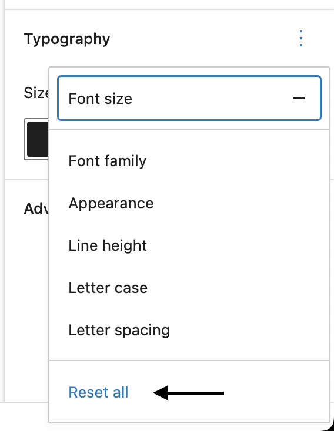

# Comment Date block

The *Comment Date* *block* displays the date on which a comment was posted. This block is located inside a Comment Query Loop block and allows users to edit the appearance of the comment date.

> [!NOTE]
> You can only insert the *Comment Date block* inside a Comment Template block within the Comment Query Loop block.

Click the (+) icon inside the Comment Template block to open the block inserter pop-up window and search for the Comment Date Block.

You can also use the keyboard shortcut `/comment-date` to quickly insert a Comment Date block inside a Comment Template block.

> [!NOTE]
> [Detailed instructions on adding blocks](../../working-with-blocks/adding-a-new-block.md)

## Block toolbar

The block toolbar contains the tools to customize each block. The Comment Date block’s toolbar consists of the following tools:

**Transform to**

You can transform a *Comment Date block* into a Columns, or a Group block.

**Block-moving tools**

Use the block-moving tools to move the block up and down inside the editor. Use the six dots icon to drag and drop the *Comment Date Block* and reposition it anywhere on the editor. Alternatively, click on the up and down arrows to move the block up or down the editor.

> [!NOTE]
> [Get more information about moving a block within the editor.](../../working-with-blocks/moving-blocks.md)

**More options**

The [More Options menu](../../working-with-blocks/more-options.md) represented by **three vertical dots on the far right of the toolbar** gives you more features such as the ability to duplicate, remove, or edit your block as HTML.

> [!NOTE]
> [Read about these and other settings.](../../working-with-blocks/more-options.md)

## Block settings

The block settings panel contains customization options specific to the block. To open it, select the block and click the cog icon next to the Publish button.

Here are the options for the *Comment Date Block*:

### Settings

In the Settings tab, you can select the Date format. By turning on the *Default format* option, you can choose to use the default date format. When this setting is turned off, you can select the preferred date format from the drop-down list or enter a custom date or time [format](../../../../using-wordpress/writing-and-publishing/organizing-your-site/customize-date-and-time-format.md).

You can also turn on/off the ‘*Link to comment’* switch. Turning on this button will link the date field to the specific comment.

### Color

The *Comment Date Block* lets you customize the text, background, and link color. Click on any of the options to change the color. Choose from the default color or click the upper rectangle area to pick a custom color using the color picker.

> [!NOTE]
> [See this guide for more information about changing colors.](../../working-with-blocks/block-settings/colors-settings-overview.md)

### Typography

To access all the typography options click on the 3-dot button in the right corner of the Typography tab. You also have the option to Reset all the typography changes you made by clicking on the Reset all option in the dropdown.

> [!NOTE]
> [Get more details about changing typography settings.](../../working-with-blocks/block-settings/typography-settings-overview.md)

**Advanced**

The following Advanced settings options are available: HTML Anchor, Additional CSS Class(es), Additional CSS, and Styles.

> [!NOTE]
> [Learn more about advanced settings.](../../working-with-blocks/block-settings/advanced-settings-overview.md)

## Changelog

-   Updated 2026-06-29
    -   Linked to advanced settings
-   Updated 2025-12-08
    -   Changed capitalization in title and other instances to Comment Date block
-   Created 2022-07-25
