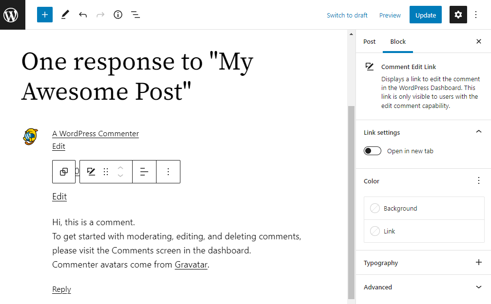
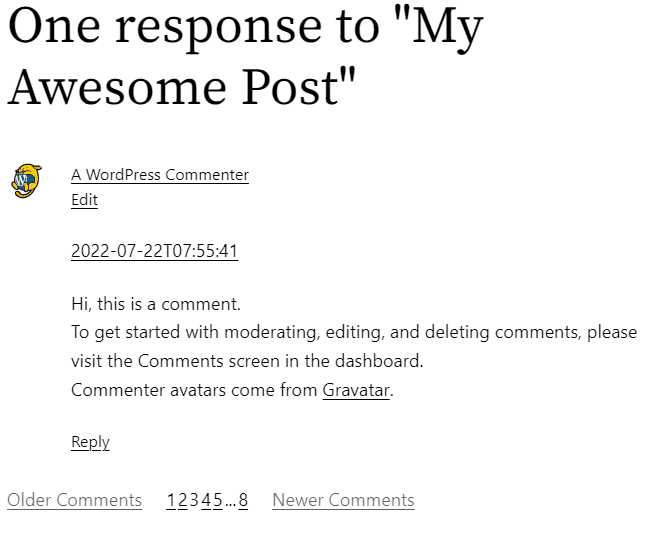
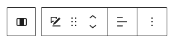
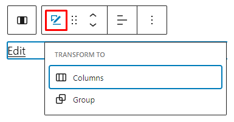
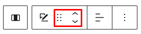
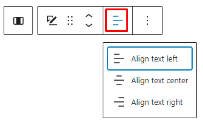
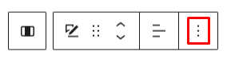
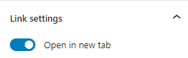
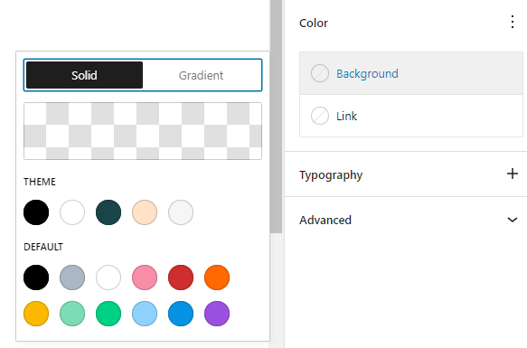
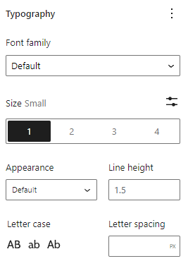

# Comment Edit Link block

The *Comment Edit Link* block displays a link to edit the comment in the WordPress Dashboard. This block is located inside a Comment Query Loop block and lets you customize the appearance of the *Edit* link. The Edit link is only visible to users who have permission to edit the comments.

> [!NOTE]
> You can only insert the *Comment Edit Link* block inside a Comment Template block within the Comment Query Loop block.

Click the (+) icon inside the comment template block to open the block inserter pop-up window and search for the *Comment Edit Link* block.

You can also use the keyboard shortcut <kbd>/comment-edit-link</kbd>to quickly insert a *Comment Edit Link* block inside a Comment Template block.

> [!NOTE]
> [Detailed instructions on adding blocks](../../working-with-blocks/adding-a-new-block.md)

## Block toolbar

The block toolbar contains the tools to customize each block. The *Comment Edit Link* block’s toolbar consists of the following tools:

**Transform to**

You can transform a *Comment Edit Link* block into a Columns block, or a Group block.

**Block-moving tools**

> [!NOTE]
> [Get more information about moving a block within the editor.](../../working-with-blocks/moving-blocks.md)

Use the block-moving tools to move the block up and down inside the editor. Use the six dots icon to drag and drop the *Comment Edit Link* block and reposition it anywhere on the editor. Alternatively, click on the up and down arrows to move the block up or down the editor.

**Change text alignment**

Text alignment options let you align the Edit button towards the left, center, or right.

**More options**

The [More Options menu](../../working-with-blocks/more-options.md) represented by **three vertical dots on the far right of the toolbar** gives you more features such as the ability to duplicate, remove, or edit your block as HTML.

> [!NOTE]
> [Read about these and other settings.](../../working-with-blocks/more-options.md)

## Block settings

The block settings panel contains customization options specific to the block. To open it, select the block and click the cog icon next to the Publish button.

Here are the options for the *Comment Edit Link* block:

### Link

In the Link Settings section, you can enable the *open in new tab* option, and if enabled, will open the link editing page in a new tab.

### Color

The Comment Edit Link block lets you customize the background and link color.

Click on any of the options to change the color. Choose from the default color or click the upper rectangle area to pick a custom color using the color picker.

> [!NOTE]
> [See this guide for more information about changing colors.](../../working-with-blocks/block-settings/colors-settings-overview.md)

### Typography

Typography settings allow you to change a block’s font size, appearance, line height, letter casing, and spacing.

> [!NOTE]
> [Get more details about changing typography settings.](../../working-with-blocks/block-settings/typography-settings-overview.md)

**Advanced settings**

The following Advanced settings options are available: HTML Anchor, Additional CSS Class(es), Additional CSS, and Styles.

> [!NOTE]
> [Learn more about advanced settings.](../../working-with-blocks/block-settings/advanced-settings-overview.md)

## Changelog

-   Updated 2026-06-29
    -   Linked to advanced settings
-   Created 2022-08-17
