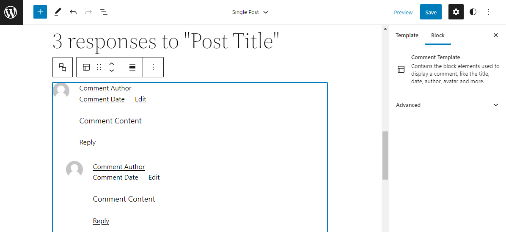
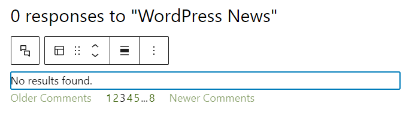
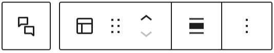
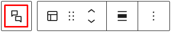
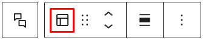
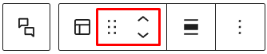
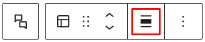
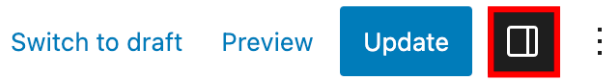

# Comment Template block

The *Comment Template* block is a part of the *Comments* block. It contains block elements to display comments, such as the comment author, avatar, and comment content.

## How to use the Comment Template Block

When you add a Comments block, the *Comment Template* block is included by default. Also, you can only insert a *Comment Template* block inside a Comments block. Since the *Comment Template* is a part of the Comments block, the content will change on the front-end depending on the query.

To add a *Comment Template* block, click the block inserter icon (**+**) inside the Comments block to open the block inserter pop-up window and search for the *Comment Template* block.

You can also use the keyboard shortcut<kbd>/comment-template</kbd> to insert a *Comment Template* block quickly.

> [!NOTE]
> Check the detailed instructions on how to add a block [here](../../working-with-blocks/adding-a-new-block.md).

When the *Comments* block is added in the post editor, the *Comment Template* block will display the actual comments on the post and use a “No results found” placeholder when there’s no comment on the post yet.

## Block toolbar

To view the block toolbar, click on the block, and the toolbar will be displayed.

Every block has unique toolbar icons and blocks specific user controls that allow you to manipulate the block right in the editor.

The *Comment Template* block shows the following buttons:

-   Select Comments block
-   Transform to
-   Drag icon
-   Move arrows
-   Align
-   More options

### Select Comments block

This button will select the Comments block, as it’s the parent block of the *Comment Template* block.

### Transform to

When you click the Transform button, you can convert the *Comment Template* block into another block type using the existing content.

### Block-moving tools

Use the block-moving tools to move the block up and down inside the editor. Use the six dots icon to drag and drop the *Comment Template* block and reposition it anywhere on the Comments block. Alternatively, click on the up and down arrows to move the block up or down the editor.

> [!NOTE]
> [Get more information about moving a block within the editor.](../../working-with-blocks/moving-blocks.md)

### Change alignment

The *change alignment* tool is used for the *Comment Template* block’s position inside the Comments Query Loop block. Choose one of the following block alignment options:

-   None
-   Align left
-   Align center
-   Align right

### Options

The **Options** button on a block toolbar gives you more features to customize the block.

> [!NOTE]
> [Read about these and other settings.](../../working-with-blocks/more-options.md)

## Block settings

The block settings panel contains customization options specific to the block. To open it, select the block and click the **Settings** button next to the **Publish** button.

### Typography

Typography settings allow you to change a block’s font size, appearance, line height, letter casing, and spacing.

> [!NOTE]
> [Get more details about changing typography settings.](../../working-with-blocks/block-settings/typography-settings-overview.md)

### Dimensions

The *Comment Template* block provides dimension settings options to change padding and margin size.

> [!NOTE]
> [For details, refer to this support article: Dimensions Settings Overview.](../../working-with-blocks/block-settings/dimension-controls-overview.md)

### Advanced

The following Advanced settings options are available: HTML Anchor, Additional CSS Class(es), Additional CSS, and Styles.

> [!NOTE]
> [Learn more about advanced settings.](../../working-with-blocks/block-settings/advanced-settings-overview.md)

## Changelog

-   Updated 2026-06-29
    -   Linked to advanced settings
-   Updated 2023-04-11
    -   Added “no results found” placeholder
-   Updated 2023-04-05
    -   Updated images for 6.2
    -   Added dimensions support
-   Created 2022-08-19
