# Date Block

Use the Date block to display a custom date.

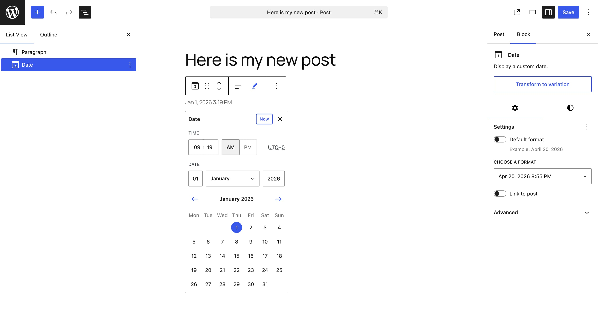

## Add a Date block

To add the Date block, click the **+ Block Inserter** button in the top-left corner of the editor. Search for the Date block and click on the block to add it to the page.

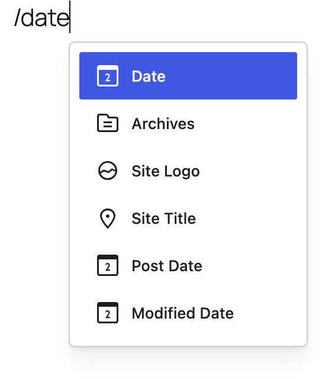

You can also quickly add the Date block by typing `/date` and pressing **Enter**.

> [!NOTE]
> [Detailed instructions on adding blocks.](../../working-with-blocks/adding-a-new-block.md)

## Block toolbar

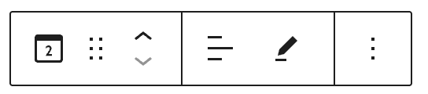

To view the block toolbar, click on the block and the toolbar will be displayed.

### Transform

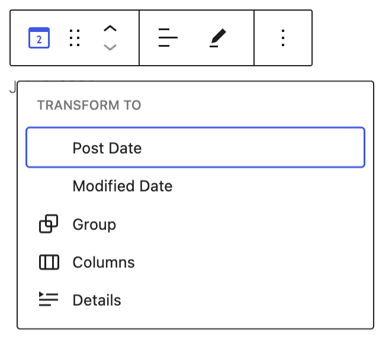

Click on the **Transform** button to convert the Date block into a Post Date, Modified Date, Group, Columns or Details block.

### Block moving tools

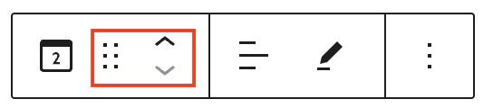

The block-moving tools allow you to move the block in the editor. Use the **six dots icon** to drag and drop the block and place it anywhere on the page. Alternatively, click on the **up and down arrows** to move the block up or down.

> [!NOTE]
> [Get more information about moving a block within the editor.](../../working-with-blocks/moving-blocks.md)

### Change text alignment

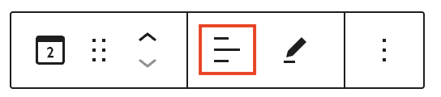

Click the **Change alignment** button in the Block toolbar to display the alignment drop-down. You can align the block text to the left, make it center-aligned or align it to the right.

### Change date

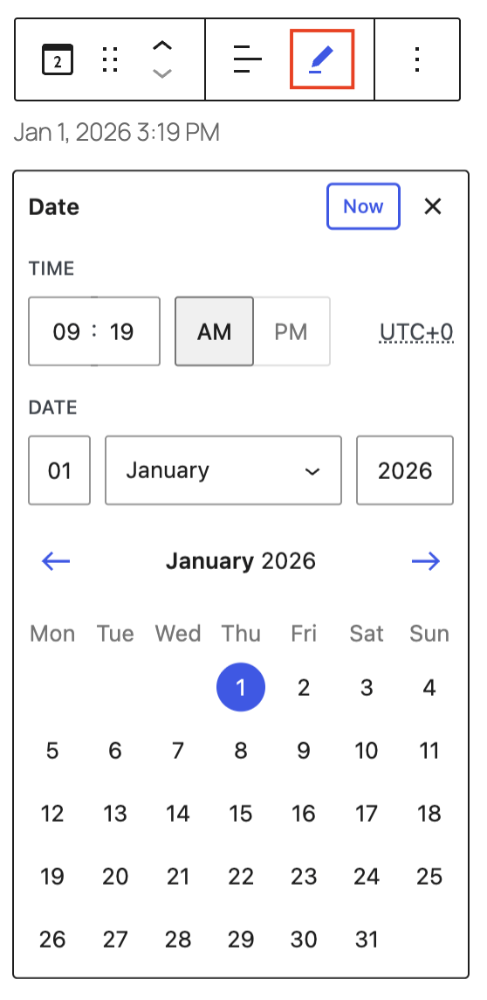

Click the **Change date** button in the Block toolbar to display a modal with date settings.

You can select a custom date and time through the input fields and options or select the date from the calendar. You can use the arrow buttons or drop down box to select a different month.

Click anywhere outside the modal, press the <kbd>Escape</kbd> key, or click on the button with the X to close the modal.

### More options

The **More options** menu represented by three vertical dots on the far right of the toolbar gives you more features such as the ability to duplicate or remove the block.

> [!NOTE]
> [Read about these and other settings.](../../working-with-blocks/more-options.md)

## Block settings

Every block has specific options in the editor sidebar in addition to the options found in the block toolbar. If you do not see the sidebar, click on the **Settings** button next to the Save/Publish button.

### Transform to variation button

The Date block can be easily transformed into a [Post Date](post-date-block.md) or [Modified Date](post-modified-date-block.md) block either by choosing the Transform button on the block toolbar or the **Transform to variation** button from the block settings.

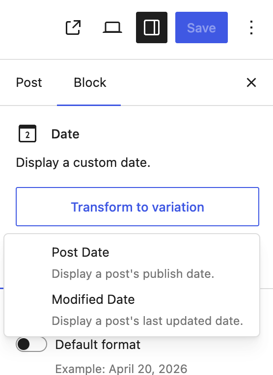

The Date block settings panel is divided into two tabs – **Settings**, and **Styles**.

### Settings

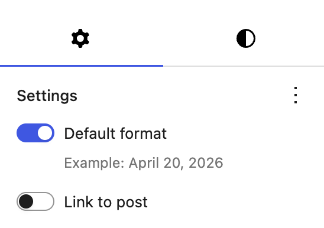

#### Default format

This option is toggled on when you first add a Date block. Your site’s Default format can be changed in the site settings area, see [customize default date and time format](../../../../using-wordpress/writing-and-publishing/organizing-your-site/customize-date-and-time-format.md) to learn how.

To change the Date block to use a different format from your site’s default format, toggle off the **Default format** settings.

You can choose a format from a list of predefined selections under **Choose a format**.

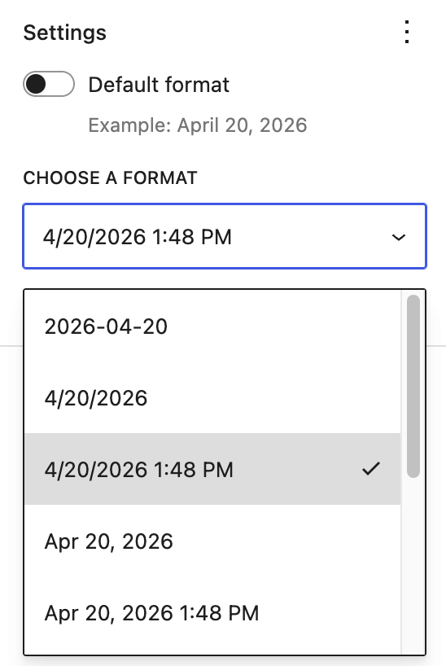

Or you can choose **Custom** from the drop down and enter a new format string in the input box that appears.

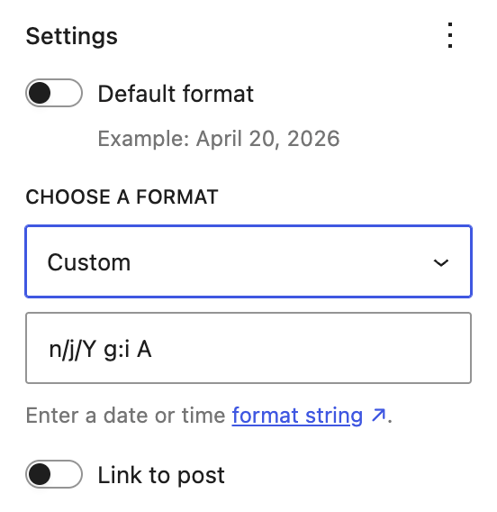

#### Link to Post

Toggle on the **Link to post** option to link the date to the URL of the post. In a Query Loop block, this enables the website visitor to go to the post by clicking on the Date.

#### Advanced

The following Advanced settings options are available: HTML Anchor, Additional CSS Class(es), Additional CSS, and Styles.

> [!NOTE]
> [Learn more about advanced settings.](../../working-with-blocks/block-settings/advanced-settings-overview.md)

### Styles

#### Color

The Date block provides Color settings options to change the text and background colors.

> [!NOTE]
> [See this guide for more information about changing colors.](../../working-with-blocks/block-settings/colors-settings-overview.md)

#### Typography

The Date block provides typography settings to change the font family, size, appearance, line height, letter case, letter spacing, and decoration.

> [!NOTE]
> [Get more details about changing typography settings.](../../working-with-blocks/block-settings/typography-settings-overview.md)

#### Dimensions

The Date block provides dimension settings options to change padding and margin size.

> [!NOTE]
> [Learn more about dimension controls.](../../working-with-blocks/block-settings/dimension-controls-overview.md)

#### Border

The Date block provides border settings options to add border color, width, and radius.

> [!NOTE]
> [Learn more about border settings.](../../working-with-blocks/block-settings/border-settings-overview.md)

## Changelog

-   Created 2026-07-08
