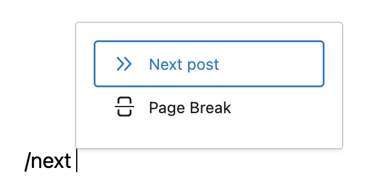
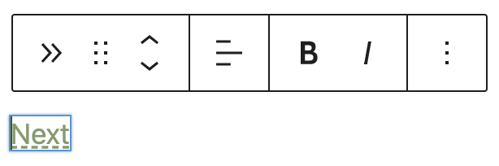
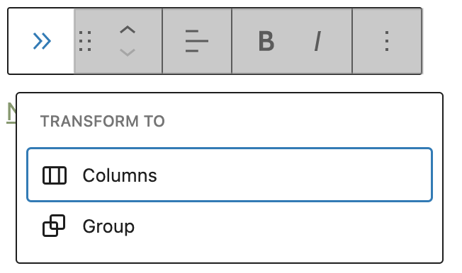
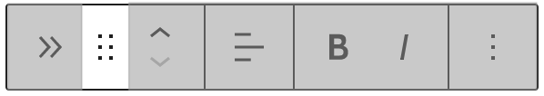
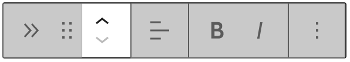
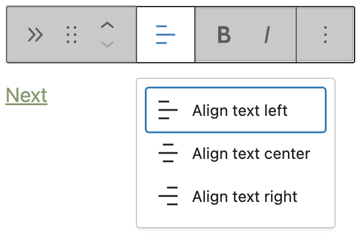
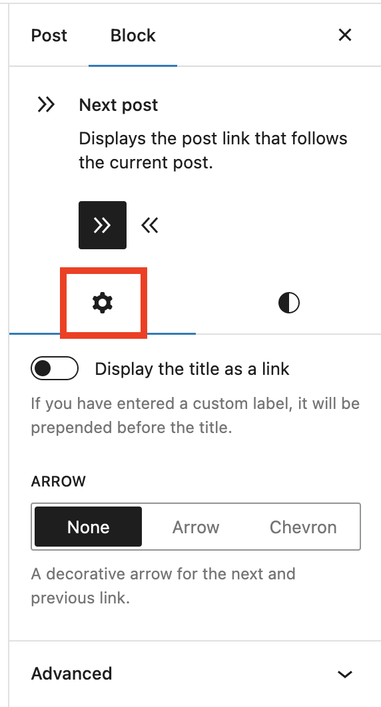
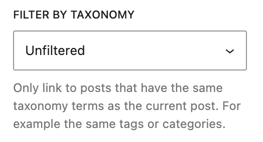
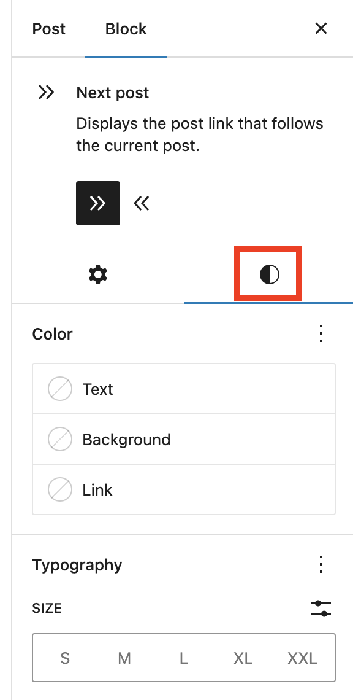

# Next Post block

Use the **Next Post** block to display a Next link which automatically points to the next post or page to the one currently displayed. 

Click the (**+**) icon to open the block inserter pop-up window and search for the **Next Post** block.

<video controls preload="metadata" src="https://wordpress.org/documentation/files/2023/05/232021838-2961f5aa-f27d-411c-be3f-b65ee9403a36.mov"></video>

You can also type the keyboard shortcut `/next` in a new paragraph and hit `enter` to quickly insert a Next Post block.

> [!NOTE]
> Refer to this article for [detailed instructions on adding blocks](../../working-with-blocks/adding-a-new-block.md).

## Block toolbar

To display the block toolbar, click on the block.

Every block comes with unique toolbar icons. These block-specific controls allow you to manipulate the block right in the editor.

The **Next Post** block toolbar shows 7 buttons:

-   Transform to
-   Drag
-   Move up/down
-   Change text alignment
-   Bold
-   Italic
-   Options

**Transform to**

You can transform the **Next Post** block into the [Columns](../design/columns-block.md) block or the [Group](../design/group-block.md) block.

**Drag**

To drag and drop the block to a new location on the page template, click and hold the rectangle of dots, then drag it to the new location. The blue separator line indicates where the block will be placed. Release the left mouse button when you find the new location to place the block.

**Move up/down**

The up and down arrow icons can be used to move the block up and down on the page.

> [!NOTE]
> Detailed instructions on moving a block within the editor can be found [here](../../working-with-blocks/moving-blocks.md).

**Align text**

Using the alignment drop-down from the toolbar, you can align the whole paragraph text to the left, make it center-aligned or orient it to the right.

**Bold**

The **Next Post** block allows you to change the “Next” default label of the link to a phrase of your choice. If so, you can apply bold formatting to the new label.

<video controls preload="metadata" src="https://wordpress.org/documentation/files/2023/05/232024083-e7b77789-e4a9-42aa-a898-fec3976d74b1.mov"></video>

**Italic**

Similar to the bold formatting, you can change the link’s label and apply italic formatting. 

**More options**

More options on a block toolbar give you more features to customize the block.

Details about **More options** can be found in this [support article](../../working-with-blocks/more-options.md).

## Block settings

The block settings panel contains customization options specific to the block. To open it, select the block and click the **Settings** icon next to the **Publish** button.

Here are the options for the **Next Post** block:

**Settings**

Under the **Settings** tab, turn on **Display title as a link** button in the Block Settings to link the Next Post link to the URL of the next post.

Choose between **None**, **Arrow** or **Chevron** options to add a decorative arrow next to the Next post link.

**Advanced**

The following Advanced settings options are available: HTML Anchor, Additional CSS Class(es), Additional CSS, Filter by Taxonomy, and Styles.

The Filter by Taxonomy option allows you to only link to posts that have the same taxonomy terms as the current post. For example the same tags or categories.

> [!NOTE]
> [Learn more about advanced settings.](../../working-with-blocks/block-settings/advanced-settings-overview.md)

**Styles**

Under the **Styles** tab, you can find options to customize the Color settings and Typography settings for the **Next Post** block.

**Color**

The **Next Post block** has color settings options to change the text, background and link colors.

For details refer to this support article: [Color settings overview](../../working-with-blocks/block-settings/colors-settings-overview.md)

**Typography**

The **Next Post block** has typography settings to change the font family, appearance, line height, letter spacing, decoration, letter case, and font size.

For details refer to this support article: [Typography settings overview](../../working-with-blocks/block-settings/typography-settings-overview.md)

## Changelog

-   Updated 2026-06-29 (props @awetz583)
    -   Linked to advanced settings
-   Created 2023-05-11
