# Pagination block

The **Pagination** block displays paginated navigation to the next/previous set of posts, when applicable. This block is located inside a [Query Loop](query-loop-block.md) block and lets you customize the layout and appearance of the navigation.

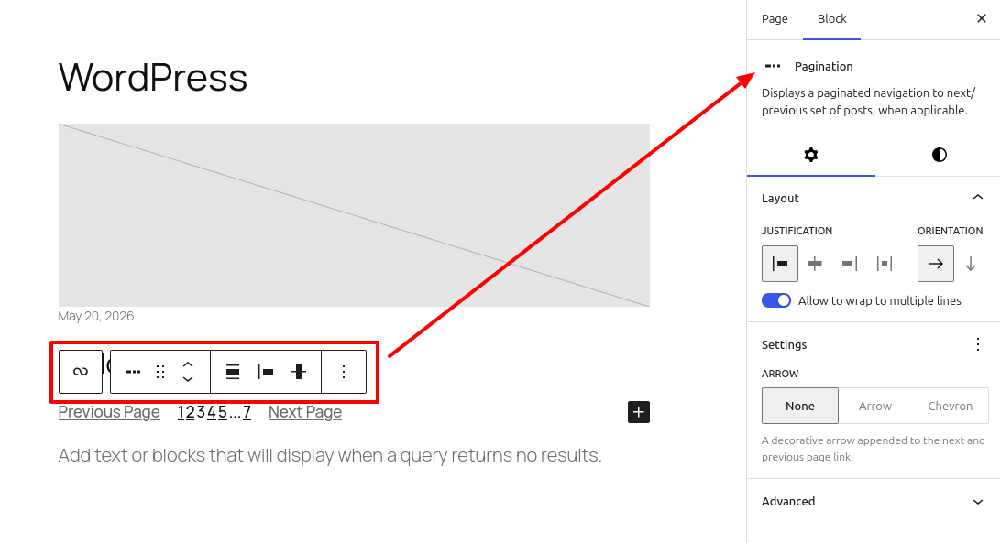

A **Pagination** block is included by default if you choose a correct pattern in a Query Loop block. That said, you can also insert it manually when needed.

Click the **add block** (**+**) icon inside the Query Loop block to open the **block inserter** pop-up window and search for the **Pagination** block.

You can also use the keyboard shortcut <kbd>/pagination</kbd> in a new paragraph block followed by `enter` to insert a block quickly.

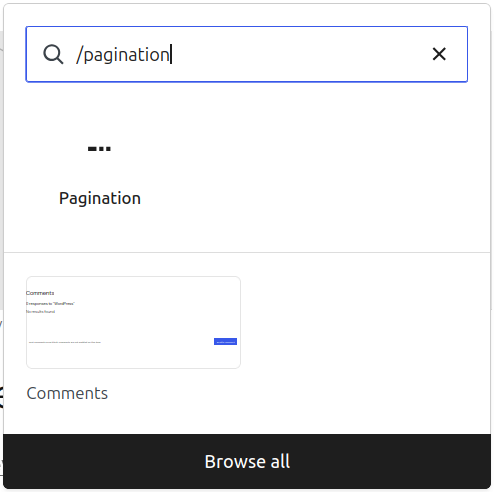

> [!NOTE]
> Detailed instructions on adding blocks can be found [here](../../working-with-blocks/adding-a-new-block.md).

## Block toolbar

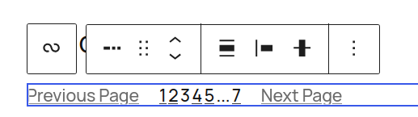

The block toolbar contains the tools to customize each block. The **Pagination** block’s toolbar consists of the following tools:

### Transform to

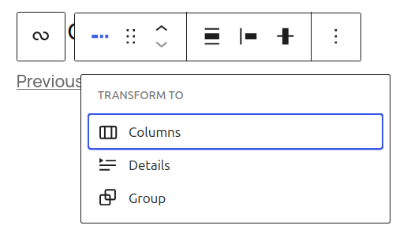

You can transform a **Pagination** block into a Columns, or a Group block.

### Block-moving tools

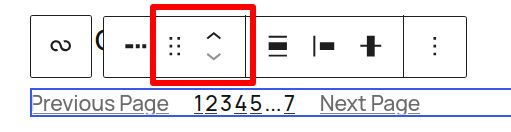

Use the block-moving tools to move the block up and down inside the editor. Use the six dots icon to drag and drop the **Pagination** block and reposition it anywhere on the editor. Alternatively, click on the up and down arrows to move the block up or down the editor.

### Change items justification

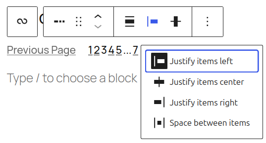

The **Change items justification** tool lets you change the horizontal placement of the items inside the **Pagination** block. There are four options to choose from:

1.  **Justify items left** will move the items toward the left side of the block.
2.  **Justify items center** will move the items toward the center of the block.
3.  **Justify items right** will move the items toward the right side of the block.
4.  **Space between items** will distribute all items across the block and automatically adjust the space between them.

### Change vertical alignment

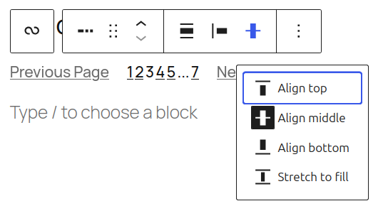

The **Change vertical alignment** tool lets you choose the vertical position of the items inside the **Pagination** block. You can choose between top, middle, and bottom vertical alignment.

### Change alignment

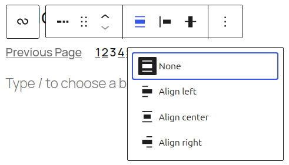

Unlike the previous alignment tools, the **Change alignment** tool is used for the **Pagination** block’s position inside the Query Loop block. Choose one of the following block alignment options:

1.  None
2.  Wide width
3.  Full width
4.  Align left
5.  Align center
6.  Align right

### More options

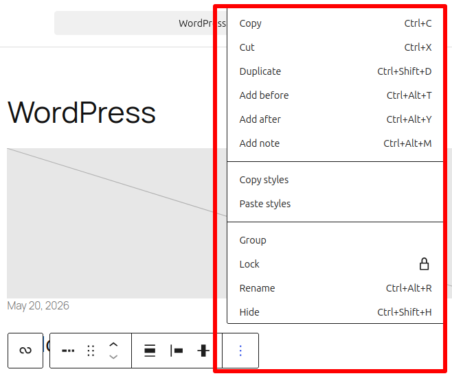

Click on the three dots icon to show more block options. A drop-down menu with these actions will appear:

Details about **More options** can be found in this [support article](../../working-with-blocks/more-options.md).

## Block settings

### Layout

The **Pagination** block provides Layout settings options to change the justification or orientation of the text and to wrap to multiple lines.

> [!NOTE]
> For details, refer to this support article: [Layout settings overview](../../working-with-blocks/block-settings/layout-settings-overview.md)

### Settings

The **Settings** tab lets you change the decorative arrow appended to the next and previous page links. You can choose between **None**, **Arrow,** and **Chevron** icons. You can also choose whether to display or hide the label text based on what you prefer.

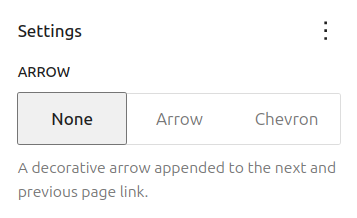

### Color

The Pagination block provides color settings options to change the text, background, and link colors. It can be found in the Styles tab.

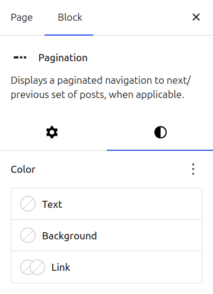

For details, refer to this support article: [Color settings overview](../../working-with-blocks/block-settings/colors-settings-overview.md)

### Typography

The Pagination block provides typography settings to change the font family, appearance, line height, letter spacing, decoration, letter case, and font size. This can be found in the **Styles** tab.

<video controls preload="metadata" src="https://wordpress.org/documentation/files/2024/03/pagination-block-styles-tab.mp4"></video>

> [!NOTE]
> For details, refer to this support article: [Typography settings overview](../../working-with-blocks/block-settings/typography-settings-overview.md)

### Advanced

The Pagination block provides the following Advanced settings options: HTML anchor, Additional CSS Class(es), Additional CSS, and Styles.

> [!NOTE]
> [Learn more about advanced settings](../../working-with-blocks/block-settings/advanced-settings-overview.md)

## Pagination inner blocks

The **Pagination** block consists of the following three inner blocks (which can’t be inserted on their own):

-   **Previous Page block** – displays the previous posts page link.
-   **Page Numbers block** – displays a list of page numbers for pagination.
-   **Next Page block** – displays the next posts page link.

All these blocks are located inside a Query Loop block and lets you customize the appearance of the Pagination for the query loop.

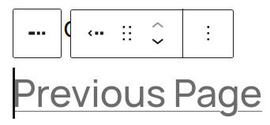

*Previous Page*

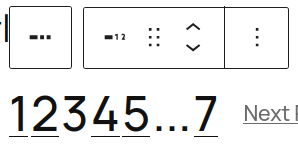

*Page Numbers*

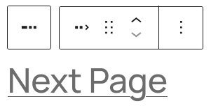

*Next Page*

### Block toolbar

The block toolbar for all the **Pagination** inner blocks contains the tools to customize each block.

#### Block-moving tools

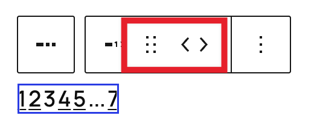

Use the block-moving tools to move the block up and down inside the editor. Use the six dots icon to drag and drop the block and reposition it anywhere on the editor. Alternatively, click on the up and down arrows to move the block up or down the editor.

#### More options

Page Numbers, Next Page, and Previous Page blocks share the same functionality for the More block options button. Click the three dot icon to show **More block** options. A drop-down menu with these actions will appear:

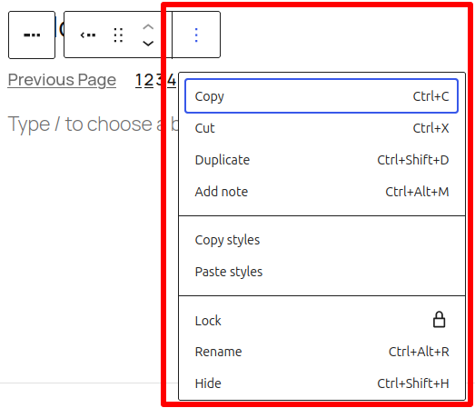

### Block settings

The block settings panel contains customization options specific to the block. To open it, select the block and click the cog icon in the sidebar.

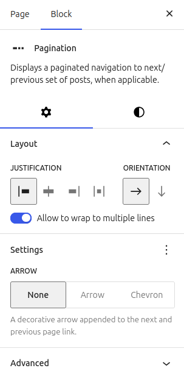

Here are the options for the **Pagination** inner blocks:

#### Color

The Pagination inner blocks provide a color settings option to add a background color.

> [!NOTE]
> For details, refer to this support article: [Color settings overview](../../working-with-blocks/block-settings/colors-settings-overview.md)

#### Typography

The **Pagination** inner blocks provide typography settings to change the font family, appearance, line height, letter spacing, decoration, letter case, and font size.

The typography settings specific to the **Page Numbers** inner block have been moved to the **Styles** tab.

<video controls preload="metadata" src="https://wordpress.org/documentation/files/2024/03/page-numbers-block-styles-tab.mp4"></video>

> [!NOTE]
> For details, refer to this support article: [Typography settings overview](../../working-with-blocks/block-settings/typography-settings-overview.md)

#### Advanced

The Pagination inner blocks provide the following Advanced settings options: HTML anchor, Additional CSS Class(es), Additional CSS, and Styles.

> [!NOTE]
> [Learn more about advanced settings](../../working-with-blocks/block-settings/advanced-settings-overview.md)

## Changelog

-   Updated 2026-08-10
    -   Updated screenshots. (props @pedrofigueroa1989)
-   Updated 2026-05-25 (props @kjoyner @awetz583)
    -   Updated “Advanced” section to refer to new overview page
-   Updated 2023-03-07
    -   Updated the videos to show the Styles tab where the Typography settings now resides
    -   Updated the screenshots
-   Updated 2023-10-04
    -   Updated for 6.3
-   Created 2022-12-12
