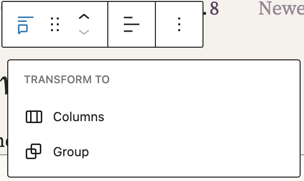
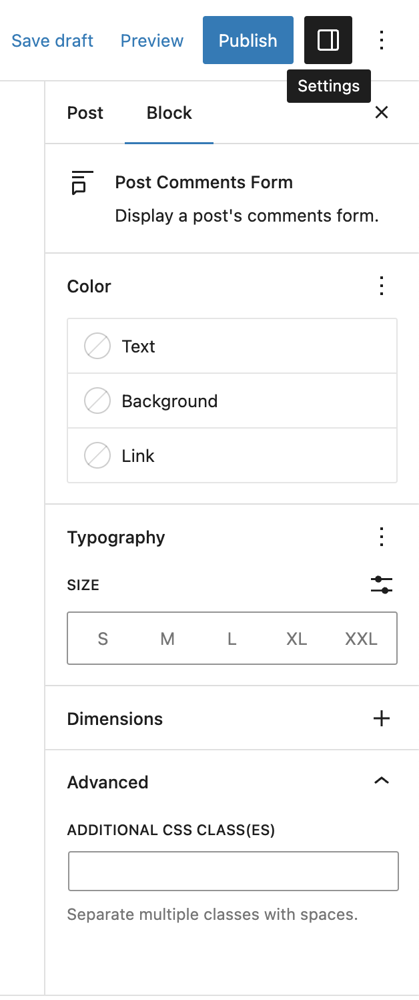

# Post Comments Form block

The **Post Comments Form** block displays a post’s comments form. This block is located inside a Comments block and lets you customize the appearance of the post comments form.

You can only insert the **Post Comments Form** block inside a [Comment Template](comment-template-block.md) block within the Comment block.

Click the (+) icon inside the comment template block to open the block inserter pop-up window and search for the **Post Comments Form** block.

You can also use the keyboard shortcut <kbd>/post-comments-form</kbd> to quickly insert a **Post Comments Form** block inside a Comment Template block.

If your post has comments disabled, you can still add the **Post Comments Form** and enable the comments again while adding the block:

> [!NOTE]
> Detailed instructions on adding blocks can be found [here](../../working-with-blocks/adding-a-new-block.md).

## Block toolbar

The block toolbar contains the tools to customize each block. The **Post Comments Form** block’s toolbar consists of the following tools:

**Transform to**

You can transform a **Post Comments Form** block into a Columns, or a Group block.

**Block-moving tools**

Use the block-moving tools to move the block up and down inside the editor. Use the six dots icon to drag and drop the **Post Comments Form** block and reposition it anywhere on the editor. Alternatively, click on the up and down arrows to move the block up or down the editor.

**Change text alignment**

Text alignment options let you align the **Edit** button towards the left, center, or right.

**More options**

The drop-down menu to the left of the [More options menu](../../working-with-blocks/more-options.md) contains a range of additional rich text editing options such as highlighting, inline code, strikethrough, and more.

Details about **More options** can be found in this [support article](../../working-with-blocks/more-options.md).

## Block settings

The block settings panel contains customization options specific to the block. To open it, select the block and click the settings icon next to the **Publish** or **Update** button.

Here are the options for the **Post Comments Form** block:

**Color**

The **Post Comments Form** block provides Color settings options to change the text, background, and link colors.

For details refer to this support article: [Color settings overview](../../working-with-blocks/block-settings/colors-settings-overview.md)

**Typography**

The **Post Comments Form** block provides typography settings to change the font family, appearance, line height, letter spacing, decoration, letter case, and font size.

For details refer to this support article: [Typography settings overview](../../working-with-blocks/block-settings/typography-settings-overview.md)

**Dimension**

The **Post Comments Form** block provides spacing settings to change the margin and padding.

For details refer to this support article: [Dimension controls overview](../../working-with-blocks/block-settings/dimension-controls-overview.md)

**Advanced**

The following Advanced settings options are available: HTML Anchor, Additional CSS Class(es), Additional CSS, and Styles.

> [!NOTE]
> [Learn more about advanced settings.](../../working-with-blocks/block-settings/advanced-settings-overview.md)

## Changelog

-   Updated 2026-06-29
    -   Linked to advanced settings
-   2023-03-30
    -   Updated screenshots
    -   Added information about spacing settings
-   Created 2022-11-22
